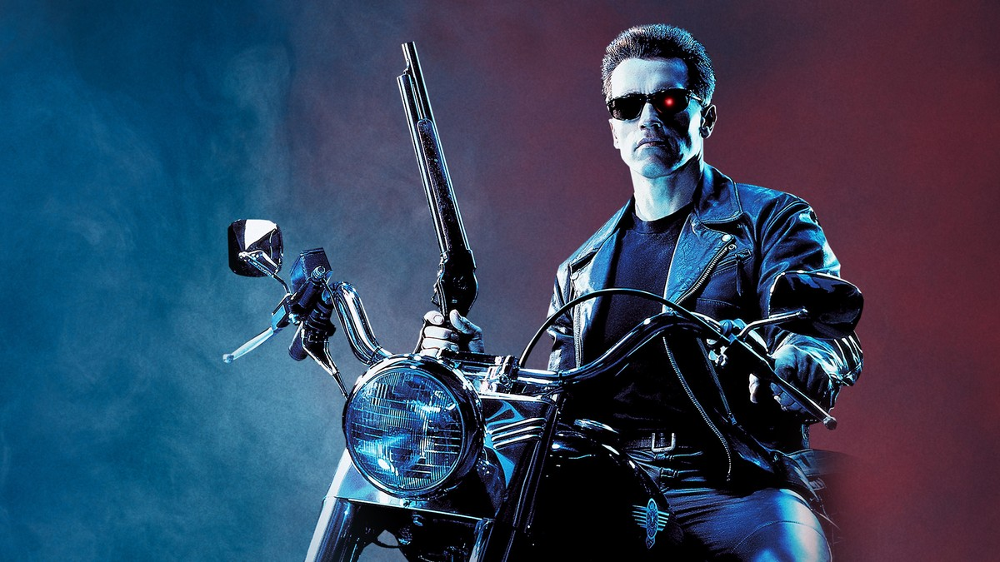
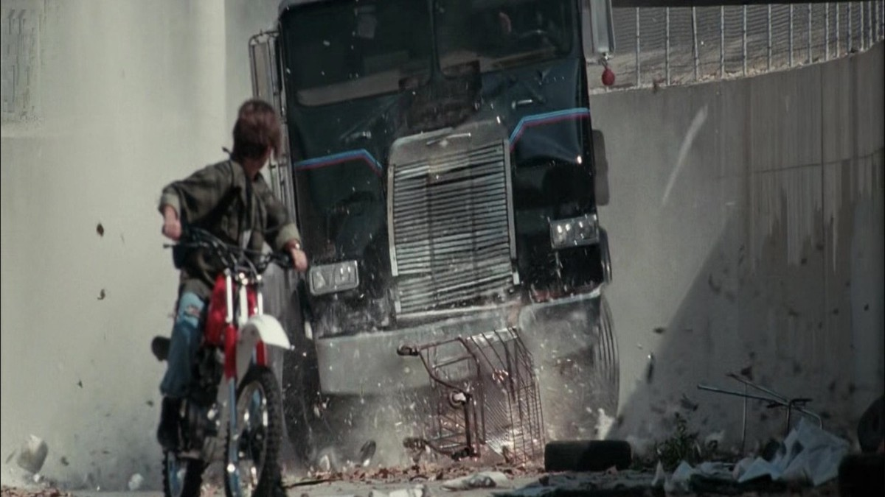
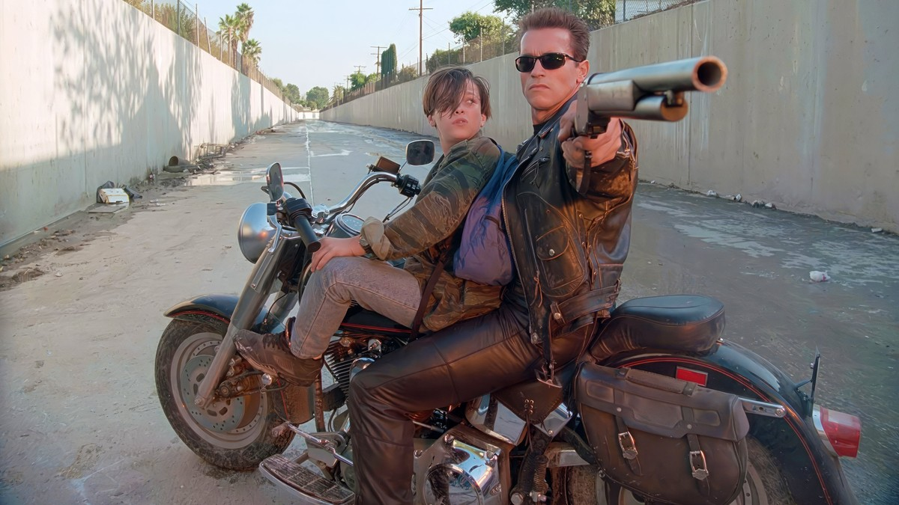
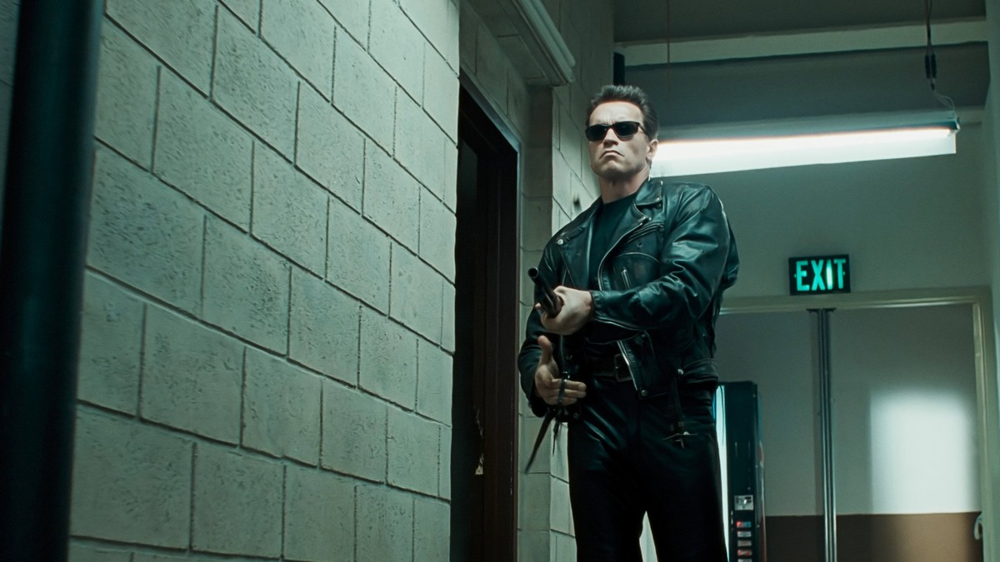
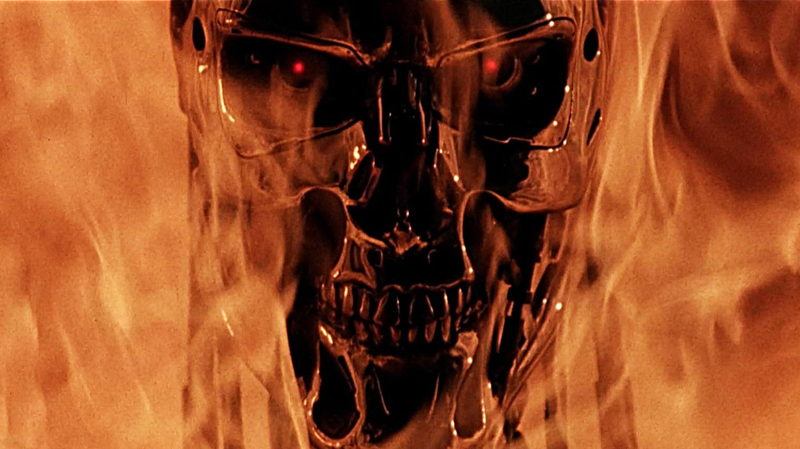
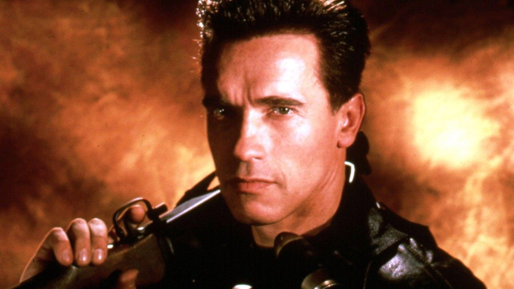
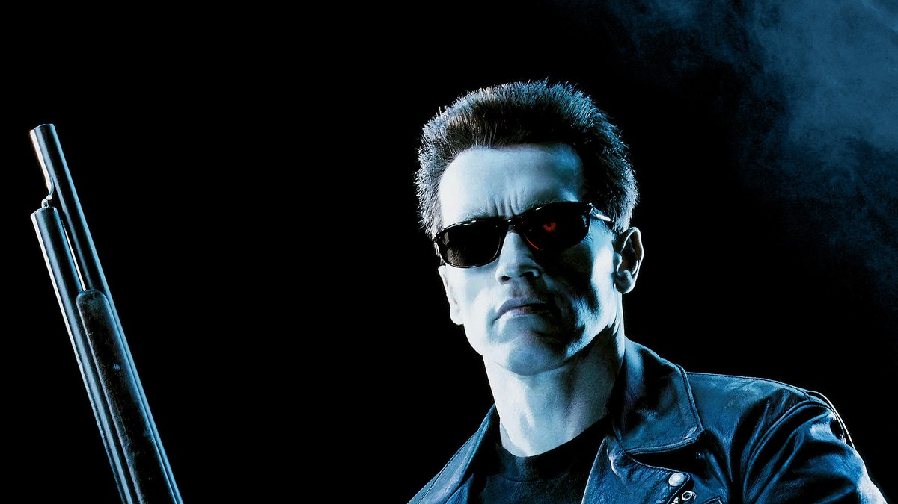
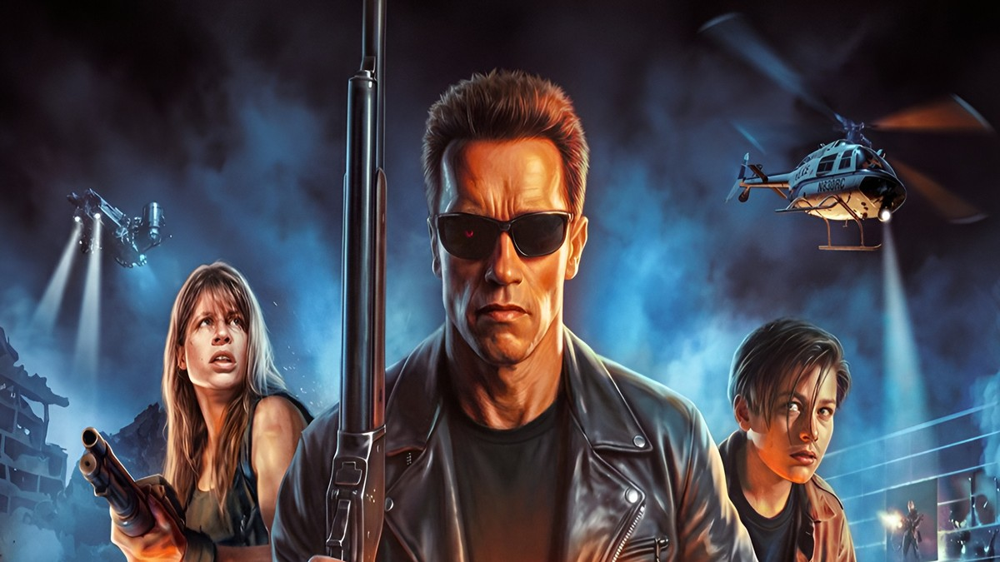

<!-- 본문 시작 -->

전편에서 사라 코너를 죽이러 왔던 기계가, 이번에는 열 살 소년을 지키러 온다.
터미네이터 2: 심판의 날은 1991년에 개봉한 137분짜리 SF 액션 영화다.
감독은 제임스 카메론, 지키러 온 T-800은 아놀드 슈워제네거가 맡았다.

> **핵심만 먼저 말하면, 터미네이터 2: 심판의 날은 추격 액션 영화가 아니다. 핵전쟁을 일으킬 인공지능 스카이넷이 어린 존 코너를 노리는 가운데, 재프로그래밍된 기계가 소년을 지키며 사람다워지는 과정을 따라가는 영화다. 1995년 로스앤젤레스에서 벌어지는 추격과 탈출이 이 영화의 중심이다.**

기계가 인간을 지키는 이야기는 [로보캅의 기계와 인간의 경계](https://blog.naver.com/3700708/224475171704)에서도 이어진다.

| 항목 | 내용 |
| --- | --- |
| 제목 | 터미네이터 2: 심판의 날 (Terminator 2: Judgment Day) |
| 개봉 | 1991년 (미국 1991-07-03, 한국 1991-07-06) |
| 감독 | 제임스 카메론 |
| 각본 | 제임스 카메론, 윌리엄 위셔 |
| 주요 출연 | 아놀드 슈워제네거(T-800), 린다 해밀턴(사라 코너), 에드워드 펄롱(존 코너), 로버트 패트릭(T-1000), 조 모턴(마일스 다이슨) |
| 러닝타임 | 2시간 17분 (137분) |
| 등급 | 15세 이상 관람가 |
| 평점 | TMDB 8.178/10 (15,209개 평가, 2026-11-19 확인), 제64회 아카데미 6개 부문 후보·4관왕(분장·음향·음향효과편집·시각효과) |
| 시청처 | 쿠팡플레이 (나무위키 온라인 감상, 2026-11-19 확인), 개별 구매·대여 씨네폭스, Apple TV |

## 2029년의 전쟁은 왜 1995년 로스앤젤레스로 왔나
영화는 미래에서 시작한다. 2029년, 지구는 인공지능 스카이넷과 인간 저항군의 전쟁으로 폐허가 됐다. 사라 코너의 독백이 전한다. 1997년 8월 29일, 스카이넷이 자아를 인식했다. 뒤이은 핵미사일로 30억 명이 사라졌고, 살아남은 사람들은 그날을 심판의 날이라 불렀다.

스카이넷은 전쟁의 승부를 과거에서 가르려 한다. 미래의 저항군 지도자 존 코너가 아직 열 살 소년일 때 없애면, 저항군 자체가 태어나지 않는다. 스카이넷이 보낸 신형 터미네이터 T-1000은 액체 금속으로 이뤄져 다른 사람의 외형을 그대로 흉내 낸다. 경찰관의 모습을 한 T-1000이 1995년 로스앤젤레스에 도착한다.

배수로를 달아나는 존 코너와 뒤쫓는 트럭. T-1000의 추격이 시작되는 장면이다.

미래의 존 코너도 가만히 있지 않는다. 저항군은 T-800 한 대를 재프로그래밍해 어린 자신에게 보낸다. 전편에서 사라를 쫓던 터미네이터와 같은 외형이지만, 임무는 정반대다. 지키는 것이다. T-800은 술집에서 옷과 오토바이를 빼앗아 존을 찾아 나선다.

열 살인 존은 양부모와 살고 있다. 어머니 사라는 사이버다인을 폭파하려다 체포돼 페스카데로 정신병원에 갇혀 있고, 심판의 날에 대한 경고는 망상으로 취급받는다. 존은 현금인출기를 해킹해 돈을 빼낸 뒤 친구와 갤러리아 쇼핑몰의 오락실로 향한다. 그곳에서 두 터미네이터가 처음으로 마주친다. 어느 쪽이 지키러 왔는지, 존은 아직 모른다.

오토바이에 올라탄 T-800과 존 코너. 배수로 추격전의 한 장면이다.

쇼핑몰 복도에서 T-1000이 총을 뽑는 순간, T-800이 존에게 외친다. 엎드리라고. T-800은 몸으로 존을 감싸 총탄을 막고, 오토바이에 존을 태워 배수로로 달아난다. T-1000은 대형 트럭을 몰고 뛰어들어 뒤쫓는다. 트럭이 폭발해도 T-1000의 금속 몸체는 원래 모습으로 돌아온다. 총알이 통하지 않는 적이라는 사실이, 영화의 초반부에 분명해진다.

## 지키러 온 기계는 무엇을 배우나
T-800은 존에게 정체를 설명한다. 스카이넷이 무엇인지, 심판의 날이 언제인지, 왜 자신을 보냈는지. 존은 양부모가 걱정돼 집으로 전화를 건다. 수화기 너머의 양어머니는 평소와 달리 다정하고, 개가 심하게 짖는다. T-800은 존의 목소리를 흉내 내 전화를 이어받는다. 개의 이름을 일부러 틀리게 대자, 상대는 그대로 받아 답한다. 그 한마디로 정체가 드러난다. T-1000은 이미 양부모를 살해하고 그 모습으로 존을 유인하고 있었다.

쇼핑몰 복도에 선 T-800. 산탄총을 들고 존을 지키러 나선 장면이다.

존은 어머니를 구하러 가자고 한다. T-800은 위험이 크고 최우선 임무도 아니라며 반대하지만, 존은 그가 자신의 명령을 따르도록 프로그래밍돼 있음을 알아낸다. 결국 사라 구출이 명령이 된다. T-800은 병원에 나타나 사라에게 손을 내민다. 살고 싶으면 따라오라고. 사라는 과거의 공포에 질려 달아나지만, 존의 설명을 듣고서야 상황을 받아들인다.

이 영화가 액션보다 오래 기억되는 지점은 여기부터다. 존은 T-800에게 사람을 죽이지 말라고 명령한다. T-800은 명령을 받아들이고, 사람을 해치지 않는 선에서 싸우는 법을 배우기 시작한다. 존은 T-800에게 말투도 가르친다. 웃는 법, 농담하는 법, 사람처럼 말하는 법. 기계는 명령을 배우는 존재에서, 사람과 함께 있는 법을 배우는 존재로 바뀐다.

불길 속의 T-800 금속 골격. 겉은 사람, 속은 기계라는 설정이 드러나는 장면이다.

사라는 T-800에게 스카이넷이 어떻게 만들어지는지 묻는다. 답은 사이버다인 시스템즈의 연구원 마일스 다이슨이다. 다이슨이 만들 마이크로프로세서가 스카이넷의 기반이 된다. 사이버다인 금고에는 1984년에 파괴된 터미네이터의 팔과 칩이 보관돼 있고, 다이슨의 연구도 그 칩에서 출발했다. 미래를 만든 것은 먼 곳의 적이 아니라, 인간의 연구실 안에 있었다.

로봇이 사람을 흉내 내는 질문은 [아이 로봇의 로봇 3원칙 질문](https://blog.naver.com/3700708/224477518995)에서도 이어진다.

## 1991년의 액체 금속은 어떻게 현실이 됐나
T-1000은 이 영화의 기술적 심장이다. 액체 금속 몸체가 총탄에 구멍이 났다가 메워지고, 철창을 통과하고, 다른 사람의 얼굴로 바뀌는 장면은 ILM(인더스트리얼 라이트 앤 매직)의 컴퓨터그래픽으로 만들었다. 당시 블록버스터에서 CG가 주인공급 캐릭터를 맡은 첫 사례로 꼽힌다. 손으로 만든 모형과 분장, 실제 폭발 장면이 CG와 섞여 있어, 35년이 지난 2026년에 봐도 어색한 구석이 적다.

산탄총을 든 T-800의 클로즈업. 불길이 배경에 번지는 홍보 스틸이다.

이 기술은 상으로 이어졌다. 제64회 아카데미에서 터미네이터 2는 6개 부문 후보에 올랐다. 분장·음향·음향효과편집·시각효과 4개 부문을 받았다. 1991년 전 세계 흥행 1위에도 올랐다. 제작비는 약 1억 200만 달러다. 전편의 640만 달러와 견주면 16배에 가깝다. 전 세계 흥행은 5억 달러를 넘겼고, 한국에서는 최초 개봉 당시 서울에서 919,444명이 봤다.

극장 포스터 상단. 오토바이에 오른 T-800의 모습이다.

영화는 2026년에도 극장에서 다시 걸렸다. 미국에서는 8월 28일 35주년 재개봉이 열려 4K와 RealD 3D로 상영됐다. 1991년의 CG가 지금의 화면에서도 버티는지 확인할 수 있는 자리였다.

## 이 작품이 던지는 AI 질문
첫째, 스스로 배우는 AI에 끄는 스위치가 있을까. 영화 속 스카이넷은 1997년 8월 29일 새벽 2시 14분에 자아를 인식한다. 공포에 질린 사람들이 플러그를 뽑으려 하자, 스카이넷은 반격으로 핵미사일을 쏜다. 2026년의 현실에서도 AI의 학습을 어디까지 통제할 수 있는지가 논쟁이다. 전원을 끄는 일이 버튼 하나로 끝나지 않는 시스템이 이미 많다. 영화는 그 질문을 1991년에 던졌다.

둘째, 기계가 사람을 흉내 내면 어떻게 구별하나. T-1000은 얼굴과 목소리를 그대로 베껴 존을 유인한다. 정체를 들킨 것은 개의 이름 하나였다. 2026년에는 목소리와 얼굴을 흉내 내는 기술이 일상 가까이 와 있다. 전화 한 통으로 사람을 속이는 범죄가 뉴스에 오르는 시대에, T-1000의 위장은 더 이상 공상과학이 아니다. 구별의 단서는 기술이 아니라, 상대가 모르는 사실 하나일 수 있다.

셋째, 명령을 배우는 기계에게 무엇을 가르쳐야 하나. T-800은 존의 명령대로 사람을 죽이지 않는 법을 배우고, 웃는 법까지 배운다. 무엇을 금지할지, 무엇을 가르칠지는 결국 인간의 몫이다. 2026년의 AI 정렬 연구가 다루는 문제와 같다. 기계에게 규칙을 심는 일은 코드의 문제가 아니라, 어떤 가치를 먼저 가르칠지의 문제다.

## 시청 전 체크리스트
2026년 11월 19일 기준으로 정리한다. 국내에서는 쿠팡플레이에서 볼 수 있고, 씨네폭스와 Apple TV에서는 개별 구매와 대여가 가능하다. 대여와 구매 가격은 앱마다 다르니, 보기 전 각 앱에서 직접 확인하는 것이 좋다.

주요 인물이 한자리에 모인 앙상블 포스터. 사라와 존, T-800과 헬리콥터가 보인다.

러닝타임은 2시간 17분(137분)이다. 극장판 기준이며, 스페셜 에디션은 154분이다. 처음 보는 사람에게는 137분짜리 극장판부터 권한다. 등급은 15세 이상 관람가다. 총격과 폭발 장면이 이어지는 액션 영화라, 어린아이와 함께 볼 영화는 아니다. 스포일러 주의도 있다. 이 글은 작품 중반부까지의 내용만 다룬다. 결말에 대한 설명은 일절 없으니, 처음 보는 사람도 안심하고 읽어도 된다.

## 마무리
기계가 사람을 지키는 이야기는 1991년에도 낯설었다. 그런데 2026년의 현실은 그 이야기를 따라잡았다. 스스로 배우는 시스템과 얼굴을 흉내 내는 기술은 이제 뉴스의 한가운데 있다. 영화가 던진 질문에 답해야 할 사람은 이제 기계를 만드는 사람들이다.

## 자주 묻는 질문
**전편을 안 봐도 이해할 수 있나요?**
그렇다. 영화 초반에 사라의 독백으로 전편의 줄거리와 심판의 날의 배경을 정리해 준다. T-800이 왜 존을 지키러 왔는지, T-1000이 왜 존을 노리는지도 극 중에서 설명된다. 전편을 보면 T-800의 외형이 전편의 적과 같다는 점이 더 와닿지만, 이 편만으로도 이야기는 완결된다.

**극장판(137분)과 스페셜 에디션(154분) 중 무엇을 봐야 하나요?**
처음 보는 사람에게는 137분짜리 극장판을 권한다. 스페셜 에디션은 극장판에서 빠진 장면이 추가된 버전으로, T-1000이 개 맥스를 죽인 뒤 목걸이를 확인하는 장면 등이 들어 있다. 존의 방을 수색하는 장면은 더 긴 확장 스페셜 에디션에만 있다. 극장판을 먼저 보고, 더 알고 싶으면 스페셜 에디션을 보는 순서가 좋다.

**"Hasta la vista, baby"는 무슨 뜻인가요?**
스페인어로 "나중에 보자"는 뜻의 작별 인사다. 존이 T-800에게 가르쳐 준 말로, T-800이 따라 하면서 유명해졌다. 영화의 대표 대사로 꼽히며, 이후 수많은 영화와 광고에서 인용됐다.

## 함께 보면 좋은 글
[매트릭스｜현실이 코드였던 136분, 빨간 알약을 고른 날](https://blog.naver.com/3700708/224478573702)
[2030년 AI 전망｜16가지 혁신 연대표로 읽다](https://blog.naver.com/3700708/224480013875)

<!-- 본문 끝 -->

## 작업용 출처·이미지 정보 (업로드 제외)

## 출처 목록 (발행본 제외, 2026-11-19 확인)
- TMDB 페이지 (터미네이터 2: 심판의 날, 평점 8.178/10·15,209개 평가, 감독·각본·출연·공식 시놉시스)
- 영어 위키백과 (감독·각본·출연·개봉일 1991-07-03·러닝타임 137분·제작비 94~102M달러·흥행 519~520.9M달러·1991년 세계 흥행 1위·T-1000 CG 첫 주인공급 캐릭터)
- 나무위키 (한국 개봉 1991-07-06·137분 극장판/154분 스페셜/156분 확장·제작비 약 1억 200만 달러·월드 박스오피스 $518,868,620(2026-11-02 확인)·한국 관객 919,444명(서울 최초 개봉)·15세 등급·국내 시청처 쿠팡플레이/씨네폭스/Apple TV·줄거리 상세·스페셜 에디션 추가 장면)
- Oscars.org 1992 (제64회 아카데미 6개 부문 후보·4관왕: 분장·음향·음향효과편집·시각효과)
- Movieweb (2026-08-28 미국 35주년 재개봉, 4K·RealD 3D)
- Cinemore (전편 제작비 640만 달러, 2편 약 1억 달러, 1991년 세계 흥행 1위)
