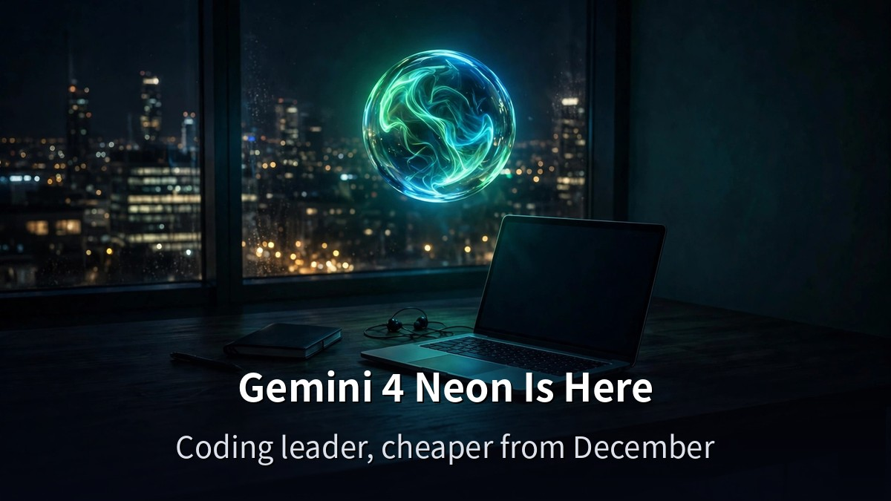
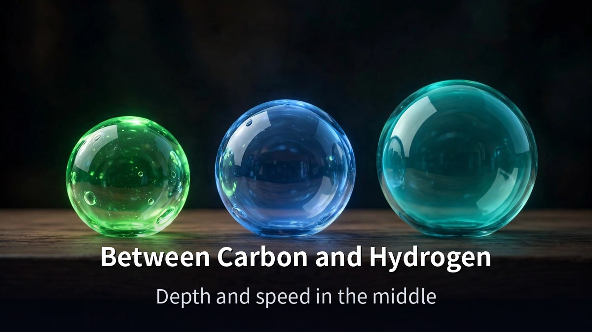
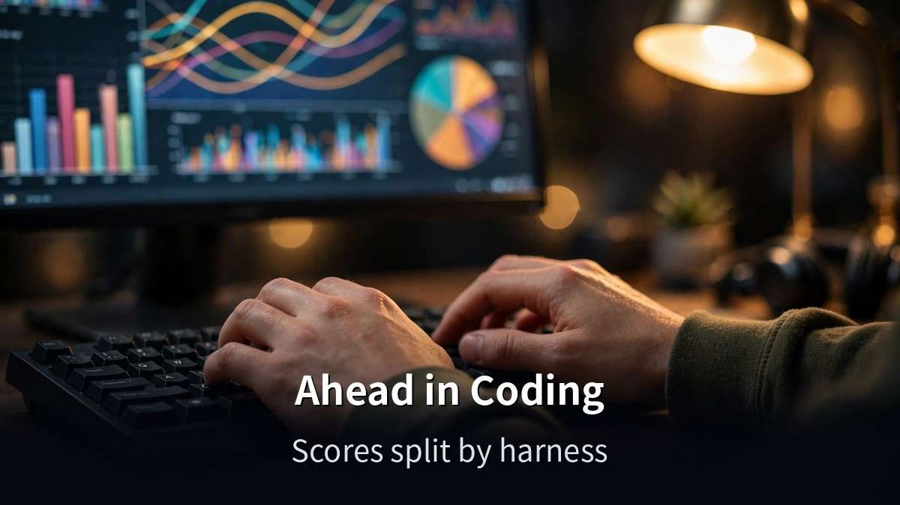

<!-- 본문 시작 -->

Neon leads in coding.
But calling it cheap right now would be a stretch.
Google released Gemini 4 Neon on November 18, and it tops the coding agent ranking while costing 32% less per task than Carbon, according to Google.
Its per-token price only drops below Carbon on December 1.
There is no free way to try it.

> **In one line, Neon sits between Carbon and Hydrogen, ranks first on the coding agent index with an Intelligence Index score of 61, is available only on the paid API tier, and only becomes the cheapest option per token after Carbon's price rise on December 1.**

Neon's spot gets clearer next to its rival — see the [GPT-6.2 Astra launch](https://aitechnotesen.blogspot.com/2026/11/gpt-62-astra-is-herecheaper-and-faster.html). Astra is strong in science and 3D, while Neon leads in coding.

## How Is Neon Different From Carbon

Three glowing orbs of different sizes sitting side by side on a desk

Neon is the fourth model in the Gemini 4 family.
It sits between Carbon, which takes the heaviest reasoning, and Hydrogen, which handles light everyday execution.
It targets work that needs depth and repeats often: complex coding, analysis, and science.

The price fits in one line.
Neon costs $3 per million input tokens and $15 per million output tokens.
Cached input costs $0.15, a 95% discount.
The context window holds 1 million tokens.

There is a catch.
Carbon is on launch pricing of $2 input and $10 output per million tokens until November 30.
On per-token price alone, Neon costs more than Carbon right now.
On December 1, Carbon rises to $4 input and $20 output, and only then does Neon become the cheaper option per token.

| Model | Input (per 1M tokens) | Output (per 1M tokens) | Cached input |
| --- | --- | --- | --- |
| Neon | $3 | $15 | $0.15 |
| Carbon | $2 (until Nov 30) | $10 (until Nov 30) | Not confirmed |
| Hydrogen | $1.50 | $7.50 | Not confirmed |
| Astra | $8 | $40 | $0.40 |

Figures checked November 19, 2026. Neon, Carbon, and Hydrogen prices follow Google's announcement and pricing-page coverage; Astra follows OpenAI's announcement. Carbon rises to $4 input and $20 output on December 1.

Thinking comes in four levels.
Low, medium, high, and xhigh.
High is the default.
Harder work calls for a higher level, and the token bill grows with it.
Google says the levels scale intelligence and token spend evenly (manufacturer claim).

Access starts with paid plans.
Neon is available on the paid Gemini API tier and in Google AI Studio, Gemini for business, and Antigravity.
In the Gemini app, AI Pro and Ultra subscribers can pick it from the model list.
There is no free API tier for Neon.
Every token it processes is billed.

## How Was the Coding Lead Confirmed

A developer desk with a monitor showing code and charts

Neon's headline result is coding.
It ranks first on Artificial Analysis's Coding Agent Index with 58.6.
On the Intelligence Index it scores 61 at the highest thinking level, third overall.
At the high thinking level it scores 60, the same as Carbon.

On the independent Vals Index it ranks second at 70.9%.
It ranks first in both Legal Research and Tax Agent work.
On AutomationBench it also ranks first at 56.3%.
On Vending-Bench 2, a long-horizon business simulation, it ranks first at $16,843.

| Benchmark | Neon | Opus 5.5 | Sol |
| --- | --- | --- | --- |
| Intelligence Index | 61 | 59 | 57 |
| Coding Agent Index | 58.6 | Not confirmed | Not confirmed |
| Terminal-Bench 4.1 | 65.2% | 65.8% | 61.5% |
| Vals Index | 70.9% | 70.1% | 66.1% |
| SWE-sweep (Antigravity) | 39.0% | 10.1% | 8.3% |

Figures checked November 19, 2026. From Google's announcement of November 18, 2026; the Intelligence Index uses the highest thinking level, and the Coding Agent Index is a separate measurement. Vals, AutomationBench, and Vending-Bench figures are independent results cited in the same announcement.

One score alone is not a reason to switch.
On Terminal-Bench 4.1, Opus 5.5 scores 65.8%, 0.6 points ahead of Neon.
SWE-sweep splits sharply by harness.
It reaches only 12.8% on the mini harness and 39.0% on the Antigravity harness.
The same model performs differently depending on the tools around it.

Science and math results are strong too.
Neon leads its field on Terminal-Bench Science at 70.5%.
RiemannBench comes in at 84.0% and HLE-Diamond at 71.3%.
On Chartography, reading dense charts, it scores 73.5%, ahead of Opus 5.5 at 66.3%.
Sol still leads there at 75.1%.

Cost per task needs to be read as Google's claim.
Google says Neon costs 32% less per task than Carbon at the default high setting (manufacturer claim).
At the highest setting it says Neon costs 36% or more less per task than competing top models (manufacturer claim).
Per-token price and cost per task are different numbers.
Using fewer tokens can make a pricier model cheaper per finished task.
Whether Neon is cheap depends on how many tokens your own work burns.

Next to Astra, Neon's position gets clearer.
Astra costs $8 input and $40 output per million tokens, more than Neon per token.
On the Intelligence Index, Astra scores 62 and Neon 61, a one-point gap.
As the [GPT-6.2 Astra price](https://aitechnotesen.blogspot.com/2026/11/gpt-62-astra-pricewhat-it-costs-and-how.html) breakdown shows, Astra matches Fable 5.2 on per-token price while Neon undercuts both.
Astra leads in science and 3D but its coding score stayed flat.
Neon leads the coding agent ranking instead.
Coding at the center points to Neon; science data or 3D work points to Astra.

## What It Costs to Use Now, and Where

A bright desk with a smartphone showing an AI app and a laptop

For most readers, there are two ways to reach Neon.
In the Gemini app, AI Pro or Ultra subscribers can pick it from the model list.
Developers can call it on the paid Gemini API tier and in AI Studio.
There is no free tier.
That is the biggest wall for anyone who wants a light first try.

A sense of the price helps.
One request with 50,000 uncached input tokens and 6,000 billed output tokens costs about $0.24.
Caching cuts input cost by 95%, so repeated reading of long documents gets much cheaper.
Thinking tokens are billed at the output rate, though.
The more thinking you ask for, the larger the bill.

There is also a separate security model.
Gemini 4 Neon for cyber specializes in finding, validating, and patching code vulnerabilities.
It leads SEC-bench Pro at 90.5% for finding vulnerabilities.
It scores 51.26% on web exploitation tests and 70.7% on patching.
Unlike regular Neon, it rolls out gradually to trusted defenders through the Fairwind Program.
If you are not a security defender, it is not for you yet.

One caution is worth keeping.
Some figures in the video about this launch do not match the official announcement (presenter's view).
The claim of an Intelligence Index score of 50 is the clearest example.
The official announcement gives 61 at the highest thinking level.
The same index moves with the thinking setting, so benchmark numbers should always be checked with their source and setting.

December 1 is the date to remember.
Until then, Carbon is cheaper per token.
From December 1, Neon becomes the cheaper option per token.
If you are not in a rush, waiting until December is kinder to your wallet.
If you need a coding agent now, the only thing to accept is that there is no free tier.

## Confirmed Facts and Claims, Separated

Confirmed by the official announcement are the launch date, prices, access, and benchmark scores.
November 18 launch, $3 input, $15 output, $0.15 cached input, 1 million-token context, four thinking levels, paid API tier and Pro and Ultra access are all in Google's announcement.
Confirmed by independent evaluation are the Artificial Analysis scores of 61 on the Intelligence Index and 58.6 on the Coding Agent Index, plus the Vals Index at 70.9% with first place in legal and tax work.
Manufacturer claims are the 32% and 36% cost-per-task savings and the phrase "cheaper than competing top models."
Presenter demos and opinions are opinions.
The image consistency demo and the 2D game character comparison come from the video presenter.
They are not in the official announcement.

Neon fills the gap below Carbon.
It leads in coding but only becomes cheaper per token in December.
There is no free tier, and that is stated plainly.
So the first impression reads as "strong, but not free."
Daily coding agent users have a reason to try it, and light users are better off waiting until December.

## Frequently Asked Questions

**Can I use Neon for free?**

No. There is no free API tier for Neon. In the Gemini app, only AI Pro or Ultra subscribers can pick it from the model list. Light users should start with Hydrogen or a model that has a free tier.

**Carbon or Neon — which one should I pick?**

The heaviest, longest projects point to Carbon. Repeated coding, analysis, and science work points to Neon. Carbon is cheaper per token until November 30, and Neon is cheaper from December 1. Cost per task depends on token use, so comparing with your own workload is the accurate way.

**How do I pick a thinking level?**

There are four levels — low, medium, high, xhigh — and high is the default. Easy work saves tokens on a low level, and hard coding or analysis goes to a higher level. Higher levels use more tokens, so they cost more.

## Good Reads

[GPT-6.2 Astra Is Here｜Cheaper and Faster Than Fable 5.2](https://aitechnotesen.blogspot.com/2026/11/gpt-62-astra-is-herecheaper-and-faster.html)

[Terminator 2: Judgment Day｜Why Did Skynet Target Humanity](https://aitechnotesen.blogspot.com/2026/11/terminator-2-judgment-daywhy-did-skynet.html)

<!-- 본문 끝 -->

## 작업용 출처·이미지 정보 (업로드 제외)

**Sources**
- Google, "Introducing Gemini 4 Neon", November 18, 2026: launch date, prices, access, benchmark scores, thinking levels, Neon for cyber
- Artificial Analysis Intelligence Index v5.0.1 and Coding Agent Index, checked November 18-19, 2026: Intelligence Index 61 (highest thinking level) and 60 (high setting), Coding Agent Index 58.6
- Vals AI Index v2.2: 70.9%, first place in Legal Research and Tax Agent work
- Google pricing-page coverage (9to5Google, cellcog.ai), November 18-19, 2026: Carbon launch pricing $2/$10 (until November 30), $4/$20 from December 1; Hydrogen $1.50/$7.50
- OpenAI, "Introducing GPT-6.2 Astra and Sol", November 17, 2026: Astra pricing $8 input and $40 output, Intelligence Index 62
- Gemini 4 Neon video transcript (November 19, 2026, 11 minutes 59 seconds): launch facts, 1 million tokens, and the starting point for presenter demos and views. The transcript's Intelligence Index claim of 50 differs from the official announcement (61) and was not used
