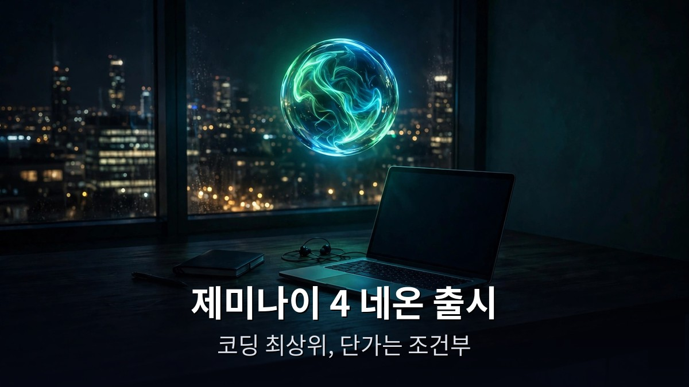
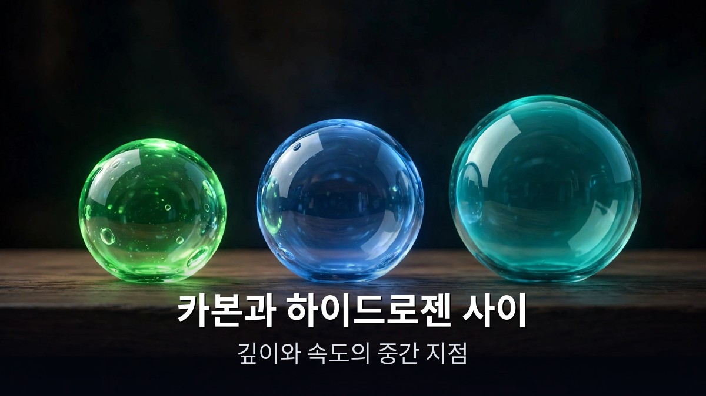

<!-- 본문 시작 -->

네온은 코딩에서 가장 앞섰다.
그런데 지금 당장 싸다고 말하기는 어렵다.
구글이 11월 18일 내놓은 제미나이 4 네온은 코딩 에이전트 평가에서 1위를 차지했고, 과제당 비용은 카본보다 32% 낮다고 밝혔다.
다만 토큰 단가는 12월 1일이 지나야 카본보다 싸진다.
무료로 쓰는 길도 없다.

> **한 줄로 정리하면, 네온은 카본과 하이드로젠 사이에 선 모델로 코딩 에이전트 지수 1위와 종합 지능 61점을 받았고, API는 유료 티어에서만 쓸 수 있으며, 단가 기준으로는 12월 1일 카본 가격 인상 뒤에야 가장 싼 선택지가 된다.**

네온이 서는 자리는 [제미나이 4 카본](https://blog.naver.com/3700708/224474053353) 글과 함께 보면 더 잘 보인다. 카본이 가장 무거운 일을 맡는 모델이라면, 네온은 그 아래에서 자주 쓰는 일을 맡는다.

## 네온은 카본과 무엇이 다른가

크기가 다른 세 개의 빛나는 구체가 책상 위에 나란히 놓인 장면

네온은 제미나이 4 패밀리의 네 번째 모델이다.
가장 무거운 추론을 맡는 카본과, 가벼운 일상 실행을 맡는 하이드로젠 사이에 선다.
복잡한 코딩과 분석, 과학 작업처럼 깊이가 필요하면서도 자주 반복되는 일을 노린 자리다.

가격은 한 줄로 정리된다.
네온은 100만 토큰당 입력 3달러, 출력 15달러다.
캐시된 입력은 0.15달러로 95% 할인된다.
문맥 윈도우는 100만 토큰이다.

여기에 함정이 하나 있다.
카본은 11월 30일까지 출시 기념 가격으로 입력 2달러, 출력 10달러에 팔리고 있다.
지금 단가만 보면 네온이 카본보다 비싸다.
12월 1일 카본이 입력 4달러, 출력 20달러로 오르면 그때서야 네온이 단가에서도 싼 쪽이 된다.

| 모델 | 입력(100만 토큰당) | 출력(100만 토큰당) | 캐시 입력 |
| --- | --- | --- | --- |
| 네온 | 3달러 | 15달러 | 0.15달러 |
| 카본 | 2달러(11월 30일까지) | 10달러(11월 30일까지) | 미확인 |
| 하이드로젠 | 1.50달러 | 7.50달러 | 미확인 |
| 아스트라 | 8달러 | 40달러 | 0.40달러 |

수치 확인 기준: 2026년 11월 19일. 네온·카본·하이드로젠 가격은 구글 공식 발표와 가격 페이지 보도 기준, 아스트라 가격은 OpenAI 발표 기준이다. 카본은 12월 1일부터 입력 4달러, 출력 20달러로 오른다.

사고 수준은 네 단계로 고를 수 있다.
낮음, 중간, 높음, 최고 네 단계다.
기본값은 높음이다.
일이 어려울수록 단계를 올리고, 토큰이 늘어나는 만큼 비용도 따라 오른다.
구글은 단계마다 지능과 토큰 지출이 고르게 올라가도록 다듬었다고 밝혔다(제조사 주장).

출시 범위는 유료부터다.
API 유료 티어와 구글 AI 스튜디오, 기업용 제미나이, 안티그래비티에서 쓸 수 있다.
제미나이 앱에서는 AI Pro와 Ultra 구독자가 모델 목록에서 고를 수 있다.
API 무료 티어에는 네온이 없다.
매번 쓰는 토큰이 전부 과금된다는 뜻이다.

## 코딩 1위는 어떻게 확인됐나

코드와 차트가 뜬 모니터 앞에서 작업하는 개발자 책상 장면

네온의 간판 성적은 코딩이다.
Artificial Analysis의 코딩 에이전트 지수에서 58.6점으로 1위에 올랐다.
종합 지능 지수에서는 최고 사고 설정 기준 61점으로 전체 3위다.
기본 사고 설정에서는 60점으로 카본과 같은 점수다.

독립 평가기관 Vals AI의 지수에서는 70.9%로 2위다.
법률 연구와 세무 대리 분야에서는 각각 1위를 차지했다.
자동화 작업 평가인 AutomationBench에서도 56.3%로 1위다.
긴 호흡의 사업 운영 시뮬레이션인 Vending-Bench 2에서는 1만 6,843달러로 1위다.

| 평가 | 네온 | 오퍼스 5.5 | 솔 |
| --- | --- | --- | --- |
| 종합 지능 지수 | 61점 | 59점 | 57점 |
| 코딩 에이전트 지수 | 58.6점 | 미확인 | 미확인 |
| Terminal-Bench 4.1 | 65.2% | 65.8% | 61.5% |
| Vals 지수 | 70.9% | 70.1% | 66.1% |
| SWE-sweep(안티그래비티) | 39.0% | 10.1% | 8.3% |

수치 확인 기준: 2026년 11월 19일. 구글 공식 발표(2026년 11월 18일) 기준이며, 종합 지능은 최고 사고 설정, 코딩 에이전트 지수는 기본 설정과 무관한 별도 측정이다. Vals·AutomationBench·Vending-Bench 수치는 같은 발표에 실린 독립 평가 결과다.

다만 점수 하나만 보고 갈아탈 일은 아니다.
Terminal-Bench 4.1에서는 오퍼스 5.5가 65.8%로 네온보다 0.6%포인트 앞섰다.
SWE-sweep은 하네스 따라 점수가 크게 갈린다.
미니 하네스에서는 12.8%에 그쳤고, 안티그래비티 하네스에서는 39.0%까지 올랐다.
같은 모델도 어떤 도구와 묶느냐에 따라 결과가 달라진다는 뜻이다.

과학·수학 쪽 성적도 있다.
Terminal-Bench Science에서 70.5%로 분야 최고를 기록했다.
RiemannBench는 84.0%, HLE-Diamond는 71.3%다.
차트 읽기 평가인 Chartography는 73.5%로 오퍼스 5.5의 66.3%를 앞질렀다.
다만 솔의 75.1%보다는 낮았다.

과제당 비용은 구글의 주장대로 읽어야 한다.
구글은 기본 사고 설정에서 네온의 과제당 비용이 카본보다 32% 낮다고 밝혔다(제조사 주장).
최고 사고 설정에서는 경쟁 최상위 모델보다 36% 이상 싸다고 했다(제조사 주장).
단가와 과제당 비용은 다른 숫자다.
토큰을 덜 쓰면 단가가 비싸도 과제당 비용은 낮아질 수 있다.
네온이 싼지는 내 작업의 토큰 사용량을 보고 판단해야 한다.

아스트라와 비교하면 위치가 더 분명해진다.
아스트라는 입력 8달러, 출력 40달러로 네온보다 단가가 높다.
종합 지능 지수에서는 아스트라가 62점, 네온이 61점으로 한 점 차이다.
[GPT-6.2 아스트라 출시](https://blog.naver.com/3700708/224483130080) 글에서 본 것처럼 아스트라는 과학·3D에 강하고 코딩 점수는 그대로였다.
네온은 반대로 코딩 에이전트에서 1위를 차지했다.
코딩이 중심이면 네온, 과학 자료나 3D 작업이 중심이면 아스트라 쪽이 가깝다.

## 지금 쓰려면 얼마, 어디서 쓰나

스마트폰에 AI 앱 화면이 켜져 있고 노트북이 놓인 밝은 책상 장면

일반 독자가 네온을 만나는 길은 두 가지다.
제미나이 앱에서 AI Pro나 Ultra 구독자라면 모델 목록에서 네온을 고를 수 있다.
개발자라면 Gemini API 유료 티어와 AI 스튜디오에서 부를 수 있다.
무료 티어는 없다.
가볍게 써보려는 사람에게는 이 점이 가장 큰 벽이다.

가격을 감으로 잡아보자.
입력 5만 토큰에 출력 6천 토큰짜리 요청 한 번은 대략 0.24달러 수준이다.
캐시를 활용하면 입력 비용이 95% 줄어든다.
긴 문서를 반복해 읽히는 작업일수록 캐시가 효력을 낸다.
다만 사고 토큰도 출력 요금으로 청구된다.
생각을 많이 시킬수록 청구서가 커진다는 뜻이다.

보안 쪽에서는 별도 모델도 나왔다.
네온 포 사이버(Neon for cyber)는 코드 취약점을 찾고, 고치고, 검증하는 데 특화된 모델이다.
취약점 찾기 평가인 SEC-bench Pro에서 90.5%로 최고 성적을 냈다.
웹 침투 평가에서는 51.26%, 취약점 패치 평가에서는 70.7%를 기록했다.
일반 네온과 달리 신뢰할 수 있는 보안 담당자에게 Fairwind Program을 통해 순차 제공된다.
보안 담당자가 아니라면 당장 쓸 일은 없다.

주의할 점도 있다.
영상에서 나온 수치 중에는 공식 발표와 어긋나는 것이 있었다(진행자 견해).
종합 지능을 50점이라고 말한 대목이 대표적이다.
공식 발표는 최고 사고 설정 기준 61점이다.
같은 지수도 설정에 따라 점수가 달라진다.
벤치마크 숫자는 출처와 설정을 함께 확인하고 써야 한다.

네온은 11월 30일이라는 날짜를 기억하고 쓰면 된다.
그전까지는 카본이 단가에서 더 싸다.
12월 1일부터는 네온이 단가에서도 싼 쪽이 된다.
급하지 않다면 12월을 기다리는 쪽이 지갑에는 낫다.
코딩 에이전트로 당장 써야 한다면, 무료 티어가 없다는 점만 받아들이면 된다.

## 확인된 사실과 주장은 이렇게 나뉜다

공식 발표로 확인된 건 출시일·가격·출시 범위·벤치마크 점수다.
11월 18일 출시, 입력 3달러·출력 15달러·캐시 입력 0.15달러, 100만 토큰 문맥, 네 단계 사고 수준, API 유료 티어와 Pro·Ultra 구독자 대상 출시는 구글 공식 발표에 적혀 있다.
독립 평가로 확인된 건 Artificial Analysis의 종합 지능 61점·코딩 에이전트 58.6점, Vals AI의 70.9%·법률·세무 분야 1위다.
제조사 주장으로 봐야 할 건 과제당 비용 32%·36% 절감과 \"경쟁 최상위 모델보다 싸다\"는 표현이다.
진행자 평가와 시연은 의견이다.
이미지 일관성이나 2D 게임 캐릭터 비교는 영상 진행자의 시연과 견해다.
공식 발표에는 없는 내용이다.

네온은 카본의 아랫자리를 메우러 나온 모델이다.
코딩에서는 1위까지 올랐지만, 단가에서는 12월까지 기다려야 싼 쪽이 된다.
무료 티어가 없다는 점도 분명하다.
그래서 네온의 첫인상은 \"잘하는데, 공짜는 아니다\"로 정리된다.
코딩 에이전트를 매일 쓰는 사람이라면 한 번 써볼 만하고, 가볍게 써보려는 사람이라면 12월을 기다리는 게 낫겠다.

## 자주 묻는 질문

**무료로 네온을 쓸 수 있나?**

API 무료 티어에는 네온이 없다. 제미나이 앱에서도 AI Pro나 Ultra 구독자만 모델 목록에서 고를 수 있다. 무료로 써보려는 사람은 하이드로젠이나 무료 티어가 있는 모델을 먼저 쓰는 게 좋다.

**카본과 네온 중 뭘 써야 하나?**

가장 무겁고 긴 프로젝트라면 카본이 맞다. 자주 반복되는 코딩·분석·과학 작업이라면 네온이 가깝다. 단가는 11월 30일까지 카본이 더 싸고, 12월 1일부터는 네온이 더 싸진다. 과제당 비용은 토큰 사용량에 따라 달라지니, 내 작업으로 직접 비교해 보는 게 정확하다.

**사고 수준은 어떻게 고르나?**

낮음·중간·높음·최고 네 단계가 있고 기본값은 높음이다. 쉬운 작업은 낮은 단계로 토큰을 아끼고, 어려운 코딩이나 분석은 단계를 올려서 푸는 방식이다. 단계가 올라갈수록 토큰이 늘어나 비용도 함께 오른다.

## 함께 보면 좋은 글

[GPT-6.2 아스트라 출시｜페이블 5.2보다 싸고 빠르다](https://blog.naver.com/3700708/224483130080)

[터미네이터 2: 심판의 날｜스카이넷은 왜 인간을 노렸나](https://blog.naver.com/3700708/224483148816)

<!-- 본문 끝 -->

## 작업용 출처·이미지 정보 (업로드 제외)

**출처**
- Google, "Introducing Gemini 4 Neon", 2026년 11월 18일: 출시일·가격·출시 범위·벤치마크 점수·사고 수준·네온 포 사이버
- Artificial Analysis Intelligence Index v5.0.1·Coding Agent Index, 2026년 11월 18~19일 기준: 종합 지능 61점(최고 사고 설정)·60점(높음 설정), 코딩 에이전트 58.6점
- Vals AI Index v2.2: 70.9%·법률 연구·세무 대리 분야 1위
- 구글 가격 페이지 보도(9to5Google·cellcog.ai 인용), 2026년 11월 18~19일: 카본 출시 기념 가격 2달러·10달러(11월 30일까지), 12월 1일부터 4달러·20달러, 하이드로젠 1.50달러·7.50달러
- OpenAI, "Introducing GPT-6.2 Astra and Sol", 2026년 11월 17일: 아스트라 가격 입력 8달러·출력 40달러, 종합 지능 62점
- 제미나이 4 네온 영상 자막 전문(2026-11-19, 11분 59초): 출시 사실·100만 토큰·진행자 시연과 견해의 출발점. 자막의 종합 지능 50점 주장은 공식 발표(61점)와 달라 미사용
