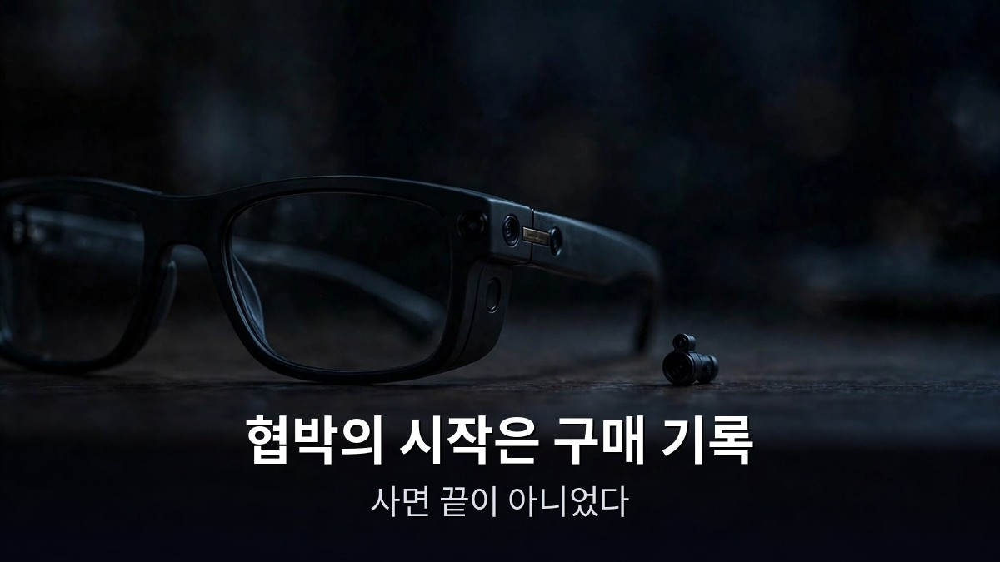
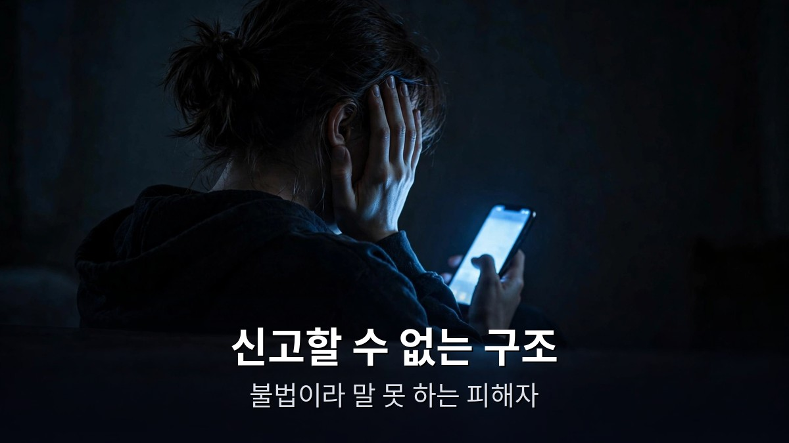
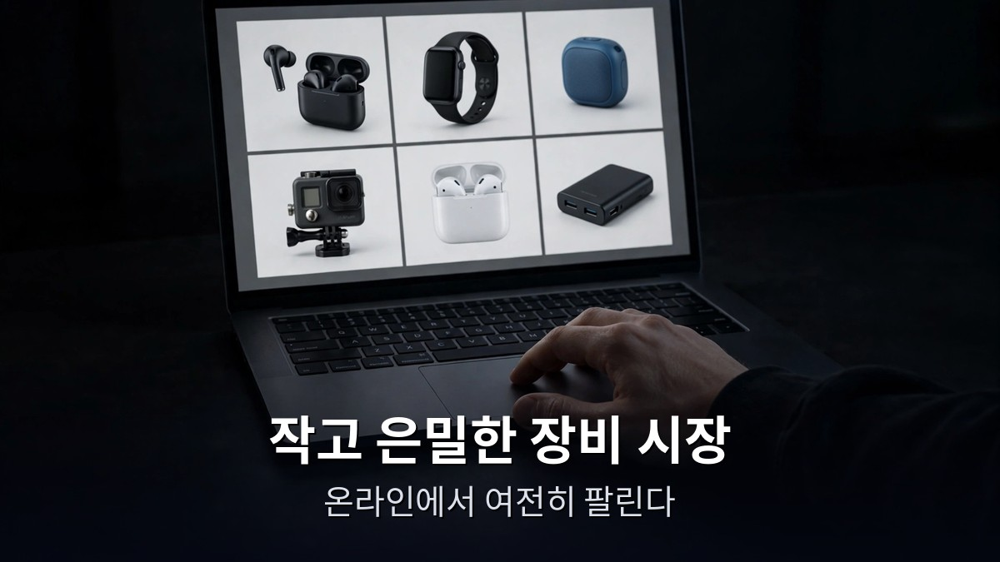
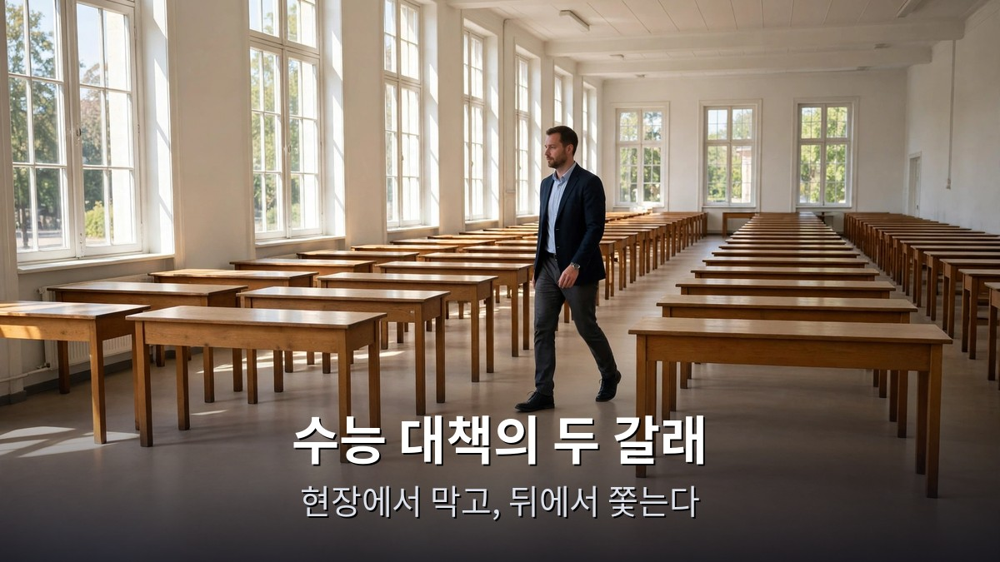

<!-- 본문 시작 -->

장비를 산 게 끝이 아니었다.
중국에서 AI 부정행위 장비를 팔던 업체가 구매자들에게 협박 메시지를 보내며 비밀을 지켜주는 대가로 30만 위안, 우리 돈으로 약 6천만 원을 요구했다는 의혹이 제기됐다.
일부 구매자는 실제로 돈을 냈다고 전해진다.
부정행위 장비를 사는 순간, 구매 기록이 또 다른 약점이 된 셈이다.

> **한 줄로 정리하면, 중국 AI 부정행위 장비 업체가 구매 기록을 빌미로 30만 위안의 비밀 유지비를 요구했다는 의혹이 나왔고, 부정행위 자체가 불법이라 피해자가 신고를 꺼리는 구조가 협박을 가능하게 했으며, 한국에서도 세무사 수석 자백과 11월 19일 수능에서 같은 장비가 문제가 됐다.**

AI가 시험을 대신 푸는 시대가 오면 시험은 어떻게 바뀌어야 할까. [2030년 AI 전망](https://blog.naver.com/3700708/224480013875) 글에서 다룬 혁신의 속도와 함께 보면, 이번 사건은 먼 미래가 아니라 이미 벌어진 일이다.

## 왜 협박이 통했나

어두운 방에서 휴대전화 화면을 들여다보며 얼굴을 감싸는 사람의 뒷모습

협박의 수단은 단순하다.
돈을 주지 않으면 구매 기록을 공개하겠다는 연락이다.
협박 메시지를 받은 한 구매자는 정말 무서웠다고 말했다.
구매 기록이 공개되면 부정행위 사실까지 드러나기 때문이다.

전문가들은 협박이 가능한 이유가 분명하다고 지적한다(전문가 견해).
AI 부정행위 자체가 불법이라 피해자들이 신고를 꺼린다는 것이다.
불법을 저지른 사실이 들킬까 봐 신고를 못 하는 구조가 협박을 가능하게 했다는 분석이다.

이 업체는 AI 안경과 초소형 카메라 같은 부정행위 장비를 팔아온 곳으로 알려졌다.
구매자 명단과 구매 기록을 갖고 있다는 점을 이용해 구매자들을 협박한 것으로 보인다.
장비를 판 쪽이 구매자의 약점을 정확히 알고 있었던 셈이다.

중국 SNS에서는 이번 사건을 두고 AI 부정행위 장비가 새로운 범죄 수법의 도구로 전락했다는 비판이 나왔다.
단순한 시험 부정행위를 넘어 협박과 갈취 같은 2차 범죄로 이어지고 있기 때문이다.
구매 기록이 협박의 도구가 되는 현실이 이 시장의 구조적 문제라는 지적이다.

## 장비 시장은 어떻게 커졌나

노트북 화면에 작은 전자기기 상품들이 나열된 온라인 쇼핑몰 장면

이번 논란의 배경에는 AI 부정행위 장비 시장의 폭발적 성장이 있다.
중국 일부 온라인 쇼핑몰에서는 AI 안경을 비롯한 각종 부정행위 장비가 여전히 판매되고 있는 것으로 전해진다.
중국 당국은 단속에 나섰지만 장비가 워낙 작고 은밀하다 보니 적발이 쉽지 않다는 지적도 나온다.

장비는 갈수록 작아지고 있다.
AI 안경은 카메라와 스피커가 달려 있어 보이는 것을 AI에게 묻고 답을 귀로 듣게 해 준다.
겉보기엔 평범한 안경이라 구분이 어렵다.
메타와 레이벤이 만든 AI 안경은 지난해에만 700만 개 넘게 팔렸다고 CNN이 전했다.

세무사 수석 합격자가 썼다는 초소형 카메라는 지름이 2mm다.
연필심 굵기 정도라 옷에 붙여도 눈에 잘 띄지 않는다.
방송사 취재진이 확인한 카메라는 어두운 곳에서도 글자가 또렷했고, 채점해 보니 만점이었다.
휴대전화를 걷어라도 소용이 없다.
카메라만 몸에 있으면 답을 내는 기기는 시험장 밖에 있어도 되기 때문이다.

수법이 얼마나 쉬워졌는지도 드러났다.
클로드로 사진 속 문제를 푸는 앱을 10분 만에 만들었다는 사례가 있다.
손목에 숨긴 카메라로 세무사 1차 기출 문제를 비추자 새 문제를 푸는 데 5.3초가 걸렸고, 세 문제 모두 정답이었다.
프로그램을 조금만 다룰 줄 알면 누구나 공범 없이 이런 도구를 손에 넣을 수 있는 때가 됐다는 뜻이다.

관심도 몰리고 있다.
지난주 온라인 쇼핑몰에서는 AI 안경 검색이 한 주 전보다 185% 늘었다.
수능 관련 게시판에는 AI 안경과 초소형 카메라가 품절이라는 글까지 올라왔다.
올해 7월까지 초소형 특수 카메라 수입액은 4년 전과 비교해 20배 가까이로 불었다는 보도도 나왔다.
판매하는 쪽은 이번 사건까지 홍보에 쓰고 있다.
해외 업체는 메신저 채널에 세무사 수석 합격을 자기들이 도왔다는 취지의 글을 올리고, 그 뒤로 한국 수험생들의 문의가 쏟아지고 있다고 적었다.

## 한국에서는 어떻게 막나

줄지어 선 시험장 책상 사이를 감독관이 걸어 다니는 밝은 시험장 장면

한국에서도 같은 장비가 이미 문제가 되고 있다.
올해 한국산업인력공단 시험에서 AI 안경 부정행위가 다섯 건 넘게 적발됐고, 토익과 중고등학교 시험에서도 나왔다.
5월 광주에서는 감독관이 시선 처리가 이상한 수험생을 보고 AI 안경을 잡아냈다.
10월 가스 기사 시험에서는 스마트 안경만 찾는 전담 인력이 블루투스 신호를 잡는 앱과 금속 탐지기로 한 명을 찾아냈다.

가장 큰 파장은 세무사 시험 수석 합격자의 자백이다.
1차 400점 만점에 397.5점을 받은 수석 합격자가 11월 15일 직접 나와 부정행위를 털어놓고 같은 날 경찰에 자수했다.
초소형 카메라로 문제를 찍어 생성형 AI로 보내고 스마트폰으로 답을 확인했다는 것이다.
국세청은 처분 절차를 시작했고, 청문을 거쳐 시험 무효와 5년간 응시 자격 정지를 정할 예정이다.

11월 19일 수능 대책은 두 갈래였다.
현장에서 막는 쪽과, 끝난 뒤에 쫓는 쪽이다.
교육부는 반입 금지 물품에 스마트 안경과 스마트링, 카메라 펜을 새로 적어 넣었다.
4교시 전에는 안경을 책상 위에 올려 점검하고, 3교시 전에는 소지품을 다시 확인한다.
스마트 기기 점검만 맡는 1,800명과 복도 감독관 6,600명, 모두 8,400명가량이 더 들어간다.
금속 탐지기는 의심되는 경우에 쓴다.
전파를 잡아내는 탐지기는 올해는 두지 못하고 내년 수능부터 도입을 검토하기로 했다.

시험이 끝난 뒤에도 쫓는다.
성적을 분석해 의심되면 AI 서비스 접속 기록과 통신 기록을 요청하기로 했다.
정부는 2027학년도 수능부터 글로벌 AI 기업과 통신사가 사후 조사에 협력하기로 했다고 밝혔다.
시험 시간대의 AI 서비스 이용 기록과 통신 내역을 대조해 현장에서 적발하지 못한 부정행위까지 추적하겠다는 취지다.

처벌도 무거워진다.
지금은 금지 기기를 갖고만 있어도 그 시험이 무효고, AI 안경을 쓰면 다음 해 수능을 볼 수 없다.
정부는 응시 제한 기간을 더 늘리는 법 개정을 추진하고 있다.
교육부 장관은 3년을, 총리는 최대 10년을 말해 아직 정해지지 않았다.
현행 수능 응시 제한은 1년이다.

| 구분 | 중국 | 한국 |
| --- | --- | --- |
| 시험 중 차단 | 가오카오 기간 주요 AI 앱의 사진 문제풀이 기능 중단 | 반입 금지 물품에 스마트 안경·스마트링·카메라 펜 추가 |
| 현장 단속 | 고사장 AI CCTV로 이상행동 포착 | 스마트 기기 전담 1,800명·복도 감독관 6,600명 추가 |
| 사후 추적 | 미확인 | 성적 분석 후 AI 서비스 접속 기록·통신 기록 요청, 2027 수능부터 빅테크·통신사 협력 |
| 처벌 | 미확인 | 시험 무효, 응시 제한 현행 1년에서 3년·최대 10년으로 확대 추진 중 |

수치 확인 기준: 2026년 11월 19일. 중국 대응은 보도 기준, 한국 대응은 교육부 발표·보도 기준이다. 응시 제한 확대는 아직 확정되지 않았다.

중국은 다른 길을 택했다.
대입 시험 가오카오 기간에는 주요 AI 앱들이 사진을 읽고 문제를 푸는 기능을 아예 꺼 버린다.
딥시크와 텐센트, 알리바바 같은 기업들이 시험 시간에 이미지 인식 기능을 일시 중단한 것이다.
그래도 시험을 이틀 앞두고 급히 만든 대책이고 결국 감독관 눈에 기대야 한다는 비판도 나온다.
특히 옷 속에 숨긴 초소형 카메라는 이번 대책으로도 가려내기 쉽지 않다.

## 확인된 사실과 주장은 이렇게 나뉜다

확인된 사실은 협박 의혹의 뼈대와 세무사 자백, 수능 대책 수치다.
30만 위안 요구와 일부 구매자의 실제 지불은 \"알려졌다\"는 범위에서 전해진 내용이다.
세무사 1차 397.5점, 11월 15일 자백·자수, 초소형 카메라 2mm, 5.3초 풀이, 전담 인력 1,800명·복도 감독관 6,600명은 영상 자막과 보도로 확인된다.
전문가 분석과 SNS 비판은 의견이다.
\"신고 구조가 협박을 가능하게 했다\"는 분석과 \"범죄 수법의 도구로 전락했다\"는 비판은 평가다.
아직 확정되지 않은 건 응시 제한 기간이다.
3년안과 최대 10년안은 추진 중인 방안일 뿐이다.

장비를 사는 일은 부정행위에서 끝나지 않는다.
구매 기록이 남고, 그 기록이 협박의 빌미가 된다.
불법이라 신고도 못 하는 구조까지 겹치면 피해자는 돈을 내는 쪽으로 몰린다.
이번 사건이 보여주는 건 장비의 위험이 아니라 시장의 구조다.
시험을 앞두고 있다면, 장비를 사는 선택지 자체를 지우는 게 먼저라는 생각이 든다.

## 자주 묻는 질문

**협박 메시지를 받으면 어떻게 해야 하나?**

협박 자체는 별개의 범죄다. 구매 기록이 공개될까 봐 신고를 꺼리는 심리를 노린 것이므로, 협박을 받았다면 경찰에 신고하는 게 맞다. 부정행위 사실이 드러날 수 있다는 두려움 때문에 돈을 내면 협박은 계속될 가능성이 크다.

**AI 안경을 사는 것 자체가 불법인가?**

AI 안경 자체는 일반 전자기기다. 문제는 시험장에서 쓰는 행위다. 시험장에서 AI 안경을 쓰면 그 시험이 무효가 되고 다음 해 수능 응시도 막힌다. 초소형 특수 카메라도 전파 인증을 받은 제품은 현행법으로 판매를 막을 수 없다고 전해진다.

**수능에서 AI 부정행위를 하면 어떻게 되나?**

금지 기기를 갖고만 있어도 그 시험이 무효다. AI 안경을 쓰면 다음 해 수능을 볼 수 없다. 시험이 끝난 뒤에도 성적 분석으로 의심되면 AI 서비스 접속 기록과 통신 기록을 요청받는다. 응시 제한 기간은 현행 1년에서 3년·최대 10년으로 늘리는 방안이 추진 중이다.

## 함께 보면 좋은 글

[클로드 힉스필드 AI 단편영화｜같은 얼굴 13명 유지법](https://blog.naver.com/3700708/224483146108)

[2001: 스페이스 오디세이｜HAL은 왜 거짓말했나](https://blog.naver.com/3700708/224481444262)

<!-- 본문 끝 -->

## 작업용 출처·이미지 정보 (업로드 제외)

**출처**
- AI 부정행위 장비 협박 영상 자막 전문(2026-11-19, 4분 22초): 30만 위안 요구·일부 지불·구매 기록 협박·중국 SNS 비판의 출발점
- 세무사 수석 AI 부정행위 영상 자막 전문 2건(2026-11-18·11-19, 8분 12초·14분 25초): 397.5점·11월 15일 자백·자수·2mm 카메라·5.3초 풀이·수능 대책 수치·응시 제한 추진
- 이데일리, "챗GPT로 수능 풀면 사후 적발?…정부 '빅테크들 협력 약속'", 2026년 11월 17일: 2027 수능 사후 조사 협력, 응시 제한 1년에서 최대 10년 확대 추진, 1,312개 시험장·감독관 7만 5천 명·전담 1,800명·복도 6,600명
- 파이낸셜뉴스, "AI로 커닝하면 AI 잠근다…전세계 '부정행위 대응 기술' 살펴보니", 2026년 11월 16일: 중국 가오카오 AI CCTV·AI 앱 기능 중단, 미국 AI 원격 감독, 영국 턴잇인
