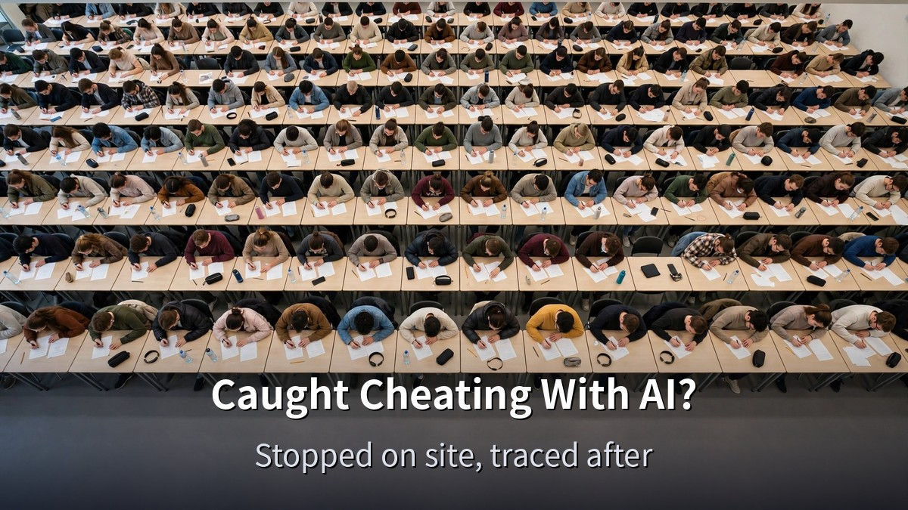
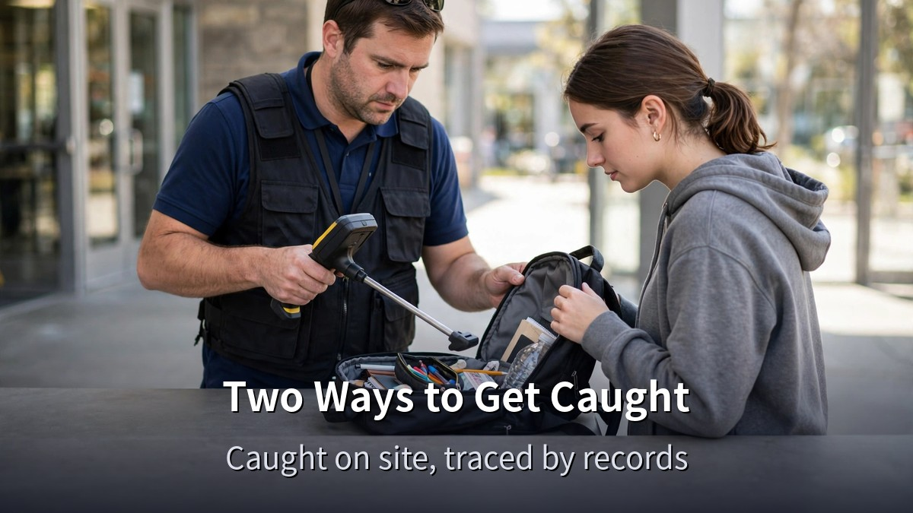
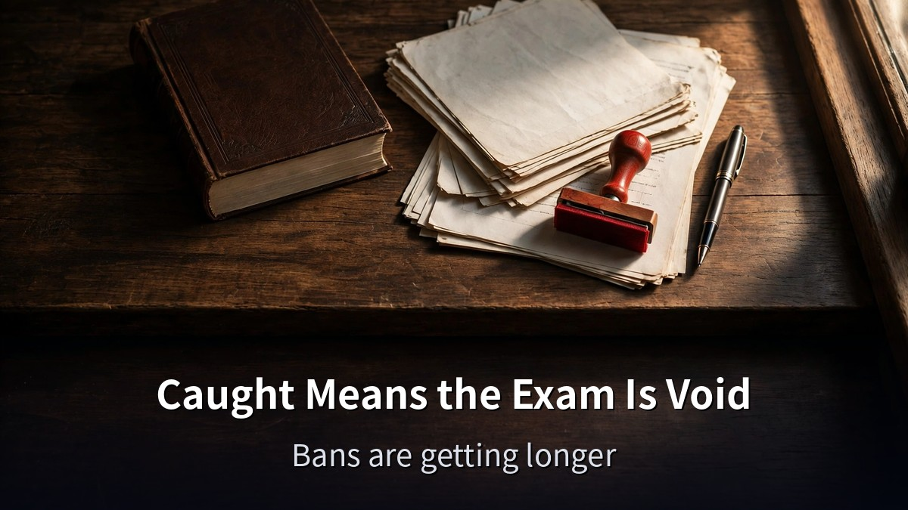
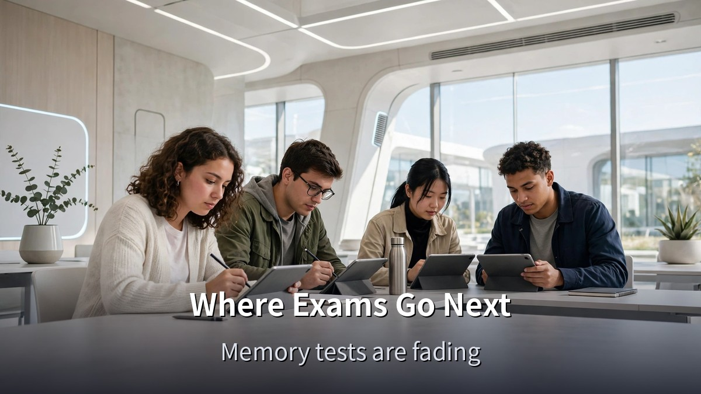

<!-- 본문 시작 -->

Yes, you get caught.
The only question is whether it happens on site or afterward.
After the tax accountant top scorer confessed to cheating with AI, the most asked question became how exam cheating with AI is detected and punished.
As of November 2026, on-site enforcement leans on people and devices, while post-exam tracing leans on AI service access records and communication logs.
The exam ban is one year now, and proposals would stretch it to three years or up to ten.

> **In one line, AI cheating is caught on site by dedicated smart-device staff and metal detectors, traced afterward through score analysis and AI service access and communication records, punished with a voided exam and an exam ban, and text-only AI detection programs run at 60-70% accuracy, so they cannot serve as decisive evidence.**

The tools keep getting cheaper and easier to reach — the [GPT-6.2 Astra price](https://aitechnotesen.blogspot.com/2026/11/gpt-62-astra-pricewhat-it-costs-and-how.html) breakdown shows a frontier model at $8 input per million tokens, and the exam story is what happens when that power reaches everyone's pocket.

## How Does AI Cheating Get Caught?

An invigilator checking belongings with a metal detector at an exam hall entrance

There are two main ways to get caught.
One catches you on site, the other traces you afterward.
Each has a different weakness.

On-site detection relies on human eyes and devices.
For the November 19 college entrance exam, 1,800 staff for smart-device checks and 6,600 hallway invigilators were added.
Glasses were placed on desks for inspection before the fourth session, and belongings were rechecked before the third session.
Metal detectors were used on suspicion.
In Gwangju in May, an invigilator spotted AI glasses from a student's odd eye movements.
In a gas technician exam in October, dedicated staff found one person with an app that catches Bluetooth signals and a metal detector.

The devices have clear limits.
AI glasses look like ordinary glasses, so telling them apart is hard.
The tiny camera the tax accountant top scorer reportedly used is 2 millimeters across, about as thick as a pencil lead, and barely shows when attached to clothing.
Invigilators have no authority to search a student's body.
The education ministry said cutting radio signals in exam halls is legally and technically unrealistic.
Signal detectors were not ready for this year's exam and will be considered from next year.

Post-exam tracing looks at records.
After the exam, scores are analyzed, and if suspicion arises, AI service access records and communication records can be requested.
The government says global AI companies and telecom carriers will cooperate with post-exam investigations from the 2027 college entrance exam.
The aim is to trace cheating that was not caught on site by matching AI service use records and communication logs from exam hours.
That is also why confiscating phones does not solve it.
As long as the camera is on the body, the device producing the answers can sit outside the exam hall.

Text detection programs need to be read separately.
Programs that judge whether written work was produced by AI run at about 60-70% accuracy.
Under some conditions accuracy falls below 50%.
OpenAI's own AI text classifier correctly identified only 26% of AI-written text as "possibly AI-written" in evaluation, and wrongly flagged 9% of human-written text as AI-written.
That is why a detection result alone cannot settle a cheating case.
In exam halls, the decisive evidence is devices and records, not detection software.

| Detection method | How it catches | Limit |
| --- | --- | --- |
| Dedicated staff, invigilators' eyes | Spot odd eye movements and behavior, inspect glasses and belongings | Tiny cameras hidden in clothing do not show; no body-search authority |
| Metal detectors, Bluetooth signals | Detect device circuits and signals | Switched-off devices are hard to find; signal detectors under review for next year |
| Score analysis, post-exam tracing | Suspicious scores lead to AI service access and communication record requests | Needs cooperation and procedures; full-scale from the 2027 exam |
| AI text detection programs | Judge AI-written share from sentence patterns | 60-70% accuracy; cannot stand alone as evidence |

Figures checked November 19, 2026. On-site figures follow video transcripts and coverage; text detection accuracy follows Sungkyunkwan University's AI guidance page.

## What Happens If You Get Caught?

A desk with documents, a red stamp, a law book, and a pen

Punishment differs by exam, but the direction is one.
The exam is voided, and an exam ban follows.

In the college entrance exam, merely possessing a banned device voids the exam.
Using AI glasses blocks the next year's exam.
The ban is one year now.
The government is pushing legislation to extend it.
The education minister mentioned three years and the prime minister up to ten years; neither is settled.

Proceedings are already running for the tax accountant exam.
The top scorer earned 397.5 out of 400 on the first stage, appeared in person on November 15, admitted the cheating, and turned himself in to police the same day.
The National Tax Service has started proceedings and plans to void the exam result and suspend exam eligibility for five years after a hearing.
Police questioned the top scorer for about ten hours and booked him without detention.
A government response team will re-examine score distributions of successful candidates from the past three to five years.

The severity makes sense once the method's evolution is clear.
Cheating used to need people.
A hidden camera sent questions outside, someone outside solved them, and answers came back through an earpiece.
Now AI has taken the outsider's place.
One person alone can get answers with no accomplice.
One case built an app that photographs problems and solves them with Claude in 10 minutes, and a camera hidden on a wrist solved new questions in 5.3 seconds, with all three answers correct.

Buying the gear is risky on its own now.
In China, a vendor that sold AI cheating gear is accused of sending threatening messages to buyers, demanding 300,000 yuan to keep their purchases secret.
Some buyers reportedly paid.
Analysts say the extortion works because cheating itself is illegal, so victims avoid reporting it.
The moment someone buys the gear, a purchase record remains, and that record becomes another weakness.

| Exam | Punishment when caught | Exam ban |
| --- | --- | --- |
| College entrance exam | Exam voided | Currently one year; extension to three or up to ten years under discussion (not settled) |
| Tax accountant exam | Exam to be voided; police investigation | Five-year suspension planned (settled after a hearing) |
| Human Resources Development Service exams | More than five AI glasses cases caught | Not confirmed |
| University assignments | AI detection is reference material; instructors recheck before judging | Not confirmed |

Figures checked November 19, 2026. College entrance and tax accountant punishments follow ministry announcements, coverage, and transcripts; the ban extension is a proposal under discussion.

## Where Do Exams Go Next?

Students solving problems on tablets in a futuristic classroom

Countries are splitting on the response.
China switches off AI app features during exam hours.
During the gaokao, companies such as DeepSeek, Tencent, and Alibaba suspended image recognition that reads photos and solves problems.
AI also analyzes CCTV footage in exam halls in real time, flagging unusual behavior to invigilators.

The United States is piloting AI remote proctoring.
A bar exam body tested a system with webcams, microphones, and a second camera that checks the exam environment in real time with 56 people.
If a test taker leaves the camera frame or an unapproved device appears, AI flags it to an invigilator automatically.
In the UK and Europe, AI text detection is the main defense.
Plagiarism tools such as Turnitin analyze sentence structure and word repetition to score the share of AI-written sentences.

The technology does not stop here.
Smart contact lenses are the next step being discussed.
A lens with a tiny display and circuit inside shows text or images in front of the eye.
A Dubai startup, XPANCEO, is building them, having raised $250 million last year at a $1.35 billion valuation.
At MWC in March this year, it showed working prototypes.
The display is under 1 millimeter, too close for the eye to focus on, so it projects images directly onto the retina.
The company says power use is under 10 microwatts, tens of thousands of times less than a smartphone screen (manufacturer claim).
Medical uses come first, and no sale date is set.

A deeper question has also surfaced.
Professor Kim Hyun-chul of Yonsei University said no amount of invigilation can stop it, and the college entrance exam that tests memorized knowledge will one day have to disappear (expert view).
If AI outperforms experts on exams, what is left for human experts?
In a society that trusts professionals because they passed exams — tax accountants, lawyers, doctors — a shaken exam shakes that trust too.
A question that began as "how do we stop it" has moved to what exams should confirm and what schools should teach.

What gets caught on site is devices and behavior, and what gets traced afterward is records.
Text detection alone cannot settle it.
Getting caught voids the exam and brings an exam ban.
Buying the gear even creates leverage for threats.
For anyone facing an exam, using AI as a study tool instead of a cheating tool is the path that leaves something behind.

## Frequently Asked Questions

**If I wear AI glasses in an exam, am I caught on the spot?**

Maybe, maybe not. Odd eye movements or a dedicated staff check can catch it on site. A tiny camera hidden in clothing does not show, so it can slip past on-site checks. Then score analysis leads to AI service access records and communication records for post-exam tracing.

**Does an AI detection program catch assignments written with AI?**

Maybe, maybe not. AI detection programs run at about 60-70% accuracy, and under some conditions below 50%. Results alone do not settle a cheating case; instructors recheck. Universities are moving toward process-based assessment and interviews alongside written work.

**Is selling or buying AI cheating gear punished too?**

Using it in an exam is what gets punished. Police said they will investigate the manufacturing, import, and sale of the gear in the tax accountant case. In China, a vendor that sold the gear is accused of threatening buyers, turning it into a second crime.

## Good Reads

[GPT-6.2 Astra Price｜What It Costs and How to Use It](https://aitechnotesen.blogspot.com/2026/11/gpt-62-astra-pricewhat-it-costs-and-how.html)

[Terminator 2: Judgment Day｜Why Did Skynet Target Humanity](https://aitechnotesen.blogspot.com/2026/11/terminator-2-judgment-daywhy-did-skynet.html)

<!-- 본문 끝 -->

## 작업용 출처·이미지 정보 (업로드 제외)

**Sources**
- Tax accountant top scorer AI cheating video transcripts, two videos (November 18 and 19, 2026, 8 minutes 12 seconds and 14 minutes 25 seconds): 397.5 score, November 15 confession and surrender, 2-millimeter camera, 5.3-second solving, exam response figures, ban extension proposals, smart contact lenses
- AI cheating-gear extortion video transcript (November 19, 2026, 4 minutes 22 seconds): 300,000-yuan demand, reported payments, purchase-record threats
- Edaily, "AI cheating on the CSAT, caught after the fact? Government promises big tech cooperation", November 17, 2026: post-exam investigation cooperation for the 2027 exam, ban extension from one year to up to ten years, 1,312 exam sites, 75,000 invigilators, 1,800 dedicated staff, 6,600 hallway invigilators
- Financial News, "If you cheat with AI, AI locks you out... anti-cheating tech around the world", November 16, 2026: China's gaokao AI CCTV and AI app feature shutdowns, US AI remote proctoring, UK Turnitin
- Sungkyunkwan University AI guidance, "Cheating cases and responses": AI detection program accuracy 60-70%, OpenAI classifier 26% identification and 9% false flagging, Copy Killer, GPTZero, Detect GPT, Originality.AI
