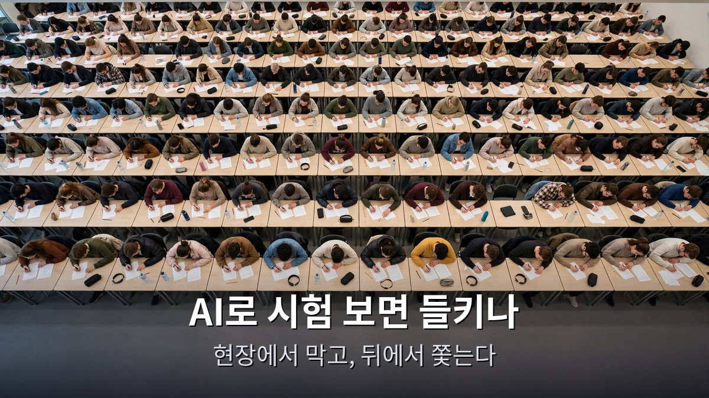
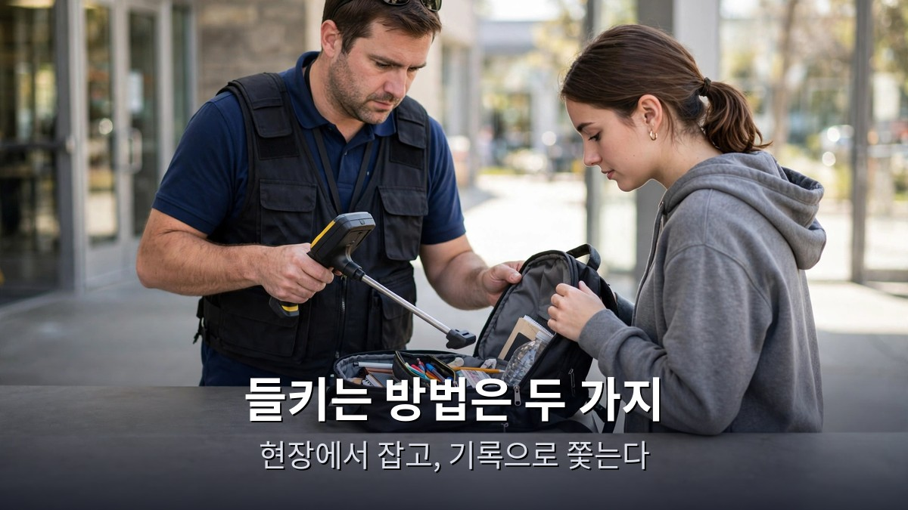
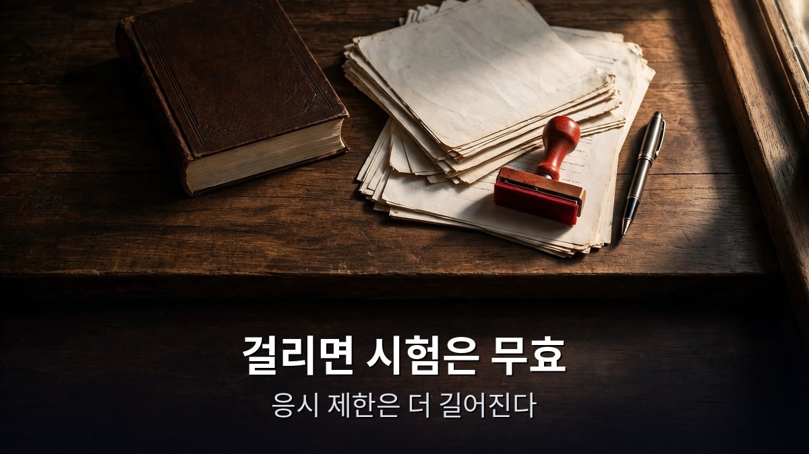
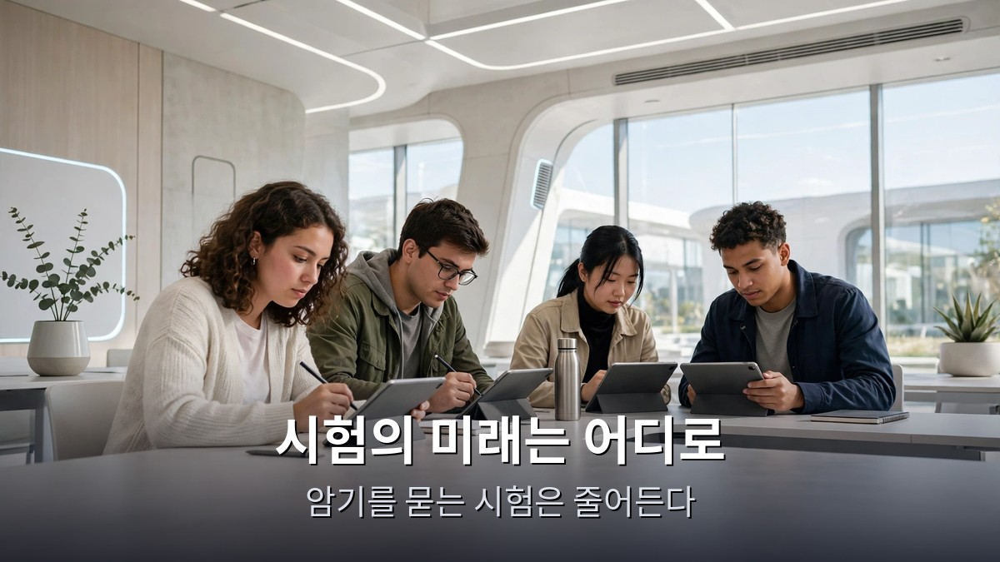

<!-- 본문 시작 -->

들킨다.
다만 현장에서 잡히느냐, 끝난 뒤에 쫓기느냐가 다를 뿐이다.
세무사 시험 수석 합격자가 AI 부정행위를 자백한 뒤, 시험장에서 AI를 쓰면 어떻게 적발되고 어떤 처벌을 받는지가 가장 많이 묻는 질문이 됐다.
2026년 11월 기준으로 정리하면, 현장 단속은 사람 눈과 기기에 기대고, 사후 추적은 AI 서비스 접속 기록과 통신 기록에 기대고 있다.
응시 제한은 지금 1년이지만, 3년·최대 10년으로 늘리는 방안이 추진 중이다.

> **한 줄로 정리하면, AI 부정행위는 현장에서 스마트 기기 전담 인력·금속 탐지기로 잡히고, 끝난 뒤에는 성적 분석과 AI 서비스 접속 기록·통신 기록으로 추적되며, 걸리면 시험 무효에 응시 제한이 따라오고, 텍스트만으로 AI 사용을 가려내는 탐지 프로그램의 정확도는 60~70% 수준이라 결정적 증거가 되지 못한다.**

시험이 앞으로 어떻게 바뀌는지 궁금하면 [2030년 AI 전망](https://blog.naver.com/3700708/224480013875) 글과 함께 보면 된다. AI가 시험을 대신 푸는 시대가 오면, 시험은 무엇을 확인하는 자리인지부터 다시 따져봐야 하기 때문이다.

## AI로 시험 보면 어떻게 들키나?

시험장 입구에서 금속 탐지기로 소지품을 확인하는 감독관 장면

적발 방법은 크게 두 가지다.
현장에서 잡는 방법과, 끝난 뒤에 기록으로 쫓는 방법이다.
두 방법은 서로 다른 약점을 갖고 있다.

현장에서 잡는 방법은 사람 눈과 기기다.
11월 19일 수능에는 스마트 기기 점검만 맡는 전담 인력 1,800명과 복도 감독관 6,600명이 더 들어갔다.
4교시 전에는 안경을 책상 위에 올려 점검하고, 3교시 전에는 소지품을 다시 확인했다.
금속 탐지기는 의심되는 경우에 썼다.
5월 광주에서는 감독관이 시선 처리가 이상한 수험생을 보고 AI 안경을 잡아냈고, 10월 가스 기사 시험에서는 스마트 안경만 찾는 전담 인력이 블루투스 신호를 잡는 앱과 금속 탐지기로 한 명을 찾아냈다.

기기의 한계도 분명하다.
AI 안경은 겉보기엔 평범한 안경이라 구분이 어렵다.
세무사 수석 합격자가 썼다는 초소형 카메라는 지름이 2mm, 연필심 굵기 정도라 옷에 붙여도 눈에 잘 띄지 않는다.
감독관에게는 수험생 몸을 뒤질 권한이 없다.
교육부는 시험장 전파를 끊는 일은 법적·기술적으로 한계가 있어 현실성이 낮다고 밝혔다.
전파를 잡아내는 탐지기는 올해 수능에는 두지 못하고 내년 수능부터 도입을 검토하기로 했다.

사후 추적은 기록을 본다.
시험이 끝난 뒤 성적을 분석해 의심되면 AI 서비스 접속 기록과 통신 기록을 요청하기로 했다.
정부는 2027학년도 수능부터 글로벌 AI 기업과 통신사가 사후 조사에 협력하기로 했다고 밝혔다.
시험 시간대의 AI 서비스 이용 기록과 통신 내역을 대조해 현장에서 적발하지 못한 부정행위까지 추적하겠다는 취지다.
휴대전화를 걷어라도 소용이 없는 이유가 여기 있다.
카메라만 몸에 있으면 답을 내는 기기는 시험장 밖에 있어도 되기 때문이다.

텍스트 탐지 프로그램은 따로 봐야 한다.
과제물처럼 글로 쓴 답안을 AI가 썼는지 가려내는 프로그램의 정확도는 60~70% 수준으로 알려져 있다.
조건에 따라 50% 이하로 떨어지기도 한다.
OpenAI가 공개한 AI 텍스트 분류기는 시험 평가에서 AI 작성 텍스트의 26%만 'AI 작성 가능성이 있음'으로 올바르게 식별했고, 사람이 쓴 텍스트의 9%를 AI 작성으로 잘못 표시했다.
텍스트 탐지 결과만으로 부정행위를 확정하지 못하는 이유다.
시험장 부정행위의 결정적 증거는 탐지 프로그램이 아니라 기기와 기록이다.

| 적발 방법 | 어떻게 잡나 | 한계 |
| --- | --- | --- |
| 전담 인력·감독관 눈 | 시선 처리·행동 이상 포착, 안경·소지품 점검 | 옷 속 초소형 카메라는 겉으로 안 보임, 몸수색 권한 없음 |
| 금속 탐지기·블루투스 신호 | 기기 회로·신호 탐지 | 꺼져 있는 기기는 찾기 어려움, 전파 탐지기는 내년 도입 검토 |
| 성적 분석·사후 추적 | 의심 성적 → AI 서비스 접속 기록·통신 기록 요청 | 협력·절차 필요, 2027 수능부터 본격화 |
| AI 텍스트 탐지 프로그램 | 문장 패턴으로 AI 작성 비율 판별 | 정확도 60~70%, 단독 증거 불가 |

수치 확인 기준: 2026년 11월 19일. 현장 단속 수치는 영상 자막·보도 기준, 텍스트 탐지 정확도는 성균관대 AI 안내 페이지 기준이다.

## 걸리면 어떻게 되나?

서류 위에 찍힌 빨간 도장과 법전, 펜이 놓인 책상 장면

처벌은 시험 종류마다 다르지만, 방향은 하나다.
무효에 응시 제한이 따라온다.

수능에서는 금지 기기를 갖고만 있어도 그 시험이 무효다.
AI 안경을 쓰면 다음 해 수능을 볼 수 없다.
응시 제한 기간은 지금 1년이다.
정부는 이를 더 늘리는 법 개정을 추진하고 있다.
교육부 장관은 3년을, 총리는 최대 10년을 말해 아직 정해지지 않았다.

세무사 시험에서는 이미 절차가 돌아가고 있다.
수석 합격자는 1차 400점 만점에 397.5점을 받았고, 11월 15일 직접 나와 부정행위를 털어놓고 같은 날 경찰에 자수했다.
국세청은 처분 절차를 시작했고, 청문을 거쳐 시험 무효와 5년간 응시 자격 정지를 정할 예정이다.
경찰은 합격자를 약 10시간 조사하고 불구속 입건했다.
정부 대응팀은 최근 3~5년치 합격자들의 점수 분포도 다시 들여다보기로 했다.

왜 이렇게까지 엄격해졌는지는 수법의 진화를 보면 알 수 있다.
옛날 부정행위는 사람을 쓰는 방식이었다.
숨긴 카메라로 문제를 밖에 보내면 밖에 있는 사람이 풀어서 이어폰으로 답을 불러줬다.
이제는 밖에 있는 사람 자리를 AI가 차지했다.
공범 없이 혼자서도 답을 받을 수 있게 된 것이다.
클로드로 사진 속 문제를 푸는 앱을 10분 만에 만들었다는 사례가 있고, 손목에 숨긴 카메라로 새 문제를 푸는 데 5.3초가 걸렸고 세 문제 모두 정답이었다.

장비를 사는 일 자체도 위험해졌다.
중국에서는 AI 부정행위 장비를 팔던 업체가 구매자들에게 협박 메시지를 보내며 비밀을 지켜주는 대가로 30만 위안을 요구했다는 의혹이 나왔다.
일부 구매자는 실제로 돈을 냈다고 전해진다.
부정행위 자체가 불법이라 피해자가 신고를 꺼리는 구조가 협박을 가능하게 했다는 분석이다.
장비를 사는 순간 구매 기록이 남고, 그 기록이 또 다른 약점이 된다.

| 시험 | 적발 시 처분 | 응시 제한 |
| --- | --- | --- |
| 수능 | 시험 무효 | 현행 1년, 3년·최대 10년 확대 추진 중(미확정) |
| 세무사 시험 | 시험 무효 예정, 경찰 수사 | 5년 응시 자격 정지 예정(청문 후 확정) |
| 한국산업인력공단 시험 | 적발 사례 5건 이상 | 미확인 |
| 과제물(대학 등) | AI 탐지 결과는 참고 자료, 교수자 재확인 후 판단 | 미확인 |

수치 확인 기준: 2026년 11월 19일. 수능·세무사 처분은 교육부 발표·보도·자막 기준, 응시 제한 확대는 추진 중인 방안이다.

## 앞으로 시험은 어떻게 바뀌나?

미래 교실에서 태블릿으로 문제를 푸는 학생들의 모습

각 나라의 대응은 갈리고 있다.
중국은 시험 시간에 AI 앱의 기능을 직접 껐다.
가오카오 기간에 딥시크와 텐센트, 알리바바 같은 주요 AI 서비스 기업들이 사진을 읽고 문제를 푸는 이미지 인식 기능을 일시 중단했다.
고사장마다 설치된 CCTV 영상을 AI가 실시간으로 분석해 이상행동을 포착하고 감독관에게 알리는 방식도 쓰고 있다.

미국은 AI 원격 감독을 시범 도입하고 있다.
변호사시험 운영 단체가 56명을 대상으로 웹캠·마이크·보조 카메라로 시험 환경을 실시간 확인하는 시스템을 테스트했다.
응시자가 카메라 화면 밖으로 벗어나거나 허용되지 않은 기기가 포착되면 AI가 자동 감지해 감독관에게 알린다.
영국과 유럽 대학은 AI 텍스트 판별 기술이 핵심 방어 수단이다.
턴잇인을 비롯한 표절 검사 솔루션이 문장 구조와 어휘 반복 패턴을 분석해 AI 작성 문장 비율을 수치로 판별한다.

기술은 여기서 멈추지 않는다.
스마트 콘택트렌즈가 다음 단계로 거론된다.
평범한 렌즈 안에 아주 작은 화면과 회로를 넣어 눈앞에 글자나 그림을 띄우는 렌즈다.
두바이 스타트업 엑스펜시오가 만들고 있고, 지난해 2억 5천만 달러를 투자받아 기업 가치 13억 5천만 달러로 평가받았다.
올해 3월 세계 최대 모바일 전시회에서는 실제로 작동하는 시제품을 공개했다.
화면 크기는 1mm도 안 되고, 사람 눈은 이렇게 가까이 붙은 화면에 초점을 맞추지 못해 망막에 영상을 직접 비추는 방식을 쓴다.
소비 전력은 10마이크로와트 미만으로 스마트폰 화면의 수만분의 1 수준이라고 회사는 밝혔다(제조사 주장).
의료용이 먼저 나오고 있고 판매 시점은 정해지지 않았다.

더 근본적인 질문도 나왔다.
연세대 김현철 교수는 감독을 아무리 늘려도 막을 수 없고, 지식을 묻는 수능 역시 언젠가 사라져야 할 시험이라고 봤다(전문가 견해).
AI가 시험에서 전문가를 앞지르는 시대라면 사람 전문가에게 남는 몫은 무엇인가.
세무사·변호사·의사처럼 시험을 통과한 전문가를 믿는 구조에서 시험이 흔들리면 그 믿음도 함께 흔들린다.
어떻게 막을까 해서 시작한 고민은 이제 시험이 무엇을 확인하는 자리인지, 학교에서는 무엇을 배워야 하는지로 옮겨가고 있다.

현장에서 잡히는 건 기기와 행동이고, 끝난 뒤에 쫓기는 건 기록이다.
텍스트 탐지 프로그램만으로는 확정할 수 없고, 걸리면 시험은 무효가 되고 응시 제한이 따라온다.
장비를 사는 일은 협박의 빌미까지 만든다.
시험을 앞둔 사람이라면 AI를 부정행위 도구가 아니라 공부 도구로 쓰는 쪽이 남는 길이라는 생각이 든다.

## 자주 묻는 질문

**AI 안경을 쓰고 시험을 보면 현장에서 바로 잡히나?**

바로 잡힐 수도 있고 아닐 수도 있다. 시선 처리가 이상하거나 전담 인력의 점검에 걸리면 현장에서 적발된다. 다만 옷 속에 숨긴 초소형 카메라는 겉으로 안 보여서 현장 단속을 피할 수 있다. 그럴 때는 성적 분석 뒤 AI 서비스 접속 기록과 통신 기록으로 사후 추적한다.

**과제물을 AI로 쓰면 탐지 프로그램에 걸리나?**

걸릴 수도 있고 아닐 수도 있다. AI 탐지 프로그램의 정확도는 60~70% 수준으로 알려져 있고, 조건에 따라 50% 이하로 떨어지기도 한다. 탐지 결과만으로 부정행위를 확정하지 않고 교수자가 다시 확인한다. 대학에서는 과정 중심 평가나 서술형·면접 병행으로 AI 사용 여부를 가리는 쪽으로 가고 있다.

**AI 부정행위 장비를 팔거나 사는 것도 처벌받나?**

시험장에서 쓰는 행위가 처벌 대상이다. 다만 경찰은 세무사 수석 사건과 관련해 장비의 제조·수입·판매 과정까지 수사하겠다고 밝혔다. 중국에서는 장비를 팔던 업체가 구매자를 협박한 의혹까지 나와 2차 범죄로 번지고 있다.

## 함께 보면 좋은 글

[GPT-6.2 아스트라 가격｜얼마부터 쓰나, 무료는 되나](https://blog.naver.com/3700708/224483147383)

[매트릭스｜현실이 코드였던 136분, 빨간 알약을 고른 날](https://blog.naver.com/3700708/224478573702)

<!-- 본문 끝 -->

## 작업용 출처·이미지 정보 (업로드 제외)

**출처**
- 세무사 수석 AI 부정행위 영상 자막 전문 2건(2026-11-18·11-19, 8분 12초·14분 25초): 397.5점·11월 15일 자백·자수·2mm 카메라·5.3초 풀이·수능 대책 수치·응시 제한 추진·스마트 콘택트렌즈
- AI 부정행위 장비 협박 영상 자막 전문(2026-11-19, 4분 22초): 30만 위안 요구·일부 지불·구매 기록 협박
- 이데일리, "챗GPT로 수능 풀면 사후 적발?…정부 '빅테크들 협력 약속'", 2026년 11월 17일: 2027 수능 사후 조사 협력, 응시 제한 1년에서 최대 10년 확대 추진, 1,312개 시험장·감독관 7만 5천 명·전담 1,800명·복도 6,600명
- 파이낸셜뉴스, "AI로 커닝하면 AI 잠근다…전세계 '부정행위 대응 기술' 살펴보니", 2026년 11월 16일: 중국 가오카오 AI CCTV·AI 앱 기능 중단, 미국 AI 원격 감독, 영국 턴잇인
- 성균관대 AI 종합안내, "부정행위 사례 및 대응방안": AI 탐지 프로그램 정확도 60~70%, OpenAI 분류기 26% 식별·9% 오식별, Copy Killer·GPTZero·Detect GPT·Originality.AI
