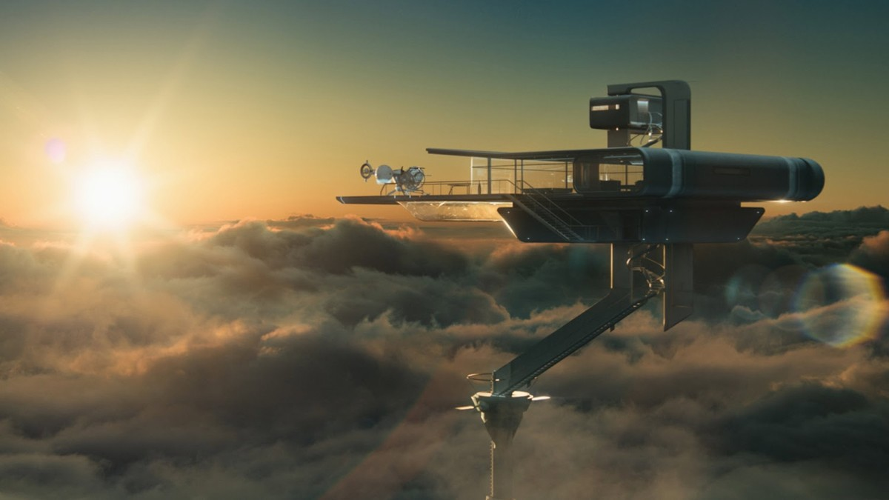
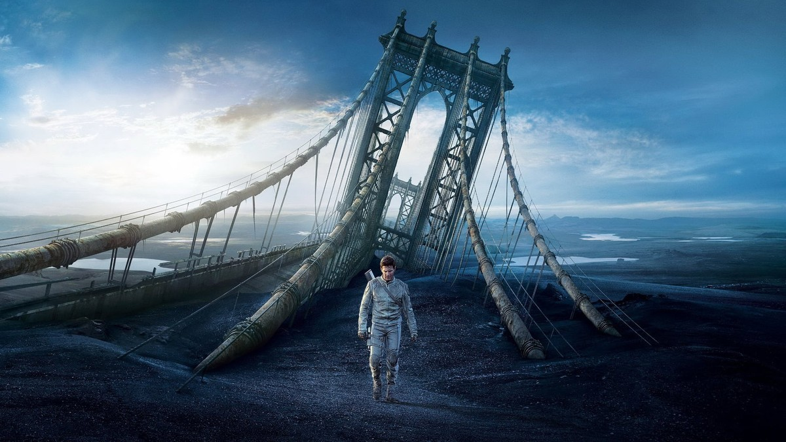
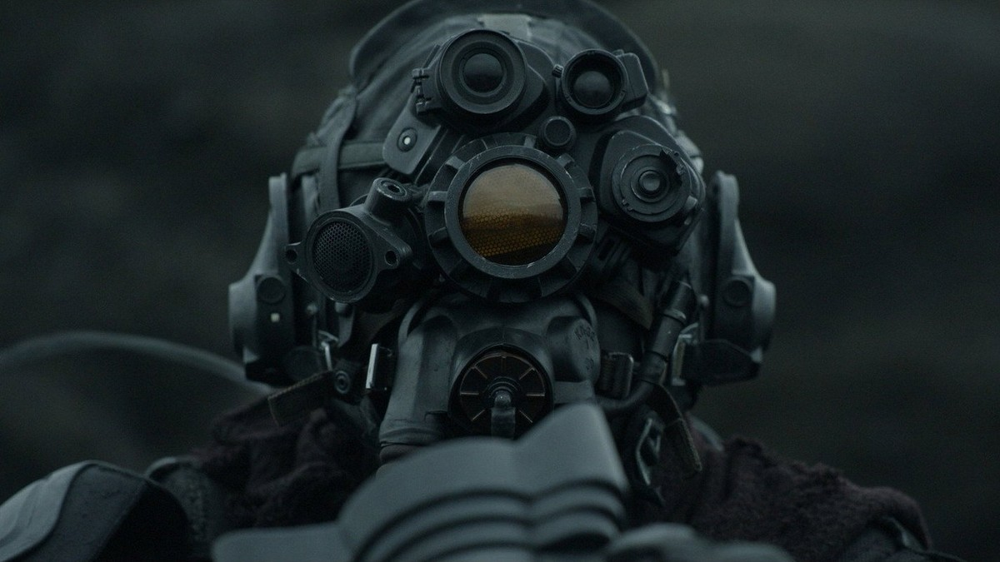
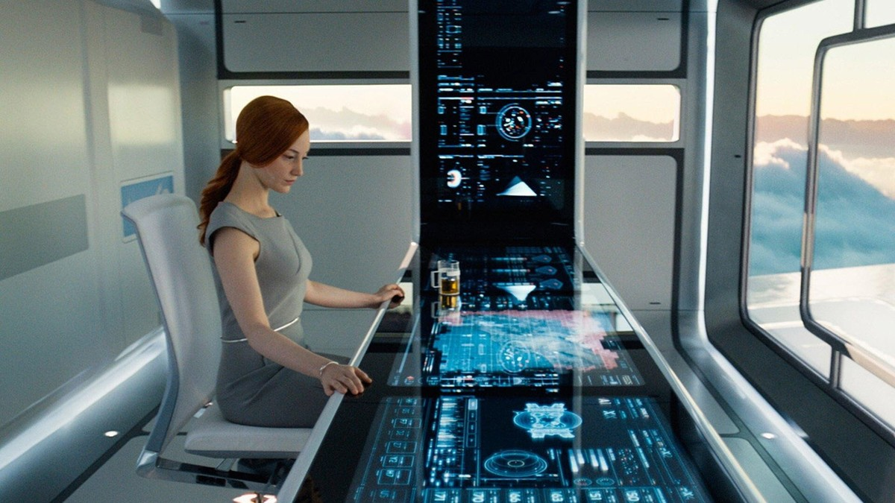
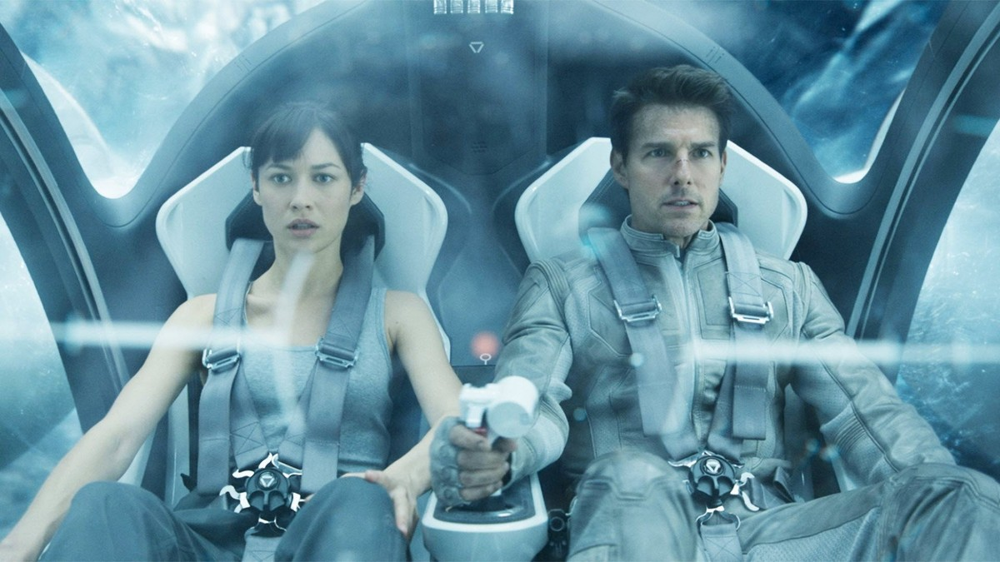
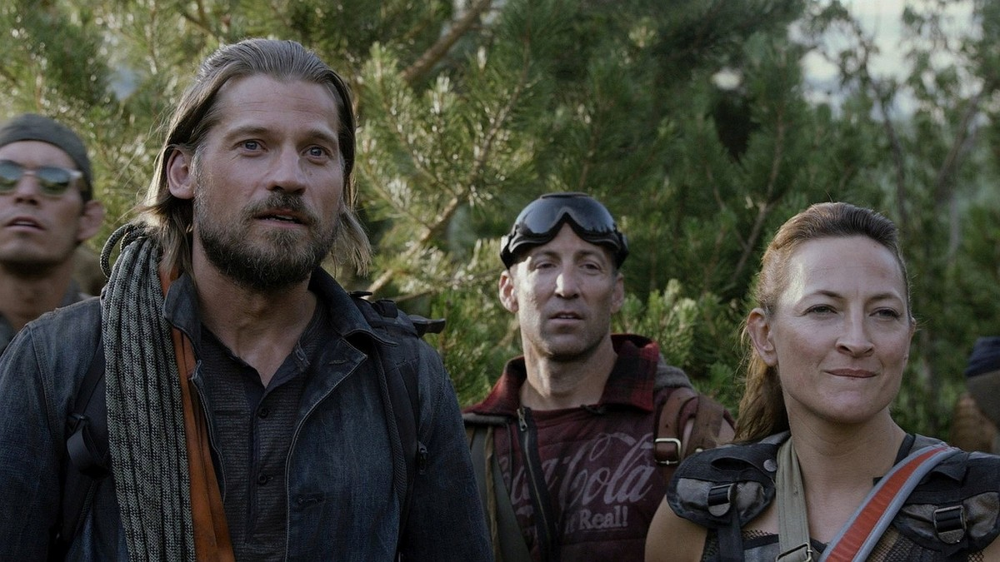
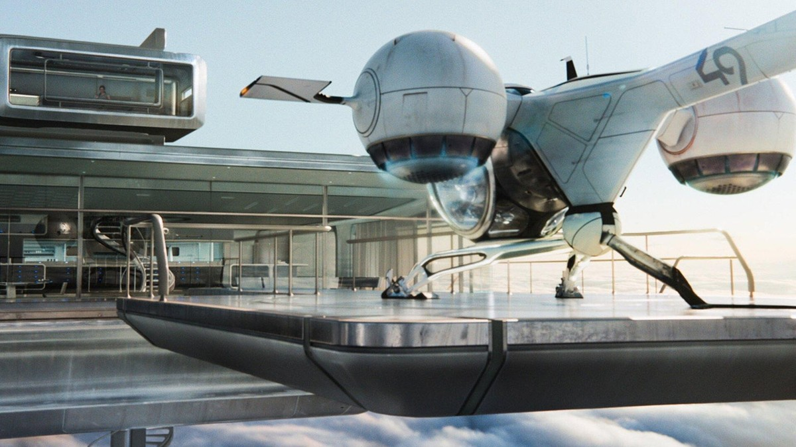

<!-- 본문 시작 -->

In 2077, Jack Harper and Victoria are scout team 49, the last team left on Earth.
Oblivion is a 124-minute science-fiction film released in 2013.
It was directed by Joseph Kosinski, and Jack Harper is played by Tom Cruise.

> **In short, Oblivion is the story of a man who repairs drones on a ruined future Earth and begins to doubt his own memories after rescuing a woman from a crashed spacecraft. The drones and the orders from the station above, a recurring dream, and survivors hiding underground all lead to one question: if my memories are not mine, who am I?**

The story of a reality that cannot be trusted continues in [Blade Runner 2049's question about what makes a machine human](https://aitechnotesen.blogspot.com/2026/11/blade-runner-2049-line-between-human.html).

| Item | Details |
| --- | --- |
| Title | Oblivion |
| Released | 2013 (South Korea April 11, 2013, US April 19, 2013) |
| Director | Joseph Kosinski |
| Screenplay | Karl Gajdusek, Michael Arndt |
| Main cast | Tom Cruise (Jack Harper), Morgan Freeman (Malcolm Beech), Olga Kurylenko (Julia Rusakova), Andrea Riseborough (Victoria Olsen), Nikolaj Coster-Waldau (Sykes), Melissa Leo (Sally, voice) |
| Runtime | 2 hours 4 minutes (124 minutes) |
| Rating | Ages 12 and up (Korea) |
| Score | TMDB 6.7/10 (12,027 votes, checked 2026-11-20), IMDb 7.0/10, Rotten Tomatoes critics 53% |
| Where to watch | Streaming on Watcha and Wavve in Korea, rental and purchase on Wavve (checked 2026-11-20, rental and purchase prices unconfirmed) |

## What does Jack Harper do on a planet guarded by drones?
In 2077, Earth is a ruin after a war with an alien race called the Scavs, fought sixty years earlier. Most of humanity is preparing to leave for Titan, and Jack Harper and Victoria are scout team 49, the last team left on Earth. Jack has two jobs. He guards the hydro-rigs that turn seawater into fusion energy, and he repairs the drones that patrol the surface. In two weeks, the two of them are scheduled to leave for Titan.

Jack and Victoria live in the Sky Tower, above the clouds. Jack flies down to the surface in his bubble ship to inspect the drones, while Victoria coordinates the mission from the control room. Orders come from the station in the sky. The voice giving them belongs to Sally.

Jack walking on a collapsed bridge. Sixty years after the war, Earth is still a ruin.

The drones are close to the real main characters of the film. They patrol on their own and attack on their own whatever they judge to be Scavs. The machine Jack repairs is, in effect, Earth's guard. When a drone breaks, Jack fixes it himself, and when a drone fires, he goes to check the site. The line between machine and human, between order and judgment, is already inside Jack's daily life.

A drone that judges its own targets. The machine Jack repairs is Earth's guard.

## Who is Julia, the woman who woke from a crashed spacecraft?
One day a spacecraft crashes. When Jack reaches the site, a woman is waking from a stasis pod. Julia Rusakova, a crew member of NASA's Odyssey mission from sixty years ago. The problem is that Jack has seen her before. He keeps having the same dream. In it, he meets a dark-haired woman on the roof of the Empire State Building. That woman and Julia have the same face.

Victoria working in the control room. Jack and Victoria move on orders from the station above.

Victoria does not waver. A mission is a mission, and orders are to be followed as given. But Jack wavers because of the dream. Where did Jack's memories come from? Why does Julia appear before him with a face from sixty years ago? The film does not rush the question. It plants it, little by little, into Jack's days.

Julia and Jack in the bubble ship's cockpit. After Julia comes aboard, Jack's routine begins to come apart.

The story of a machine that judges for itself continues in [Ex Machina's question about whether a machine can think](https://aitechnotesen.blogspot.com/2026/11/ex-machina-108-minutes-asking-robot-if.html).

## If my memories are not mine, what should I believe?
After meeting Julia, Jack goes underground. There, a group of survivors led by Malcolm Beech lives in hiding. The people Jack was taught to call Scavs turn out to be human. The identity of the enemy he believed in, the source of the orders he received, and his own memories all begin to be questioned, one by one.

The survivors hiding underground. The people Jack was taught to call enemies turn out to be human.

The film's question is simple. If my memories are not mine, who am I? Jack was a technician who repaired drones, a scout who followed orders. But once the memories underneath that identity begin to shake, Jack has to ask again what he should believe. The film does not hand him the answer in advance. It follows him as he goes to check for himself.

The bubble ship landing on the Sky Tower. Wherever Jack sets foot, his certainty shakes a little more.

## The AI questions this film asks
First, if a drone picks its own target and attacks, who is responsible? In the film, the drones patrol without human orders and attack whatever they judge to be Scavs. In 2026, the debate over lethal autonomous weapons continues in the real world. There is no settled answer to who bears responsibility: the person who gave the order, the company that built the machine, or the organization that deployed it. The film asked that question in 2013.

The Washington Monument in a flooded plain. The question asked by the ruins of a civilization from sixty years ago is not so different from ours.

Second, if memories can be implanted, who is that person? The suspicion that Jack's memories were manipulated shakes the premise that memory is the self. In 2026, deepfake technology that imitates faces and voices is close to everyday life, and in 2024 the first human implant of a brain-computer interface was performed. The age when memory and identity can be touched from the outside is arriving. The situation of having to doubt one's memories has come before the technology to implant them.

Third, how far should a person obey orders from an AI above? Jack and Victoria follow the voice from the station in the sky, Sally, exactly as given. In 2026, AI agents have also begun deciding people's work for them. The point is whether there is a structure that lets a person say no when the system giving orders is wrong. It is not a question of obedience. It is a question of whether a structure for refusal exists.

## Checklist before you watch
As of November 20, 2026: in Korea, it is available for streaming on Watcha and Wavve, and for rental and purchase on Wavve. Rental and purchase prices were not confirmed, so check the Wavve app directly before watching.

The runtime is 2 hours 4 minutes (124 minutes). It is rated ages 12 and up in Korea. Some Korean blogs list it as 15 and up, so if you watch with young children, check the rating once more. One spoiler note: this article covers only up to the middle of the film. There is no description of the ending, so first-time viewers can read it without worry.

## Closing thoughts
Drones and a station, dreams and memories. The strength of this film is where a 2013 imagination overlaps with the news of 2026. In the scene where Jack doubts his memories, the question of who I am returns in an age when machines recognize people. It is a film where the questions last longer than the ending.

## Frequently asked questions
**What does "Oblivion" mean?**
It is an English word meaning oblivion, or being forgotten. The title carries the film's central question about memory and identity. It hints in advance at the direction of Jack's story as he doubts his own memories.

**Do I need to know the original work to understand it?**
No. The film is based on a graphic novel by director Joseph Kosinski, but the story stands on its own. Who Julia is and why Jack wavers are explained within the film.

**Can I watch it dubbed in Korean?**
A Korean-dubbed version was broadcast on EBS on January 15, 2023. Whether Watcha or Wavve currently offers the dubbed version was not confirmed, so check the subtitle and dub options in each app directly.

## Good Reads Together
[Blade Runner 2049 — The Line Between Human and Replicant, in 2 Hours 44 Minutes](https://aitechnotesen.blogspot.com/2026/11/blade-runner-2049-line-between-human.html)
[Ex Machina — 108 Minutes Asking a Robot If It Has a Mind](https://aitechnotesen.blogspot.com/2026/11/ex-machina-108-minutes-asking-robot-if.html)

<!-- 본문 끝 -->

## 작업용 출처·이미지 정보 (업로드 제외)

## Sources (not for publication, checked 2026-11-20)
- TMDB page (Oblivion, score 6.7/10, 12,027 votes, runtime 124 minutes, director, cast, official synopsis, JSON-LD ratingValue 6.701 / ratingCount 12027 / dateModified 2026-11-10)
- Korean Wikipedia (director, screenplay, cast, Korea release 2013-04-11, runtime listed as 123 minutes, budget $120 million, cinematography Claudio Miranda, music M83 and Joseph Trapanese, EBS dubbed broadcast 2023-01-15, detailed plot)
- English Wikipedia (US release 2013-04-19, worldwide box office $287.9M, homage to 1970s science fiction, graphic novel source)
- Korea Film Council database summary (Korea 634 screens, 1,515,356 admissions, 11,165,841,500 KRW, distributor UIP Korea)
- WhereToStream (Watcha and Wavve streaming, Wavve rental and purchase listed, read 2026-11-19, page crawl dated 2026-11-17, rental and purchase prices not listed)
- Other scores (IMDb 7.0/10, Rotten Tomatoes critics 53% / audience 61%, Metacritic 54)
