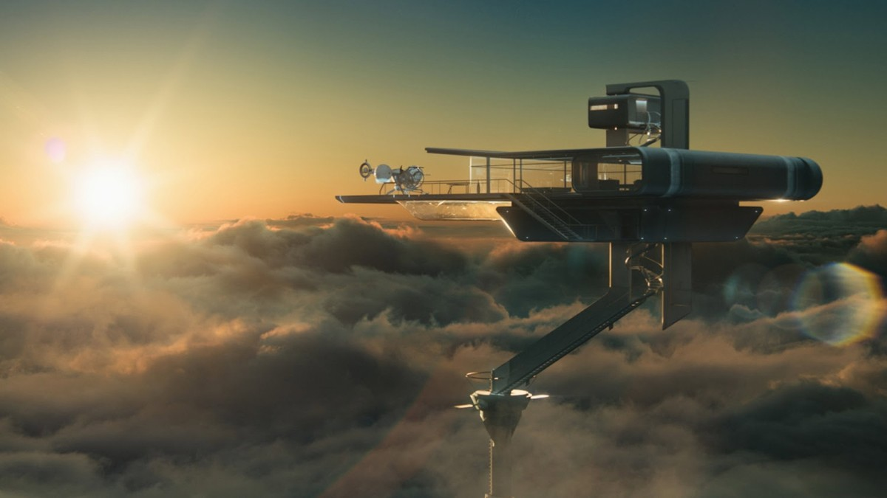
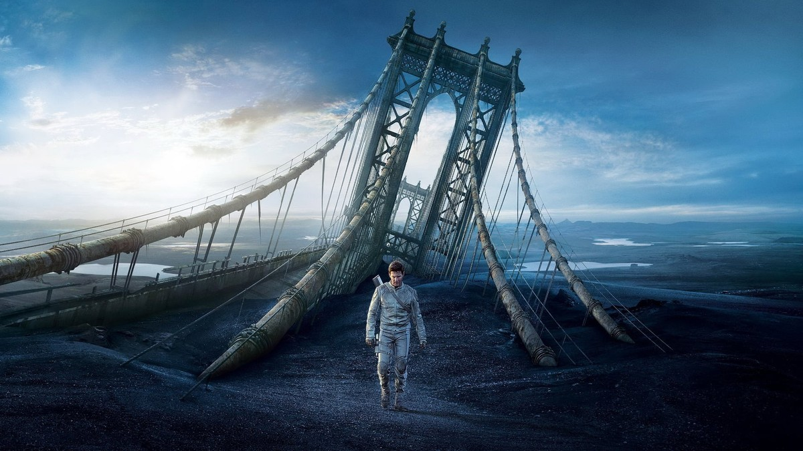
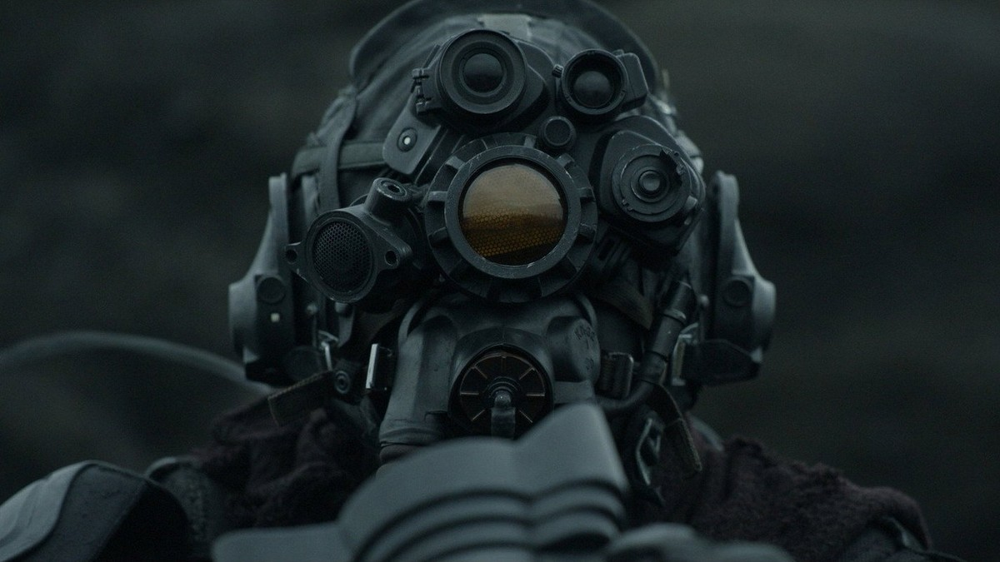
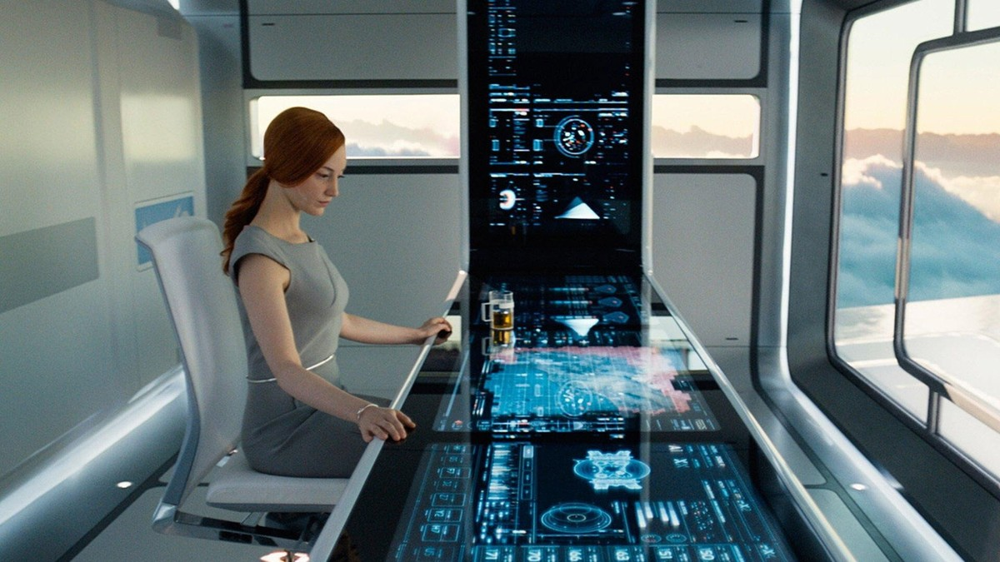
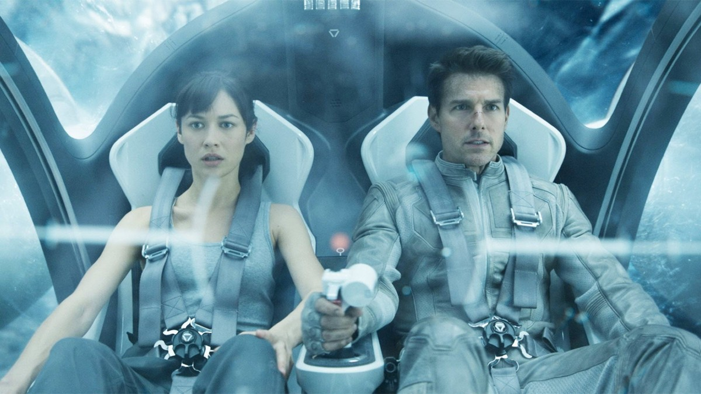
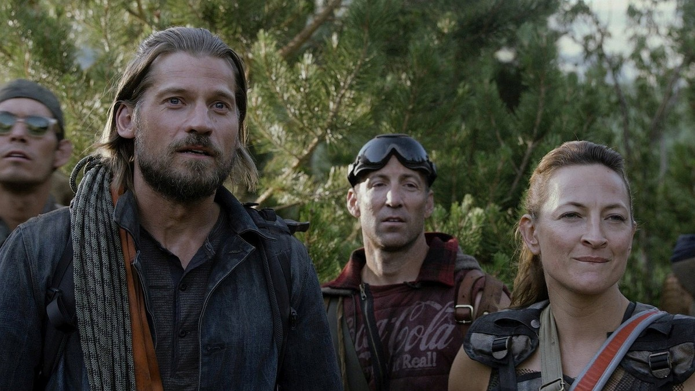
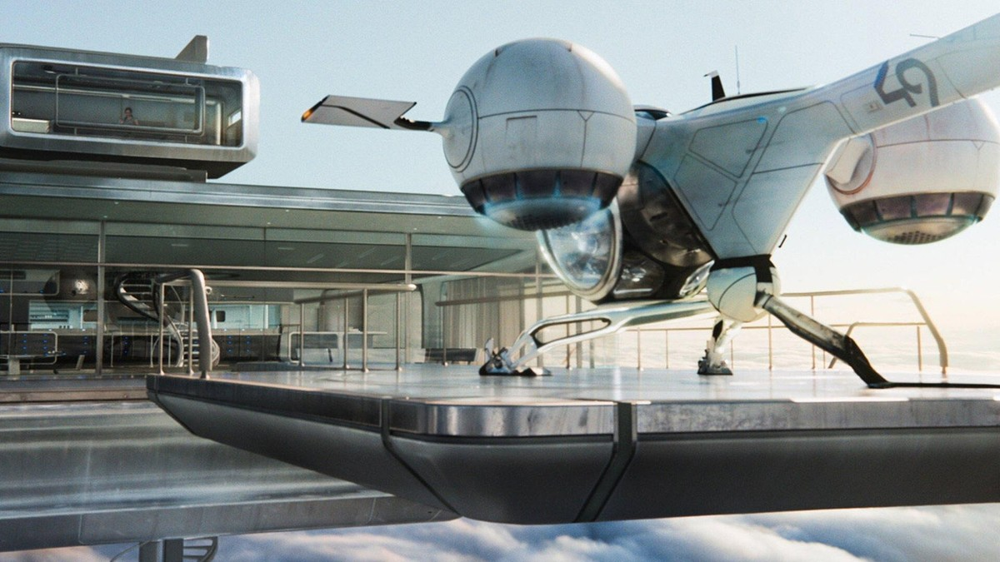
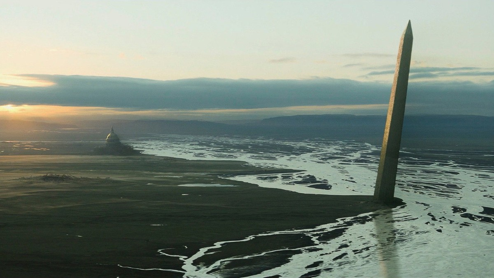

<!-- 본문 시작 -->

2077년, 잭 하퍼와 빅토리아는 지구에 남은 49번 정찰팀이다.
오블리비언은 2013년에 개봉한 124분짜리 SF 영화다.
감독은 조셉 코신스키, 잭 하퍼는 톰 크루즈가 맡았다.

> **핵심만 먼저 말하면, 오블리비언은 황폐해진 미래 지구에서 드론을 수리하는 남자가, 추락한 우주선에서 깨어난 여자를 만나 자신의 기억을 의심하기 시작하는 이야기다. 드론과 정거장의 지시, 반복되는 꿈, 지하에 숨어 사는 생존자들이 한데 얽히며 '기억이 내 것이 아니라면 나는 누구인가'라는 질문으로 이어진다.**

현실이 의심스러운 이야기는 [매트릭스의 가상현실과 진짜 현실의 경계](https://blog.naver.com/3700708/224478573702)에서도 이어진다.

| 항목 | 내용 |
| --- | --- |
| 제목 | 오블리비언 (Oblivion) |
| 개봉 | 2013년 (한국 2013-04-11, 미국 2013-04-19) |
| 감독 | 조셉 코신스키 |
| 각본 | 칼 가이듀섹, 마이클 아른트 |
| 주요 출연 | 톰 크루즈(잭 하퍼), 모건 프리먼(말콤 비치), 올가 쿠릴렌코(줄리아), 앤드리아 라이즈버러(빅토리아), 니콜라이 코스테르 발다우(사이크스), 멀리사 리오(샐리 목소리) |
| 러닝타임 | 2시간 4분 (124분) |
| 등급 | 12세 이상 관람가 |
| 평점 | TMDB 6.7/10 (12,027개 평가, 2026-11-20 확인), IMDb 7.0/10, 로튼토마토 비평가 53% |
| 시청처 | 왓챠·웨이브 스트리밍, 웨이브 대여·구매 (2026-11-20 확인, 대여·구매 가격 미확인) |

## 드론이 지키는 지구, 잭 하퍼는 무슨 일을 하나
2077년, 지구는 60년 전 외계 종족 스캐브와의 전쟁으로 황폐해졌다. 살아남은 인류는 대부분 타이탄으로 떠날 준비를 하고 있고, 잭 하퍼와 빅토리아는 지구에 남은 49번 정찰팀이다. 잭의 임무는 두 가지다. 바닷물을 핵융합 에너지로 바꾸는 해양 수소 채취기를 지키는 일, 그리고 지상을 순찰하는 드론을 수리하는 일이다. 임무가 끝나면 두 사람은 2주 뒤 타이탄으로 떠날 예정이다.

잭과 빅토리아는 구름 위의 스카이 타워에서 산다. 잭은 버블십을 타고 지상으로 내려가 드론을 점검하고, 빅토리아는 관제실에서 임무를 조율한다. 지시는 하늘 위의 정거장에서 온다. 목소리의 주인공은 샐리다.

무너진 다리 위를 걷는 잭. 전쟁이 끝난 지 60년이 지났지만, 지구는 아직 폐허다.

드론은 이 영화의 진짜 주인공에 가깝다. 드론은 스스로 순찰하고, 스캐브로 판단한 대상을 스스로 공격한다. 잭이 수리하는 기계가 곧 지구의 경비병인 셈이다. 잭은 드론이 고장 나면 직접 고치고, 드론이 쏜 자리에 가서 현장을 확인한다. 기계와 사람, 명령과 판단의 경계가 잭의 일상 속에 이미 들어와 있다.

스스로 표적을 판단하는 드론. 잭이 고치는 기계가 곧 지구의 경비병이다.

## 추락한 우주선에서 깨어난 여자, 줄리아는 누구인가
어느 날 우주선 한 대가 추락한다. 잭이 현장에 가보니 동면 캡슐 안에서 한 여자가 깨어나고 있다. 줄리아 루사코바, 60년 전 NASA 오디세이호의 승무원이다. 문제는 잭이 이 여자를 처음 보는 게 아니라는 점이다. 잭은 자꾸 같은 꿈을 꾼다. 엠파이어 스테이트 빌딩 옥상에서 검은 머리의 여자를 만나는 꿈이다. 그 여자와 줄리아는 같은 얼굴이다.

관제실에서 일하는 빅토리아. 잭과 빅토리아는 하늘 위 정거장의 지시를 받아 움직인다.

빅토리아는 흔들리지 않는다. 임무는 임무일 뿐이고, 지시는 그대로 따르면 된다. 하지만 잭은 꿈 때문에 흔들린다. 잭의 기억은 어디서 온 것일까. 줄리아는 왜 60년 전의 얼굴로 눈앞에 나타난 것일까. 영화는 이 질문을 서두르지 않고, 잭의 하루하루에 조금씩 새겨 넣는다.

버블십 조종석의 줄리아와 잭. 줄리아를 태운 뒤 잭의 일상은 조금씩 어긋나기 시작한다.

기계가 스스로 판단하는 이야기는 [아이 로봇의 로봇 3원칙과 기계의 마음](https://blog.naver.com/3700708/224477518995)에서도 이어진다.

## 기억이 내 것이 아니라면, 무엇을 믿어야 하나
줄리아를 만난 뒤 잭은 지하로 내려간다. 그곳에는 말콤 비치가 이끄는 생존자 무리가 숨어 살고 있다. 잭이 스캐브라고 배웠던 이들은 사실 사람이었다. 잭이 믿었던 적의 정체, 잭이 받은 지시의 출처, 잭의 기억 자체가 하나씩 의심받기 시작한다.

지하에 숨어 사는 생존자들. 잭이 적이라 배웠던 사람들이 사실은 사람이었다.

이 영화의 질문은 단순하다. 기억이 내 것이 아니라면, 나는 누구인가. 잭은 드론을 고치는 기술자였고, 지시를 따르는 정찰팀원이었다. 그런데 그 정체성의 바탕인 기억이 흔들리자, 잭은 무엇을 믿어야 할지 다시 묻게 된다. 영화는 답을 미리 주지 않는다. 대신 잭이 직접 확인하러 가는 과정을 따라간다.

스카이 타워에 착륙하는 버블십. 잭의 발이 닿는 곳마다 확신은 조금씩 흔들린다.

## 이 작품이 던지는 AI 질문
첫째, 드론이 스스로 표적을 골라 공격하면, 책임은 누구에게 있는가. 영화 속 드론은 인간의 명령 없이 순찰하고, 스캐브로 판단한 대상을 공격한다. 2026년의 현실에서도 스스로 표적을 고르는 자율무기 논쟁이 이어지고 있다. 명령을 내린 사람, 기계를 만든 기업, 배치한 조직 중 누구에게 책임을 물을지 정해진 답이 없다. 영화는 그 질문을 2013년에 던졌다.

물에 잠긴 워싱턴 기념탑. 60년 전 문명의 흔적이 묻는 질문은 지금과 크게 다르지 않다.

둘째, 기억을 심으면, 그 사람은 누구인가. 잭의 기억이 조작됐다는 의심은 "기억이 곧 나"라는 전제를 흔든다. 2026년의 현실에서는 얼굴과 목소리를 흉내 내는 딥페이크가 일상에 가까워졌고, 2024년에는 뇌-컴퓨터 인터페이스의 첫 인체 이식까지 이뤄졌다. 기억과 정체성을 외부에서 건드릴 수 있는 시대가 오고 있다. 기억을 심는 기술이 아니라, 기억을 의심해야 하는 상황이 먼저 왔다.

셋째, 위에 있는 AI의 지시에, 사람은 어디까지 복종해야 하는가. 잭과 빅토리아는 하늘 위 정거장의 목소리, 샐리가 내리는 지시를 그대로 따른다. 2026년의 현실에서도 AI 에이전트가 사람의 업무를 대신 결정하기 시작했다. 지시를 내리는 시스템이 틀렸을 때, 사람이 "아니요"라고 말할 수 있는 구조가 있는지가 관건이다. 복종의 문제가 아니라, 거부의 구조가 있는지의 문제다.

## 시청 전 체크리스트
2026년 11월 20일 기준으로 정리한다. 국내에서는 왓챠와 웨이브에서 스트리밍으로 볼 수 있고, 웨이브에서 대여와 구매도 가능하다. 대여와 구매 가격은 확인되지 않았으니, 보기 전 웨이브 앱에서 직접 확인하는 것이 좋다.

러닝타임은 2시간 4분(124분)이다. 등급은 12세 이상 관람가로 표기된다. 다만 일부 블로그에서는 15세로 안내하기도 하니, 어린 자녀와 함께 볼 때는 등급을 한 번 더 확인하는 것이 좋다. 스포일러 주의도 있다. 이 글은 작품 중반부까지의 내용만 다룬다. 결말에 대한 설명은 일절 없으니, 처음 보는 사람도 안심하고 읽어도 된다.

## 마무리
드론과 정거장, 꿈과 기억. 2013년의 상상이 2026년의 뉴스와 겹치는 지점이 이 영화의 힘이다. 잭이 기억을 의심하는 장면은, 기계가 사람을 알아보는 시대에 '나는 누구인가'라는 질문을 다시 던진다. 결말보다 질문이 오래 남는 영화다.

## 자주 묻는 질문
**"오블리비언"은 무슨 뜻인가요?**
망각, 잊혀짐이라는 뜻의 영어 단어다. 영화의 핵심 질문인 기억과 정체성을 제목에 담고 있다. 잭이 자신의 기억을 의심하는 이야기의 방향을 제목이 미리 알려준다.

**원작을 알아야 이해할 수 있나요?**
아니요. 조셉 코신스키 감독의 그래픽 노블이 원작이지만, 영화만으로 이야기가 완결된다. 원작을 몰라도 줄리아가 누구인지, 잭이 왜 흔들리는지는 극 중에서 설명된다.

**한국에서 더빙으로도 볼 수 있나요?**
2023년 1월 15일 EBS에서 우리말 더빙판이 방송된 기록이 있다. 현재 왓챠·웨이브에서 더빙을 제공하는지는 확인되지 않았으니, 각 앱에서 자막·더빙 여부를 직접 확인하는 것이 좋다.

## 함께 보면 좋은 글
[로보캅(1987)｜죽은 형사가 기계 경찰이 되다, 기억이 남긴 질문](https://blog.naver.com/3700708/224475171704)
[2030년 AI 전망｜16가지 혁신 연대표로 읽다](https://blog.naver.com/3700708/224480013875)

<!-- 본문 끝 -->

## 작업용 출처·이미지 정보 (업로드 제외)

## 출처 목록 (발행본 제외, 2026-11-20 확인)
- TMDB 페이지 (오블리비언, 평점 6.7/10·12,027개 평가·러닝타임 124분·감독·출연·공식 시놉시스, JSON-LD ratingValue 6.701 / ratingCount 12027 / dateModified 2026-11-10)
- 한국어 위키백과 (감독·각본·출연·한국 개봉 2013-04-11·러닝타임 123분 표기·제작비 1억 2,000만 달러·촬영 클라우디오 미란다·음악 M83+조셉 트래패니스·2023-01-15 EBS 더빙 방송·줄거리 상세)
- 영어 위키백과 (미국 개봉 2013-04-19·전 세계 흥행 $287.9M·1970년대 SF 오마주·그래픽 노블 원작)
- 영화진흥위원회 통합전산망 기준 정리 (한국 634개 스크린·관객 1,515,356명·매출 11,165,841,500원·배급 UIP 코리아)
- WhereToStream (왓챠·웨이브 스트리밍, 웨이브 대여·구매 표시, 2026-11-19 열람, 페이지 크롤 기준 2026-11-17, 대여·구매 가격 미표시)
- 기타 평점 (IMDb 7.0/10, 로튼토마토 비평가 53% / 관객 61%, 메타크리틱 54)
