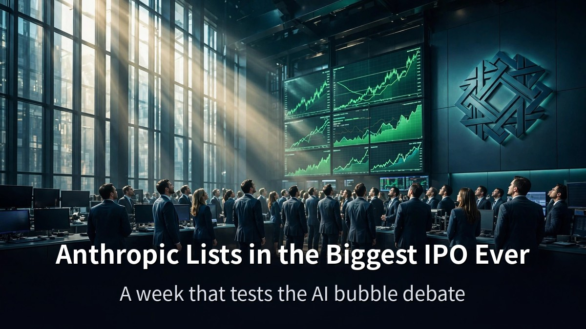
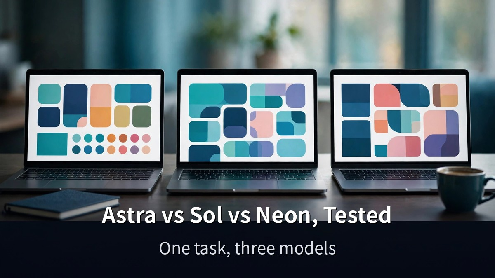
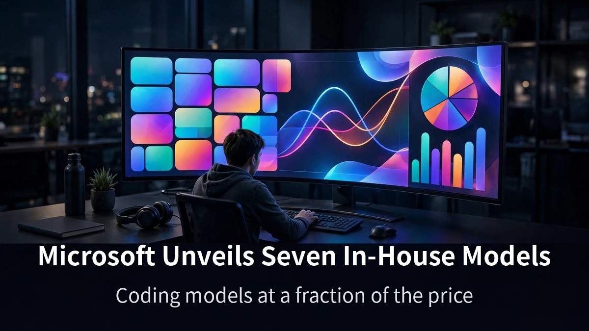
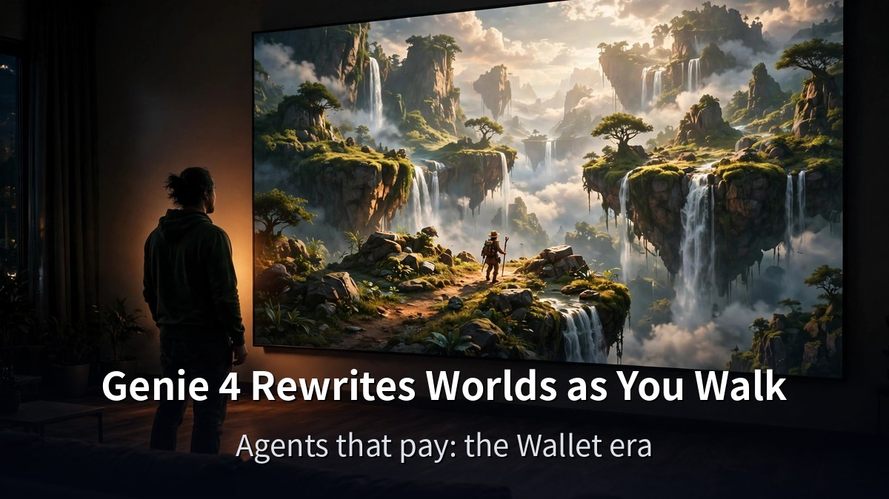

<!-- 본문 시작 -->



Anthropic priced its shares at $83 and closed the first day at $97.17.
The stock opened at $111.50, briefly pushing the market value past $2 trillion, then gave back part of the gain by the afternoon.
The $81.3 billion raised makes this the largest IPO ever, and a live test of the AI bubble debate.

```blog
type: text
runs:
  - text: "Anthropic sold 980 million shares at $83 each, raised $81.3 billion, and closed day one at $97.17, up 17% from the offer price. In the same week, GPT-6.2 Astra, Gemini 4 Neon, and Microsoft's seven in-house models all pushed the same direction: cheaper models, closer to everyday work."
    style: {bold: true, color: "#007aa6"}
```

As the [GPT-6.2 Astra launch](https://aitechnotesen.blogspot.com/2026/11/gpt-62-astra-is-herecheaper-and-faster.html) shows, Astra leads on the Intelligence Index at 62. This week, though, the bigger question came from Anthropic's listing, not from Astra's scores. The market had to answer whether an AI company earns enough to justify this price.

```blog
type: heading
level: 2
runs:
  - text: "The biggest IPO ever: what happened on day one?"
    style: {bold: true, color: "#007aa6"}
```



(Illustration) Investors watching the exchange screens on opening day

The offering closed on the night of November 18.
The first range was $70 to $78 a share, for 825 million shares.
Orders piled in, so the price settled above the range at $83, and the share count grew to 980 million.
The $81.3 billion raised passed the $75 billion record SpaceX set in June.

Trading began on Nasdaq just before noon on November 19, under the ticker ANT.
The stock opened at $111.50, 34% above the offer price, and climbed to about $115 during the session.
At that point the market value touched about $2 trillion.
The gain faded through the afternoon, and the close came in at $97.17, 17% above the offer price.
At the close, the fully diluted value stood at about $1.76 trillion.

More than 813 million shares changed hands on day one, beating SpaceX's 522 million on its debut.
Retail investors got less than 20% of the offering.
Even so, retail buying was heavy: Vanda Research called it the third-biggest day of net retail buying for a debut since its records began in 2012, with retail trading of more than $750 million.

The mood flipped the next day.
By midday on November 20, the stock had fallen to $85, down 13%.
Retail buyers who chased the open were facing losses within a day.
The first day's excitement did not survive 24 hours.

| Item | Detail |
| --- | --- |
| Offer price | $83 (above the $70-$78 range) |
| Shares sold | 980 million (up from 825 million) |
| Amount raised | $81.3 billion (largest IPO ever) |
| Opening price | $111.50 (34% above the offer) |
| Day-one close | $97.17 (17% above the offer) |
| Day-one volume | 813 million shares |

Figures checked November 20, 2026. Offer terms and trading results are based on press coverage.

```blog
type: text
runs:
  - text: "Anthropic revenue: "
    style: {bold: true, color: "#ff008c"}
  - text: "Revenue for the first nine months of 2026 was $33.24 billion, up about 1,200% from the same period a year earlier. The company was founded in 2021 and valued at around $20 billion in 2024."
```

```blog
type: text
runs:
  - text: "The stock changed direction within a day. A 17% first-day pop is not an answer to the AI bubble question."
    style: {bold: true, background: "#FFF3CD"}
```

Nvidia reported earnings the same week, on Tuesday.
Revenue came in at about $116 billion after the close on November 17, above the expected figure of about $109 billion.
Guidance for next quarter was $130 billion.
This was the first report since Jensen Huang stepped down as CEO on November 12, so the leadership gap drew as much attention as the numbers.
The board said it does not intend to bring Huang back as CEO.

```blog
type: heading
level: 2
runs:
  - text: "Astra, Sol, or Neon: which one should you use?"
    style: {bold: true, color: "#007aa6"}
```



(Illustration) Three laptops on a desk, each showing a different website design

The three models arrived within two days, on November 17 and 18.
GPT-6.2 Astra and Sol came first, followed by Gemini 4 Neon.
On the Intelligence Index, Astra scores 62, Neon 61, and Sol 57.
On scores alone, Astra leads, with Neon one point behind.

Prices tell a different story.
Astra costs $8 per million input tokens and $40 per million output tokens.
Neon costs $3 for input and $15 for output, less than half of Astra on both sides.
A model in the same intelligence band now costs less than half the price.

| Model | Intelligence Index | Input (per 1M tokens) | Output (per 1M tokens) |
| --- | --- | --- | --- |
| GPT-6.2 Astra | 62 | $8 | $40 |
| Gemini 4 Neon | 61 | $3 | $15 |
| GPT-6.2 Sol | 57 | Not confirmed | Not confirmed |

Figures checked November 20, 2026. The Intelligence Index is from Artificial Analysis; prices are from the official OpenAI and Google announcements. Sol pricing was not confirmed in the official announcement.

When scores alone do not settle the choice, trying the same task on each model works better.
This week, the same website-building task was run through all three models in turn, comparing how finished the result looked and how much fixing it needed.
A one-point gap on an index often means little in real work, while the price gap shows up on every bill.
For work you repeat often, start with the cheaper model and move up only when the result falls short.

A cheaper route opened up as well.
Microsoft's MAI Code 2, released on November 17, delivers 98% of GPT-6.1 Sol's coding performance at about 40% of the price, according to Microsoft (maker's claim).
Against Claude Opus 5.5, it reaches 96% of the performance at 5% of the price, Microsoft said (maker's claim).
It is available right away in GitHub Copilot.
These figures are averages across four benchmarks in Microsoft's own testing, so treat them as a reference until independent checks appear.

```blog
type: text
runs:
  - text: "How to choose: "
    style: {bold: true, color: "#ff008c"}
  - text: "Look at price and where you can use the model before a one-point gap on an index. The more often you run a task, the more the cheaper model pays off."
```

```blog
type: text
runs:
  - text: "Benchmark scores change with settings and harnesses. The same model can score differently depending on the tools around it."
    style: {bold: true, background: "#FFF3CD"}
```

As the [GPT-6.2 Astra price](https://aitechnotesen.blogspot.com/2026/11/gpt-62-astra-pricewhat-it-costs-and-how.html) breakdown shows, Astra matches Fable 5.2 on per-token price while Neon undercuts both. Carbon, the heaviest model in the Gemini 4 family, handles the longest work, while Neon takes the repeated work below it. When Carbon's price rises on December 1, Neon becomes the cheaper option per token as well.

```blog
type: heading
level: 2
runs:
  - text: "Microsoft's seven models: what actually changed?"
    style: {bold: true, color: "#007aa6"}
```



(Illustration) A developer at a curved monitor showing a code editor

Microsoft released seven in-house models at once at its Ignite event on November 17.
The lineup covers coding (MAI Code 2 and Code 2 Flash), security (MAI Cyber 2 Flash), images (MAI Image 2.7 and 2.7 Flash), voice (MAI Realtime 1), medical transcription (MAI Transcribe 2), and judgment calls (Decision 1.1).
The shared pitch is price, not peak performance: near-top performance at a fraction of the cost.

The image model stands out most.
MAI Image 2.7 ranks first in image editing on Artificial Analysis.
As of November 16, it holds 1,215 Elo from 5,478 votes, ahead of GPT Image 2.6 Sunburst by 4 Elo.
Microsoft said the price is about one fifth of Sunburst (maker's claim).
In public preview it costs about $35 per 1,000 images, and the lighter Flash about $10.

| Model | Headline figure | Where to use it |
| --- | --- | --- |
| MAI Code 2 | 98% of Sol performance, 40% of price | GitHub Copilot |
| MAI Image 2.7 | No. 1 in image editing, one fifth of price | Foundry public preview |
| MAI Realtime 1 | From $0.01 per audio minute | Foundry limited preview |

Figures checked November 20, 2026. All figures are from Microsoft's announcement; independent checks have not appeared yet.

There is a voice model too.
MAI Realtime 1, Microsoft's first live speech-to-speech model, starts at $0.01 per audio minute.
Reasoning is billed separately: $1 per million input tokens and $5 per million output tokens.
For security, Cyber 2 Flash scored 92.3% on the CyberGym-E2E benchmark, ahead of GPT-6 Astra at 91.5%, at less than 2% of the cost per task, Microsoft said (maker's claim).

Microsoft also introduced MAI Licensed Weights, letting companies tune a model with their own data and run it in their own Azure environment.
The weight is shifting from renting models to running them yourself.

## The rest of this week's news

(Illustration) A person looking at a fantasy world on a living-room wall screen

On payments, ChatGPT Wallet arrived on November 13.
Built with American Express, Mastercard, and Visa, the wallet lets the dots agents complete purchases for users.
Card details never reach the agent or the merchant: each transaction uses a one-time token, and every purchase passes a human check first.
It starts with ChatGPT Pro subscribers in the United States who are 18 or older.

Google put Genie 4 into Project Genie on November 18 and opened the developer API on November 19.
Type a new sentence while walking through a world and the world changes with it, sound included.
The API costs about $0.10 per second, with sessions capped at 120 seconds.
Genie 3 sessions got longer too.
Gemini Notebook has turned sources into interactive websites since November 16, on the web for users aged 18 and over.

HeyGen Avatar 6 and Suno Visuals arrived the same week, Claude Duet opened to more users, and Google Stitch Loop, Gemini Computer Use on Mac, ChatGPT live dictation, and ChatGPT for Sales all went public in a row.
None of them is huge on its own, but the direction is shared: AI is moving out of the chat window into payments, worlds, and sales work.

## Confirmed facts and claims, kept apart

Confirmed by official announcements and press coverage: the offer price and trading results, Nvidia's earnings, the seven MAI models, and the launch dates for Genie 4 and Wallet.
The $83 offer, $111.50 open, $97.17 close, $81.3 billion raised, and 813 million shares traded are all confirmed in press and exchange records.
The MAI price-performance figures and "No. 1 in image editing" are claims to treat as the maker's word.
The ranking cites an Artificial Analysis vote result (as of November 16), and the price comparisons use Microsoft's own testing.
Presenter views and demos are opinion.
How the website-building contest turned out, and the framing of this week as the AI bubble's turning point, are the presenter's judgments.
They do not appear in official announcements.

Seen as a whole week, the question of what an AI company is worth split in two.
The market handed Anthropic the largest sum ever, then pulled part of it back the next day.
On the model side, cheaper options kept multiplying while the top tier stayed expensive.
In the months ahead, the longer questions are who actually makes money, and how much real work the cheaper models can do.

## Frequently Asked Questions

**When do Anthropic's lockups start to lift?**

The prospectus lists 23 separate lockup release dates. On the first release day, as many as 316 million shares can become eligible for sale. For anyone who bought right after the listing, the days when that supply opens up are the next thing to watch.

**How much does the Genie 4 API cost?**

About $0.10 per second. A session runs up to 120 seconds, so a one-minute test costs about $6. Closing a tab does not stop generation or billing on Google's servers, so apps must call complete() or cancel() to end a session.

**Is ChatGPT Wallet available in Korea?**

Not yet. It starts in the United States only, for ChatGPT Pro subscribers aged 18 and over with a US-issued card and a US billing address. No timeline for wider availability has been announced.

## Good Reads

[GPT-6.2 Astra Is Here｜Cheaper and Faster Than Fable 5.2](https://aitechnotesen.blogspot.com/2026/11/gpt-62-astra-is-herecheaper-and-faster.html)

[Terminator 2: Judgment Day｜Why Did Skynet Target Humanity](https://aitechnotesen.blogspot.com/2026/11/terminator-2-judgment-daywhy-did-skynet.html)

<!-- 본문 끝 -->

## 작업용 출처·이미지 정보 (업로드 제외)

**Sources**
- Reuters, "Anthropic retail traders face losses as shares dive 13% the day after debut", November 20, 2026: offer terms, open, close, volume, retail buying
- Investopedia, "Anthropic IPO Live", November 19, 2026: open $111.50, close $97.17, volume 813 million shares
- Barron's, "A Strong Opening Act", November 19, 2026: offer price $83, 980 million shares, $1.5 trillion valuation
- The National, "Nvidia earnings and Anthropic IPO lead crucial week for AI bulls", November 16, 2026: Nvidia earnings expectations, Anthropic revenue $33.24 billion
- Microsoft AI, "Seven new world-class models at scalable price-performance", November 17, 2026: MAI model prices, performance figures, access paths
- Google DeepMind, "Project Genie update featuring Genie 4", November 18, 2026: Genie 4 launch, Project Genie
- TechCrunch, "ChatGPT's new Wallet lets AI agents shop and check out for you", November 13, 2026: ChatGPT Wallet launch and access conditions
- OpenAI, "Introducing GPT-6.2 Astra and Sol", November 17, 2026: Astra pricing, Intelligence Index 62
- Google, "Introducing Gemini 4 Neon", November 18, 2026: Neon pricing, Intelligence Index 61
