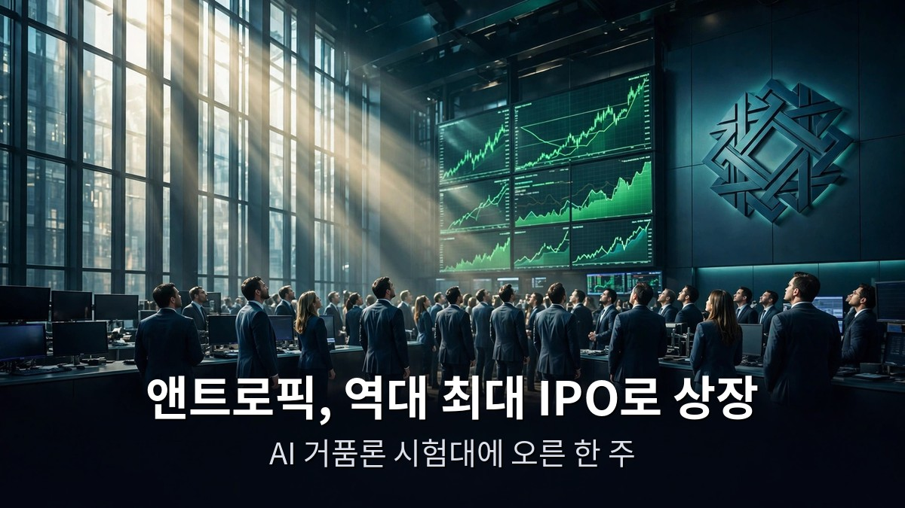
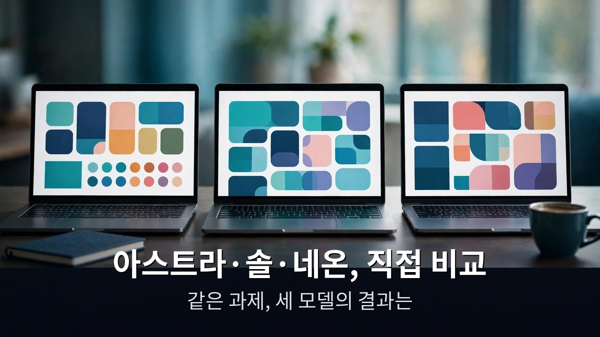
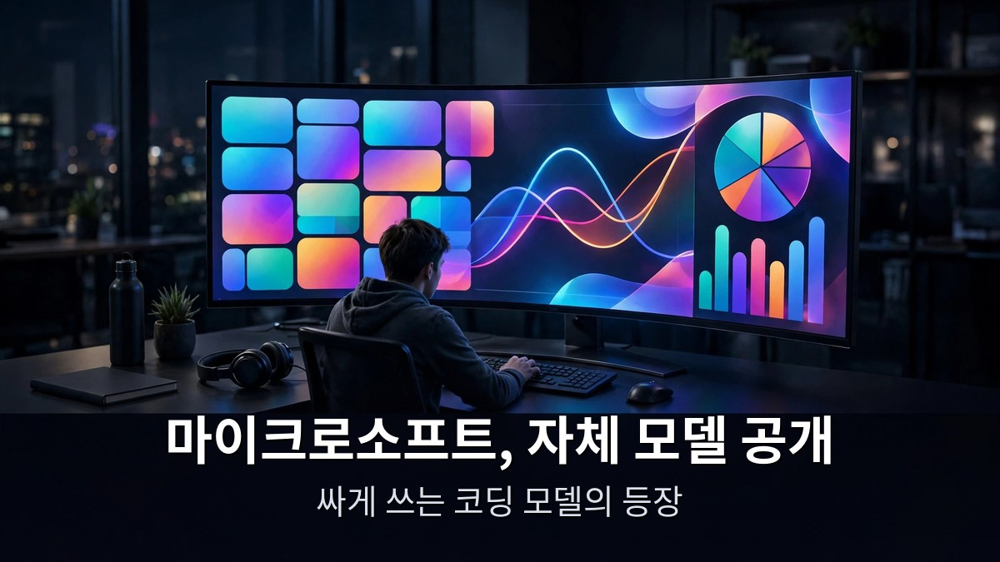
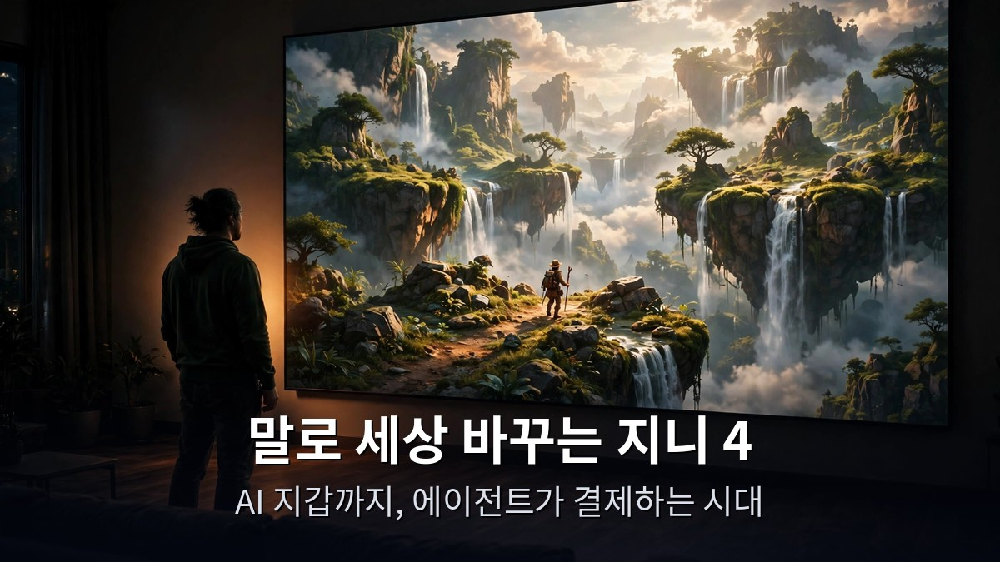

<!-- 본문 시작 -->



공모가 83달러로 시작한 앤트로픽 주식은 첫날 97.17달러로 마감했다.
시초가는 111.50달러까지 치솟아 시가총액이 한때 2조 달러에 닿았다가, 오후 들어 상승 폭을 반납했다.
813억 달러라는 역대 최대 금액을 모은 상장이 AI 거품론을 가르는 시험대에 올랐다.

```blog
type: text
runs:
  - text: "앤트로픽은 9억 8천만 주를 주당 83달러에 팔아 813억 달러를 모았고, 첫날 97.17달러로 마감해 공모가보다 17% 올랐다. 같은 주에 나온 GPT-6.2 아스트라와 제미나이 4 네온, 마이크로소프트의 자체 모델 7종까지, 가격을 낮춘 신모델 경쟁이 본격화됐다."
    style: {bold: true, color: "#007aa6"}
```

[GPT-6.2 아스트라 출시](https://blog.naver.com/3700708/224483130080) 글에서 본 것처럼 아스트라는 종합 지능 62점으로 가장 앞선 모델 중 하나다. 이번 주는 아스트라의 성능보다 앤트로픽의 상장이 더 큰 질문을 던졌다. AI 회사가 이 가격을 받을 만한 돈을 버는지, 시장이 직접 답하는 자리였기 때문이다.

```blog
type: heading
level: 2
runs:
  - text: "역대 최대 IPO, 첫날 주가는 어떻게 됐나"
    style: {bold: true, color: "#007aa6"}
```



개장 첫날 거래소 전광판을 지켜보는 투자자들

공모는 11월 18일 밤에 마무리됐다.
처음 제시한 범위는 주당 70달러에서 78달러였고, 팔려고 한 주식은 8억 2,500만 주였다.
주문이 몰리자 공모가는 범위 위인 83달러로 정해졌고, 파는 주식도 9억 8천만 주로 늘었다.
조달액은 813억 달러로, 올해 6월 스페이스X가 세운 750억 달러 기록을 넘겼다.

거래는 11월 19일 정오 직전 나스닥에서 시작됐다.
종목 코드는 ANT다.
시초가는 111.50달러로 공모가보다 34% 높았고, 장중 한때 115달러까지 올랐다.
이때 시가총액은 약 2조 달러에 닿았다.
오후 들어 오름폭이 줄었고, 종가는 97.17달러로 공모가보다 17% 높은 선에서 마감했다.
종가 기준 완전 희석 시가총액은 약 1조 7,600억 달러였다.

첫날 거래량은 8억 1,300만 주를 넘겨 스페이스X 상장 첫날 거래량 5억 2,200만 주를 앞질렀다.
개인 투자자 몫은 전체 공모 물량의 20% 미만이었다.
그런데도 개인 매수세가 몰려, 집계 업체 반다리서치는 상장 첫날 개인 순매수 규모가 2012년 이후 기록 가운데 세 번째로 컸다고 밝혔다.
개인이 거래한 금액만 7억 5천만 달러를 넘었다.

다음 날 분위기는 뒤집혔다.
11월 20일 낮에는 주가가 85달러까지 떨어지며 13% 하락했다.
시초가에 사들인 개인 투자자는 하루 만에 손실을 봤다.
상장 첫날의 들뜸이 하루를 못 간 셈이다.

| 항목 | 내용 |
| --- | --- |
| 공모가 | 83달러 (제시 범위 70~78달러 위) |
| 공모 주식 수 | 9억 8천만 주 (당초 8억 2,500만 주) |
| 조달액 | 813억 달러 (역대 최대) |
| 시초가 | 111.50달러 (공모가보다 34% 높음) |
| 첫날 종가 | 97.17달러 (공모가보다 17% 높음) |
| 첫날 거래량 | 8억 1,300만 주 |

수치 확인 기준: 2026년 11월 20일. 공모 조건·거래 결과는 보도 기준이다.

```blog
type: text
runs:
  - text: "앤트로픽 실적: "
    style: {bold: true, color: "#ff008c"}
  - text: "2026년 첫 9개월 매출은 332억 4천만 달러로, 전년 같은 기간보다 약 1,200% 늘었다. 2021년 세워진 회사가 2024년에는 약 200억 달러 가치로 평가받았다."
```

```blog
type: text
runs:
  - text: "주가는 하루 만에 방향을 바꿨다. 첫날 17% 상승이 AI 거품론에 대한 답은 아니다."
    style: {bold: true, background: "#FFF3CD"}
```

같은 주 화요일에는 엔비디아 실적도 나왔다.
2026년 11월 17일 장 마감 뒤 발표한 매출은 약 1,160억 달러로, 시장 예상치 약 1,090억 달러를 넘겼다.
다음 분기 매출 전망은 1,300억 달러로 제시됐다.
젠슨 황 전 CEO가 11월 12일 물러난 뒤 처음 나온 실적이라, 숫자만큼이나 경영 공백이 관심사였다.
이사회는 황 전 CEO의 복귀를 검토하지 않는다고 밝혔다.

```blog
type: heading
level: 2
runs:
  - text: "아스트라, 솔, 네온 중 뭘 써야 하나"
    style: {bold: true, color: "#007aa6"}
```



세 대의 노트북에 각기 다른 웹사이트가 떠 있는 책상

세 모델은 11월 17일과 18일 이틀 사이에 나왔다.
GPT-6.2 아스트라와 솔이 먼저 나왔고, 제미나이 4 네온이 뒤를 이었다.
종합 지능 지수에서는 아스트라가 62점, 네온이 61점, 솔이 57점이다.
점수만 보면 아스트라가 가장 앞서고, 네온이 한 점 차로 뒤를 잇는다.

가격은 순서가 다르다.
아스트라는 100만 토큰당 입력 8달러, 출력 40달러다.
네온은 입력 3달러, 출력 15달러로 아스트라의 절반도 안 된다.
같은 지능대 모델이 절반 가격에 나온 셈이다.

| 모델 | 종합 지능 | 입력(100만 토큰당) | 출력(100만 토큰당) |
| --- | --- | --- | --- |
| GPT-6.2 아스트라 | 62점 | 8달러 | 40달러 |
| 제미나이 4 네온 | 61점 | 3달러 | 15달러 |
| GPT-6.2 솔 | 57점 | 미확인 | 미확인 |

수치 확인 기준: 2026년 11월 20일. 종합 지능은 Artificial Analysis 지수, 가격은 OpenAI·구글 공식 발표 기준이다. 솔 가격은 공식 발표에서 확인되지 않았다.

숫자 비교만으로 고르기 어렵다면, 같은 과제를 직접 맡겨보는 방법이 있다.
이번 주에는 같은 웹사이트 만들기 과제를 세 모델에 차례로 맡긴 직접 비교가 있었다.
같은 주문을 넣고 결과물의 완성도와 손보는 횟수를 견주는 방식이다.
지수 1점 차이는 실제 작업에서는 체감되지 않는 경우가 많고, 가격 차이는 매번 청구서로 돌아온다.
자주 쓰는 작업이라면 싼 모델부터 시험해 보고, 결과가 아쉬울 때만 비싼 모델로 올리는 순서가 지갑에는 낫다.

더 싼 길도 열렸다.
마이크로소프트가 11월 17일 내놓은 MAI 코드 2는 GPT-6.1 솔 성능의 98%를 약 40% 가격에 낸다고 밝혔다(제조사 주장).
클로드 오퍼스 5.5와 견주면 성능 96%에 가격은 5% 수준이라고 했다(제조사 주장).
깃허브 코파일럿에서 바로 쓸 수 있다.
다만 이 수치는 마이크로소프트 자체 평가 네 가지 벤치마크 평균이라, 독립 검증이 붙기 전에는 참고 수준으로 봐야 한다.

```blog
type: text
runs:
  - text: "고르는 기준: "
    style: {bold: true, color: "#ff008c"}
  - text: "지능 지수 1점 차이보다 가격과 쓸 수 있는 곳을 먼저 본다. 자주 쓰는 작업일수록 싼 모델이 유리하다."
```

```blog
type: text
runs:
  - text: "벤치마크 점수는 설정과 하네스에 따라 달라진다. 같은 모델도 묶는 도구에 따라 결과가 갈린다."
    style: {bold: true, background: "#FFF3CD"}
```

[제미나이 4 카본](https://blog.naver.com/3700708/224474053353) 글에서 본 것처럼 카본은 가장 무겁고 긴 일을 맡는 모델이라, 네온은 그 아래에서 자주 반복되는 일을 맡는다. 카본 가격이 12월 1일부터 오르면 네온이 단가에서도 싼 쪽이 된다.

```blog
type: heading
level: 2
runs:
  - text: "마이크로소프트 모델 7종, 뭐가 달라졌나"
    style: {bold: true, color: "#007aa6"}
```



코드 편집기가 켜진 커브드 모니터 앞의 개발자

마이크로소프트는 11월 17일 이그나이트 행사에서 자체 모델 7종을 한 번에 내놨다.
코딩용 MAI 코드 2와 코드 2 플래시, 보안용 MAI 사이버 2 플래시, 이미지용 MAI 이미지 2.7과 2.7 플래시, 음성용 MAI 리얼타임 1, 의료 전사용 MAI 트랜스크라이브 2, 판단용 디시전 1.1이다.
공통점은 성능보다 가격이다.
최상위 모델의 90%대 성능을 몇 분의 1 가격에 내세우는 구도다.

이미지 쪽이 가장 눈에 띈다.
MAI 이미지 2.7은 Artificial Analysis 이미지 편집 순위에서 1위에 올랐다.
11월 16일 기준 1,215 Elo로, 5,478표 투표에서 GPT 이미지 2.6 선버스트를 4 Elo 차로 앞질렀다.
가격은 선버스트의 5분의 1 수준이라고 밝혔다(제조사 주장).
공개 미리보기 기준 1,000장당 약 35달러, 가벼운 플래시는 약 10달러다.

| 모델 | 내세운 수치 | 쓰는 곳 |
| --- | --- | --- |
| MAI 코드 2 | 솔 성능 98%, 가격 40% | 깃허브 코파일럿 |
| MAI 이미지 2.7 | 이미지 편집 1위, 가격 5분의 1 | 파운드리 공개 미리보기 |
| MAI 리얼타임 1 | 음성 분당 0.01달러부터 | 파운드리 제한 미리보기 |

수치 확인 기준: 2026년 11월 20일. 모두 마이크로소프트 발표 기준이며, 독립 검증은 아직 붙지 않았다.

음성 모델도 있다.
MAI 리얼타임 1은 마이크로소프트 첫 실시간 음성 대 음성 모델로, 음성 분당 0.01달러부터 시작한다.
다만 추론 비용은 따로 청구된다.
입력 100만 토큰당 1달러, 출력 100만 토큰당 5달러다.
보안용 사이버 2 플래시는 CyberGym-E2E 평가에서 92.3%로 GPT-6 아스트라의 91.5%를 앞섰고, 과제당 비용은 2% 미만이라고 밝혔다(제조사 주장).

마이크로소프트는 모델 가중치를 빌려주는 MAI 라이선스드 웨이츠도 내놨다.
기업이 자체 데이터로 모델을 다듬어 자기 애저 환경에서 돌리는 방식이다.
빌려 쓰는 쪽이 아니라 직접 운영하는 쪽으로 무게가 옮겨가는 흐름이다.

## 이번 주 나머지 소식

거실 벽면 화면 속 판타지 세상을 바라보는 사람

결제 쪽에서는 챗GPT 월렛이 11월 13일에 나왔다.
아멕스·마스터카드·비자와 함께 만든 지갑으로, AI 에이전트 dots가 결제까지 대신한다.
카드 정보는 에이전트와 상점에 건네지 않고, 거래마다 일회용 토큰을 쓴다.
결제는 건마다 사람 확인을 거친다.
처음에는 미국 챗GPT Pro 구독자 중 18세 이상만 쓸 수 있다.

구글은 11월 18일 지니 4를 프로젝트 지니에 내놨고, 11월 19일에는 개발자용 API도 열었다.
걷는 도중에 문장을 바꾸면 세상도 함께 바뀌고, 소리도 장면에 맞춰 따라온다.
API는 초당 약 0.10달러, 한 세션은 120초까지다.
지니 3 세션도 길어졌다.
제미나이 노트북은 11월 16일부터 자료를 대화형 웹사이트로 바꿔준다.
웹에서 18세 이상이 쓸 수 있다.

헤이젠 아바타 6과 수노 비주얼스도 같은 주에 나왔고, 클로드 듀엣은 쓸 수 있는 사람이 늘었다.
구글 스티치 루프와 맥용 제미나이 컴퓨터 사용, 챗GPT 실시간 받아쓰기와 영업용 챗GPT도 줄줄이 공개됐다.
하나하나가 크진 않지만, AI가 화면 안에서만 머물지 않고 결제·세상·영업 현장으로 번지는 방향은 같다.

## 확인된 사실과 주장은 이렇게 나뉜다

공식 발표와 보도로 확인된 건 공모가·거래 결과·엔비디아 실적·MAI 7종 발표·지니 4와 월렛 출시일이다.
공모가 83달러, 시초가 111.50달러, 종가 97.17달러, 조달액 813억 달러, 거래량 8억 1,300만 주는 보도와 거래소 기록으로 확인된다.
제조사 주장으로 봐야 할 건 MAI 모델들의 가격 대비 성능 수치와 "이미지 편집 1위" 같은 순위 표현이다.
순위는 Artificial Analysis 투표 결과(11월 16일 기준)를 인용한 것이고, 가격 비교는 마이크로소프트 자체 평가 기준이다.
진행자 평가와 시연은 의견이다.
웹사이트 만들기 대결의 결과 해석과 "이번 주가 AI 거품론의 분수령"이라는 틀은 진행자의 평가다.
공식 발표에는 없는 내용이다.

한 주를 놓고 보면, AI 회사의 값어치를 묻는 질문이 두 갈래로 갈렸다.
시장은 앤트로픽에 역대 최대 금액을 건넸다가, 다음 날 바로 되돌렸다.
모델 쪽에서는 비싼 최상위보다 싸게 쓰는 선택지가 늘어났다.
앞으로 몇 달은 주가보다 누가 돈을 버는지, 그리고 싼 모델이 실제 일을 얼마나 해내는지가 더 오래 남을 질문 같다.

## 자주 묻는 질문

**앤트로픽 주식, 락업 해제는 언제부터 풀리나?**

전망서에는 락업 해제일이 23차례로 나뉘어 적혀 있다. 첫 해제일에는 최대 3억 1,600만 주가 매물로 나올 수 있다. 상장 직후 주식을 산 사람에게는, 물량이 한 번에 풀리는 날이 다음 관심사일 수밖에 없다.

**지니 4 API는 얼마인가?**

초당 약 0.10달러다. 한 세션은 120초까지 이어지고, 1분 테스트는 약 6달러 수준이다. 탭을 닫아도 서버에서 생성과 과금이 이어지니, 앱에서는 세션을 마칠 때 complete()나 cancel()을 호출해야 한다.

**챗GPT 월렛은 한국에서도 쓸 수 있나?**

아직은 미국에서만 시작됐다. 미국 챗GPT Pro 구독자 중 18세 이상, 미국에서 발급된 카드와 미국 청구 주소가 필요하다. 해외 확대 일정은 발표되지 않았다.

## 함께 보면 좋은 글

[GPT-6.2 아스트라 출시｜페이블 5.2보다 싸고 빠르다](https://blog.naver.com/3700708/224483130080)

[터미네이터 2: 심판의 날｜스카이넷은 왜 인간을 노렸나](https://blog.naver.com/3700708/224483148816)

<!-- 본문 끝 -->

## 작업용 출처·이미지 정보 (업로드 제외)

**출처**
- Reuters, "Anthropic retail traders face losses as shares dive 13% the day after debut", 2026년 11월 20일: 공모 조건·시초가·종가·거래량·개인 매수
- Investopedia, "Anthropic IPO Live", 2026년 11월 19일: 시초가 111.50달러·종가 97.17달러·거래량 8억 1,300만 주
- Barron's, "A Strong Opening Act", 2026년 11월 19일: 공모가 83달러·공모 주식 9억 8천만 주·시가총액 1조 5,000억 달러
- The National, "Nvidia earnings and Anthropic IPO lead crucial week for AI bulls", 2026년 11월 16일: 엔비디아 실적 예상치·앤트로픽 매출 332억 4천만 달러
- Microsoft AI, "Seven new world-class models at scalable price-performance", 2026년 11월 17일: MAI 7종 가격·성능 수치·출시 경로
- Google DeepMind, "Project Genie update featuring Genie 4", 2026년 11월 18일: 지니 4 출시·프로젝트 지니
- TechCrunch, "ChatGPT's new Wallet lets AI agents shop and check out for you", 2026년 11월 13일: 챗GPT 월렛 출시·이용 조건
- OpenAI, "Introducing GPT-6.2 Astra and Sol", 2026년 11월 17일: 아스트라 가격·종합 지능 62점
- Google, "Introducing Gemini 4 Neon", 2026년 11월 18일: 네온 가격·종합 지능 61점
