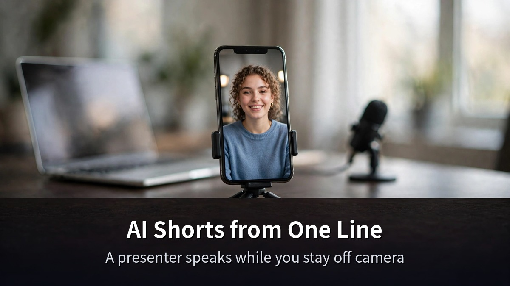
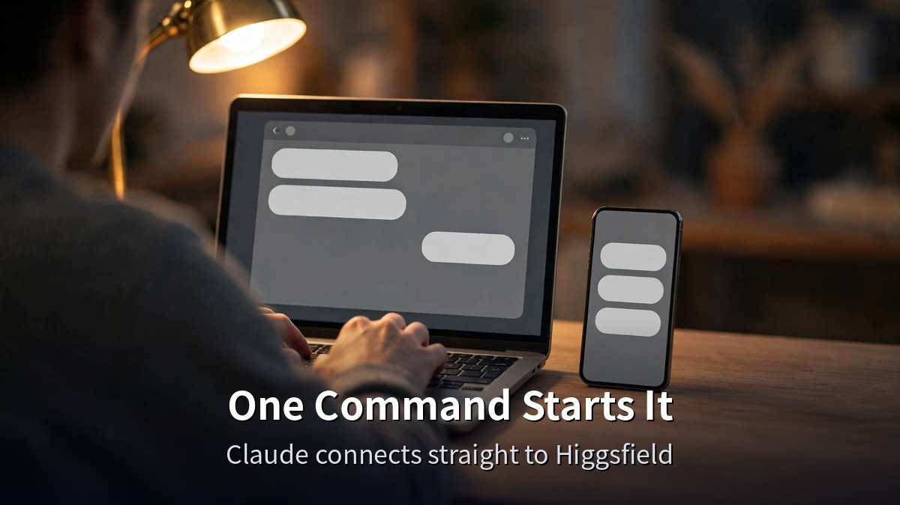
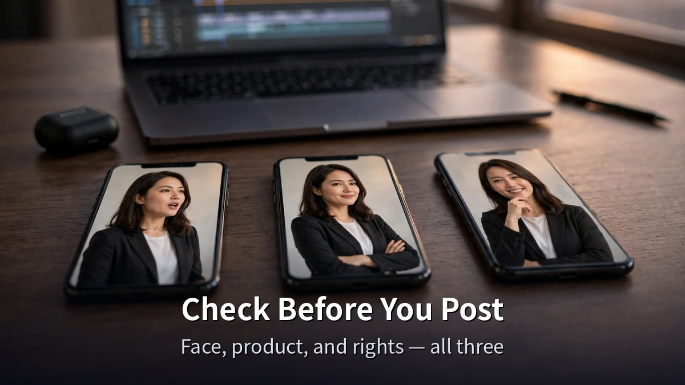

<!-- 본문 시작 -->

One short cost between 320 and 600 credits.
Higgsfield Shorts Studio makes vertical videos where an AI presenter speaks in your place — type "/shorts-studio" into the Claude chat window and it starts.
There is no need to stand in front of a camera, but the cost and the rights checks are yours to handle.

> **In one line, Higgsfield Shorts Studio turns a single Claude command into a vertical short hosted by an AI presenter, with costs running from 90 credits for a 15-second Basic clip to 1,920 credits for a two-minute High clip, and a free trial that gives three days of Plus and 100 credits but needs a payment card and switches to paid automatically.**

The same tools made a short film first — the [Claude and Higgsfield AI short film](https://aitechnotesen.blogspot.com/2026/11/claude-and-higgsfield-ai-short-filmhow.html) kept 13 identical faces through 22 cuts, and the method behind it is worth knowing before starting a short.

## How Does One Line of Command Make a Short?

An over-the-shoulder view of a person at a desk, a laptop chat window and a vertical phone mockup beside it

Making a short starts with four choices.
A reference video, a presenter, a voice, and a script.
The reference video supplies the motion to copy.
The presenter is the AI person on screen, the voice is the sound that fits that presenter, and the script is what the presenter says.

The official guide lists eight steps.
Open Shorts Studio and start generating, pick the reference, then add the presenter.
Voices come in Male, Female, Custom, or Auto generate, which builds a voice matched to the uploaded character.
Write a topic and the script is generated, then pick a length and a quality, and choose whether to generate on the Higgsfield website or continue in Claude.

Lengths are 15 seconds, 30 seconds, one minute, or two minutes.
Quality has two options, Basic and High.
Basic is faster and cheaper with medium quality, while High costs more and takes longer.
There are more than 25 presets.

Up to 38 images or videos can be used as material.
Characters, products, and clothing.
Material already in the account can be picked from Uploads, AI Influencer, Generations, and Liked, so there is no need to upload it again.
A reference video for motion must run between 10 and 120 seconds.

Connecting Claude takes one setup.
Open Connectors in Claude settings, add Higgsfield, sign in to the account, and grant permission.
The connection uses MCP, a standard connection format.
Once it is done, typing "/shorts-studio" in the chat window starts a short.
Claude directs, Higgsfield executes.

The video walks through three shorts.
The presenter was picked from two of the 13 main characters of an earlier short film.
The first short used a reference from the gallery and a hand-written script, costing 600 credits.
The second used the same reference with a different presenter and a Claude-written script, costing 480 credits because the background was rewritten.
The third was a hook set that changed only the first two seconds of the same script, costing 320 credits.
The finished shorts go through editing, saving, and uploading.

## How Many Credits Does One Short Cost?

The cost grows with length and with quality.
The official price list is below.
The exact cost shows on the Generate button before a short is made.

| Length | Quality | Credits | Estimated cost |
|---|---|---|---|
| 15 seconds | Basic | 90 | $4.41 |
| 15 seconds | High | 240 | $11.76 |
| 30 seconds | Basic | 180 | $8.82 |
| 30 seconds | High | 480 | $23.52 |
| 1 minute | Basic | 360 | $17.64 |
| 1 minute | High | 960 | $47.04 |
| 2 minutes | Basic | 720 | $35.28 |
| 2 minutes | High | 1,920 | $94.08 |

The estimates use the Plus plan at $49 a month for 1,000 credits.
A one-minute High short passes $47, so the plan is worth checking before the length grows.
A 15-second Basic short costs $4.41, under 40% of the High version at the same length.

The three figures from the video use a different basis from the table.
The first short cost 600 credits, the second 480, and the hook set 320.
Their length and quality settings were not disclosed, so they cannot be placed directly against the table.
One point is clear, though.
Whether the script is hand-written or Claude-written, and whether the background is rewritten, changes the credits for the same short.
The experiment that changed only the first two seconds cost 320 credits, the least of the three.

The plan itself is part of the math.
Higgsfield sells plans from Basic at $9 a month for 120 credits up to Max at $79 a month for 1,800 credits.
Plus through the Claude connection costs $49 a month for 1,000 credits.
Credits from any plan must be used within the month and do not carry over.
Discarded scenes cost credits again, so the bill grows with every retry.

The free trial gives three days of Plus for $0 and 100 credits to use on Claude when signing up.
A payment card is required.
If it is not cancelled before the trial ends, a paid Plus subscription starts automatically at the price shown at sign-up.
To cancel, type "cancel auto-renewal" to Claude.

**The free trial switches to paid Plus automatically after three days. If it is not cancelled, billing starts, so check how to cancel before starting the trial.**

A hand holding a phone vertically, its screen showing an AI presenter with a leather bag, coins and a wallet on the table

Picking the right model matters before the credits are spent — the [GPT-6.2 Astra launch](https://aitechnotesen.blogspot.com/2026/11/gpt-62-astra-is-herecheaper-and-faster.html) compares Astra with Fable 5.2 on price and speed.

## What Should Be Checked Before Following Along?

Before posting, watch the whole short and check five things, according to the official guide.
The presenter's face stays the same from start to finish.
The product keeps its shape, color, and label as it moves.
The spoken text matches the script and fits the chosen length.
Motion copied from a reference video looks natural on the new character.
The presenter's face and the product stay away from the edges of the 9:16 frame, where captions and platform buttons appear.

Rights need a separate check.
Every character, photo, and clip in a short should have cleared rights, including the reference clip used for motion.
**A real person's likeness needs their permission. The rights of a reference video need a direct check too.**

Connecting does not mean free use.
Every generation through the Higgsfield connector deducts credits.
Unlimited perks on the website apply only on the Higgsfield website, not to generations through the connector.
That is why a paid subscription is needed.
The free plan has no monthly credits, adds a watermark to every generation, and does not allow commercial use.

Three smartphones on a desk, each showing the same AI presenter in a different pose

**What is confirmed and what is still a claim**
Confirmed: Shorts Studio makes vertical 9:16 videos with an AI presenter; settings allow up to 38 materials, reference videos of 10 to 120 seconds, lengths from 15 seconds to two minutes, Basic and High quality, and more than 25 presets; the official price table and its credit and dollar figures; a free trial of three days with 100 credits, a card requirement, and automatic switch to paid; the video's three reported figures of 600, 480, and 320 credits.
Still a claim: that a Claude-written script with a rewritten background is always cheaper.
The three shorts in the video did not disclose their settings, so the same credits cannot be promised for a remake under the same conditions.
That changing only the first two seconds changes the response is the presenter's experiment design (presenter's view), and no view or response figures were published.
The video description states that the video was produced with the support of Higgsfield.
Prices changed several times during 2026, so the figures here should be read against their check date.

Making a short with a presenter without showing your own face opens a door for people who dread the camera.
Costs still pile up per short, and a fixed face does not make a video good on its own.
If rewriting one line of script and the first two seconds is the way to save credits, designing that experiment is still a human job.
Anyone starting out should finish one short inside the three-day free trial before deciding whether to continue.

## Frequently Asked Questions

**What can the free trial make?**

Signing up gives three days of Plus for $0 and 100 credits to use on Claude. A payment card is required. If it is not cancelled before the trial ends, a paid Plus subscription starts automatically at the price shown at sign-up. To cancel, type "cancel auto-renewal" to Claude. With 100 credits, a 15-second Basic short at 90 credits is about the limit.

**Can it be used on Claude's free plan?**

Claude's free plan allows up to one custom connector. Connecting Higgsfield itself works on the free plan. A paid Higgsfield subscription is still needed, and every generation through the connector deducts credits. The website's Unlimited perks do not apply to generations through the connector.

**Can a finished short be used for ads or commercial work?**

Videos made on Higgsfield's free plan carry a watermark and cannot be used commercially. Even on a paid plan, the rights of every person, product, and reference video must be checked directly. A real person's face needs their permission, and a reference video without cleared rights cannot be used as motion material.

## Good Reads

[Claude and Higgsfield AI Short Film｜How to Keep 13 Identical Faces](https://aitechnotesen.blogspot.com/2026/11/claude-and-higgsfield-ai-short-filmhow.html)

[Terminator 2: Judgment Day｜Why Did Skynet Target Humanity](https://aitechnotesen.blogspot.com/2026/11/terminator-2-judgment-daywhy-did-skynet.html)

<!-- 본문 끝 -->

## 작업용 출처·이미지 정보 (업로드 제외)

**Sources**
- Video description: Mr5pm DDnGdw1FYik (uploaded 2026-11-20, "Making AI Shorts with a Single Claude Prompt! AI Influencer Part 3, Credits Revealed | Higgsfield Shorts Studio"): "/shorts-studio" command, four choices (reference, character, voice, script), one-time MCP connection, three shorts at 600, 480, and 320 credits, hook set changing the first two seconds, free trial of Plus for 3 days at $0 with 100 credits, card required, automatic switch to paid, "cancel auto-renewal" to cancel, produced with the support of Higgsfield
- Higgsfield official blog, "Higgsfield Introduces Shorts Studio: Create Shorts With an AI Presenter", 2026-11-04: vertical 9:16 with an AI presenter, up to 38 materials, reference video 10–120 seconds, lengths 15 seconds, 30 seconds, 1 minute, 2 minutes, Basic and High quality, 25+ presets, eight-step workflow, price table (15-second Basic 90 credits at $4.41 through 2-minute High 1,920 credits at $94.08, Plus at $49 a month for 1,000 credits, verified November 2026), five pre-posting checks, rights and real-person permission guidance
- bto.ai, "Can Claude make videos? Higgsfield MCP setup, cost and limits" (checked 2026-11-02): MCP server address, paid subscription required, MCP generations deduct credits and website Unlimited perks do not apply, Starter $19 a month for 270 credits, Plus $59 a month for 1,200 credits
- Creator Tribune, "Higgsfield AI Review With the Credit Costs Plans Leave Out" (checked 2026-11-10): plans from $9 a month for 120 credits to $79 a month for 1,800 credits, Plus $49 for 1,000 credits, credits expire at the end of the month
