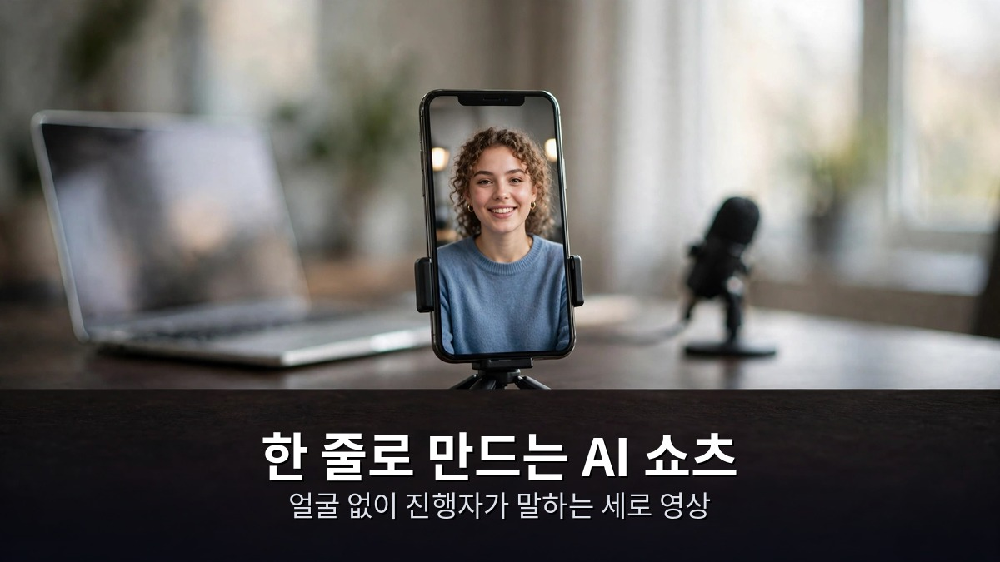
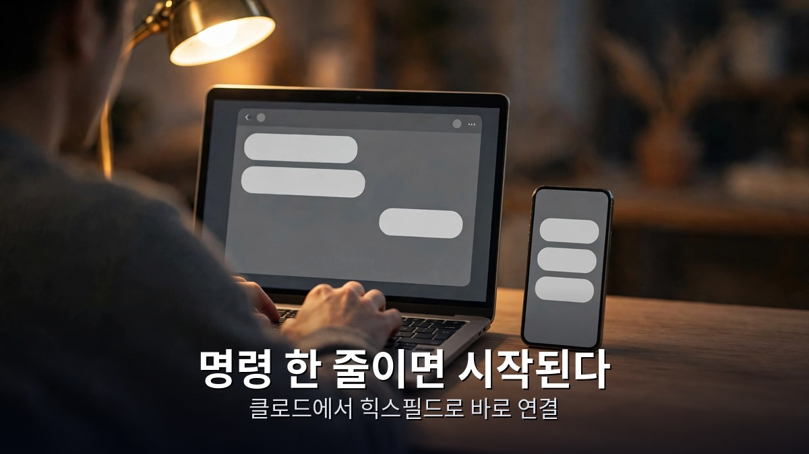
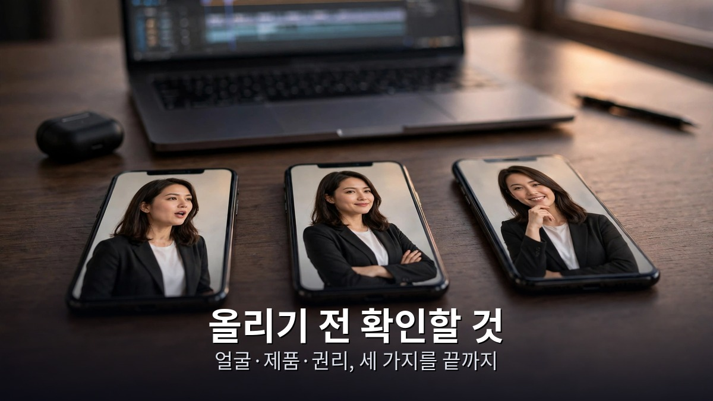

<!-- 본문 시작 -->



쇼츠 한 편에 크레딧 320개에서 600개가 들었다.
힉스필드 쇼츠 스튜디오는 클로드 채팅창에 '/shorts-studio'라고 치면 AI 진행자가 대신 말하는 세로 영상을 만든다.
카메라 앞에 설 필요는 없지만, 비용과 권리 확인은 직접 챙겨야 한다.

```blog
type: text
runs:
  - text: "힉스필드 쇼츠 스튜디오는 클로드에서 한 줄 명령으로 AI 진행자가 말하는 세로 쇼츠를 만들며, 15초 기본 화질 90크레딧부터 2분 고화질 1,920크레딧까지 길이와 화질에 따라 비용이 달라진다. 무료 체험은 플러스 요금제 3일과 크레딧 100개가 주어지지만, 카드 등록이 필요하고 3일이 지나면 자동으로 유료로 전환된다."
    style: {bold: true, color: "#007aa6"}
```

같은 도구로 만든 단편영화가 궁금하다면 [클로드 힉스필드 AI 단편영화](https://blog.naver.com/3700708/224483146108)에서 같은 얼굴 13명을 끝까지 유지한 방법을 먼저 보면 된다.

```blog
type: heading
level: 2
runs:
  - text: "한 줄 명령으로 쇼츠는 어떻게 만드나?"
    style: {bold: true, color: "#007aa6"}
```



노트북 채팅창 앞에 앉은 사람의 어깨 너머 풍경, 옆에 세운 세로 영상 목업

만드는 순서는 네 가지를 고르는 일부터 시작한다.
참고 영상, 진행자, 목소리, 대본이다.
참고 영상은 따라 하고 싶은 쇼츠의 움직임을 가져오는 재료다.
진행자는 화면에 나오는 AI 인물이고, 목소리는 그 진행자에게 어울리는 소리를 고른다.
대본은 진행자가 말할 문장이다.

공식 안내에 따른 단계는 여덟 가지다.
쇼츠 스튜디오를 열고 생성을 시작하면, 참고 자료를 고르고 진행자를 추가한다.
목소리는 남성·여성·직접 지정·자동 생성 가운데 고를 수 있다.
자동 생성은 올린 진행자에 어울리는 목소리를 만들어 준다.
주제를 적으면 대본이 생성되고, 길이와 화질을 고른 뒤 힉스필드 웹사이트에서 만들지 클로드에서 이어서 만들지 정한다.

길이는 15초, 30초, 1분, 2분 가운데 고른다.
화질은 기본과 고화질 두 가지다.
기본은 빠르고 저렴한 대신 화질이 보통이고, 고화질은 비용이 더 들고 시간도 더 걸린다.
프리셋은 25종 이상이다.

재료는 최대 38장까지 쓸 수 있다.
진행자·제품·옷 사진이나 영상이다.
이미 계정에 있는 자료는 업로드·AI 인플루언서·생성 기록·좋아요 목록에서 바로 고를 수 있어 다시 올릴 필요가 없다.
움직임을 가져올 참고 영상은 10초에서 120초 사이여야 한다.

클로드 연결은 한 번만 하면 된다.
클로드 설정에서 커넥터를 열고 힉스필드를 추가한 뒤 계정에 로그인해 권한을 부여하는 방식이다.
연결 방식은 MCP라는 표준 연결 규격이다.
연결이 끝나면 채팅창에 '/shorts-studio'라고 치는 것으로 쇼츠 제작이 시작된다.
감독은 클로드, 실행은 힉스필드라는 역할 분담이다.

영상에서는 쇼츠 3편을 만드는 과정이 나왔다.
진행자는 앞서 단편영화의 주인공 13명 가운데 2명을 골라 썼다.
첫 번째 쇼츠는 참고 영상을 갤러리에서 고르고 대본을 직접 써서 600크레딧이 들었다.
두 번째 쇼츠는 같은 참고 영상에 다른 진행자를 쓰고 클로드가 대본을 썼는데, 배경을 다시 쓰는 방식으로 480크레딧이 들었다.
세 번째는 같은 대본에서 처음 2초만 바꿔 비교하는 훅 세트로, 320크레딧이 들었다.
만든 쇼츠는 편집하고 저장해 올리는 과정까지 이어진다.

```blog
type: heading
level: 2
runs:
  - text: "쇼츠 한 편에 크레딧은 얼마나 드나?"
    style: {bold: true, color: "#007aa6"}
```

```blog
type: text
runs:
  - text: "공식 요금표 "
    style: {bold: true, color: "#ff008c"}
  - text: "— 플러스 요금제(월 49달러, 크레딧 1,000개) 기준, 2026년 11월 확인"
```

비용은 길이가 길어질수록, 화질이 높아질수록 늘어난다.
공식 요금표는 아래와 같다.
정확한 비용은 생성 버튼에 만들기 전에 표시된다.

| 길이 | 화질 | 크레딧 | 예상 비용 |
|---|---|---|---|
| 15초 | 기본 | 90 | 4.41달러 |
| 15초 | 고화질 | 240 | 11.76달러 |
| 30초 | 기본 | 180 | 8.82달러 |
| 30초 | 고화질 | 480 | 23.52달러 |
| 1분 | 기본 | 360 | 17.64달러 |
| 1분 | 고화질 | 960 | 47.04달러 |
| 2분 | 기본 | 720 | 35.28달러 |
| 2분 | 고화질 | 1,920 | 94.08달러 |

예상 비용은 플러스 요금제 월 49달러에 크레딧 1,000개 기준이다.
1분 고화질 한 편이 47달러를 넘는다는 뜻이라, 길이를 늘리기 전에 요금제를 먼저 따져봐야 한다.
15초 기본 한 편은 4.41달러로, 같은 길이 고화질(11.76달러)의 40%도 안 된다.

영상에서 밝힌 세 편의 사용량은 요금표와 같은 기준이 아니다.
첫 편 600크레딧, 두 번째 편 480크레딧, 훅 세트 320크레딧이다.
이 수치들은 영상의 길이와 화질 설정이 공개되지 않아 요금표와 직접 견주기는 어렵다.
다만 한 가지는 분명하다.
대본을 직접 쓰느냐 클로드가 쓰느냐, 배경을 다시 쓰느냐에 따라 같은 쇼츠라도 크레딧이 달라진다.
처음 2초만 바꾸는 실험은 320크레딧으로, 세 편 가운데 가장 적게 들었다.

요금제 자체도 따져봐야 한다.
힉스필드는 월 9달러에 크레딧 120개인 기본부터 월 79달러에 1,800개인 맥스까지 여러 요금제를 판다.
클로드 연결로 결제하는 플러스는 월 49달러에 크레딧 1,000개다.
어떤 요금제든 한 달에 받은 크레딧은 그달 안에 써야 하고, 다음 달로 넘어가지 않는다.
버린 장면에도 크레딧이 다시 들어가니, 다시 만들 때마다 비용이 쌓인다.

무료 체험은 가입하면 플러스 요금제를 3일 동안 0달러로 쓰고, 클로드에서 쓸 크레딧 100개를 받는다.
다만 카드 등록이 필요하다.
3일이 지나기 전에 해지하지 않으면, 가입할 때 안내된 가격으로 유료 플러스가 자동으로 시작된다.
해지는 클로드에 "cancel auto-renewal"이라고 치면 된다.

```blog
type: text
runs:
  - text: "무료 체험은 3일이 지나면 자동으로 유료 플러스로 전환된다. 해지하지 않으면 결제가 시작되니, 체험 전에 해지 방법을 먼저 확인해 두는 게 좋다."
    style: {bold: true, background: "#FFF3CD"}
```


세로로 든 스마트폰 화면 속 AI 진행자와 가죽 가방, 옆 탁자에 놓인 동전과 지갑

진행자 얼굴을 먼저 고정하는 방법은 [힉스필드 캐릭터 시트 만드는 법](https://blog.naver.com/3700708/224476482529)에서 만드는 순서부터 확인하면 된다.

```blog
type: heading
level: 2
runs:
  - text: "따라 하기 전에 무엇을 확인해야 하나?"
    style: {bold: true, color: "#007aa6"}
```

```blog
type: text
runs:
  - text: "게시 전 확인 "
    style: {bold: true, color: "#ff008c"}
  - text: "— 올리기 전에 쇼츠 전체를 끝까지 보고 다섯 가지를 확인한다"
```

올리기 전에 확인할 다섯 가지는 공식 안내에 적혀 있다.
진행자 얼굴이 처음부터 끝까지 같은지, 제품의 모양·색·라벨이 움직이면서도 그대로인지, 말하는 내용이 대본과 맞고 길이에 들어가는지, 참고 영상에서 가져온 움직임이 새 진행자에게 자연스러운지, 진행자 얼굴과 제품이 9:16 화면 가장자리에서 떨어져 있는지다.
가장자리는 자막과 플랫폼 버튼이 가리는 자리라, 중요한 요소가 닿으면 안 된다.

권리 확인은 따로 챙겨야 한다.
쇼츠에 들어가는 모든 인물·사진·영상은 권리가 정리된 것만 써야 한다.
참고 영상도 마찬가지다.

```blog
type: text
runs:
  - text: "실존 인물의 얼굴을 쓸 때는 본인 허락이 필요하다. 참고 영상의 권리도 직접 확인해야 한다."
    style: {bold: true, background: "#FFF3CD"}
```

연결했다고 무료로 쓸 수 있는 건 아니다.
힉스필드 커넥터로 만드는 모든 생성은 크레딧이 차감된다.
웹에서 쓰는 무제한 혜택은 힉스필드 웹사이트에서만 적용되고, 커넥터 경유 생성에는 적용되지 않는다.
유료 구독이 필요한 이유다.
무료 요금제는 월 크레딧이 없고, 생성마다 워터마크가 붙고, 상업적 이용도 안 된다.



책상 위에 놓인 스마트폰 세 대, 각기 다른 포즈의 같은 AI 진행자를 보여주는 화면

**확인된 사실과 아직 주장인 것**
확인된 것은 쇼츠 스튜디오가 세로 9:16 영상을 AI 진행자와 함께 만든다는 점, 재료 최대 38장·참고 영상 10초에서 120초·길이 15초에서 2분·화질 기본과 고화질·프리셋 25종 이상이라는 설정, 공식 요금표의 크레딧과 예상 비용, 무료 체험 3일과 크레딧 100개·카드 등록·자동 전환 조건, 영상에서 밝힌 세 편의 사용량 600·480·320크레딧이다.
아직 주장으로 남는 것은 클로드가 대본을 쓰고 배경을 다시 쓰는 방식이 항상 더 저렴하다는 판단이다.
영상 속 세 편은 설정이 공개되지 않아, 같은 조건에서 다시 만들면 같은 크레딧이 든다고 단정할 수 없다.
"처음 2초만 바꾸면 반응이 달라진다"는 비교도 진행자의 실험 설계에 따른 것이고(진행자 견해), 조회수나 반응 수치가 공개된 것은 아니다.
이 영상은 힉스필드 지원을 받아 제작됐다고 설명란에 적혀 있다.
요금은 2026년 안에 여러 번 바뀌었으니, 이 글의 가격은 확인 날짜 기준으로 읽어야 한다.

얼굴을 비추지 않고도 진행자가 있는 쇼츠를 만들 수 있다는 건, 카메라 앞이 부담이던 사람에게는 문이 하나 열리는 일이다.
다만 비용은 편 수에 따라 쌓이고, 얼굴이 고정된다고 해서 영상이 저절로 좋아지는 건 아니다.
대본 한 줄과 처음 2초를 바꾸는 실험이 크레딧을 아끼는 길이라면, 그 실험을 설계하는 손은 여전히 사람의 몫이다.
쇼츠를 시작하려는 사람이라면, 무료 체험 3일 안에 한 편을 끝까지 만들어 보고 나서 계속할지를 정하는 게 순서일 것 같다.

## 자주 묻는 질문

**무료 체험으로 뭘 만들 수 있나요?**

가입하면 플러스 요금제를 3일 동안 0달러로 쓰고, 클로드에서 쓸 크레딧 100개를 받는다. 카드 등록이 필요하다. 3일이 지나기 전에 해지하지 않으면 가입할 때 안내된 가격으로 유료 플러스가 자동으로 시작된다. 해지는 클로드에 "cancel auto-renewal"이라고 치면 된다. 100크레딧으로는 15초 기본 쇼츠 한 편(90크레딧)을 만들 수 있는 수준이다.

**클로드 무료 요금제에서도 쓸 수 있나요?**

클로드 무료 요금제는 사용자 지정 커넥터를 1개까지 쓸 수 있다. 힉스필드를 연결하는 것 자체는 무료 요금제에서도 된다. 다만 힉스필드 쪽에서 유료 구독이 필요하고, 커넥터로 만드는 모든 생성은 크레딧이 차감된다. 웹의 무제한 혜택은 커넥터 경유 생성에 적용되지 않는다.

**만든 쇼츠를 광고나 상업용으로 써도 되나요?**

힉스필드 무료 요금제로 만든 영상에는 워터마크가 붙고 상업적 이용이 안 된다. 유료 요금제를 쓰더라도 등장하는 인물·제품·참고 영상의 권리는 직접 확인해야 한다. 실존 인물의 얼굴을 쓸 때는 본인 허락이 필요하고, 권리가 정리되지 않은 참고 영상은 움직임 재료로 쓸 수 없다.

## 함께 보면 좋은 글

[클로드 힉스필드 AI 단편영화｜같은 얼굴 13명 유지법](https://blog.naver.com/3700708/224483146108)

[2001: 스페이스 오디세이｜HAL은 왜 거짓말했나](https://blog.naver.com/3700708/224481444262)

<!-- 본문 끝 -->

## 작업용 출처·이미지 정보 (업로드 제외)

**출처**
- 영상 설명문: 오후다섯씨 DDnGdw1FYik (2026-11-20 업로드, "클로드 한 줄로 AI 쇼츠 만들기! 얼굴 없이 AI 인플루언서 3편, 크레딧까지 공개 | 힉스필드 쇼츠 스튜디오"): '/shorts-studio' 명령, 참고 영상·진행자·목소리·대본 네 가지 선택, MCP 한 번 연결, 세 편 사용량 600·480·320크레딧, 훅 세트 처음 2초 교체, 무료 체험 플러스 3일 0달러·크레딧 100개·카드 등록·자동 전환·"cancel auto-renewal" 해지, 힉스필드 지원 제작 표기
- Higgsfield 공식 블로그, "Higgsfield Introduces Shorts Studio: Create Shorts With an AI Presenter", 2026-11-04: 세로 9:16·AI 진행자, 재료 최대 38장, 참고 영상 10~120초, 길이 15초·30초·1분·2분, 기본·고화질, 프리셋 25종 이상, 8단계 제작 순서, 요금표(15초 기본 90크레딧 4.41달러~2분 고화질 1,920크레딧 94.08달러, 플러스 월 49달러·1,000크레딧 기준, 2026년 11월 확인), 게시 전 확인 5가지, 권리·실존 인물 허락 안내
- bto.ai, "Can Claude make videos? Higgsfield MCP setup, cost and limits" (2026-11-02 기준): MCP 서버 주소, 유료 구독 필요, MCP 경유 생성은 크레딧 차감·웹 무제한 혜택 미적용, Starter 월 19달러·270크레딧, Plus 월 59달러·1,200크레딧
- Creator Tribune, "Higgsfield AI Review With the Credit Costs Plans Leave Out" (2026-11-10 확인): 요금제 월 9달러·120크레딧부터 월 79달러·1,800크레딧, 플러스 49달러·1,000크레딧, 크레딧 월말 소멸
