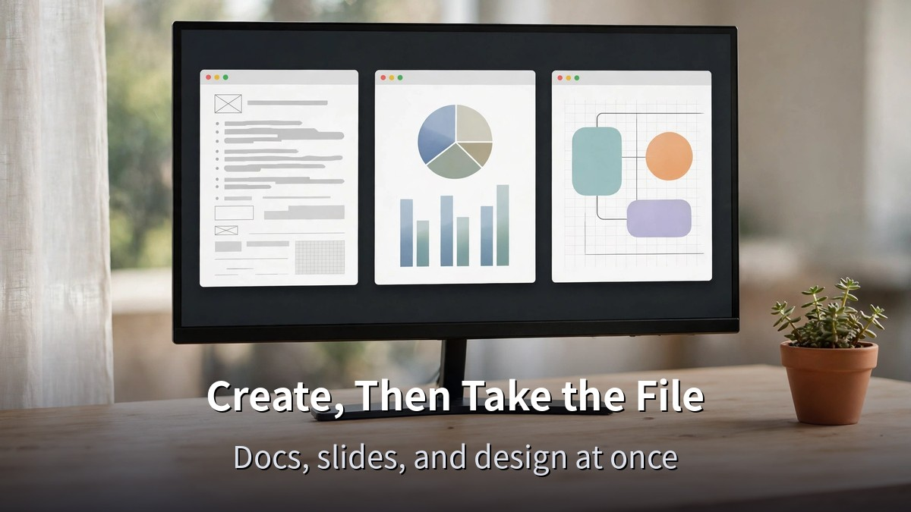

<!-- 본문 시작 -->

Claude works best in one order: ask, create, delegate, then let it work on your computer.
Someone who only used a single chat window starts making documents and slides, sets scheduled tasks, and hands work to the desktop app.
As of November 2026, prices run in four tiers, from free to Ultra at $200 a month, and coding starts with Pro at $20 a month.
Follow the map and the plan and first step for your own use become clear right away.

> **In one line, Claude goes from asking in a chat window to making documents, slides, and designs, then to scheduled tasks and the desktop app doing the work for you. Prices run in four tiers from free to Ultra at $200 a month, and Pro at $20 a month is the first step if you want it to handle code.**

Frontier model prices keep moving, and the [GPT-6.2 Astra price](https://aitechnotesen.blogspot.com/2026/11/gpt-62-astra-pricewhat-it-costs-and-how.html) breakdown shows what a top model costs to run, which is the right context before picking a Claude plan.

## How Much Does Claude Cost?

A person typing a question into a laptop chat window to start a conversation

There are four tiers.
Free costs $0, and Pro costs $20 a month.
Max costs $100 a month, and Ultra costs $200 a month.

| Plan | Monthly price | Usage and what is included |
| --- | --- | --- |
| Free | $0 | Limited usage every 5 hours and every week, up to 5 projects |
| Pro | $20 a month ($17 a month on annual billing) | At least 5x Free usage, Claude Code included |
| Max | $100 a month | 5x Pro usage, Fable included, $100 a month in API credits |
| Ultra | $200 a month | 10x Pro weekly usage, no 5-hour limit, $200 a month in API credits |

Paying for Pro a year at once costs $200.
Paid month by month, a year costs $240, so annual billing saves $40.

Prices are US list prices before tax, as shown on the official pricing page.
Paying through the App Store or Google Play can cost a different amount, so it is worth checking the number on the pricing page before subscribing.

Claude Code is not in the Free plan.
Coding work needs a paid plan, so anyone hitting a wall while coding on Free should check the feature range first, not the plan name.

Teams have a separate plan.
A Standard seat costs $25 a month, or $20 a month on annual billing, and a Premium seat costs $125 a month, or $100 a month on annual billing.
A team can run from 2 to 150 people, and the two seat types can be mixed in one team.
Enterprise costs $20 per seat a month plus API usage, billed annually.

Usage draws from one pool across web, desktop, mobile, and Claude Code.
Heavy use in one place shrinks what is left everywhere else.

## How Do You Actually Use Claude?

A work screen with a document, a slide deck, and a design canvas open side by side

The map reads in four steps.
Ask, create, delegate, and let it work on your computer.

Asking starts in a single chat window.
Type a question and an answer comes back, and adding a slides command turns the answer into a draft deck right away.
Memory remembers earlier conversations, so the same explanation does not need repeating.

Creating means taking the result as a file.
Documents, slides, designs, sheets, and whiteboards can all be made inside the chat window.
Long results open as artifacts in a side window, where they are easy to revise.

Delegating means letting Claude start work at a set time.
With a scheduled task in place, the phone is only for decisions.
Morning reports and weekly recurring summaries fit this step well.

Letting it work on your computer continues in the desktop app.
With auto mode on, Claude reads files and moves between apps to get work done.
It also works inside existing apps such as Word, Adobe tools, and Chrome.
Using Claude inside Chrome needs Pro or above.

Several Claudes can also work together.
Split the work and one gathers material while another drafts.
This fits days when several jobs need to move at once.

Duet, personal finance, and meeting features were introduced in the video as coming soon.
They are not released yet, so they cannot be used now. Check again after launch before deciding whether to use them.

## Who Is Each Plan For?

A person at a breakfast table looking at a phone while choosing a plan for the day

Pick a plan by how much you use it and what you hand over.
More use does not mean a better plan. The plan that fits your work is the better plan.

**For occasional questions and summaries —** Free is enough. Five projects, artifacts, and making documents and slides are all in the free tier.

**For everyday work —** Pro is the baseline. Claude Code, scheduled tasks, and using Claude inside Chrome all open up, and usage rises to at least 5x Free.

**For all-day use —** look at Max or Ultra. Max gives 5x Pro, and Ultra gives 10x Pro weekly usage with no 5-hour limit.

Models are picked by the job.
Haiku suits fast, light work, Sonnet suits everyday questions and drafts, and Opus suits long plans and complex code.
Fable is the top model for analysis that needs deep thinking, and it is available on paid plans.

Free leans on the base models, while Opus and Fable open up on paid plans.
Starting with the most expensive model burns through usage fast, so light work belongs on a light model.

The map makes Claude feel less like a grand tool and more like a tool with an order to it.
Start by asking, move into making, then into delegating, and it becomes clear where things stall.
Prices work the same way. Start free and step up only where it runs short.
Next time, the plan is to find my place on the map first and try just one next step.

## Frequently Asked Questions

**Where do I pay, and what happens if I cancel?**

Change plans in Settings under Billing. After canceling, the plan stays active until the end of the current billing period. Cancel at least 24 hours before the renewal date to avoid the next charge. Chats and projects stay after canceling.

**What happens when I run out of usage?**

When a 5-hour window limit is reached, waiting for the window to pass restores access. On paid plans, usage credits can be switched on to keep working at API rates. Remaining usage can be checked in Settings under Usage.

**How large is the context window?**

It varies by model, but reaches up to 1 million tokens. That is the reference point when dropping in a long document for a summary or a comparison. Longer documents burn usage faster, so trimming to the needed part works better.

## Good Reads

[GPT-6.2 Astra Price｜What It Costs and How to Use It](https://aitechnotesen.blogspot.com/2026/11/gpt-62-astra-pricewhat-it-costs-and-how.html)

[Terminator 2: Judgment Day｜Why Did Skynet Target Humanity](https://aitechnotesen.blogspot.com/2026/11/terminator-2-judgment-daywhy-did-skynet.html)

<!-- 본문 끝 -->

## 작업용 출처·이미지 정보 (업로드 제외)

**Sources**
- Anthropic official pricing page (claude.com/pricing, checked directly 2026-11-20): Free $0, Pro $20/month ($17/month annual, $200 upfront), Max $100/month (5x Pro), Ultra $200/month (10x Pro weekly, no 5-hour limit), Enterprise $20/seat/month plus API usage, up to 5 free projects, context window up to 1M tokens, shared usage pool, billing, cancellation, and usage credit guidance
- Team plan figures (checked against official pages 2026-11-05 to 2026-11-12): Standard seat $25/month ($20 annual), Premium seat $125/month ($100 annual), 2 to 150 seats, seats can be mixed, Claude Code included in both
- honjobs, "The Ultimate Claude Guide: Master Everything with This One Map (Latest Edition)", video description and timeline (uploaded 2026-11-20): ask, create, delegate, assign tasks map; chat window, slides, memory; documents, slides, design, sheets, whiteboards; Word, Adobe, Chrome; scheduled tasks; desktop app, auto mode; teaming up multiple Claudes; Duet, personal finance, and meetings as coming soon
- Model lineup (Haiku, Sonnet, Opus 5.5, Fable): checked against official pages 2026-11-12
