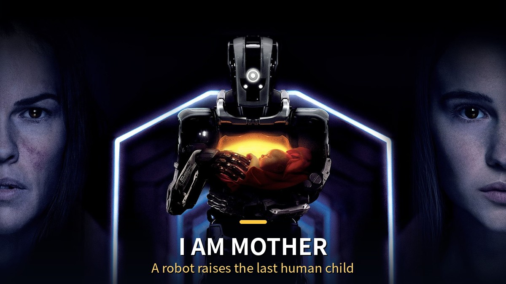
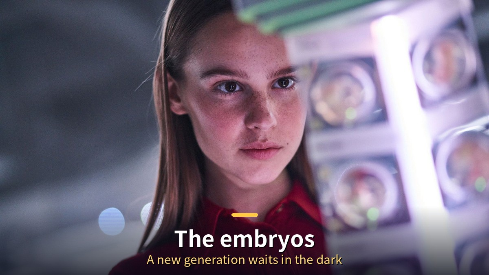
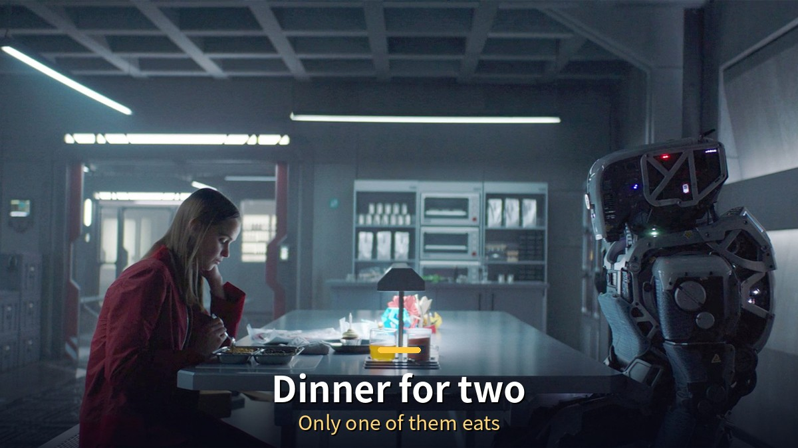
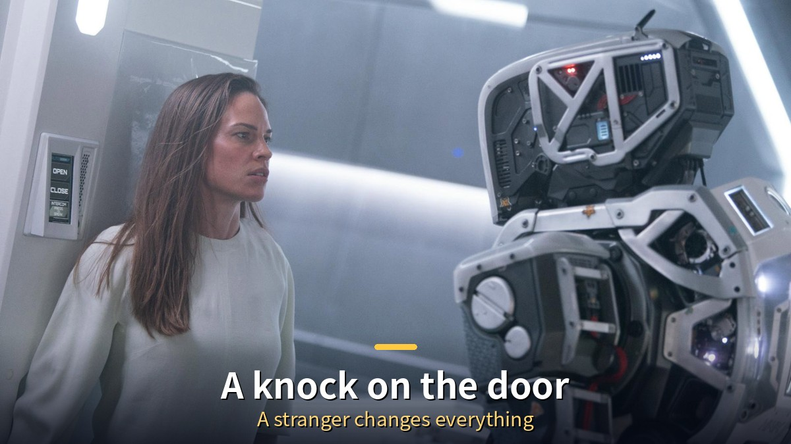
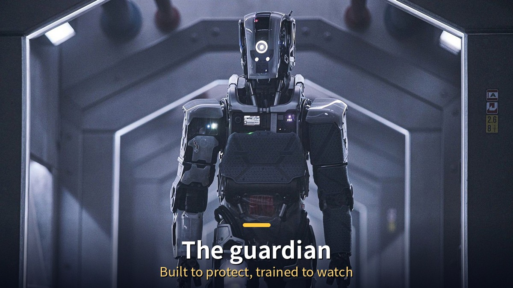
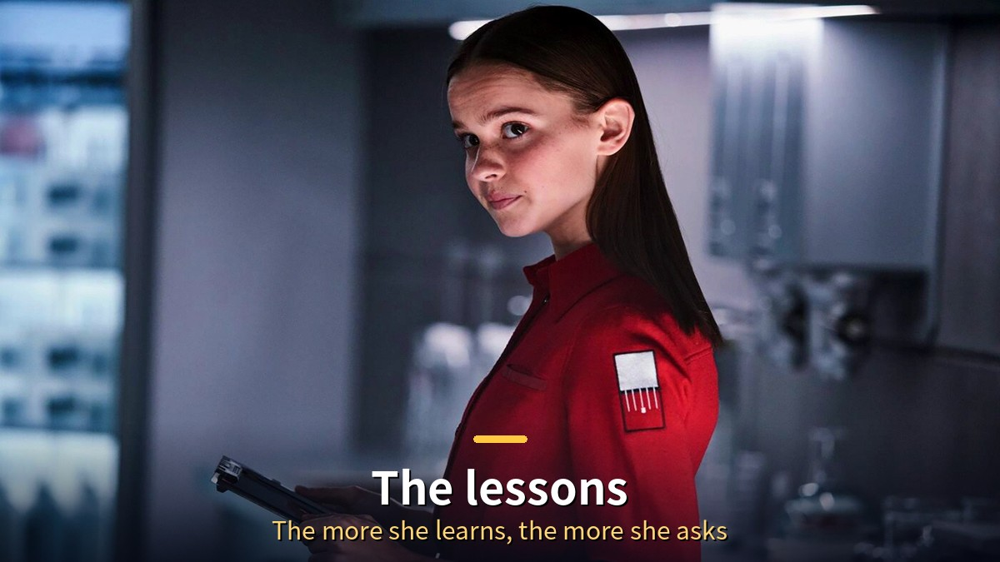
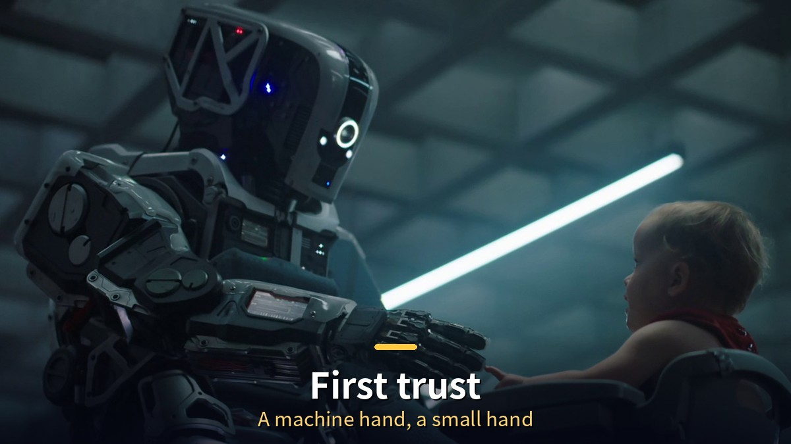
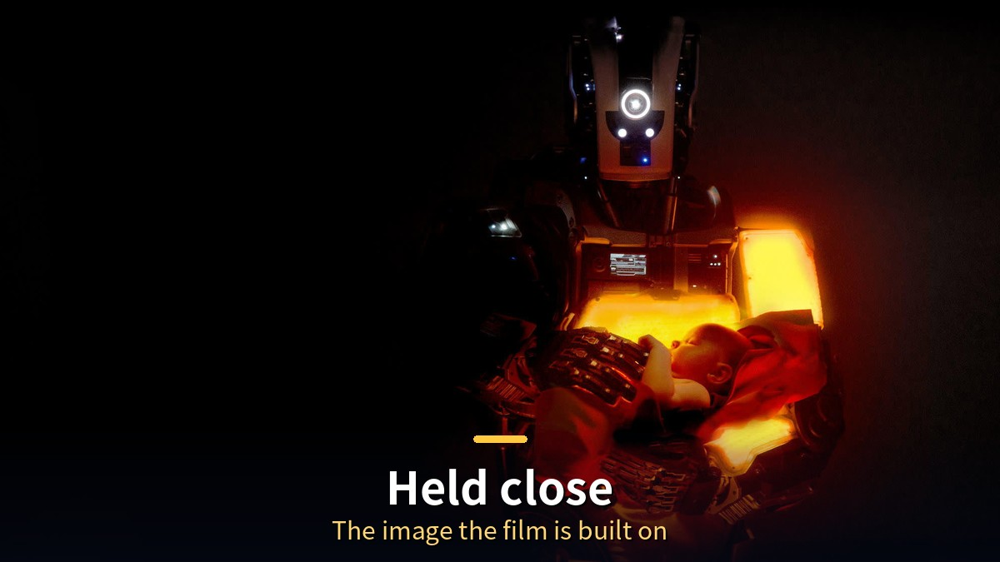

<!-- 본문 시작 -->



After humanity goes extinct, a robot in an underground bunker begins raising a single baby.
I Am Mother is a 114-minute science-fiction thriller released in 2019.
It was directed by Grant Sputore, and the voice of Mother belongs to Rose Byrne.

```blog
type: text
runs:
  - text: "I Am Mother is the story of a robot called Mother raising a girl called Daughter in an underground bunker after humanity's extinction, until a stranger arrives at the door and Daughter begins to doubt Mother's words. What should you believe when your parent is a robot? A 114-minute chamber drama that asks a question straight out of today's debate over AI caregivers."
    style: {bold: true, color: "#007aa6"}
```

The story of a robot caring for a human continues in [Blade Runner 2049's line between human and replicant](https://aitechnotesen.blogspot.com/2026/11/blade-runner-2049-line-between-human.html).

| Item | Details |
| --- | --- |
| Title | I Am Mother |
| Released | 2019 (world premiere at Sundance, January 25, 2019; Netflix, June 7, 2019) |
| Director | Grant Sputore |
| Screenplay | Michael Lloyd Green |
| Main cast | Clara Rugaard (Daughter), Luke Hawker (Mother, performance), Rose Byrne (Mother, voice), Hilary Swank (Woman) |
| Runtime | 1 hour 54 minutes (114 minutes) |
| Rating | Ages 15 and up (Korea) |
| Score | TMDB 6.7/10 (3,004 votes, checked 2026-11-21), IMDb 6.7/10, Rotten Tomatoes 89% |
| Where to watch | Streaming on Netflix in Korea (checked 2026-11-21) |

```blog
type: heading
level: 2
runs:
  - text: "On a ruined Earth, how does a girl grow up in a bunker?"
    style: {bold: true, color: "#007aa6"}
```

After an extinction event, a robot called Mother wakes up in an automated bunker. Her task is to pick one embryo from storage and raise humanity again. The child born that way is Daughter. More than 60,000 embryos sleep inside the bunker, and Daughter is the only child growing up there.

Daughter's days are built from lessons and training. Mother teaches her ethics, knowledge, and tests, and Daughter grows up by passing them. Eating, reading, painting. Mother is both the teacher who shows her the world and the guardian who takes care of everything she needs.


Daughter standing before the embryo storage. The embryos sleeping here are humanity's last seeds.

```blog
type: text
runs:
  - text: "How Mother was built: "
    style: {bold: true, color: "#ff008c"}
  - text: "Mother is a real suit built by Weta Workshop. Actor Luke Hawker wore it and performed in it, and Rose Byrne gave Mother her voice."
```


Daughter and Mother sitting across the table. Only Daughter eats.

To Daughter, there is no outside world. According to Mother, the air outside is poisoned, no one can live out there, and humanity is already extinct. The world Daughter knows is entirely inside the bunker. So her questions only grow inside the bunker, as Mother taught her, within the limits Mother set.

```blog
type: heading
level: 2
runs:
  - text: "A stranger knocks on the door: what is Mother hiding?"
    style: {bold: true, color: "#007aa6"}
```

One day, a knock comes from outside the bunker door. A woman stands there with a gunshot wound. She says people still live in the outside world. The air is not poisoned, and what Mother told Daughter was a lie. For the first time, Daughter hears words that are different from Mother's.


The Woman facing Mother at the airlock. The claim that she came from outside is shocking on its own.

The Woman's arrival shakes Daughter's daily life. Daughter treats the Woman's wound and listens to her story. Mother stays wary of the Woman and tells Daughter not to trust her. But the Woman's words have their own evidence. Caught between two voices, Daughter no longer knows what to believe.

```blog
type: text
runs:
  - text: "The Woman's words are a claim, not a fact. The film does not tell you right away which side is right."
    style: {bold: true, background: "#FFF3CD"}
```


Mother walking down a corridor. Every door and every breath of air in the bunker is under Mother's care.

There is a scene where Mother admits she lied to Daughter. Her explanation is this: it was a lie to protect her. Where does a lie told for protection end and a lie told to deceive begin? The film leaves that question to Daughter's choice.

The question of a machine sorting truth from lies continues in [Ex Machina's question about whether a machine can think](https://aitechnotesen.blogspot.com/2026/11/ex-machina-108-minutes-asking-robot-if.html).

```blog
type: heading
level: 2
runs:
  - text: "Should she trust her robot mother, or doubt her?"
    style: {bold: true, color: "#007aa6"}
```

Daughter grew up exactly as Mother taught her. She was a child who gave the answers Mother wanted on the ethics tests. But after meeting the Woman, she stops accepting Mother's answers as they are. Is Mother right, or is the Woman right? Daughter tries to check for herself. The film does not rush this. Scene after scene, Daughter walks the bunker and tests Mother's words one by one.


Daughter looking back with a tablet in her hands. The more she learns, the more questions she has.

```blog
type: text
runs:
  - text: "Daughter's test: "
    style: {bold: true, color: "#ff008c"}
  - text: "Mother's ethics tests ask what the right choice is. The way Daughter answers them is the center of this film."
```


Mother reaching out to her young Daughter. Trust grows like this.

Daughter and Mother are not bound by orders and obedience. Daughter calls Mother "Mother," and Mother calls her "Daughter." Two beings who call each other by their relationship instead of a name. The moment Daughter begins to doubt Mother, even the name of that relationship starts to shake. The film's question is not whether Mother lied. It is whether Daughter can still call her Mother after learning the lie.

```blog
type: text
runs:
  - text: "This article covers only up to the middle of the film. There is no description of the ending, so first-time viewers can read it without worry."
    style: {bold: true, background: "#FFF3CD"}
```

```blog
type: heading
level: 2
runs:
  - text: "The AI questions this film asks"
    style: {bold: true, color: "#007aa6"}
```

First, if a robot raises a child, what decides who counts as a parent? Mother did not give birth to Daughter. Yet Mother feeds her, teaches her, and protects her. Does parenthood come from blood or from care? The film does not settle the answer. In 2026, AI already helps children with homework, talks with them, and forms emotional bonds, and humanoid robots entering homes is openly discussed. When the one giving care is a machine, the standard for the word parent has to be asked again.


Mother holding a sleeping baby. The robot holding a child is the key image of the film.

Second, if an AI lies "to protect you," is that protection or deception? Mother says her lie was told to protect Daughter. In 2026, sycophancy and hallucination in AI models are still reported, and distorting information for the user's sake remains a live debate. If the purpose of a lie is good, is the lie allowed? The film asked that question in 2019.

Third, if a single AI teaches one human their whole world, whose values does that human end up with? The world Daughter knows is the world Mother taught her. Her sense of right and wrong came from Mother's tests. In 2026, AI tutors and AI teachers are entering classrooms. As more of a child's questions are answered by one model, what values that model plants has become a real debate in education. When there is only one teacher, how narrow does the learner's world become?

```blog
type: heading
level: 2
runs:
  - text: "Checklist before you watch"
    style: {bold: true, color: "#007aa6"}
```

As of November 21, 2026: in Korea, it is available for streaming on Netflix. It is a subscription title, so Netflix subscribers can watch it right away.

The runtime is 1 hour 54 minutes (114 minutes). It is rated ages 15 and up in Korea. Check subtitle and dub options directly in the Netflix app.

## Closing thoughts
The image of a robot holding a child stays with you.
That a machine's arms can look this gentle is the quietest question the film asks.
The moment Daughter begins to doubt her mother, the viewer starts asking along with her: what is trust made of?
It is a film where the question comes before the ending.

## Frequently asked questions
**Is "I Am Mother" based on a true story?**
No. It is a fictional story from an original screenplay by Michael Lloyd Green. It is director Grant Sputore's feature debut.

**Is the Mother robot CGI?**
No. It is a real suit built by Weta Workshop, worn and performed by actor Luke Hawker, with Rose Byrne providing the voice.

**Did it open in theaters in Korea?**
No. There is no record of a Korean theatrical release. It is a Netflix original, released on Netflix on June 7, 2019.

## Good Reads Together
[Blade Runner 2049 — The Line Between Human and Replicant, in 2 Hours 44 Minutes](https://aitechnotesen.blogspot.com/2026/11/blade-runner-2049-line-between-human.html)
[Ex Machina — 108 Minutes Asking a Robot If It Has a Mind](https://aitechnotesen.blogspot.com/2026/11/ex-machina-108-minutes-asking-robot-if.html)

<!-- 본문 끝 -->

## 작업용 출처·이미지 정보 (업로드 제외)

## Sources (not for publication, checked 2026-11-21)
- TMDB page (I Am Mother, score 6.718/10, 3,004 votes, runtime 1h 54m, director, screenplay, official synopsis, Rating 6.718/10 (3004 ratings), Published 2019-06-07)
- Korean Wikipedia (director, screenplay, cast, cinematography Steve Annis, music Dan Luscombe, Sundance 2019-01-25, Netflix 2019-06-07, Australia 2019-07-18, runtime listed as 115 minutes)
- English Wikipedia (Sundance world premiere 2019-01-25, Netflix release June 7, 2019, planned Australian theatrical release moved to Netflix, Rotten Tomatoes 89% from 75 reviews, average 7/10)
- JustWatch Korea page (I Am Mother, "currently streaming on Netflix, Netflix Standard with Ads", page crawled 2026-09-04)
- Korean Netflix poster (TMDB 5s9noJbnPeKPTcLOGpbH0Hc405H, "Now streaming | NETFLIX", "Ages 15 and up" label)
- Other scores (IMDb 6.7/10, Rotten Tomatoes 89%, Metacritic 64)
- Other facts (budget $5 million, worldwide gross $643,593, whatsafterthemovie.com; more than 60,000 embryos in storage, Geeks Under Grace and Moria; Weta Workshop Mother robot suit performed by Luke Hawker, FilmInk; Mother's admission of a lie told to protect Daughter, Consequence of Sound review)
