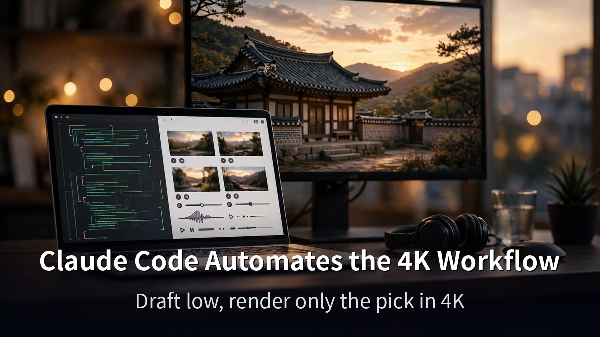
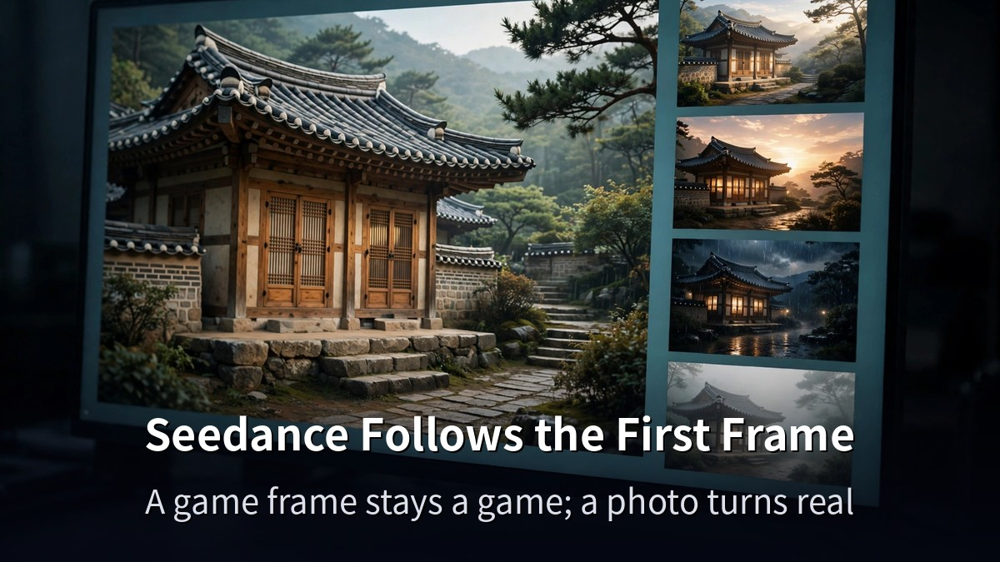
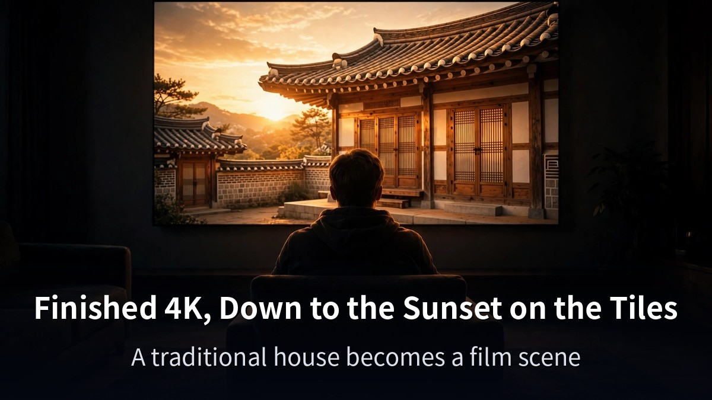

<!-- 본문 시작 -->



On Higgsfield, where one 4K render costs 140 credits, a set of four scenes in different light was finished for 204 credits.
The trick is to draft four versions at 480p first, then render only the chosen one in 4K.
Rendering all four in 4K from the start would have cost 560 credits.

```blog
type: text
runs:
  - text: "Turning the Heonanseolheon birthplace in Gangneung, built in 3D in 2023, into a photorealistic 4K film scene took 204 credits for the final cut: one photo at 4.25, four 480p drafts at 60, and one 4K render at 140. That is about 64% less than the 560 credits four 4K renders would have cost. Claude Code planned the order; a person made the choice."
    style: {bold: true, color: "#007aa6"}
```

As the [Claude Shorts Studio](https://aitechnotesen.blogspot.com/2026/11/make-ai-shorts-with-one-claude.html) post shows, Claude already connects straight to Higgsfield for short videos. This job was different: a single 4K film frame, not a short, and that is why the order mattered.

```blog
type: heading
level: 2
runs:
  - text: "Four 4K renders at 560 credits: how did 204 do the job?"
    style: {bold: true, color: "#007aa6"}
```



A cinematic scene taking shape on an AI video generation workspace

The starting point is the Heonanseolheon birthplace in Chodang-dong, Gangneung, built in 3D inside a game engine in 2023.
It was made for an augmented-reality service, then sat unused inside a computer, until now, when it is being reworked into a scene from a film.
The attempt is to turn traditional Korean architecture into video from its structure and data, not just from a flat image.

The order Claude Code planned is simple.
First, make four versions at 480p: morning, sunset, a rainy night, and fog, four kinds of light.
At 15 credits each, four drafts cost 60 credits.
Pick the one you like, then render only that one in 4K.
One 4K render costs 140 credits and takes about three minutes.

| Item | Credits |
| --- | --- |
| One photo | 4.25 |
| Four 480p drafts | 60 |
| One 4K render | 140 |
| Final cut total | 204 |
| Four 4K renders from the start | 560 |

Figures checked November 22, 2026. Credit prices are from the Higgsfield pricing page.

Sunset was the recommendation, and sunset was the pick.
Claude Code gives the opinion; the person makes the choice (presenter's view).
The morning version sprouted flower bushes that were never there, the rainy-night version flips from day to night in its first second, and in the fog version flowers slide out of frame.
No version was perfect, so a person picked the best of the four.

```blog
type: text
runs:
  - text: "The credit math: "
    style: {bold: true, color: "#ff008c"}
  - text: "One photo at 4.25 + four 480p drafts at 60 + one 4K render at 140 = 204 credits for the final cut. Four 4K renders from the start would cost 560 credits."
```

```blog
type: text
runs:
  - text: "Counting the experiments and angle tests, the day used 1,694 credits. The 64% saving applies to the final cut alone."
    style: {bold: true, background: "#FFF3CD"}
```

The saving says one thing: what costs money is not generating, but choosing.
Draft cheaply until the pick is settled, then spend the expensive resolution only on the chosen frame.

```blog
type: heading
level: 2
runs:
  - text: "A game scene went in. Why did no real footage come out?"
    style: {bold: true, color: "#007aa6"}
```


A dashboard screen showing an automation flow that cuts credit use

The first attempt failed.
With the 3D game scene as the first frame, four 480p versions changed the light but stayed a game on screen.
Pressing 4K at that point would have thrown away 140 credits.
The cause is how Seedance 2.5 handles the first frame: it carries the first frame's form forward, so a game first frame means a game result.

So the order changed.
The 3D scene was first turned into a real photo of the same composition, and that photo became the first frame.
One photo cost 4.25 credits.
Running four 480p drafts again, this time real footage came out.
If a game trailer is what you need, use the 3D scene as it is; if a film-like scene is what you need, put the photo in first.

One more thing is worth knowing.
4K is not an upscale of 480p; it is made fresh, so the result can differ slightly.
The sunset light caught on the roof tiles and the wooden lattice can still look far more detailed in 4K.
The side that kept the 3D scene stayed a grey model even in 4K.

Seedance 2.5 is the video model ByteDance announced on June 23, 2026.
Its headline figures are up to 30 seconds in one pass, native 4K, up to 50 references, and native audio made with the picture.
At the same 4K, Kling 3.0 and O3 stop at 15 seconds per clip, while Seedance 2.5 reaches 30.

| Item | Seedance 2.5 |
| --- | --- |
| Length per generation | Up to 30 seconds |
| Resolution | 480p to native 4K |
| Reference inputs | Up to 50 images, videos, and audio |
| Audio | Native audio made with the picture |

Figures checked November 22, 2026. Based on the ByteDance announcement and model specifications.

```blog
type: text
runs:
  - text: "The first-frame rule: "
    style: {bold: true, color: "#ff008c"}
  - text: "Seedance carries the first frame's form forward. If you need real footage, the first frame has to be a real photo."
```

Claude Code does more than plan the order.
It looks at the generated images, judges whether each one suits the video, and finds problems on its own.
It spotted leftover speech bubbles from the augmented-reality image, erased them, and when the erasing was not clean, found the cause and repeated the work until it was.
Repetitive fixes get bundled into rules and run as scripts or programs.
Hooks and subagents run those rules in its place.
Think when thinking is needed; run the rest as code, without AI. That is how the tokens stay low.

As the [Claude Usage Map](https://aitechnotesen.blogspot.com/2026/11/claude-usage-mapprices-from-free-to.html) post shows, knowing where and how to use Claude comes first. In this job Claude Code was the assistant that opened, wrote, and fixed files directly, while the decisions stayed with a person.

```blog
type: heading
level: 2
runs:
  - text: "Who does this order suit, and what does a month cost?"
    style: {bold: true, color: "#007aa6"}
```



A person watching one finished 4K frame on a large screen

This order suits people who already have the material: a 3D space or real photos, and a scene to try in several kinds of light.
It is closer to polishing a scene you have into something film-like than to building one from an empty screen.
If the scene itself still needs building, this order is the second step.
The next experiment, as previewed, is Claude building the 3D space itself through code (presenter's view).

Prices are from the official Higgsfield page.
Ultra gives 3,000 credits a month at $129 a month, or $99 a month on annual billing.
Plus gives 1,200 credits at $59 a month, or $47 a month on annual billing.
Starter gives 270 credits at $19 a month.
At 204 credits per final scene in this order, one month of Ultra covers about 14 scenes.
The presenter said Ultra drops from $129 to $65 a month during the Black Friday period; that is a limited-time promotional price (presenter's claim).
Black Friday prices apply to the first billing period only and renew at list price after that.
Unused credits do not roll over; they expire each cycle.

| Plan | Credits per month | Annual billing per month | List price |
| --- | --- | --- | --- |
| Starter | 270 | $19 | $19 |
| Plus | 1,200 | $47 | $59 |
| Ultra | 3,000 | $99 | $129 |

Figures checked November 22, 2026. From the official Higgsfield pricing page, taxes excluded.

```blog
type: text
runs:
  - text: "One month of credits: "
    style: {bold: true, color: "#ff008c"}
  - text: "Ultra's 3,000 credits a month cover about 14 scenes at 204 credits each in this order."
```

```blog
type: text
runs:
  - text: "4K has not opened in the United States yet, and there is no mobile app. A desktop browser is the assumed setup."
    style: {bold: true, background: "#FFF3CD"}
```

A Higgsfield community contest is open too.
The total prize pool is $1 million, first prize $200,000, and entries close on November 26.
Seedance 4K videos can be entered.

## Confirmed facts and claims, kept apart

Confirmed: the credit prices and the final-cut total, the Seedance 2.5 specifications, and the Higgsfield plans.
480p at 15 credits, 4K at 140, a photo at 4.25, the final cut at 204, and 560 for four 4K renders from the start are confirmed against the pricing page and the work log.
Seedance 2.5 at 30 seconds, 4K, 50 references, and native audio is from the ByteDance announcement.
Promo lines such as "up to 60% off for Black Friday" and the pricing page's own conversions are the maker's word.
Presenter views and demos are opinion.
Calling sunset the best pick and framing the result as "a scene from a film" are the presenter's judgments.
They do not appear in official announcements.

Changing the order alone cut the credits to about a third, and that is the point of this job.
Watching a birthplace that slept in 3D become a film scene, it feels like choosing, not generating, is the expensive part of AI video.
Next comes Claude building the space itself, and then the question will be how much of the choosing stays human.
For now, the most expensive hand is still the one that picks a frame before pressing 4K.

## Frequently Asked Questions

**Is 4K just an upscale of 480p?**

No. 4K is made fresh, not enlarged from 480p, so the 4K result can differ slightly from the draft. After rendering the chosen frame in 4K, check that the result came out as expected.

**Do Higgsfield credits roll over to the next month?**

No. Unused credits expire each cycle. An Ultra month of 3,000 credits loses whatever is left, so it pays to plan how many scenes to make in a month before picking a plan.

**Where can Seedance 2.5 be used?**

It is available on generation platforms such as Higgsfield, and the API is offered through Volcano Engine. 4K has not opened in the United States yet, desktop browsers are recommended, and there is no mobile app.

## Good Reads

[Make AI Shorts with One Claude Line｜Higgsfield Shorts Studio](https://aitechnotesen.blogspot.com/2026/11/make-ai-shorts-with-one-claude.html)

[Claude Usage Map｜Prices From Free to Ultra, Start to Finish](https://aitechnotesen.blogspot.com/2026/11/claude-usage-mapprices-from-free-to.html)

<!-- 본문 끝 -->

## 작업용 출처·이미지 정보 (업로드 제외)

**Sources**
- Higgsfield AI, Pricing (higgsfield.ai/pricing): Ultra, Plus, and Starter prices and monthly credits, checked November 22, 2026
- ByteDance, Seedance 2.5 announcement (Volcano Engine FORCE, June 23, 2026): native 4K, up to 30 seconds, up to 50 references, native audio
- Higgsfield, community contest notice: $1 million total prize pool, $200,000 first prize, closes November 26
- EmpirioLabs AI, "Seedance 2.5 vs 2.0 Pro vs Kling V3 vs Kling O3: 4K Video Compared", November 16, 2026: 4K clip length comparison (Seedance 2.5 at 30 seconds, Kling at 15)
