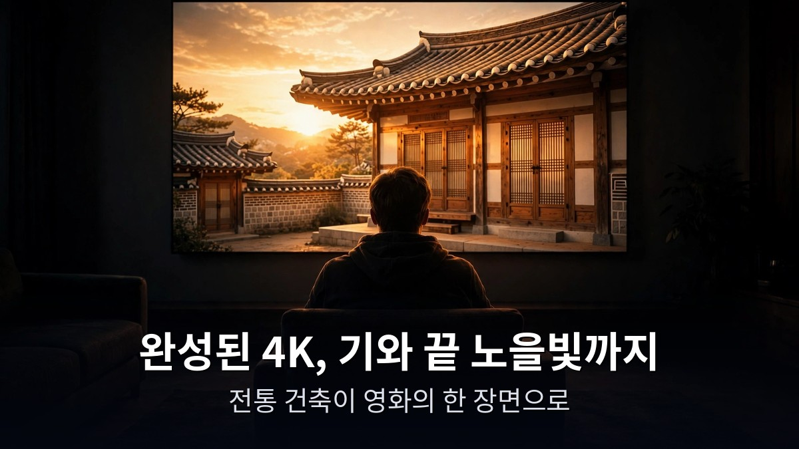

<!-- 본문 시작 -->


4K 영상 한 판에 140크레딧이 드는 힉스필드에서, 네 가지 빛의 장면을 본편 204크레딧에 완성하는 순서가 나왔다.
480p로 네 판을 먼저 뽑아 고른 뒤, 마지막 한 판만 4K로 만드는 방식이다.
처음부터 4K로 네 판을 뽑았다면 560크레딧이 들었을 작업이다.

```blog
type: text
runs:
  - text: "2023년에 3D로 지은 강릉 허난설헌 생가를 4K 실사 영화 장면으로 바꾸는 데 본편 204크레딧이 들었다. 사진 한 장 4.25, 480p 네 판 60, 4K 한 판 140을 더한 값으로, 처음부터 4K로 뽑았을 때의 560보다 약 64% 적다. 순서를 짠 건 클로드 코드, 고른 건 사람이다."
    style: {bold: true, color: "#007aa6"}
```

[클로드 쇼츠 스튜디오](https://blog.naver.com/3700708/224485641382) 글에서 본 것처럼 클로드는 힉스필드와 바로 이어져 짧은 영상을 만드는 데도 쓰인다. 이번 작업은 쇼츠가 아니라 4K 영화 장면 한 컷을 만드는 실험이었고, 그래서 순서가 결과를 갈랐다.

```blog
type: heading
level: 2
runs:
  - text: "4K 네 판 560크레딧, 어떻게 204로 줄였나"
    style: {bold: true, color: "#007aa6"}
```


시네마틱한 장면이 만들어지는 AI 영상 생성 작업 화면

출발점은 2023년에 게임 엔진 안에 3D로 만든 강릉 초당동 허난설헌 생가다.
증강현실 서비스를 위해 지은 공간이 컴퓨터 안에서 잠들어 있다가, 이제 영화의 한 장면으로 다시 쓰이는 셈이다.
우리나라 전통 건축을 단순한 이미지가 아니라 구조와 데이터를 토대로 영상으로 만드는 시도다.

클로드 코드가 짠 순서는 간단하다.
먼저 480p로 네 판을 만든다.
아침, 해질녘, 비 오는 밤, 안개까지 빛이 다른 네 가지다.
한 판에 15크레딧이라 네 판이면 60크레딧이다.
이 네 판에서 마음에 드는 한 판을 고르고, 그 한 판만 4K로 뽑는다.
4K 한 판은 140크레딧, 만드는 데 3분쯤 걸린다.

| 구분 | 크레딧 |
| --- | --- |
| 사진 한 장 | 4.25 |
| 480p 네 판 | 60 |
| 4K 한 판 | 140 |
| 본편 합계 | 204 |
| 처음부터 4K 네 판 | 560 |

수치 확인 기준: 2026년 11월 22일. 크레딧 단가는 힉스필드 요금제 페이지 기준이다.

네 판 중 해질녘이 추천으로 올랐고, 고른 것도 해질녘이었다.
의견은 클로드 코드가 내고, 고르는 건 사람이 한다(진행자 견해).
아침 판에는 없던 꽃 덤불이 생겼고, 비 오는 밤 판은 처음 1초에 낮에서 밤으로 바뀌었다.
안개 판에서는 꽃이 화면 밖으로 미끄러졌다.
완벽한 판은 없었고, 그중 가장 나은 판을 사람이 골랐다.

```blog
type: text
runs:
  - text: "크레딧 계산: "
    style: {bold: true, color: "#ff008c"}
  - text: "사진 4.25 + 480p 네 판 60 + 4K 한 판 140 = 본편 204크레딧. 처음부터 4K 네 판이면 560크레딧이다."
```

```blog
type: text
runs:
  - text: "실험과 앵글 탐색까지 합치면 당일 1,694크레딧이 들었다. 약 64% 절감은 본편 한 편에만 해당한다."
    style: {bold: true, background: "#FFF3CD"}
```

절감이 말해주는 건 하나다.
비싼 건 생성이 아니라 고르는 과정이다.
골라낼 판이 정해지기 전에는 싼 해상도로 충분히 고르고, 결정된 판에만 비싼 해상도를 쓰는 순서가 지갑을 지킨다.

```blog
type: heading
level: 2
runs:
  - text: "게임 화면을 넣었더니, 왜 실사가 안 나왔나"
    style: {bold: true, color: "#007aa6"}
```


크레딧 사용량을 줄이는 자동화 흐름을 보여주는 대시보드 화면

처음 시도는 실패했다.
3D 게임 화면을 첫 장면으로 넣고 480p 네 판을 만들었더니 빛은 바뀌었는데 화면은 그대로 게임이었다.
이대로 4K를 눌렀으면 140크레딧을 그냥 날릴 뻔했다.
원인은 시댄스 2.5의 첫 장면 처리 방식이다.
시댄스는 첫 장면의 모양을 그대로 이어가기 때문에, 첫 장면이 게임 화면이면 결과도 게임 화면이 된다.

그래서 순서를 바꿨다.
3D 화면을 같은 구도의 실사 사진으로 먼저 바꾸고, 그 사진을 첫 장면으로 삼았다.
사진 한 장에 4.25크레딧이 들었다.
다시 480p 네 판을 돌리자 이번에는 진짜 실사가 나왔다.
게임 트레일러가 필요하면 3D를 그대로 쓰면 되고, 영화 같은 장면이 필요하면 사진을 먼저 넣으면 된다.

여기서 한 가지 더 알아둘 점이 있다.
4K는 480p를 그냥 키운 게 아니라 새로 만드는 것이라, 결과가 약간 달라질 수 있다.
480p에서 본 장면과 4K 결과가 완전히 같지 않을 수 있다는 뜻이다.
다만 기와 끝이나 문살에 걸린 노을빛까지, 4K에서는 세부가 훨씬 선명하게 보인다.
3D를 그대로 넣은 쪽은 4K로 키워도 회색 모형 그대로다.

시댄스 2.5는 바이트댄스가 2026년 6월 23일 발표한 영상 생성 모델이다.
한 번에 최대 30초, 네이티브 4K, 참조 최대 50개, 영상과 함께 만드는 네이티브 오디오가 내세우는 수치다.
같은 4K라도 클링 3.0과 O3는 한 번에 15초까지, 시댄스 2.5는 30초까지 만든다.

| 항목 | 시댄스 2.5 |
| --- | --- |
| 한 번에 만드는 길이 | 최대 30초 |
| 해상도 | 480p~4K 네이티브 |
| 참조 입력 | 이미지·영상·오디오 최대 50개 |
| 오디오 | 영상과 함께 만드는 네이티브 오디오 |

수치 확인 기준: 2026년 11월 22일. 바이트댄스 발표와 모델 사양 기준이다.

```blog
type: text
runs:
  - text: "첫 장면의 법칙: "
    style: {bold: true, color: "#ff008c"}
  - text: "시댄스는 첫 장면의 모양을 그대로 이어간다. 실사가 필요하면 첫 장면부터 실사 사진이어야 한다."
```

클로드 코드의 역할은 순서 짜기에서 끝나지 않는다.
생성된 이미지를 분석하고 평가해, 영상을 만들기에 좋은 이미지인지 스스로 가려낸다.
증강현실용 이미지라 남아 있던 말풍선을 먼저 알아보고 지웠고, 깨끗하게 안 지워지자 원인을 찾아 완벽하게 지워질 때까지 반복했다.
반복되는 손질은 규칙으로 묶어 스크립트나 프로그램으로 돌린다.
훅과 서브에이전트 같은 자동화 장치가 그 규칙을 대신 실행한다.
생각할 때는 생각하고, 규칙으로 돌릴 수 있는 일은 AI 없이 프로그래밍으로 처리하는 게 토큰을 아끼는 길이다.

[클로드 사용법 지도](https://blog.naver.com/3700708/224485709482) 글에서 본 것처럼 클로드를 어디에 어떻게 쓰는지 아는 것이 먼저다. 이 작업에서 클로드 코드는 파일을 직접 열고 쓰고 고치는 조수였고, 결정은 사람이 내렸다.

```blog
type: heading
level: 2
runs:
  - text: "이 순서, 누구에게 맞고 한 달에 얼마가 드나"
    style: {bold: true, color: "#007aa6"}
```



완성된 4K 영상의 한 장면을 큰 화면으로 보는 사람

이 순서는 이미 가진 재료가 있는 사람에게 맞는다.
3D 공간이나 실사 사진, 같은 구도의 장면을 여러 빛으로 뽑아보고 싶은 경우가 그렇다.
처음부터 빈 화면에서 만드는 작업보다는, 있는 장면을 영화처럼 다듬는 작업에 가깝다.
반대로 장면 자체를 새로 지어야 한다면, 이 순서는 두 번째 단계다.
다음 실험으로 예고된 것도 클로드가 프로그래밍으로 3D 공간을 직접 짓는 과정이다(진행자 견해).

요금은 힉스필드 공식 페이지 기준이다.
울트라는 한 달 3,000크레딧에 월 129달러, 연간 결제 시 월 99달러다.
플러스는 한 달 1,200크레딧에 월 59달러, 연간 결제 시 월 47달러다.
스타터는 한 달 270크레딧에 월 19달러다.
본편 204크레딧짜리 장면을 같은 순서로 만들면 울트라 한 달 치로 14편 분량이다.
영상에서 진행자는 블랙 프라이데이 기간 울트라가 월 129달러에서 65달러까지 내려간다고 소개했는데, 이는 기간 한정 프로모션 가격이다(진행자 언급).
다만 블랙 프라이데이 할인가격은 첫 결제 기간에만 적용되고 이후에는 정가로 갱신된다.
미사용 크레딧은 다음 달로 넘어가지 않고 매 주기 소멸한다.

| 요금제 | 한 달 크레딧 | 연간 결제 월 요금 | 정가 |
| --- | --- | --- | --- |
| 스타터 | 270 | 19달러 | 19달러 |
| 플러스 | 1,200 | 47달러 | 59달러 |
| 울트라 | 3,000 | 99달러 | 129달러 |

수치 확인 기준: 2026년 11월 22일. 힉스필드 공식 요금제 페이지 기준, 세금 별도다.

```blog
type: text
runs:
  - text: "한 달 치 계산: "
    style: {bold: true, color: "#ff008c"}
  - text: "울트라 월 3,000크레딧이면 본편 204크레딧짜리 장면을 같은 순서로 14편 만들 수 있다."
```

```blog
type: text
runs:
  - text: "미국에서는 아직 4K가 열리지 않았고, 모바일 앱도 없다. 데스크톱 브라우저에서 쓰는 게 전제다."
    style: {bold: true, background: "#FFF3CD"}
```

힉스필드 커뮤니티 콘테스트도 열려 있다.
총 상금 100만 달러, 1등 20만 달러, 11월 26일까지다.
시댄스 4K 영상도 낼 수 있다.

## 확인된 사실과 주장은 이렇게 나뉜다

확인된 건 크레딧 단가와 본편 합계, 시댄스 2.5의 스펙, 힉스필드 요금제다.
480p 15크레딧, 4K 140크레딧, 사진 4.25크레딧, 본편 204크레딧과 처음부터 4K 네 판일 때의 560크레딧은 요금제 페이지와 작업 기록으로 확인된다.
시댄스 2.5의 30초·4K·참조 50개·네이티브 오디오는 바이트댄스 발표 기준이다.
제조사 주장으로 봐야 할 건 "블랙 프라이데이 최대 60% 할인" 같은 판촉 문구와 요금제 페이지의 환산 수치다.
진행자 평가와 시연은 의견이다.
"해질녘이 가장 낫다"는 선택과 "영화의 한 장면으로 바꿨다"는 틀은 진행자의 판단이다.
공식 발표에는 없는 내용이다.

순서를 바꾸는 것만으로 크레딧이 3분의 1 가까이 줄었다는 게 이번 작업의 결론이다.
3D로 잠들어 있던 생가가 영화 장면이 되는 과정을 보면, AI 영상에서 비싼 건 생성이 아니라 고르는 과정이라는 생각이 든다.
다음에는 클로드가 공간부터 직접 짓는다고 하니, 그때는 고르는 일이 어디까지 사람의 몫으로 남는지 다시 보게 될 것 같다.
아직은 4K 한 판을 누르기 전, 어떤 판을 고를지 정하는 손이 가장 비싼 셈이다.

## 자주 묻는 질문

**4K는 480p를 키운 건가요?**

아니다. 4K는 480p를 확대하는 게 아니라 새로 만드는 것이다. 그래서 480p에서 본 장면과 4K 결과가 약간 달라질 수 있다. 골라낸 판을 4K로 뽑은 뒤에는 결과가 그대로 나왔는지 다시 확인하는 게 좋다.

**힉스필드 크레딧은 다음 달로 넘어가나요?**

넘어가지 않는다. 미사용 크레딧은 매 주기마다 소멸한다. 울트라 한 달 3,000크레딧을 다 쓰지 못하면 남은 크레딧은 사라지니, 한 달에 만들 장면 수를 먼저 정해두고 요금제를 고르는 게 낫다.

**시댄스 2.5는 어디서 쓸 수 있나요?**

힉스필드 같은 생성 플랫폼에서 고를 수 있고, API는 볼케이노 엔진을 통해 제공된다. 4K는 아직 미국에서 열리지 않았고 데스크톱 브라우저 사용이 권장되며, 모바일 앱은 없다.

## 함께 보면 좋은 글

[클로드 한 줄로 AI 쇼츠 만들기｜힉스필드 쇼츠 스튜디오](https://blog.naver.com/3700708/224485641382)

[클로드 사용법 지도｜무료부터 울트라까지 가격 정리](https://blog.naver.com/3700708/224485709482)

<!-- 본문 끝 -->

## 작업용 출처·이미지 정보 (업로드 제외)

**출처**
- Higgsfield AI, Pricing (higgsfield.ai/pricing): 울트라·플러스·스타터 요금과 월 크레딧, 2026년 11월 22일 기준
- ByteDance, Seedance 2.5 발표 (Volcano Engine FORCE, 2026년 6월 23일): 4K 네이티브·최대 30초·참조 최대 50개·네이티브 오디오
- Higgsfield, 커뮤니티 콘테스트 안내: 총 상금 100만 달러·1등 20만 달러·11월 26일 마감
- EmpirioLabs AI, "Seedance 2.5 vs 2.0 Pro vs Kling V3 vs Kling O3: 4K Video Compared", 2026년 11월 16일: 4K 클립 길이 비교(시댄스 2.5 30초·클링 15초)
