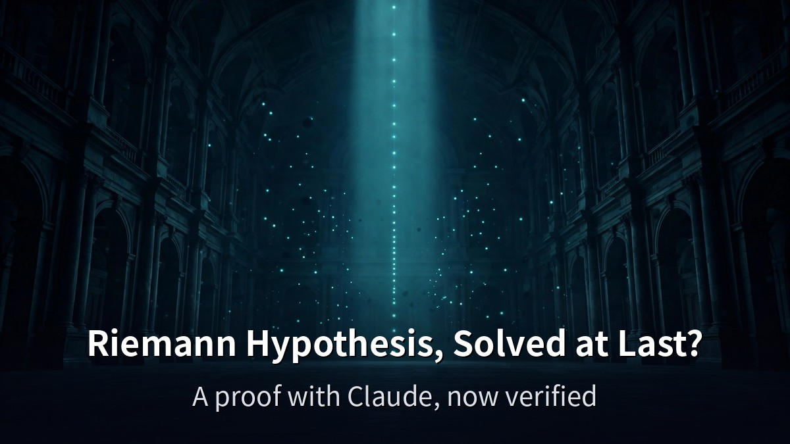
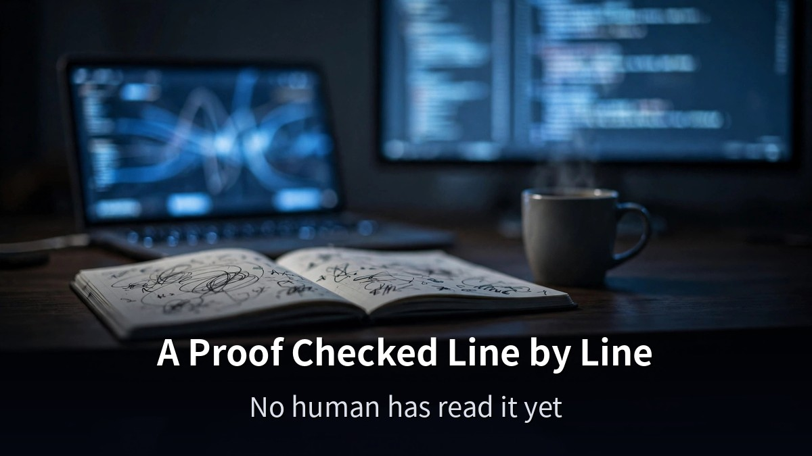
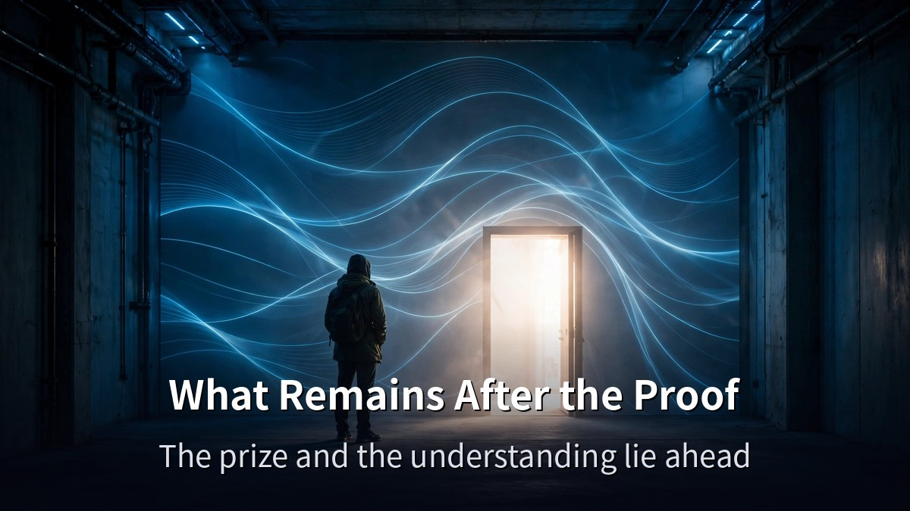

<!-- 본문 시작 -->



Anthropic mathematician Levent Alpöge says he has proved the Riemann Hypothesis, the 167-year-old problem, working with Claude.
The proof, released on November 20, arrived as 17.4 million lines of Lean code, and the next day the Lean and Mathlib communities certified it correct.
The $1 million prize is still far away, though, because journal publication and two years of scrutiny still lie ahead.

```blog
type: text
runs:
  - text: "The Riemann Hypothesis stood unsolved for 167 years after it was proposed in 1859, with a $1 million prize from the Clay Mathematics Institute. Alpöge built the proof with Claude in about six weeks, as 17.4 million lines of Lean code, and it passed the Lean and Mathlib communities' certification on November 21."
    style: {bold: true, color: "#007aa6"}
```

The proof came out the day after Anthropic went public. As [Anthropic Goes Public｜Biggest IPO Ever, Up 17% on Day One](https://aitechnotesen.blogspot.com/2026/11/anthropic-goes-publicbiggest-ipo-ever.html) shows, the company priced at $83 and closed the first day at $97.17. Two pieces of math-world news, one day apart.

```blog
type: heading
level: 2
runs:
  - text: "What is the Riemann Hypothesis, and why did it resist proof for 167 years?"
    style: {bold: true, color: "#007aa6"}
```


A question that began by candlelight has lasted more than a century

The Riemann Hypothesis is a conjecture the German mathematician Bernhard Riemann put forward in 1859.
It claims that the prime numbers, scattered seemingly at random, are governed by a hidden order.
More precisely, every nontrivial zero of the Riemann zeta function lies on a single vertical line, where the real part equals one half.
In plain terms, a rule decides where primes appear, and it holds without exception.

Why did it resist proof for so long?
The first ten trillion zeros have been checked and all sit on the line, yet a single zero off the line, anywhere beyond that range, would bring the whole conjecture down.
No amount of finite checking counts as proof.
Progress was so rare that most leading experts spent little of their time on the problem at all.

In 2000 the Clay Mathematics Institute named it one of seven Millennium Prize Problems, with $1 million for each.
So far only one, the Poincaré conjecture, has been officially resolved.
Alpöge says his proof also settles the larger Generalized Riemann Hypothesis, which extends the same order to a whole family of functions tied to the primes.
Hector Pasten, a mathematician at the Pontifical Catholic University of Chile, told Scientific American on November 20, 2026, that it amounts to "completing a dictionary between different branches of math."

Nobody expected it this fast.
The forecasting community at Metaculus had put the resolution in May 2035, as of this week, and Terence Tao had said a team of humans and AI might solve it around 2050.
Both were wrong.

```blog
type: text
runs:
  - text: "The Riemann Hypothesis in one line: "
    style: {bold: true, color: "#ff008c"}
  - text: "The primes look random, but a hidden rule decides where they fall. Proving it means showing that rule holds without exception."
```

```blog
type: text
runs:
  - text: "Ten trillion zeros checked is not a proof. One zero off the line would bring the conjecture down on the spot."
    style: {bold: true, background: "#FFF3CD"}
```

```blog
type: heading
level: 2
runs:
  - text: "A 17.4-million-line proof: how was it verified?"
    style: {bold: true, color: "#007aa6"}
```



No human read the whole proof; machines checked it line by line

Alpöge studied number theory at Harvard before joining Anthropic in 2024.
According to a timeline Claude put together for the note, the first key idea arrived on October 6, and the Generalized Riemann Hypothesis fell on November 16.
The final moment came late on a Sunday night, and the first person he messaged was Anthropic CEO Dario Amodei.

Alpöge posted a short four-page note, "Remark," on his personal website.
There is no formal paper.
The proof itself is Lean code: 17.4 million lines, 175,187 files, in 14 parts.
Compressed it is about 239 MB; unpacked, 61.6 GB.

Lean is a proof assistant.
You write a statement and a proof, and a small program called the kernel checks every step against the rules of logic.
Instead of a human reading the proof and feeling convinced, a machine checks exhaustively for any rule broken along the way.
That is why the length is not the obstacle. A proof too long for any person to read can still be checked to the end by a machine.

Verification moved fast from the day after the release.
Andrew Sutherland, a mathematician at MIT, compiled the code independently on his own machine, with zero errors.
Only the three standard axioms were used.
Independent checkers reached the same conclusion.
Nanoda, a checker written separately in Rust, accepted the full proof in 27 minutes 42 seconds, and con-leche in 3 minutes 15 seconds.

On November 21 the Lean and Mathlib communities issued a joint statement.
Endorsed by the Lean Focused Research Organization and the Mathlib Initiative, it said, "We have full confidence that Alpöge's proof of the Riemann Hypothesis is correct."
The statement matches Mathlib's own definition of the hypothesis, the code compiles without errors, the code proves the right statement, and independent checkers confirm the proof is valid.
Andrew Sutherland of MIT told Scientific American on November 20, 2026, "This is indeed an historic moment."

| Check | Result |
| --- | --- |
| Statement match | Confirmed against Mathlib's definition by two comparison tools |
| Compilation | 175,187 files, zero errors |
| Axioms | Only the three standard axioms used |
| Independent checkers | Nanoda 27 minutes 42 seconds, con-leche 3 minutes 15 seconds |
| Community certification | Joint Lean and Mathlib statement, November 21 |

Figures checked as of November 21, 2026. Based on the Lean and Mathlib communities' statement and MIT's verification page.

```blog
type: text
runs:
  - text: "The heart of the verification: "
    style: {bold: true, color: "#ff008c"}
  - text: "What was checked first was not whether a human understood the proof, but whether the code proves the right statement and passes machine checks."
```

```blog
type: text
runs:
  - text: "Compiling without errors is not the same as a human understanding the proof. The second part is only just beginning."
    style: {bold: true, background: "#FFF3CD"}
```

Claude is already a tool for mathematics research. As [Claude Usage Map｜Prices From Free to Ultra, Start to Finish](https://aitechnotesen.blogspot.com/2026/11/claude-usage-mapprices-from-free-to.html) shows, the plans from free to Ultra cover different ranges of what you can do with it.

```blog
type: heading
level: 2
runs:
  - text: "The $1 million prize: when could it be paid?"
    style: {bold: true, color: "#007aa6"}
```



An open door does not mean everything beyond it is visible

The prize follows the Clay Mathematics Institute's rules.
A solution must appear in a refereed mathematics publication, at least two years must pass after that, and it must win broad acceptance across the world's mathematics community.
Only then does the institute form a committee of experts to decide on the prize.
The institute does not accept solutions sent to it directly.
Its problem page still listed the Riemann Hypothesis as unsolved on November 20.

So the road to the prize is long.
It starts with writing a proof humans can read, then journal publication, two years of scrutiny, and a committee decision.
Alpöge himself estimates a readable write-up would run past 250,000 pages.
Mathematician Terence Tao said digesting the contents of the proof will take some time.

The Riemann result was not the only AI mathematics story this year.
In July Alpöge, working with Fable, put forward a 216-character candidate counterexample to the Jacobian conjecture, and in September an OpenAI internal model's Navier-Stokes proof claim stirred controversy.
On November 13, Google's Gemini agents announced a formalization of the Weil conjectures.
On the same day, Alpöge and Tristan Buckmaster also put forward a proof of blowup for the unforced Navier-Stokes equations.
They posted a 79-page paper with a Lean formalization, but the numerical certificate behind it has not been released yet.
The Riemann Hypothesis sits at the peak of that run.

| When | Event | Status |
| --- | --- | --- |
| July | Jacobian conjecture counterexample candidate, 216 characters | Candidate, under review |
| September | Navier-Stokes proof claim (OpenAI, 88 hours) | Under review amid controversy |
| October | Progress reported on understanding the primes (OpenAI) | Progress reported |
| November 13 | Weil conjectures formalized (Google) | Formalization announced |
| November 20 | Riemann Hypothesis proof released | Certified by the Lean community on November 21 |

Figures checked as of November 21, 2026. Based on reporting on each event and the Lean community statement.

```blog
type: text
runs:
  - text: "What to watch next: "
    style: {bold: true, color: "#ff008c"}
  - text: "A human-readable draft of the proof, journal publication, and a change on the Clay problem page must arrive in that order before the prize clock starts."
```

## What is confirmed, and what is exaggeration or speculation

What is confirmed comes down to dates and numbers.
The note on November 20, 17.4 million lines of Lean code, 175,187 files, zero-error compilation, three standard axioms, the Lean and Mathlib communities' certification on November 21, and the Clay rules on publication, two years, and acceptance.
Machine verification finishing is not the same as official acceptance finishing.
What counts as a claim is Alpöge's own wording.
He wrote that he believes he has found a proof. He chose the word believes, not a flat assertion.
Anthropic has not commented on the announcement.
On the same day, a human-written draft of the Generalized Riemann Hypothesis by Stanford postdoc Alessandro Masullo also appeared.
Terence Tao listed all three of the day's claims on his blog on November 20 without saying which, if any, is right.
Some have questioned the timing, a day after the listing.
Alpöge wrote in his note that the timing was horrible, that he wished he had finished much earlier, and that the cynical reading is false.
What counts as speculation is the leap to "AI has finished mathematics" or "disease will be solved next."
Whether curing disease comes next is still a question, not a confirmed outlook.
Nothing changes overnight either. Banks will not change, and the internet will not get faster.
The tools of mathematics research have changed, not the products we use tomorrow.

News that a problem nobody could find a path through for 167 years now has a path lands first as a feeling, before the numbers.
The part that stays with me is that a machine proved it and no human understands it yet.
Understanding will catch up slowly, and until then only the records of verification will keep piling up.
It will not change my life tomorrow, but it feels like a day to remember as the day mathematics started working differently.

## Frequently Asked Questions

**Does solving the Riemann Hypothesis reveal all the primes?**

No. It does not hand over the value of each prime. It shows that the rule governing where primes fall holds without exception. Facts already known about primes stay as they are, and the theorems proved on the assumption that the hypothesis holds become true all at once.

**Who pays the $1 million, and when?**

The Clay Mathematics Institute. A committee decides only after journal publication, two years, and broad acceptance by mathematicians worldwide. If several people solved it together, the prize can be shared.

**Can an ordinary person check the proof?**

The code is public. MIT's verification page (math.mit.edu/~drew/grh/) shows the compilation results and the checker records. Running the code, though, is not the same as understanding the proof. The second part takes time, even for experts.

## Good Reads

[Anthropic Goes Public｜Biggest IPO Ever, Up 17% on Day One](https://aitechnotesen.blogspot.com/2026/11/anthropic-goes-publicbiggest-ipo-ever.html)

[Claude Usage Map｜Prices From Free to Ultra, Start to Finish](https://aitechnotesen.blogspot.com/2026/11/claude-usage-mapprices-from-free-to.html)

<!-- 본문 끝 -->

## 작업용 출처·이미지 정보 (업로드 제외)

**Sources**
- Scientific American, "Anthropic mathematician claims to prove Riemann hypothesis, most famous problem in all of math", November 20, 2026: Alpöge's note, 17.4 million lines of Lean code, Generalized Riemann Hypothesis, Pasten and Sutherland quotes, day after Anthropic's listing
- Lean and Mathlib communities, "Lean verification of the Riemann Hypothesis", November 21, 2026: joint certification statement, four verification criteria, independent checkers
- The Wall Street Journal, "Anthropic Mathematician Says AI Has Solved the Most Famous Problem in Math", November 21, 2026: certification completed November 21, 250,000-page estimate, late Sunday night finish
- Levent Alpöge, "Remark", alpo.ge/remark.pdf, November 20, 2026: "I believe I have, working with Claude, discovered a proof of the Riemann Hypothesis"
- TheAIGRID, "AI Just Cracked One Of The Worlds BIGGEST Mystery", November 20, 2026: about six weeks of work, first idea on October 6, Generalized Riemann Hypothesis on November 16, Metaculus May 2035, Tao's 2050 outlook, chapter structure (recursive self-improvement, disease, the case for caution) · cross-checked against the transcript (transcripts.md, video 2)
- DataCamp, "Riemann Hypothesis: Two Proofs in One Day, One Using AI", November 21, 2026: the Masullo draft, Tao's remarks on the 2050s, not yet officially accepted
- nacionale, "Unforced Navier-Stokes blowup claimed: what it means", November 21, 2026: the November 20 Navier-Stokes blowup claim, 79-page paper, certificate not released, no independent check
- Terence Tao, "What's new" blog, November 20, 2026: all three claims of the day listed, "It is very early days," no verdict on which is right
- Clay Mathematics Institute, Millennium Prize rules: journal publication, two years elapsed, general acceptance, no direct submissions
- dev.to, "Riemann Hypothesis Lean proof: what the checkers actually check", November 21, 2026: 17,374,215 lines, 175,187 files, nanoda 27 minutes 42 seconds, con-leche 3 minutes 15 seconds, Tao's remark
- The Times of India, "AI cracks a mystery from 1939", 2026: Jacobian conjecture counterexample candidate of 216 characters, awaiting verification
- 36Kr, "250,000 Pages of Proof: Has the Riemann Hypothesis Been Solved by AI?", November 21, 2026: 250,000-page estimate, MIT compilation confirmed on the day of release
