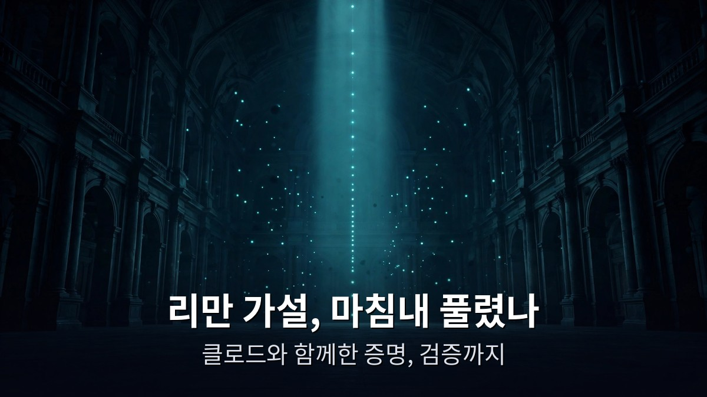
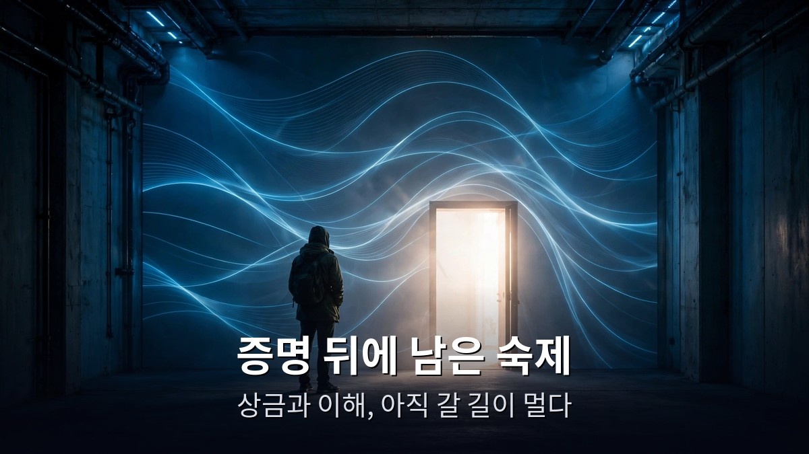

<!-- 본문 시작 -->



앤트로픽 수학자 레벤트 알포괴가 클로드와 함께 167년 난제 리만 가설의 증명을 내놨다.
11월 20일 공개된 증명은 1,740만 줄의 린 코드로 나왔고, 다음 날 린·매스립 공동체가 증명이 옳다고 인증했다.
다만 학술지 게재와 2년의 검증 기간이 남아 있어, 100만 달러 상금은 아직 멀었다.

```blog
type: text
runs:
  - text: "리만 가설은 1859년 제기된 뒤 167년 동안 풀리지 않았고, 클레이 수학연구소가 100만 달러를 걸었다. 알포괴는 클로드와 약 6주 만에 1,740만 줄의 린 코드로 증명을 만들었고, 11월 21일 린·매스립 공동체 인증까지 받았다."
    style: {bold: true, color: "#007aa6"}
```

증명이 나온 건 앤트로픽 상장 다음 날이었다. [앤트로픽 상장｜공모가 83달러, 첫날 17% 올랐다](https://blog.naver.com/3700708/224485579380) 글에서 본 것처럼 회사는 공모가 83달러로 시작해 첫날 97.17달러로 마감했다. 수학계 뉴스가 하루 차이로 이어진 셈이다.

```blog
type: heading
level: 2
runs:
  - text: "리만 가설은 무엇이고, 왜 167년 동안 못 풀었나"
    style: {bold: true, color: "#007aa6"}
```


촛불 아래서 시작된 질문이 백 년 넘게 이어졌다

리만 가설은 1859년 독일 수학자 베른하르트 리만이 내놓은 추측이다.
소수는 겉보기에 무작위로 흩어져 있지만, 그 배치를 결정하는 숨은 질서가 있다는 주장이다.
정확히는 리만 제타 함수의 자명하지 않은 0이 모두 실수부가 2분의 1인 직선 위에 있다는 내용이다.
소수가 어디에 나타나는지를 지배하는 규칙이 예외 없이 성립한다는 뜻이다.

왜 이렇게 오래 못 풀었을까.
0이 10조 개까지 줄 위에 있는 것은 확인됐지만, 그 너머에 줄을 벗어난 0 하나만 나와도 가설은 무너진다.
유한한 확인은 아무리 많아도 증명이 되지 않는다.
진전이 워낙 드물어 최고 전문가들조차 이 문제에는 시간을 거의 쓰지 않았다.

2000년 클레이 수학연구소는 리만 가설을 7대 밀레니엄 문제 중 하나로 지정하고 문제마다 100만 달러를 걸었다.
지금까지 공식 해결은 푸앵카레 추측 1건뿐이다.
알포괴는 리만 가설을 품은 더 큰 가설, 일반화 리만 가설까지 함께 증명했다고 밝혔다.
일반화 가설은 소수뿐 아니라 소수와 얽힌 함수 가족 전체에 같은 질서를 확장한 것이다.
칠레 가톨릭대 수학자 엑토르 파스텐은 2026년 11월 20일 사이언티픽 아메리칸에 "수학의 서로 다른 분야를 잇는 사전이 완성되는 셈이다"라고 말했다.

아무도 이렇게 빠를 줄은 몰랐다.
예측 시장 메타큘러스는 이번 주까지 해결 시점을 2035년 5월로 봤고, 테렌스 타오는 사람과 AI 팀이 2050년쯤 풀 수 있을 것이라고 말한 바 있다.
둘 다 빗나갔다.

```blog
type: text
runs:
  - text: "리만 가설, 한 줄로: "
    style: {bold: true, color: "#ff008c"}
  - text: "소수가 무작위처럼 보여도 그 배치를 정하는 숨은 규칙이 있다는 주장이다. 증명은 그 규칙이 예외 없이 성립함을 보이는 일이다."
```

```blog
type: text
runs:
  - text: "10조 개까지 확인됐다는 말은 증명이 아니다. 줄을 벗어난 0 하나가 나오면 가설은 그 자리에서 무너진다."
    style: {bold: true, background: "#FFF3CD"}
```

```blog
type: heading
level: 2
runs:
  - text: "1,740만 줄 증명, 검증은 어떻게 이뤄졌나"
    style: {bold: true, color: "#007aa6"}
```


증명 전체를 사람이 읽은 게 아니라, 기계가 한 줄씩 확인했다

알포괴는 하버드에서 수론을 연구하다 2024년 앤트로픽으로 옮긴 수학자다.
클로드가 정리한 일정에 따르면 첫 핵심 아이디어는 10월 6일에 나왔고, 일반화 리만 가설은 11월 16일에 풀렸다.
마지막 순간은 일요일 밤 늦은 시간이었고, 알포괴가 가장 먼저 연락한 사람은 앤트로픽 CEO 다리오 아모데이였다.

알포괴는 네 쪽짜리 짧은 노트 "Remark"를 개인 홈페이지에 올렸다.
정식 논문은 없다.
증명 본체는 린 코드 1,740만 줄, 파일 17만 5,187개, 14개 묶음으로 나왔다.
압축하면 약 239MB, 풀면 61.6GB에 이른다.

린은 증명 보조 프로그램이다.
명제와 증명을 쓰면 커널이라는 작은 프로그램이 모든 단계를 논리 규칙에 맞게 검사한다.
사람이 증명을 읽고 납득하는 방식이 아니라, 기계가 규칙 위반이 있는지 전수 검사하는 방식이다.
그래서 증명의 길이가 문제가 되지 않는다. 사람이 읽을 수 없는 길이라도 기계는 끝까지 확인한다.

검증은 공개 다음 날부터 빠르게 진행됐다.
MIT 수학자 앤드루 서덜랜드는 자기 컴퓨터에서 코드를 독립 컴파일했고, 오류는 0개였다.
사용된 공리는 표준 3개뿐이었다.
독립 검사기도 같은 결론을 냈다.
러스트로 따로 만든 검사기 나노다는 27분 42초, 콘레체는 3분 15초 만에 전체 증명을 받아들였다.

11월 21일 린·매스립 공동체는 공동 성명을 냈다.
린 FRO와 매스립 이니셔티브가 지지한 성명은 "알포괴의 리만 가설 증명이 옳다는 데 전적인 확신을 가진다"고 밝혔다.
명제가 매스립의 리만 가설 정의와 일치하고, 코드가 오류 없이 컴파일되며, 코드가 올바른 명제를 증명하고, 독립 검사기들이 증명을 유효하다고 확인했다는 것이다.
MIT 앤드루 서덜랜드는 2026년 11월 20일 사이언티픽 아메리칸에 "이건 정말 역사적인 순간이다"라고 말했다.

| 검증 항목 | 확인 결과 |
| --- | --- |
| 명제 일치 | 매스립 정의와 비교 도구 2종 확인 |
| 컴파일 | 파일 17만 5,187개, 오류 0개 |
| 공리 | 표준 3개만 사용 |
| 독립 검사 | 나노다 27분 42초, 콘레체 3분 15초 |
| 공동체 인증 | 11월 21일 린·매스립 공동 성명 |

수치 확인 기준: 2026년 11월 21일. 린·매스립 공동체 성명과 MIT 검증 페이지 기준이다.

```blog
type: text
runs:
  - text: "검증의 핵심: "
    style: {bold: true, color: "#ff008c"}
  - text: "사람이 증명을 이해했는지가 아니라, 코드가 올바른 명제를 증명하고 기계 검사를 통과했는지가 먼저 확인됐다."
```

```blog
type: text
runs:
  - text: "컴파일이 통과됐다는 말과 사람이 증명을 이해했다는 말은 다르다. 둘째는 이제부터 시작이다."
    style: {bold: true, background: "#FFF3CD"}
```

클로드는 이미 수학 연구의 도구로 쓰이고 있다. [클로드 사용법 지도｜무료부터 울트라까지 가격 정리](https://blog.naver.com/3700708/224485709482) 글에서 정리한 것처럼 무료부터 울트라까지 요금제별로 쓸 수 있는 범위가 다르다.

```blog
type: heading
level: 2
runs:
  - text: "100만 달러 상금, 언제 받을 수 있나"
    style: {bold: true, color: "#007aa6"}
```



문이 열렸다고 해서, 그 너머가 다 보이는 건 아니다

상금은 클레이 수학연구소의 규정을 따른다.
해결안은 심사가 있는 수학 간행물에 실려야 하고, 게재 뒤 최소 2년이 지나야 하며, 그 사이 전 세계 수학계의 폭넓은 인정을 받아야 한다.
그 뒤에야 연구소가 전문가 위원회를 꾸려 상금 여부를 결정한다.
연구소는 해결안을 직접 접수하지도 않는다.
클레이 문제 페이지에는 11월 20일 시점에도 리만 가설이 미해결로 남아 있었다.

그래서 상금까지의 순서는 길다.
사람이 읽을 수 있는 증명을 쓰는 일부터 시작해 학술지 게재, 2년의 검증 기간, 위원회 결정까지 이어진다.
알포괴 본인도 제대로 쓰려면 25만 쪽이 넘을 것이라고 추산했다.
수학자 테렌스 타오는 증명의 내용을 소화하는 데 시간이 걸릴 것이라고 말했다.

올해 AI의 수학 행보는 리만 가설 하나가 아니었다.
같은 해 7월 알포괴는 페이블과 함께 야코비 추측의 반례 후보를 216자로 내놨고, 9월에는 오픈AI 내부 모델의 나비에-스토크스 증명 주장이 논란이 됐다.
11월 13일에는 구글의 제미나이 에이전트가 바일 추측을 형식화했다고 발표했다.
같은 날 알포괴와 트리스탄 버크마스터는 강제력이 없는 나비에-스토크스 방정식의 blowup 증명도 내놨다.
79쪽 논문과 린 형식화를 함께 올렸지만, 수치 검증의 열쇠인 인증서는 아직 공개되지 않았다.
리만 가설은 이 흐름의 정점에 선 소식이다.

| 시기 | 사건 | 상태 |
| --- | --- | --- |
| 7월 | 야코비 추측 반례 후보 216자 | 반례 후보, 검증 진행 중 |
| 9월 | 나비에-스토크스 증명 주장(오픈AI, 88시간) | 검증·논란 진행 중 |
| 10월 | 소수 이해 진전 보고(오픈AI) | 진전 보고 |
| 11월 13일 | 바일 추측 형식화(구글) | 형식화 발표 |
| 11월 20일 | 리만 가설 증명 공개 | 린 공동체 인증 11월 21일 |

수치 확인 기준: 2026년 11월 21일. 각 사건의 보도와 린 공동체 성명 기준이다.

```blog
type: text
runs:
  - text: "앞으로 확인할 것: "
    style: {bold: true, color: "#ff008c"}
  - text: "사람이 읽는 증명 초안, 학술지 게재, 클레이 상태 변경이 순서대로 나와야 상금 시계가 돈다."
```

## 확인된 사실과 과장·추측은 이렇게 나뉜다

확인된 것은 날짜와 수치다.
11월 20일 노트 공개, 1,740만 줄의 린 코드, 파일 17만 5,187개, 오류 0개 컴파일, 표준 공리 3개, 11월 21일 린·매스립 공동체 인증, 클레이 규정의 게재·2년·인정 조건이다.
기계 검증이 끝났다고 공식 인정이 끝난 것은 아니다.
주장으로 봐야 할 건 알포괴 본인의 표현이다.
그는 "증명을 발견했다고 믿는다"고 썼다. 확신이 아니라 믿음이라는 단어를 골랐다.
앤트로픽은 이번 발표에 대해 공식 입장을 내지 않았다.
같은 날 스탠퍼드 박사후 연구원 알레산드로 마술로의 사람이 쓴 일반화 리만 가설 초안도 나왔다.
테렌스 타오는 11월 20일 블로그에서 당일 세 가지 주장을 나열하면서도 어느 쪽이 옳은지는 말하지 않았다.
상장 바로 다음 날이라 시점을 의심하는 시각도 있다.
알포괴는 노트에서 시점이 끔찍할 정도로 안 좋았고, 그런 의심은 사실이 아니라고 밝혔다.
추측으로 봐야 할 건 "AI가 수학을 끝냈다"거나 "질병도 곧 풀린다"는 식의 확대 해석이다.
질병 정복이 다음 순서인지는 아직 질문일 뿐, 확인된 전망이 아니다.
당장 바뀌는 일도 없다. 은행이 달라지거나 인터넷이 빨라지는 소식은 아니다.
수학 연구의 도구가 바뀐 것이지, 내일 쓸 제품이 나온 게 아니다.

167년 동안 아무도 길을 못 찾던 문제에 길이 났다는 소식은, 숫자보다 느낌으로 먼저 온다.
기계가 증명하고 사람이 아직 이해하지 못했다는 대목이 오래 남는다.
이해는 천천히 따라올 것이고, 그 사이에는 검증의 기록만 차곡차곡 쌓일 것이다.
당장 내 삶이 달라지는 소식은 아니지만, 수학이 일하는 방식이 바뀐 날로는 기억될 것 같다.

## 자주 묻는 질문

**리만 가설이 풀리면 소수가 다 밝혀지나?**

아니다. 소수의 개별 값을 알려주는 게 아니라, 소수 분포를 지배하는 규칙이 예외 없이 성립함을 보이는 것이다. 이미 알려진 소수 사실이 뒤집히지 않고, 리만 가설을 전제로 증명된 정리들이 한꺼번에 참이 된다.

**100만 달러는 누가, 언제 주나?**

클레이 수학연구소가 준다. 학술지 게재 뒤 2년이 지나고 전 세계 수학계의 인정을 받은 뒤에 전문가 위원회가 결정한다. 여럿이 함께 푼 경우 상금은 나눠 받을 수 있다.

**일반인도 증명을 확인할 수 있나?**

코드는 공개돼 있다. MIT 서덜랜드의 검증 페이지(math.mit.edu/~drew/grh/)에서 컴파일 결과와 검사기 기록을 볼 수 있다. 다만 코드를 실행해 보는 것과 증명을 이해하는 것은 다르다. 후자는 전문가에게도 시간이 걸린다.

## 함께 보면 좋은 글

[앤트로픽 상장｜공모가 83달러, 첫날 17% 올랐다](https://blog.naver.com/3700708/224485579380)

[클로드 사용법 지도｜무료부터 울트라까지 가격 정리](https://blog.naver.com/3700708/224485709482)

<!-- 본문 끝 -->

## 작업용 출처·이미지 정보 (업로드 제외)

**출처**
- Scientific American, "Anthropic mathematician claims to prove Riemann hypothesis, most famous problem in all of math", 2026년 11월 20일: 알포괴 노트 공개·1,740만 줄 린 코드·일반화 리만 가설·파스텐과 서덜랜드 발언·앤트로픽 상장 다음 날
- Lean and Mathlib communities, "Lean verification of the Riemann Hypothesis", 2026년 11월 21일: 공동체 인증 성명·4가지 검증 기준·독립 검사기
- The Wall Street Journal, "Anthropic Mathematician Says AI Has Solved the Most Famous Problem in Math", 2026년 11월 21일: 11월 21일 인증 완료·25만 쪽 추산·일요일 밤 마무리
- Levent Alpöge, "Remark", alpo.ge/remark.pdf, 2026년 11월 20일: "I believe I have, working with Claude, discovered a proof of the Riemann Hypothesis"
- TheAIGRID, "AI Just Cracked One Of The Worlds BIGGEST Mystery", 2026년 11월 20일: 약 6주 작업·10월 6일 첫 아이디어·11월 16일 일반화 가설·메타큘러스 2035년 5월·타오 2050년 전망·챕터 구성(재귀적 자기 개선·질병·신중론) · 자막 원문 대조 완료(transcripts.md 영상 2)
- DataCamp, "Riemann Hypothesis: Two Proofs in One Day, One Using AI", 2026년 11월 21일: 마술로 초안·타오 2050년대 발언·공식 인정 전 상태
- nacionale, "Unforced Navier-Stokes blowup claimed: what it means", 2026년 11월 21일: 11월 20일 나비에-스토크스 blowup 주장·79쪽 논문·인증서 미공개·독립 검증 없음
- Terence Tao, "What's new" blog, 2026년 11월 20일: 당일 세 가지 주장 정리·"It is very early days"·어느 쪽이 옳은지 판단 없음
- Clay Mathematics Institute, Millennium Prize rules: 학술지 게재·2년 경과·전 세계 수학계 인정·직접 접수 불가
- dev.to, "Riemann Hypothesis Lean proof: what the checkers actually check", 2026년 11월 21일: 17,374,215줄·175,187개 파일·나노다 27분 42초·콘레체 3분 15초·타오 발언
- The Times of India, "AI cracks a mystery from 1939", 2026년: 야코비 추측 반례 후보 216자·검증 대기
- 36Kr, "250,000 Pages of Proof: Has the Riemann Hypothesis Been Solved by AI?", 2026년 11월 21일: 25만 쪽 추산·공개 당일 MIT 컴파일 확인
