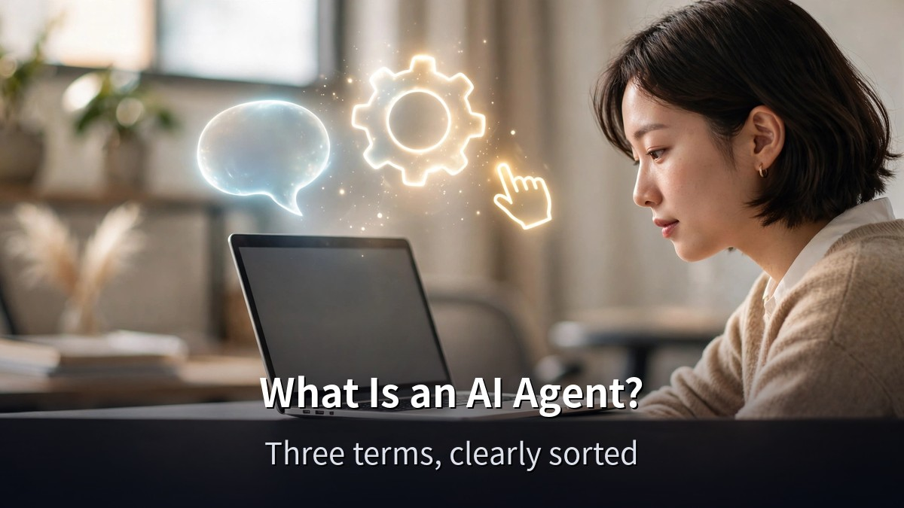
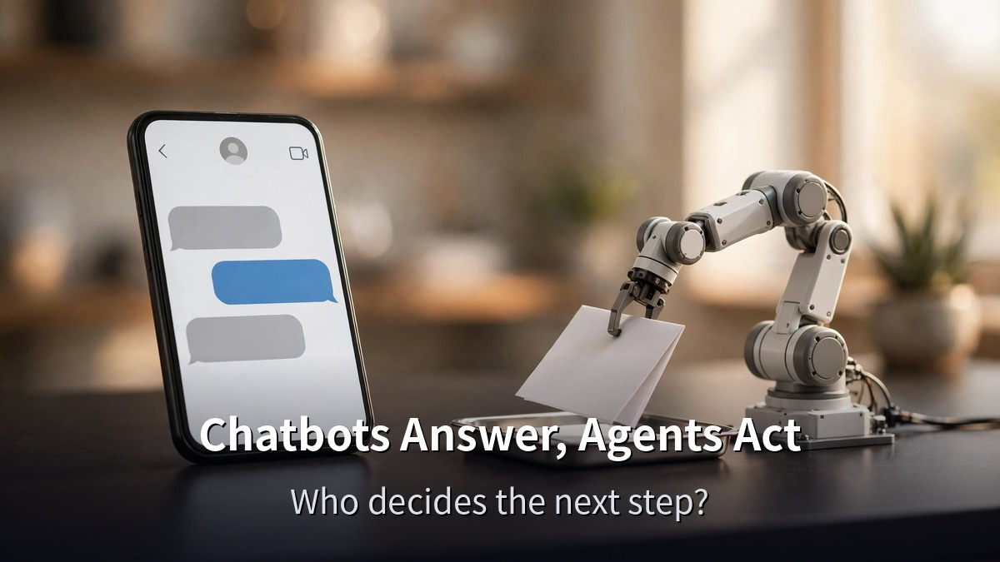
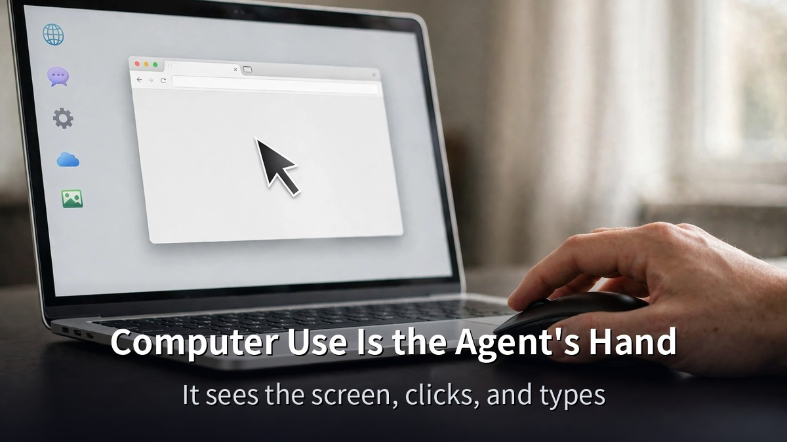

<!-- 본문 시작 -->



In one line, an AI agent is an AI that does not stop at giving an answer — it uses tools to finish the job.
Lately the news is full of three terms — agent, agentic AI, and computer use — and they do not mean the same thing, which is why they are so confusing.
This post sorts out all three, using Anthropic's official documentation (2024-12-19) as the standard.

```blog
type: text
runs:
  - text: "An AI agent is a system in which the model decides its own next steps, calls tools, and finishes a goal; agentic AI is the broader term covering both agents and workflows; and computer use is the agent's hand, looking at the screen, clicking, and typing."
    style: {bold: true, color: "#007aa6"}
```

If you want to see how an agent is actually used, the [Claude Usage Map](https://aitechnotesen.blogspot.com/2026/11/claude-usage-mapprices-from-free-to.html) walks through the order of asking, creating, and delegating.

```blog
type: heading
level: 2
runs:
  - text: "How Is an AI Agent Different from a Chatbot?"
    style: {bold: true, color: "#007aa6"}
```



A phone chat window sits next to a robot arm moving a document

```blog
type: text
runs:
  - text: "AI agent — "
    style: {bold: true, color: "#ff008c"}
  - text: "A system that decides its own next steps and calls tools in order to finish a task. Anthropic describes an agent as 'an application that completes a task by planning its own steps and calling tools that read files, run commands, or edit code' (Anthropic, 2024-12-19)."
```

There is one test that settles it.
Does the model decide the next step on its own?

A chatbot leaves that decision to the person, question by question.
Its job ends when it gives an answer.

An agent takes a goal, plans the order itself, reads files, runs commands, checks the result, and then decides the next step.
It is also different from a workflow, which only follows a fixed order.
A workflow follows a code path a person set in advance; an agent builds that path itself.

Say you ask for a Monday morning report every week.
An agent decides the order — gather the data, build a table, draft the text — and finishes the job.
A chatbot would need a person to tell it what to do at every step.

Agents fit work that takes several steps.
Recurring research and summaries, or a first draft of a report, are good examples — jobs that do not end with a single question.

Here is the point people get wrong.
Bolting tools onto a chatbot does not make it an agent.
Who decides the next step is the dividing line.

```blog
type: text
runs:
  - text: "An agent does not do every job on its own."
    style: {bold: true, background: "#FFF3CD"}
  - text: " If the goal is vague, it can stop halfway or head in the wrong direction. When you hand it a task, it is safer to write down clearly what 'done' looks like."
```

```blog
type: heading
level: 2
runs:
  - text: "Computer Use: The Agent's Hand"
    style: {bold: true, color: "#007aa6"}
```



A hand on a mouse beside a laptop screen with a visible cursor

```blog
type: text
runs:
  - text: "Computer use — "
    style: {bold: true, color: "#ff008c"}
  - text: "A tool that lets Claude interact with a desktop directly, looking at screenshots and controlling the mouse and keyboard. It was released as a public beta on October 22, 2024, together with Claude 3.5 Sonnet (Anthropic, 2024-10-22)."
```

The key point is that the model does not touch the computer directly.
The app sends a screenshot, the model tells it the next action, the app runs it, and a fresh screenshot comes back — a loop.

Calling a function through an API is like working through a fixed service window.
Computer use is more like a person looking at the screen, clicking, and typing.
It fits jobs where an old program or website has no dedicated connection, and someone has to move through it by hand.

Here is the point people get wrong.
Computer use is not an agent by itself.
It is a tool the agent uses — its hand.

```blog
type: text
runs:
  - text: "Whatever is visible on screen is exposed to the model."
    style: {bold: true, background: "#FFF3CD"}
  - text: " It is safer not to use it on a screen showing passwords or bank details. It is meant to run in a sandboxed environment."
```

The models that power agents keep arriving, too.
The [GPT-6.2 Astra Launch](https://aitechnotesen.blogspot.com/2026/11/gpt-62-astra-is-herecheaper-and-faster.html) post covers the latest model news.

```blog
type: heading
level: 2
runs:
  - text: "Why Is Agentic AI a Broader Term?"
    style: {bold: true, color: "#007aa6"}
```


Three blank cards lined up in a row on a desk

```blog
type: text
runs:
  - text: "Agentic AI — "
    style: {bold: true, color: "#ff008c"}
  - text: "A broad category covering both agents and workflows. Anthropic places both under the umbrella of 'agentic systems' (Anthropic, 2024-12-19). IBM describes it as a system of several AI agents reaching a goal under limited supervision."
```

That is why the sentence 'every AI agent is agentic AI, but not every agentic AI is an AI agent' holds.
One caveat has to be stated, though.
Vendors use the term differently — some use it broadly, others narrowly.

So when an article or an ad says 'agentic', check first whether it means a specific product or a broad trend.
Agentic AI is a category, not a product name.
Saying 'I bought an agentic AI' sounds off.

| Type | Who decides the next step | Where it ends |
| --- | --- | --- |
| Chatbot | The person (each question) | Giving an answer |
| Workflow | A fixed order set by a person | Completing the set steps |
| AI agent | The model itself | Reaching the goal, or a stop condition |
| Computer use | The agent's tool | Looking at the screen, clicking, typing |

As the table shows, there is one dividing line.
Who decides the next step, and where the work ends.

```blog
type: text
runs:
  - text: "Remember it this way — "
    style: {bold: true, color: "#ff008c"}
  - text: "Agentic AI is the broad term, an AI agent is one system inside it, and computer use is the agent's hand."
```

Sorting out the three terms made the news easier to read.
I used to think every mention of 'agent' meant the same technology, but now I look first at who decides the next step.
Computer use is probably what I will try first — handing it one small job in an old program and learning it from there.
Once the terms are sorted, the technology feels a little less distant. Next time a new word shows up, I will start from the definition, just like this time.

## Frequently Asked Questions

**Do I need to know how to code to use an AI agent?**

No. There are agent tools that work with plain chat instructions and no code. The more complex the job, though, the more important it is to write down the goal and what 'done' looks like.

**Can anyone use computer use right now?**

It was released as a public beta in October 2024 and keeps improving. Anthropic itself said at launch that it could be 'at times cumbersome and error-prone', and the official documentation notes that sensitive information visible on screen is exposed to the model. Check the official documentation for current availability before using it.

**Is an agent the same as automation?**

No. Automation repeats a fixed sequence, while an agent changes the sequence itself as the situation changes. If the order is fixed, it is closer to a workflow or automation; if the model judges and changes it, it is closer to an agent.

## Good Reads

[Claude Usage Map｜Prices From Free to Ultra, Start to Finish](https://aitechnotesen.blogspot.com/2026/11/claude-usage-mapprices-from-free-to.html)

[Anthropic Goes Public｜Biggest IPO Ever, Up 17% on Day One](https://aitechnotesen.blogspot.com/2026/11/anthropic-goes-publicbiggest-ipo-ever.html)

<!-- 본문 끝 -->

## 작업용 출처·이미지 정보 (업로드 제외)

**Sources**
- Anthropic, Building effective agents (2024-12-19) — https://www.anthropic.com/research/building-effective-agents
- Anthropic, Computer use tool (platform.claude.com, public beta 2024-10-22) — https://platform.claude.com/docs/en/agents-and-tools/tool-use/computer-use-tool
- Anthropic Agent SDK documentation summary (roughworks.ca, checked November 2026) — https://roughworks.ca/blog/ai-agents-explained/
- cadenceworks.com, Agentic AI vs AI Agents (checked 2026-11-15) — https://www.cadenceworks.com/insights/agentic-ai-vs-ai-agents
- Definitions and dates checked on 2026-11-21 (prep memo evergreen-2026-11-22-term-briefing-prep.md)
