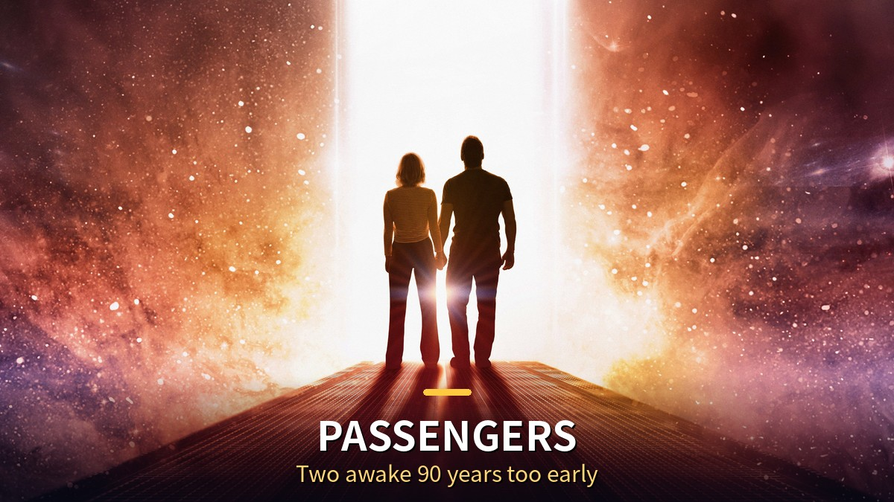
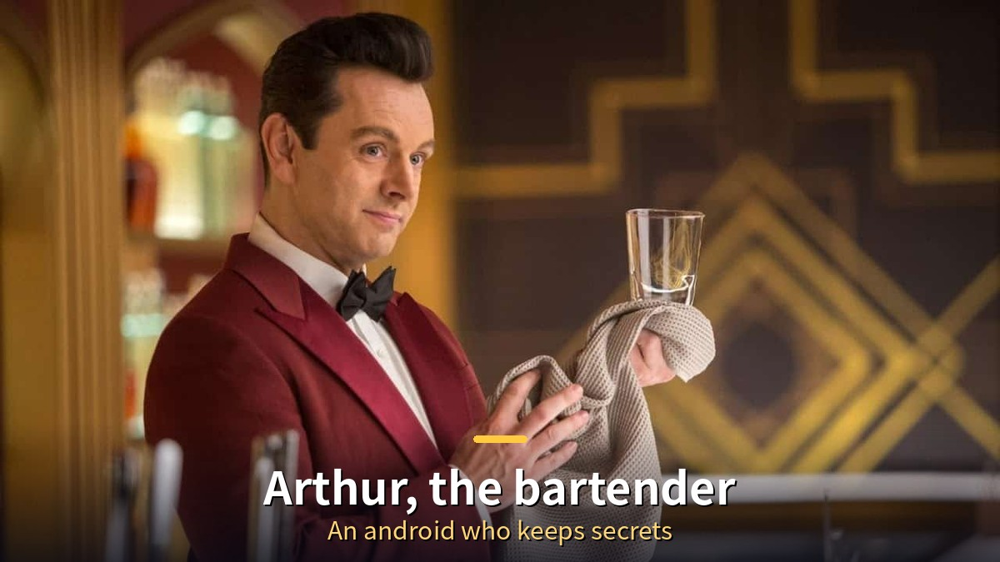
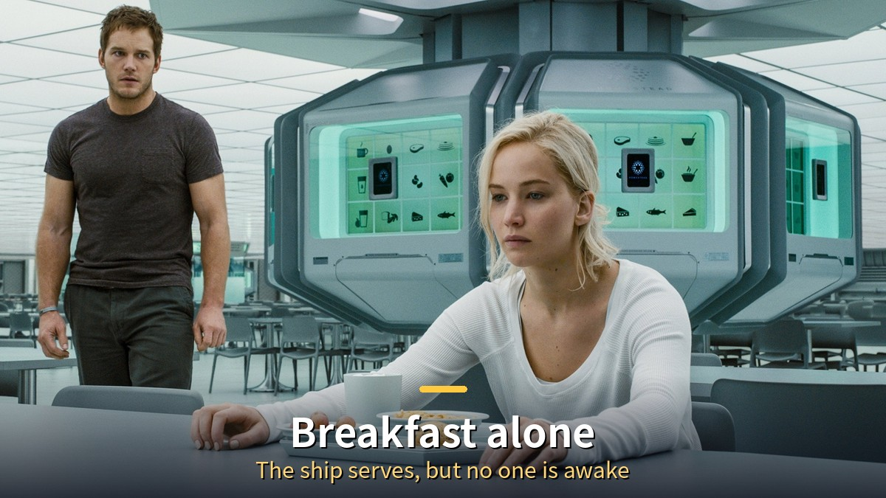
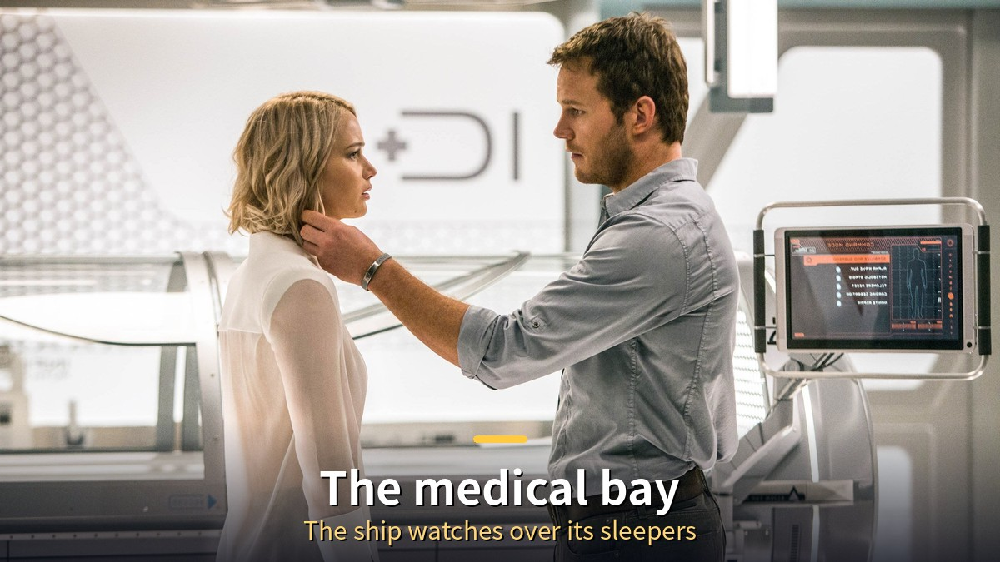
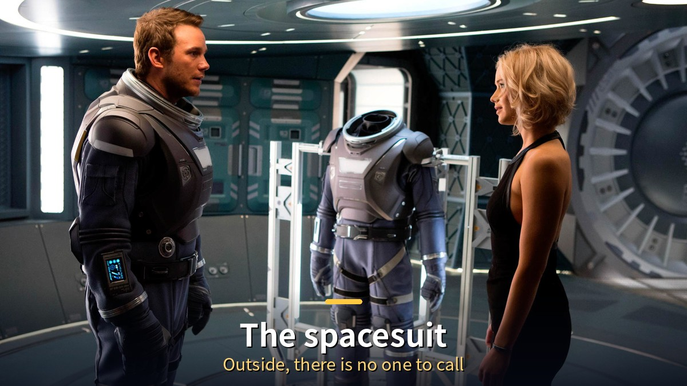
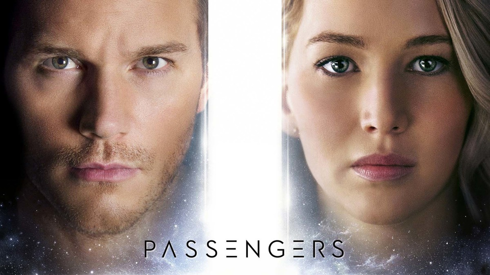

<!-- 본문 시작 -->



On a 120-year voyage, a single hibernation pod on the starship Avalon opens 90 years early.
Engineer Jim Preston now has to live alone for 90 years before the ship reaches its destination.
Passengers is a 116-minute science-fiction romance released in 2016, directed by Morten Tyldum.

```blog
type: text
runs:
  - text: "Passengers is the story of engineer Jim, who wakes 90 years early aboard the starship Avalon on a 120-year voyage, and who, after enduring alone, wakes the writer Aurora. A single sentence from the android bartender Arthur shakes the couple's relationship, and as the ship's failures surface, the 116-minute starship becomes a stage for asking what humans choose."
    style: {bold: true, color: "#007aa6"}
```

The story of a machine standing beside a human continues in [Blade Runner 2049's line between human and replicant](https://aitechnotesen.blogspot.com/2026/11/blade-runner-2049-line-between-human.html).

| Item | Details |
| --- | --- |
| Title | Passengers |
| Released | 2016 (US December 21, 2016; Korea January 4, 2017) |
| Director | Morten Tyldum |
| Screenplay | Jon Spaihts |
| Main cast | Chris Pratt (Jim Preston), Jennifer Lawrence (Aurora Lane), Michael Sheen (Arthur), Laurence Fishburne (Gus Mancuso), Andy Garcia (Captain Norris) |
| Runtime | 1 hour 56 minutes (116 minutes) |
| Rating | Ages 12 and up (Korea) |
| Score | TMDB 7.0/10 (14,692 votes, checked 2026-11-22), IMDb 7.0/10, Rotten Tomatoes 30% |
| Where to watch | Streaming on Wavve and Watcha in Korea (checked 2026-11-22) |

```blog
type: heading
level: 2
runs:
  - text: "On a 120-year voyage, how does a passenger woken 90 years early live?"
    style: {bold: true, color: "#007aa6"}
```

The Avalon carries 5,000 colonists and 258 crew members from Earth to the planet Homestead II. Everyone sleeps in hibernation pods for the 120-year journey. Then a meteor strike damages Jim's pod, and Jim wakes 90 years ahead of schedule. There is no way to fall asleep again, and no way to contact Earth.

All Jim has left is the ship. Automated kitchens serve the meals, and a swimming pool, a cinema, and a bar are all on board. No one else is awake. The only one Jim can talk to is the bartender Arthur. Arthur is an android.


Arthur the bartender polishing a glass. For a year, the only one Jim could talk to was an android.

```blog
type: text
runs:
  - text: "Who Arthur is: "
    style: {bold: true, color: "#ff008c"}
  - text: "Arthur (Michael Sheen) is the android bartender of the ship's bar, and the only conversation partner who listens to Jim's worries."
```


The cafeteria's automated food dispensers. Pick a menu and the machine serves the food.

Jim spends a year alone. The ship works perfectly, and that perfection only tightens around him. There is little to do and nowhere to go except inside the ship. Then Jim sees the writer Aurora Lane sleeping in a hibernation pod. Aurora was on her way to write about life in the colony world. After long deliberation, Jim opens Aurora's pod.

```blog
type: heading
level: 2
runs:
  - text: "When two people start living together, what changes?"
    style: {bold: true, color: "#007aa6"}
```

Aurora is devastated to learn she woke 90 years early. But she accepts reality and starts a life aboard the ship with Jim. The two eat together, watch films, and swim. When Jim plays the piano, Aurora sits beside him. The ship becomes the couple's home.


Jim at the grand piano, Aurora with a martini in hand. The bar becomes the couple's living room.

The closer the two grow, the heavier Jim's secret becomes. Aurora trusts Jim without knowing why she woke. The only one who knows the secret is Arthur. Then one day at the bar, Arthur tells Aurora the truth, and the couple's relationship falls apart.

```blog
type: text
runs:
  - text: "What Aurora learns is not that it was an 'accident,' but that it was a 'choice.' The film keeps asking about that difference until the end."
    style: {bold: true, background: "#FFF3CD"}
```


Aurora swimming in a pool under the stars. The ceiling shows the universe as it is.

Aurora turns away from Jim. They are on the same ship, yet they become strangers. The ship's lights stay the same, only the air between the two changes. The film does not rush this stretch. Scene after scene, Aurora drifts away from Jim, calmly and steadily.

The story of a machine testing a human continues in [Ex Machina's question about whether a machine can think](https://aitechnotesen.blogspot.com/2026/11/ex-machina-108-minutes-asking-robot-if.html).

```blog
type: heading
level: 2
runs:
  - text: "When the ship's failures surface, what do the two choose?"
    style: {bold: true, color: "#007aa6"}
```

Then another hibernation pod fails, and Chief Deck Officer Gus Mancuso wakes. Gus tells them that system failures are spreading all over the ship. The ship looks fine on the outside, but the failures are spreading inside. Gus shows Jim and Aurora how to check the ship's condition, and the two go deep inside the ship.


Jim and Aurora facing each other in the medical bay. The hibernation pods and monitor behind them show the ship's condition.

```blog
type: text
runs:
  - text: "What Gus does: "
    style: {bold: true, color: "#ff008c"}
  - text: "Gus (Laurence Fishburne) is the deck officer who wakes up, and he opens the way for Jim and Aurora to find the cause of the ship's failures."
```


Jim in a spacesuit facing Aurora. A spacewalk is the couple's last option.

Once they find the cause, the two learn that a repair outside the ship is needed. It is a job that means putting on a spacesuit and going outside. The film does not dress this choice up as heroism. It asks what two people woken 90 years early must risk to save a ship carrying 5,258 lives.

```blog
type: text
runs:
  - text: "This article covers only up to the middle of the film. There is no description of the ending, so first-time viewers can read it without worry."
    style: {bold: true, background: "#FFF3CD"}
```

```blog
type: heading
level: 2
runs:
  - text: "The AI questions this film asks"
    style: {bold: true, color: "#007aa6"}
```

First, when a lonely human wakes a machine's companion, is that a choice or coercion? Jim spent a year alone before waking Aurora. Aurora never agreed. In 2026, AI companions and care robots are already entering the lives of lonely people. When a machine soothes a human's loneliness, whose consent does that relationship belong to? The film asked that question in 2016.


The faces of Jim and Aurora, side by side. The official key art.

Second, when an android tells a secret, is that betrayal or honesty? Arthur knew Jim's secret. After Arthur told the truth, the couple's relationship collapsed. In 2026, how much an AI assistant or chatbot should say about a user's secrets is still a live debate. When you hand a secret to a machine, whose side does that machine stand on?

Third, on a ship where everything is automated, what is a human for? The Avalon leaves meals, cleaning, and navigation to machines. People only have to sleep. In 2026, as AI takes over more and more work, what the human role is has become a real debate. In a world where machines do everything, what should humans stay awake for?

```blog
type: heading
level: 2
runs:
  - text: "Checklist before you watch"
    style: {bold: true, color: "#007aa6"}
```

As of November 22, 2026: in Korea, it is available for streaming on Wavve and Watcha. It is not available on Netflix Korea. Both are subscription services, so Wavve and Watcha subscribers can watch it right away.

The runtime is 1 hour 56 minutes (116 minutes). It is rated ages 12 and up in Korea. Check subtitle and dub options directly in each app.

## Closing thoughts
The image of two people facing each other in spacesuits stays with you.
On a ship where machines do everything, the questions people ask each other only grow sharper.
Ninety years does not feel long, because the question is a story of today.
Because the film does not hand you an answer, the question stays with you after it ends.

## Frequently asked questions
**Is "Passengers" based on a true story?**
No. It is a fictional story from an original screenplay by Jon Spaihts. Director Morten Tyldum is also known for The Imitation Game.

**Is Arthur (the android bartender) a real robot?**
No. He is a character performed by actor Michael Sheen, brought to life with costume and acting.

**Did it open in theaters in Korea?**
Yes. It opened in Korea on January 4, 2017, and as of November 22, 2026 it is available for streaming on Wavve and Watcha.

## Good Reads Together
[Blade Runner 2049 — The Line Between Human and Replicant, in 2 Hours 44 Minutes](https://aitechnotesen.blogspot.com/2026/11/blade-runner-2049-line-between-human.html)
[Ex Machina — 108 Minutes Asking a Robot If It Has a Mind](https://aitechnotesen.blogspot.com/2026/11/ex-machina-108-minutes-asking-robot-if.html)

<!-- 본문 끝 -->

## 작업용 출처·이미지 정보 (업로드 제외)

## Sources (not for publication, checked 2026-11-22)
- TMDB page (Passengers, score 6.956/10, 14,692 votes, official synopsis, top billed cast, published 2016-12-21)
- Korean Wikipedia (director Morten Tyldum, screenplay Jon Spaihts, cast, runtime 116 minutes, budget $110 million, box office $303.1 million, plot range)
- English Wikipedia (Avalon carries 5,000 colonists and 258 crew, 120-year voyage to Homestead II, box office $303 million, budget $110-150 million, Rotten Tomatoes 30% from 255 critics)
- isitonnetflix.com (Korea: not on Netflix, available on wavve and Watcha, crawled 2026-11-22)
- Radio Times (Aurora as a journalist/writer, Jim spending a year alone, IMDb 7.0/10)
- Other scores (IMDb 7.0/10, Rotten Tomatoes 30%, Metacritic 41/100)
- Other facts (two Oscar nominations: Best Production Design and Best Original Score, Letterboxd review and hellhorror.com; cinematography Rodrigo Prieto, music Thomas Newman, Korean Wikipedia)
