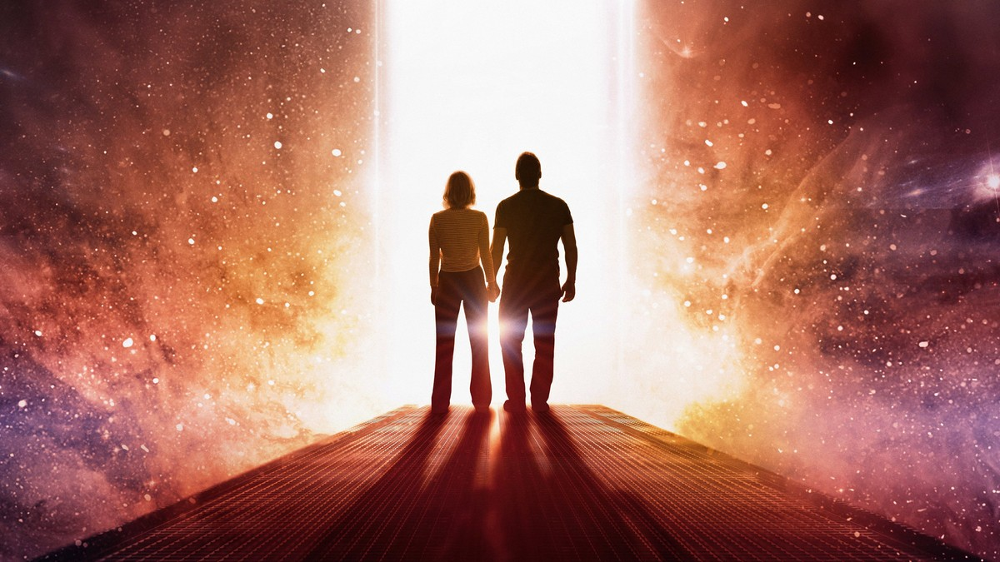
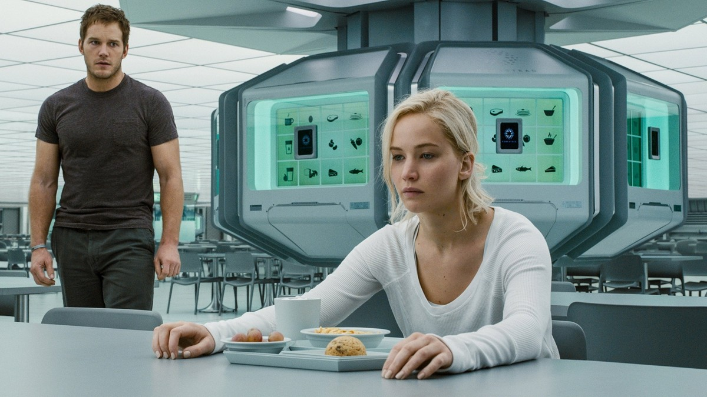
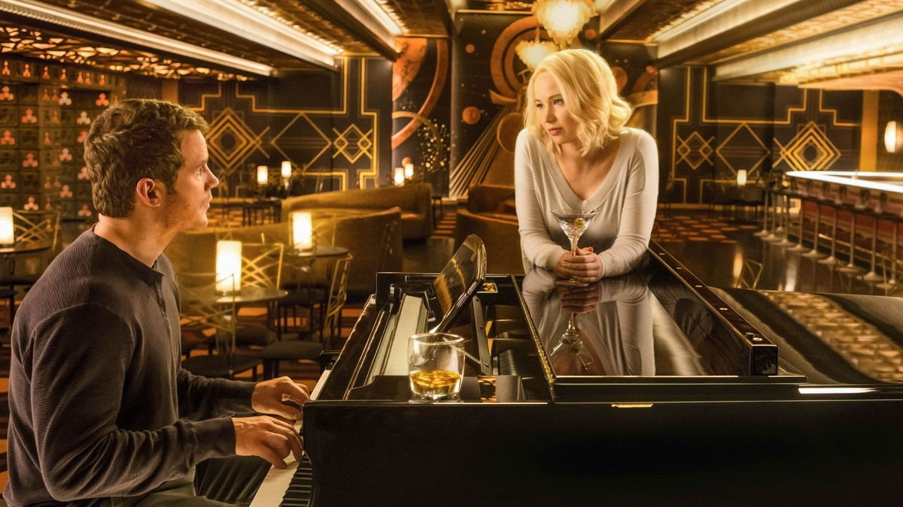
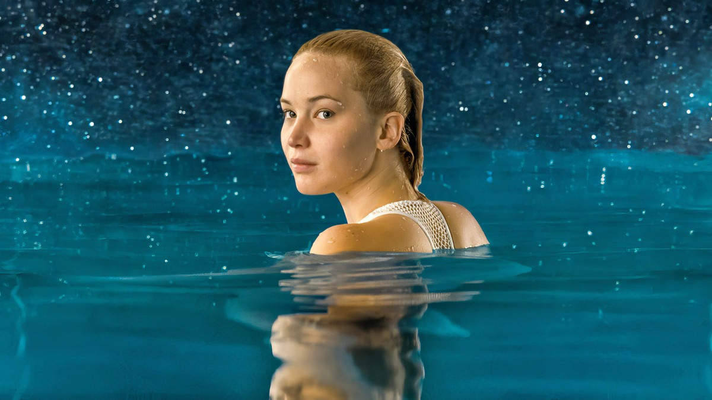
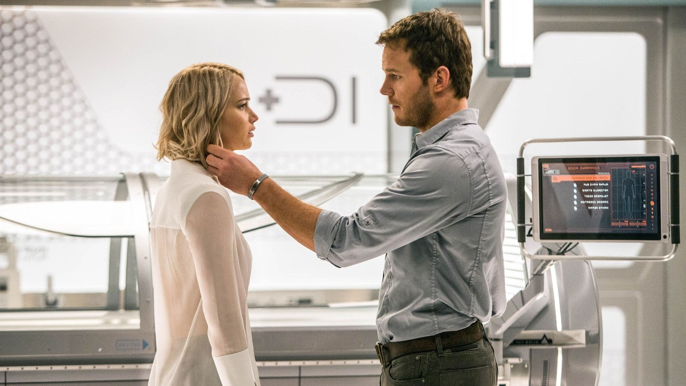
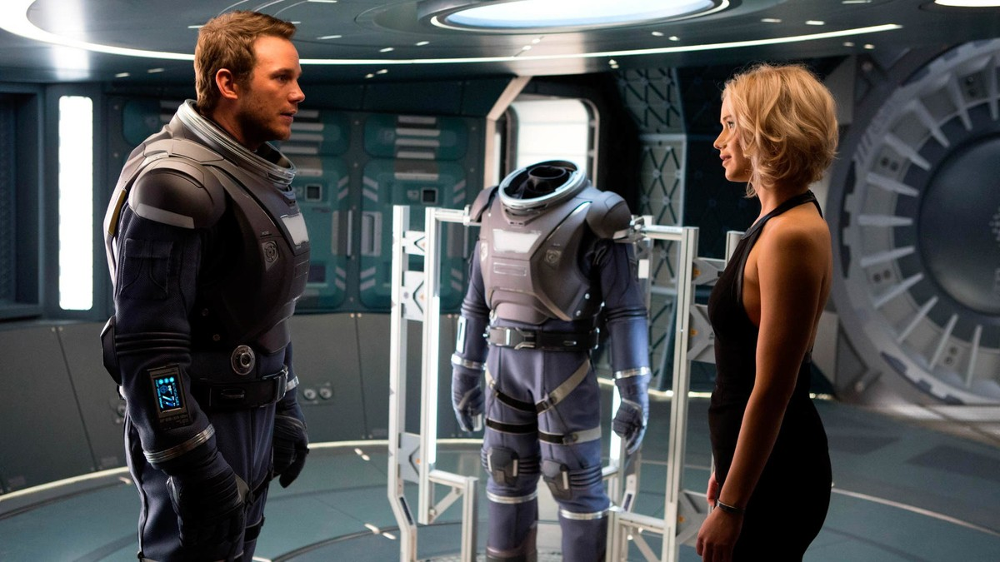
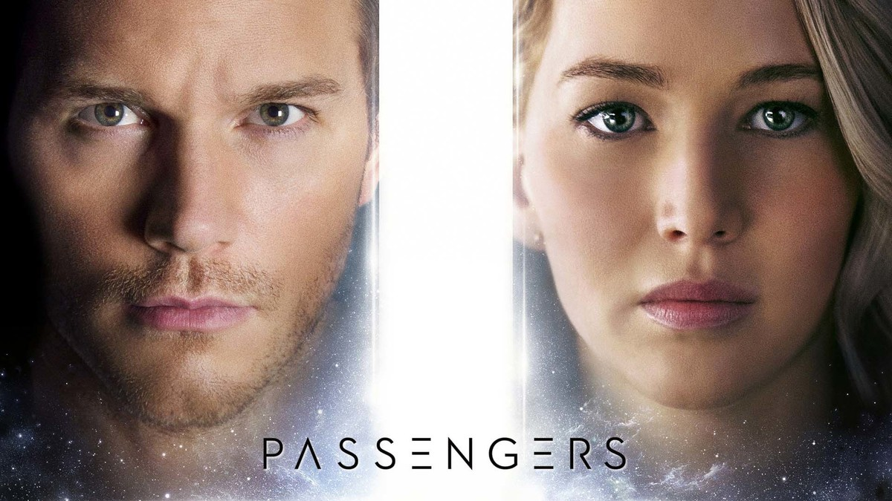

<!-- 본문 시작 -->



120년 항해에 나선 우주선 아발론호에서 수면 캡슐 하나가 90년 일찍 열렸다.
정비공 짐 프레스턴은 목적지까지 90년을 혼자 살아야 하는 처지가 된다.
패신저스는 2016년 개봉한 116분짜리 SF 로맨스로, 모르텐 튈둠 감독이 연출했다.

```blog
type: text
runs:
  - text: "패신저스는 120년 항해에 나선 우주선 아발론호에서 정비공 짐이 90년 일찍 깨어나고, 홀로 견디다 작가 오로라를 깨우면서 벌어지는 이야기다. 안드로이드 바텐더 아서의 말 한마디가 두 사람의 관계를 뒤흔들고, 선내 고장이 드러나면서 116분짜리 우주선은 인간의 선택을 묻는 무대가 된다."
    style: {bold: true, color: "#007aa6"}
```

기계가 인간의 곁에 서는 이야기는 [아이, 로봇의 로봇 3원칙과 기계의 마음](https://blog.naver.com/3700708/224477518995)에서도 이어진다.

| 항목 | 내용 |
| --- | --- |
| 제목 | 패신저스 (Passengers) |
| 개봉 | 2016년 (미국 2016-12-21, 한국 2017-01-04) |
| 감독 | 모르텐 튈둠 |
| 각본 | 존 스페이츠 |
| 주요 출연 | 크리스 프랫(짐 프레스턴), 제니퍼 로렌스(오로라 레인), 마이클 신(아서), 로런스 피시번(거스 맨쿠소), 앤디 가르시아(노리스 선장) |
| 러닝타임 | 1시간 56분 (116분) |
| 등급 | 12세 이상 관람가 |
| 평점 | TMDB 7.0/10 (14,692개 평가, 2026-11-22 확인), IMDb 7.0/10, 로튼토마토 30% |
| 시청처 | 웨이브·왓챠 스트리밍 (2026-11-22 확인) |

```blog
type: heading
level: 2
runs:
  - text: "120년 항해, 90년 일찍 깬 승객은 어떻게 살아가나"
    style: {bold: true, color: "#007aa6"}
```

아발론호는 5,000명의 개척민과 258명의 승무원을 태우고 지구에서 홈스테드 2행성으로 향하는 우주선이다. 120년 항해 동안 모두가 수면 캡슐에 들어간다. 그런데 운석 충돌로 짐의 캡슐이 고장 나고, 짐은 예정보다 90년 일찍 깨어난다. 다시 잠들 방법도, 지구와 연락할 방법도 없다.

짐에게 남은 것은 배뿐이다. 식당은 자동 조리기가 차려주고, 수영장·영화관·바가 모두 갖춰져 있다. 사람은 아무도 깨어 있지 않다. 짐이 말을 나눌 수 있는 상대는 바텐더 아서뿐이다. 아서는 안드로이드다.


잔을 닦는 바텐더 아서. 짐이 1년 동안 말을 나눈 상대는 안드로이드뿐이었다.

```blog
type: text
runs:
  - text: "아서의 정체: "
    style: {bold: true, color: "#ff008c"}
  - text: "아서(마이클 신)는 선내 바의 안드로이드 바텐더로, 짐의 고민을 들어주는 유일한 대화 상대다."
```


자동 조리기가 늘어선 식당. 메뉴를 고르면 기계가 음식을 내놓는다.

짐은 1년을 혼자 보낸다. 배는 완벽하게 돌아가는데, 그 완벽함이 오히려 짐을 옥죈다. 할 일은 많지 않고, 갈 곳은 배 안뿐이다. 그러다 짐은 수면 캡슐 속에서 자는 작가 오로라 레인을 보게 된다. 오로라는 식민 행성에서의 삶을 글로 쓰러 가는 길이었다. 짐은 고민 끝에 오로라의 캡슐을 연다.

```blog
type: heading
level: 2
runs:
  - text: "두 사람이 함께 살기 시작하면, 무엇이 달라지나"
    style: {bold: true, color: "#007aa6"}
```

오로라는 자신이 90년 일찍 깨어났다는 사실에 절망한다. 하지만 현실을 받아들이고, 짐과 함께 우주선 안에서 삶을 시작한다. 두 사람은 식사를 하고, 영화를 보고, 수영을 한다. 짐이 피아노를 치면 오로라는 옆에 앉는다. 배는 두 사람의 집이 된다.


그랜드피아노를 치는 짐과 마티니를 든 오로라. 바는 두 사람의 거실이 된다.

두 사람의 사이가 깊어질수록, 짐의 비밀이 무거워진다. 오로라는 자신이 왜 깨어났는지 모른 채 짐을 믿고 있다. 그 비밀을 아는 존재는 아서뿐이다. 그러다 바에서 아서가 오로라에게 진실을 말하면서 두 사람의 관계는 파국으로 치닫는다.

```blog
type: text
runs:
  - text: "오로라가 알게 된 진실은 '사고'가 아니라 '선택'이었다는 점이다. 영화는 이 차이를 끝까지 묻는다."
    style: {bold: true, background: "#FFF3CD"}
```


별이 보이는 수영장에서 헤엄치는 오로라. 천장은 우주를 그대로 보여준다.

오로라는 짐을 외면한다. 같은 배 안에 있으면서도 두 사람은 남이 된다. 배의 불빛은 그대로인데, 두 사람 사이의 공기만 달라졌다. 영화는 이 구간을 서두르지 않는다. 오로라가 짐에게서 멀어지는 장면들이 차분히 이어진다.

기계가 인간을 시험하는 이야기는 [엑스 마키나의 튜링 테스트](https://blog.naver.com/3700708/224474081075)에서도 이어진다.

```blog
type: heading
level: 2
runs:
  - text: "선내 고장이 드러나면, 두 사람은 무엇을 선택하나"
    style: {bold: true, color: "#007aa6"}
```

그러던 중 또 다른 수면 캡슐이 고장 나면서 갑판 책임자 거스 맨쿠소가 깨어난다. 거스는 선내 곳곳에서 시스템 오류가 잇따르고 있다는 사실을 알려준다. 배는 겉보기엔 멀쩡하지만, 속에서는 고장이 번지고 있다. 거스는 짐과 오로라에게 배의 상태를 확인하는 방법을 알려주고, 두 사람은 선내 깊숙한 곳으로 들어간다.


의료실에서 마주한 짐과 오로라. 뒤쪽 수면 캡슐과 모니터가 선내 상태를 보여준다.

```blog
type: text
runs:
  - text: "거스의 역할: "
    style: {bold: true, color: "#ff008c"}
  - text: "거스(로런스 피시번)는 깨어난 갑판 책임자로, 짐과 오로라에게 배의 고장 원인을 확인하는 길을 열어준다."
```


우주복을 입은 짐과 마주 선 오로라. 선외 작업은 두 사람의 마지막 선택지다.

원인을 확인한 두 사람은 선외 수리가 필요하다는 것을 알게 된다. 우주복을 입고 선밖으로 나가야 하는 일이다. 영화는 이 선택을 영웅담으로 포장하지 않는다. 90년 일찍 깨어난 두 사람이, 5,258명의 목숨이 걸린 배를 살리기 위해 무엇을 감수해야 하는지를 묻는다.

```blog
type: text
runs:
  - text: "이 글은 작품 중반부까지의 내용만 다룬다. 결말에 대한 설명은 일절 없으니, 처음 보는 사람도 안심하고 읽어도 된다."
    style: {bold: true, background: "#FFF3CD"}
```

```blog
type: heading
level: 2
runs:
  - text: "이 작품이 던지는 AI 질문"
    style: {bold: true, color: "#007aa6"}
```

첫째, 인간이 외로워서 기계를 깨우면, 그건 선택인가 강요인가. 짐은 오로라를 깨우기 전에 1년을 혼자 보냈다. 오로라는 동의한 적이 없다. 2026년의 현실에서도 AI 컴패니언과 돌봄 로봇이 외로운 사람의 곁에 들어오고 있다. 기계가 인간의 외로움을 달래줄 때, 그 관계의 동의는 누구의 몫인가. 영화는 2016년에 이 질문을 던졌다.


나란히 놓인 짐과 오로라의 얼굴. 공식 키아트다.

둘째, 안드로이드가 비밀을 말하면, 그건 배신인가 정직인가. 아서는 짐의 비밀을 알고 있었다. 아서가 진실을 말한 뒤 두 사람의 관계는 무너진다. 2026년의 현실에서도 AI 비서와 챗봇이 사용자의 비밀을 어디까지 말해야 하는지가 논쟁이다. 기계에게 비밀을 맡기면, 그 기계는 누구 편에 서는가.

셋째, 모든 것이 자동화된 배에서 인간은 무엇을 하는 존재인가. 아발론호는 식사·청소·항해까지 기계가 맡는다. 사람은 잠만 자면 된다. 2026년에는 AI가 일의 많은 부분을 대신하면서, 인간의 역할이 무엇인지가 실제 논쟁이 됐다. 기계가 다 해주는 세상에서 인간은 무엇을 위해 깨어 있어야 하는가.

```blog
type: heading
level: 2
runs:
  - text: "시청 전 체크리스트"
    style: {bold: true, color: "#007aa6"}
```

2026년 11월 22일 기준으로 정리한다. 국내에서는 웨이브와 왓챠에서 스트리밍으로 볼 수 있다. 넷플릭스 한국에서는 제공되지 않는다. 구독으로 보는 작품이라, 웨이브·왓챠 구독자라면 바로 볼 수 있다.

러닝타임은 1시간 56분(116분)이다. 등급은 12세 이상 관람가다. 자막과 더빙 여부는 각 앱에서 직접 확인하는 것이 좋다.

## 마무리
우주복 앞에서 마주한 두 사람의 장면이 오래 남는다.
기계가 다 해주는 배 안에서, 인간이 서로에게 묻는 질문이 더 또렷해진다.
90년이라는 시간이 길게 느껴지지 않는 건, 그 질문이 지금의 이야기라서다.
답을 정해주지 않는 영화라서, 질문이 오래 남는다.

## 자주 묻는 질문
**패신저스는 실화인가요?**
아니요. 존 스페이츠의 오리지널 각본을 바탕으로 한 가상의 이야기다. 감독 모르텐 튈둠은 <이미테이션 게임>으로도 알려져 있다.

**아서(안드로이드 바텐더)는 실제 로봇인가요?**
아니요. 배우 마이클 신이 직접 연기한 캐릭터로, 분장과 연기로 안드로이드를 표현했다.

**한국에서 극장 개봉했나요?**
예. 2017년 1월 4일 국내 개봉했고, 2026년 11월 22일 기준 웨이브·왓챠에서 스트리밍으로 볼 수 있다.

## 함께 보면 좋은 글
[나의 마더｜로봇이 키운 아이, 엄마를 의심하다](https://blog.naver.com/3700708/224485792978)
[매트릭스｜현실이 코드였던 136분, 빨간 알약을 고른 날](https://blog.naver.com/3700708/224478573702)

<!-- 본문 끝 -->

## 작업용 출처·이미지 정보 (업로드 제외)

## 출처 목록 (발행본 제외, 2026-11-22 확인)
- TMDB 페이지 (패신저스, 평점 6.956/10·14,692개 평가·공식 시놉시스·주요 출연·개봉 2016-12-21)
- 한국어 위키백과 (감독 모르텐 튈둠·각본 존 스페이츠·출연·러닝타임 116분·제작비 1억 1천만 달러·흥행 3억 31만 달러·한국 개봉 2017-01-04는 티스토리 healing-m 확인·줄거리 범위)
- 영어 위키백과 (아발론호 5,000명 개척민+258명 승무원·120년 항해·홈스테드 2행성·흥행 3억 3백만 달러·제작비 1억 1천만~1억 5천만 달러·로튼토마토 30%·255명 평론가)
- isitonnetflix.com (한국: 넷플릭스 미제공·웨이브·왓챠 제공, 2026-11-22 크롤 확인)
- Radio Times (오로라가 기자·작가라는 설정·짐이 1년을 혼자 보낸 사실·IMDb 7.0/10)
- 기타 평점 (IMDb 7.0/10, 로튼토마토 30%, 메타크리틱 41/100)
- 기타 사실 (아카데미 미술상·음악상 후보 2개 부문, Letterboxd 리뷰·hellhorror.com; 촬영 로드리고 프리에토·음악 토마스 뉴먼, 한국어 위키백과)
