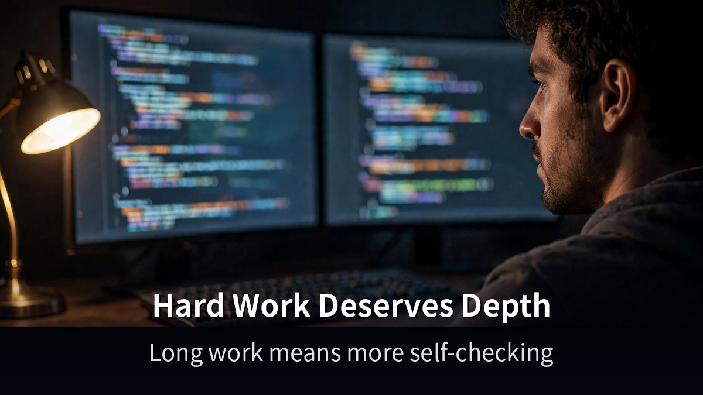

<!-- 본문 시작 -->


The short answer first: use low for simple work, medium or high for everyday coding and writing, and xhigh or max for hard reasoning and long agent work.
The effort setting controls how many tokens Claude spends on one request.
Raise it and answers get deeper but cost more tokens; lower it and answers come faster and cheaper, though they can get shallower.

```blog
type: text
runs:
  - text: "Claude effort has five levels, low, medium, high, xhigh, and max, set with output_config.effort. Most models default to high, while Claude Opus 5.5 and Haiku 5.5 default to medium. Simple work belongs on low, hard work on high or above."
    style: {bold: true, color: "#007aa6"}
```

Knowing the levels lets you use the same Claude more cheaply and more deeply. Token saving matters, but the effort level is the default you set first.

```blog
type: heading
level: 2
runs:
  - text: "What is the effort level, and how do you change it"
    style: {bold: true, color: "#007aa6"}
```


(Illustration) A five-step dial that adjusts how many tokens Claude uses

The effort level controls how many tokens Claude spends when responding to a request.
According to Anthropic's official docs, the API sets it with output_config.effort.
In the apps and Claude Code, you pick it from the menu beside the model name.

There are five levels: low, medium, high, xhigh, and max.
Low is the most efficient. It saves a lot of tokens but gives up some capability.
Medium balances speed, cost, and performance.
High spends as many tokens as the task needs for excellent results.
Xhigh is for long-horizon work over 30 minutes with token budgets in the millions.
Max is absolute maximum capability, with no constraints on token spending.

Start with the defaults.
Most models default to high.
Only Claude Opus 5.5 and Haiku 5.5 default to medium.
If you never touched the setting, you are already on high.

Effort is not a token budget by itself.
The official docs call it a behavioral signal, not a strict token cap.
At a low level Claude still thinks on a hard problem, just less than it would at a higher one.
Lower effort also means fewer tool calls and shorter answers.

```blog
type: text
runs:
  - text: "Defaults at a glance: "
    style: {bold: true, color: "#ff008c"}
  - text: "Most models default to high; Opus 5.5 and Haiku 5.5 default to medium. If you never changed it, you are on the default."
```

```blog
type: text
runs:
  - text: "Raising the effort level does not change the model. It changes how much work the same model puts into one request."
    style: {bold: true, background: "#FFF3CD"}
```

```blog
type: heading
level: 2
runs:
  - text: "When should you use low, medium, high, or max"
    style: {bold: true, color: "#007aa6"}
```



(Illustration) Tasks split by level, from short notes to long coding work

Pick by how hard the work is and how long it runs.
The table below is the core of this post.

| Effort level | Good for | Watch out for |
| --- | --- | --- |
| low | Short summaries, classification, simple subagent work | Answers can get shallow on hard work |
| medium | Everyday coding, editing, agent work that needs balance | Default on Opus 5.5 and Haiku 5.5 |
| high | Complex reasoning, hard coding, general agent work | Default on most models, no change needed |
| xhigh | Long coding and agent work over 30 minutes, million-token budgets | Wasteful on short work |
| max | Work that needs the deepest possible reasoning | Costs a lot, little gain on easy work |

Low fits fast repetition.
Short summaries, classification, and sub-tasks you can fix right away are good examples.
The official docs list subagents as the typical low-effort case.
An Anthropic experiment, relayed in the video, puts numbers on the gap.
For the same request, "Build me a workout-tracking app," low took 1 minute 30 seconds, medium 4 minutes, high 11 minutes, and max 67 minutes.
The low app had a single record entry and a simple chart; the max app added a heat chart.
The higher the level, the more Claude checked its own work and the less it asked the user.

Medium works well as a daily default.
That is why Opus 5.5 and Haiku 5.5 default to it.
Anthropic notes that Opus 5.5 at medium matches or beats Opus 5 at high on its coding evaluations.
Keep in mind that the same level means a different amount of work on each model.

High is the starting point for hard work.
Complex reasoning, difficult coding problems, and agent tasks belong here.
It is the default on most models, so there is nothing to change.

Save xhigh and max for special cases.
Xhigh is for work that runs longer than 30 minutes.
Max is available on Claude Fable 5.2, Mythos 5.2, Opus 5.5 and 5, Sonnet 5.5 and 5, Haiku 5.5, and others.
Using max on easy work costs a lot and buys little.
The docs also note that per-model recommendations can differ from the general table.
On hard work, though, the gap is wide.
In the same Anthropic experiment (video transcript), 370 Terminal-Bench 3.0 problems run on Claude Fable 5.1 were passed 140 times on low and 214 times on max.
Tokens per problem were about 73,000 on low and about 222,000 on max, roughly three times as many.
By field, security rose from 64% to 87% and hardware from 34% to 75%, while software development moved from 43% to 56% and operations from 12% to 22%.
Failures split in two: misses from overlooking something fell from 59 to 24, but failures from starting in the wrong direction only fell from 133 to 107.
More effort makes the work more thorough, but it rarely fixes a wrong start.

```blog
type: text
runs:
  - text: "The one-line rule: "
    style: {bold: true, color: "#ff008c"}
  - text: "Choose by difficulty and duration. Short and easy means low, ordinary means medium or high, long and hard means xhigh or max."
```

```blog
type: text
runs:
  - text: "Max does not make every answer better. On easy work it mostly adds tokens, not quality."
    style: {bold: true, background: "#FFF3CD"}
```

```blog
type: heading
level: 2
runs:
  - text: "How do you save tokens by running the levels"
    style: {bold: true, color: "#007aa6"}
```


(Illustration) The same work split across levels to save tokens

Mix levels inside one session.
Do the hard design at high or xhigh, then drop to low for the simple follow-up.
The docs also describe changing effort mid-conversation.
Per-message effort is a beta feature, so check whether your model supports it first.

Opus 4.5 needs a separate note.
It is the only extended-thinking-only model that supports effort, and it is used together with budget_tokens.
Its setup differs from other models, so check the official docs before using it.

No official per-level token multiplier exists.
Second-hand write-ups sometimes claim high uses several times the tokens of medium, but those numbers are not in the official docs, so this post does not state them as fact.
The right way to learn the ratio is to measure it on your own work.
Run the same task at each level and compare token use with answer quality.

## What is confirmed, and what is only a claim

Confirmed facts come from the official docs.
They cover the five level names and descriptions, the output_config.effort setting, the high default on most models, the medium default on Opus 5.5 and Haiku 5.5, the max model list, and the long-horizon use of xhigh.
The docs also state two cautions: effort is a behavioral signal rather than a strict token budget, and per-model recommendations can override the general table.
Token multipliers belong in the claim column.
Numbers passed around in second-hand write-ups are not official figures, so this post does not present them as settled.
The experiment numbers in this post (same-request times, Terminal-Bench 3.0 pass counts and token use, pass rates by field, failure counts) come from Anthropic's own experiment as relayed in the video, confirmed from the transcript obtained on 2026-11-23.
The transcript is auto-generated, so wording may be imperfect, and results can differ on other tasks.
The same applies to the video host's impressions. Treat them as one person's view, not as numbers.
The use-case guidance in this post restates the docs' own use cases in plain language.

Knowing the levels alone changes nothing.
It does give you a choice: spend less on easy work, or dig deeper on hard work.
Try splitting low and high across today's tasks, and the difference shows up quickly.
Choosing a level is, in the end, choosing where your tokens go.
Refining the request matters as much as the level.
In the same experiment, when Claude first interviewed the user and turned the request into a detailed brief, the times narrowed to 16 minutes on low, 22 on medium, 33 on high, and 79 on max.
A clear request saves more tokens than a higher level on a vague one.

## Frequently asked questions

**Can I just leave the default as it is?**

Yes. The high default on most models covers hard work well. If you run many short repeat tasks, dropping to low saves tokens.

**Does max always give better answers?**

No. Max fits work that needs the deepest reasoning. On easy work it costs more without changing the answer much.

**How do I change the level in Claude Code?**

Use the /effort command in the session. /effort status shows the current level, and /effort high sets a new one. Max lasts for one session in some cases, so set it with an environment variable if you want it to persist.

## Further reading

[Claude Code 4K video and credit savings](https://blog.naver.com/3700708/224486678576)

[How to start Claude for free](https://blog.naver.com/3700708/224474079288)

<!-- 본문 끝 -->

## 작업용 출처·이미지 정보 (업로드 제외)

**Sources**
- Anthropic, "Effort", platform.claude.com/docs/en/build-with-claude/effort, checked 2026-11-23: five level descriptions, output_config.effort, high default and medium default on Opus 5.5 and Haiku 5.5, max model list, xhigh long-horizon use, behavioral-signal note, per-message effort beta
- honjobs, "low부터 max까지, 클로드 노력 단계가 오를 때마다 바뀌는 것들", 2026-11-22: starting topic. Transcript obtained (2026-11-23, browser transcript panel, transcripts.md) — same-request times by level (low 1m30s, medium 4m, high 11m, max 67m), Terminal-Bench 3.0 results (370 problems, low 140 passes, max 214; about 73,000 vs 222,000 tokens), pass rates by field, failure counts, and the interview-refined request experiment (low 16m, medium 22m, high 33m, max 79m)
- Anthropic, Claude Code model and effort docs: Opus 5.5 at medium matching Opus 5 at high on coding evaluations, /effort command, max session behavior
