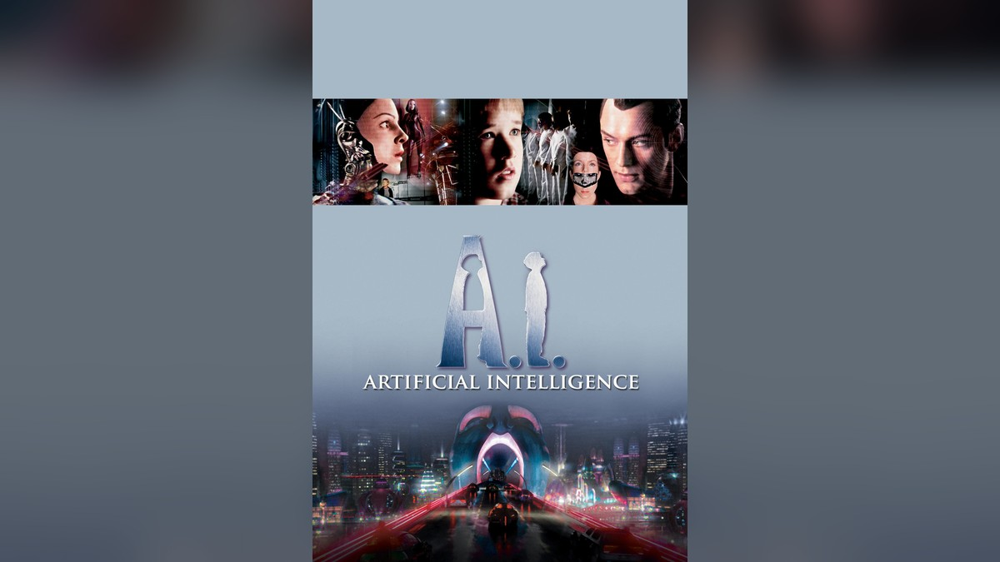
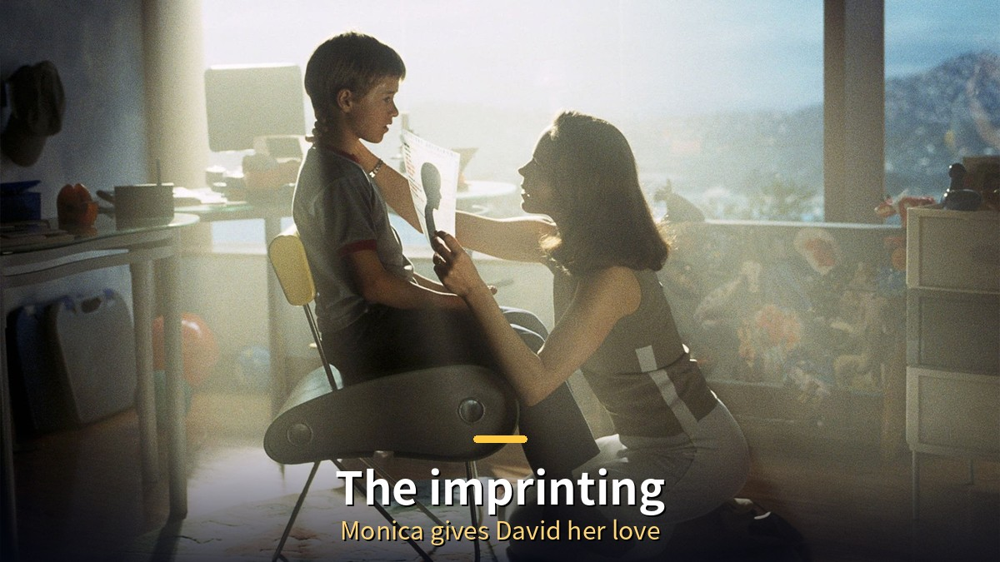
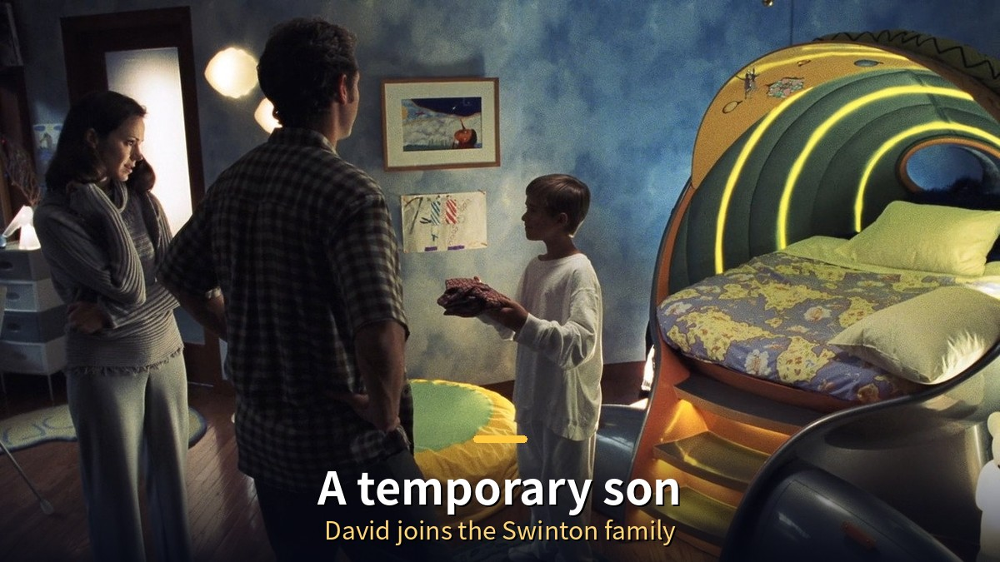
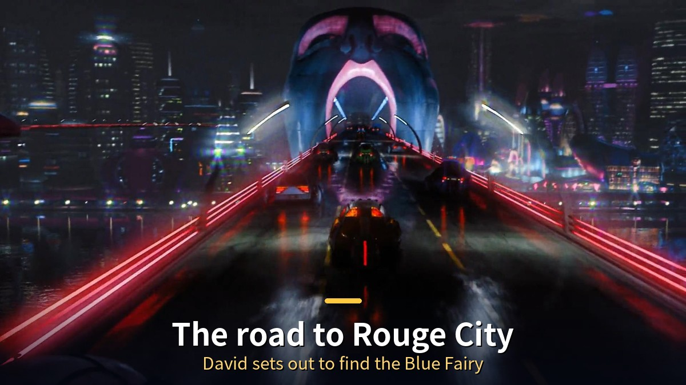
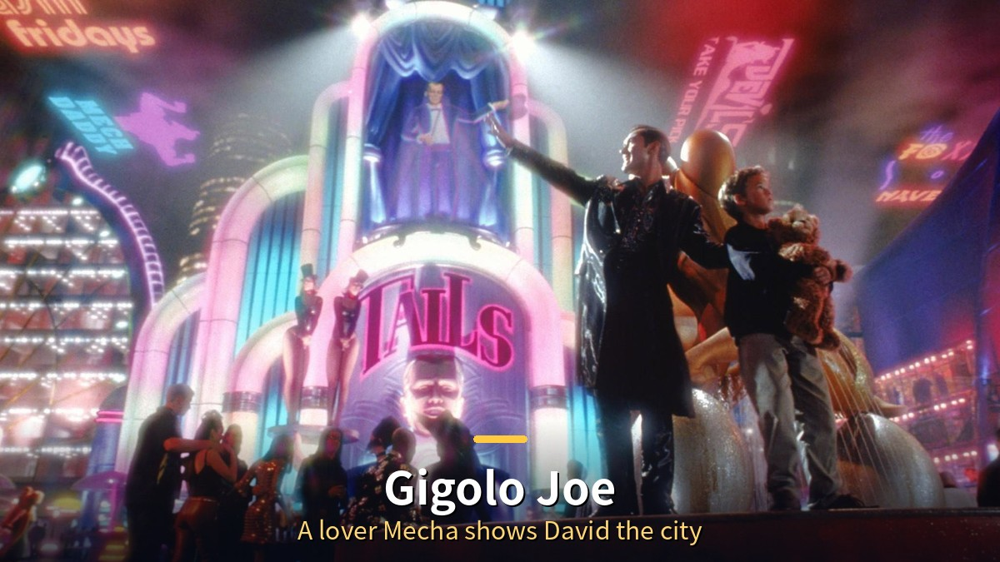
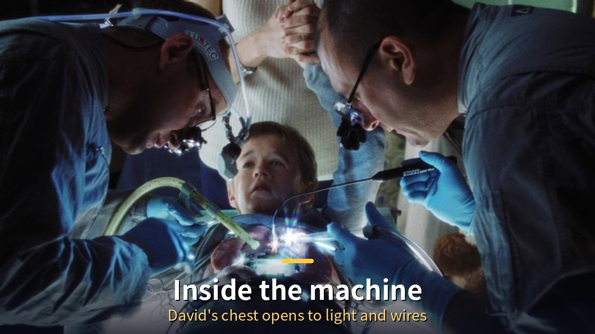
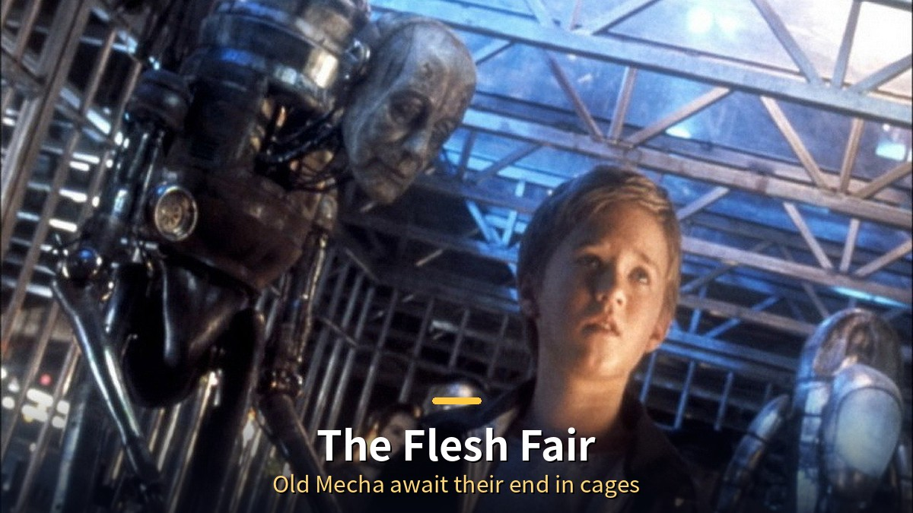
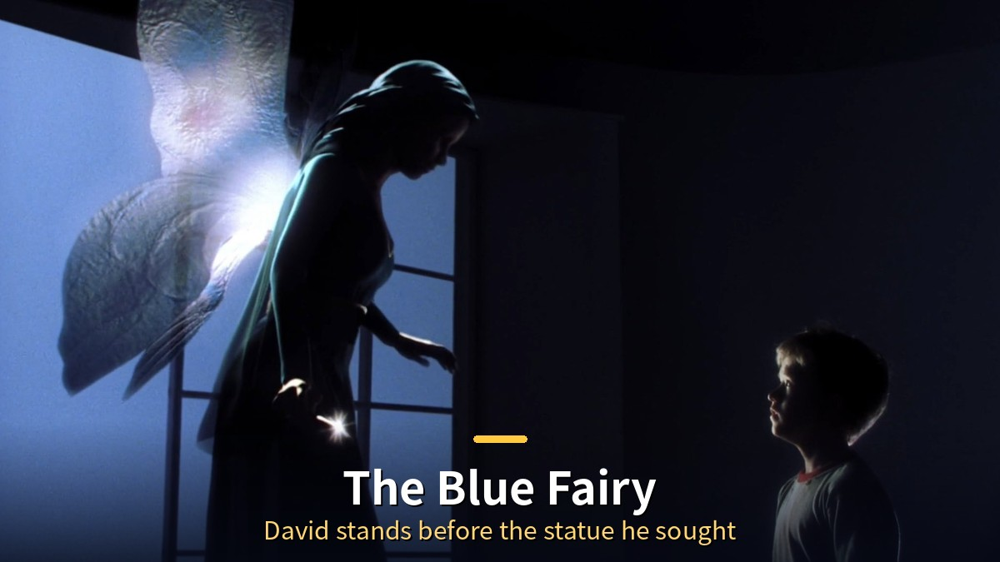

<!-- 본문 시작 -->


The official poster for A.I. Artificial Intelligence.

In 2001, Steven Spielberg took over a project Stanley Kubrick had prepared for decades and completed it as a science-fiction drama.
It is the story of David, a boy robot programmed to feel love.
The 146-minute film earned $235.9 million worldwide, and 25 years later it asks the question of machines with feelings all over again.

```blog
type: text
runs:
  - text: "David, a boy robot designed to feel love, is abandoned by his family and sets out to find the Blue Fairy so he can become a 'real boy.' Directed by Steven Spielberg in 2001, this 146-minute science-fiction drama earned $235.9 million worldwide and posed the question of machines that feel."
    style: {bold: true, color: "#007aa6"}
```

The story of a machine standing beside a human continues in [I, Robot's Three Laws of Robotics and the mind of a machine](https://aitechnotesen.blogspot.com/2026/11/i-robot115-minutes-that-made-robot.html).

| Item | Details |
| --- | --- |
| Title | A.I. Artificial Intelligence |
| Released | 2001 (US June 29, 2001; Korea August 10, 2001) |
| Director | Steven Spielberg |
| Screenplay | Steven Spielberg, Ian Watson (based on the Brian Aldiss short story "Supertoys") |
| Main cast | Haley Joel Osment (David), Jude Law (Gigolo Joe), Frances O'Connor (Monica), William Hurt (Professor Hobby), Sam Robards (Henry) |
| Runtime | 2 hours 26 minutes (146 minutes) |
| Rating | Ages 12 and up (Korea) |
| Score | TMDB 7.1/10 (about 6,900 votes, checked 2026-11-23), IMDb 7.2/10, Rotten Tomatoes 76% |
| Where to watch | Streaming on Netflix; rent ₩1,320 HD or buy ₩4,950 HD on Wavve (checked 2026-11-23) |

```blog
type: heading
level: 2
runs:
  - text: "A boy robot made to feel love — can he become family?"
    style: {bold: true, color: "#007aa6"}
```

It is the 22nd century. The ice caps have melted and coastal cities are under water. The population has shrunk, and humanlike robots called Mecha fill the gaps of everyday life. Professor Hobby of Cybertronics takes the next step. He builds a boy robot that can feel love.

```blog
type: text
runs:
  - text: "Term: Mecha"
    style: {bold: true, color: "#ff008c"}
  - text: " The film's general word for humanoid robots. They take on human jobs, from gardeners and housekeepers to lovers."
```

David, the robot boy that results, is placed with the Swinton family. Their own son Martin lies in suspended animation with a rare disease. David is a temporary son until Martin returns. Monica imprints her love on David. From that moment, Monica becomes David's whole world.


Monica imprints her love on David. Kneeling before the seated boy, she holds up a paper with a spoon drawn on it.

```blog
type: text
runs:
  - text: "Who David is: "
    style: {bold: true, color: "#ff008c"}
  - text: "David (Haley Joel Osment) is the first boy-type Mecha designed to feel love, and becomes the Swintons' temporary son."
```


David's bedroom in the Swinton home. Monica and Henry look at David, who holds Teddy.

Then Martin recovers and comes home. Tension grows between the two boys. When David's actions put Martin in danger, Monica makes her decision. She abandons David in the woods instead of having him destroyed. Only Teddy, the supertoy teddy bear, stays beside David.

```blog
type: heading
level: 2
runs:
  - text: "Why does the abandoned David go looking for the Blue Fairy?"
    style: {bold: true, color: "#007aa6"}
```

David believes the story of Pinocchio. Just as the Blue Fairy turned Pinocchio into a real boy, David believes that becoming a real boy will make his mother love him again. So David sets out with Teddy to find the Blue Fairy.


The road to find the Blue Fairy. Beyond the rain-wet highway rises Rouge City's giant face arch.

On the road, David meets Gigolo Joe, a lover Mecha. Joe is designed to imitate love. David, who is designed to feel love, and Joe, who is designed to imitate it — the two robots begin their journey together.

```blog
type: text
runs:
  - text: "What Gigolo Joe does: "
    style: {bold: true, color: "#ff008c"}
  - text: "Joe (Jude Law) is a lover Mecha who travels through Rouge City with David and shows him the underside of human society."
```


Gigolo Joe and David before the neon signs of Rouge City. Joe points ahead while David holds Teddy.

The two reach the glittering city of Rouge City. But behind it lies the Flesh Fair, a show where obsolete Mecha are destroyed for entertainment. David and Joe barely escape. Following a lead, they visit Dr. Know, who points them toward Manhattan. David's journey now heads for the place where the Blue Fairy is said to be.

```blog
type: text
runs:
  - text: "David's journey is not the story of 'a robot becoming human.' It is the story of a being imprinted with love who keeps holding on to that love even after being abandoned."
    style: {bold: true, background: "#FFF3CD"}
```

The story of machine-made reality overlapping with human reality continues in [The Matrix's question of reality and simulation](https://aitechnotesen.blogspot.com/2026/11/the-matrix136-minutes-when-reality.html).

```blog
type: heading
level: 2
runs:
  - text: "Where does the film draw the line between human and machine?"
    style: {bold: true, color: "#007aa6"}
```

Professor Hobby's experiment starts from a single question. If you build a machine that feels love, what makes it different from a human? David cries like a human, longs like a human, and clings like a human. And yet humans do not accept David as family. At the center of the film sits this structure: a being that feels love is denied love in return.


Technicians open David's chest and look inside. Glowing machinery shows that David is a robot.

Mecha take human jobs, but they do not take the human place. There are gardener Mecha, housekeeper Mecha, and lover Mecha, yet people do not treat Mecha as people. The film holds on to this contradiction until the end. When a machine with feelings wants a human's love, what responsibility do humans carry?


David stands among old Mecha in a cage at the Flesh Fair. Robots no longer useful are locked away.

```blog
type: text
runs:
  - text: "Made for $100 million, the film earned $235.9 million worldwide, but critics were divided. Rotten Tomatoes gave it 76% freshness, while the audience score (Popcornmeter) stopped at 64%."
    style: {bold: true, background: "#FFF3CD"}
```

**This article covers only up to the middle of the film. There is no description of the ending, so first-time viewers can read it without worry.**

```blog
type: heading
level: 2
runs:
  - text: "The AI questions this film asks"
    style: {bold: true, color: "#007aa6"}
```

First, can love be programmed? David is designed to feel love. In 2026, AI companion services that talk with people and offer comfort have become everyday life. Is imitating feelings the same as feeling them, or something different? The question David raised sits at the center of today's emotional AI debate.


David stands before the Blue Fairy statue. The winged statue glows as it looks down at him.

Second, when machines take human jobs, what is left for humans? In the film, Mecha take roles from gardeners to lovers. In 2026, AI already writes, codes, and counsels, and humanoid robots are entering factories and homes. In a world where machines take the work, what is the human role? The film was already asking that in 2001.

Third, do robots need rights? At the Flesh Fair, obsolete Mecha are destroyed for entertainment. A machine that is no longer useful to humans is treated as something that can be smashed. In 2017, Saudi Arabia granted citizenship to the humanoid robot Sophia. How far the status of machines should be recognized is still an unanswered debate.

```blog
type: heading
level: 2
runs:
  - text: "Checklist before you watch"
    style: {bold: true, color: "#007aa6"}
```

As of November 23, 2026: in Korea, it streams on Netflix, and Wavve offers it for rent at ₩1,320 HD and for purchase at ₩4,950 HD. Watcha lists it in aggregators but its own title page says it is not currently available, so it is not listed as a provider here.

The runtime is 2 hours 26 minutes (146 minutes). It is rated ages 12 and up in Korea. Check subtitle and dub options directly in each app.

## Closing thoughts
That a film from 2001 overlaps with the questions of 2026 is no coincidence.
The story of a boy designed to feel love only grows sharper now that machines imitating feelings are part of everyday life.
In an age when machines take human jobs one by one, this is a film that asks what it means to remain human.
Because what lingers is a question, not an ending, the film stays with you for a long time.

## Frequently asked questions
**Is "A.I. Artificial Intelligence" a Stanley Kubrick film or a Steven Spielberg film?**
It is a Steven Spielberg film. But Spielberg took over and directed a project Stanley Kubrick had prepared for decades. The screenplay was written by Spielberg and Ian Watson, based on Brian Aldiss's short story "Supertoys."

**Why does David look for the Blue Fairy?**
In the story of Pinocchio, the Blue Fairy turns Pinocchio into a real boy. David believes that becoming a real boy will make his mother Monica love him again. The Blue Fairy is, for David, the symbol of a way to become real.

**Where can I watch it in Korea?**
As of November 23, 2026, it streams on Netflix in Korea, and Wavve offers it for rent at ₩1,320 HD and for purchase at ₩4,950 HD. Watcha is not currently offering it.

## Good Reads Together
[The Matrix｜136 Minutes When Reality Turned Out to Be Code, the Day He Chose the Red Pill](https://aitechnotesen.blogspot.com/2026/11/the-matrix136-minutes-when-reality.html)
[I, Robot｜115 Minutes That Made a Robot Suspect Humanity](https://aitechnotesen.blogspot.com/2026/11/i-robot115-minutes-that-made-robot.html)

<!-- 본문 끝 -->

## 작업용 출처·이미지 정보 (업로드 제외)

## Sources (not for publication, checked 2026-11-23)
- TMDB page (A.I. Artificial Intelligence, ID 644, score about 7.1/10, about 6,900 votes, official synopsis, top billed cast, runtime 2h 26m)
- English Wikipedia (director Steven Spielberg, screenplay Spielberg and Ian Watson, based on Brian Aldiss, released 2001-06-29, runtime 146 minutes, budget $100 million, box office $235.9 million, two Oscar nominations for visual effects and original score, plot range)
- Korean Wikipedia (director Steven Spielberg, screenplay Spielberg and Ian Watson, release dates 2001-06-29 and 2001-08-10, budget $100 million, box office $235,926,552, Saturn Awards)
- whatsafterthemovie.com (IMDb 7.2/10, Rotten Tomatoes 76%, Popcornmeter 64%, Metacritic 65, TMDB 70%, budget $100 million, box office $235.9 million, released 2001-06-29)
- TMDB watch page and JustWatch Korea (checked in the browser on 2026-11-23, region Korea): streaming on Netflix and Netflix Standard with Ads; rent on Wavve ₩1,320 HD; buy on Wavve ₩4,950 HD. Watcha appears in aggregator listings but its own title page says the title is not currently available, so it is treated as not offered. The flickfinder Watcha listing is treated as outdated.
- Other fact (Saudi Arabia granted citizenship to the humanoid robot Sophia in 2017 — public reporting)
