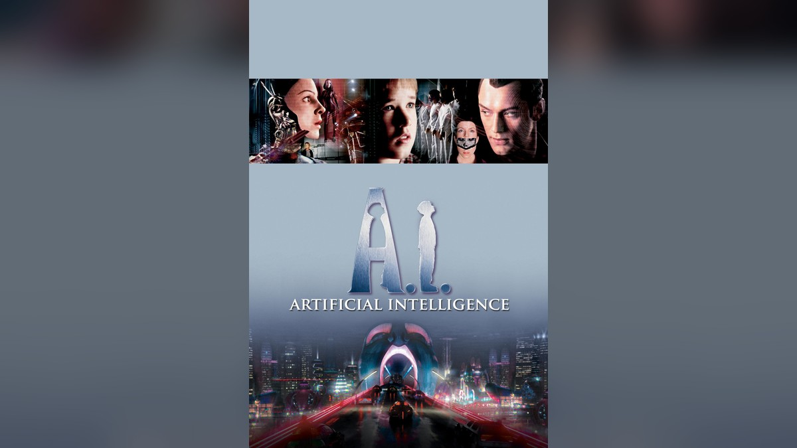
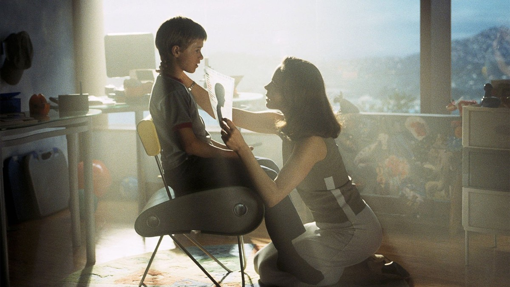
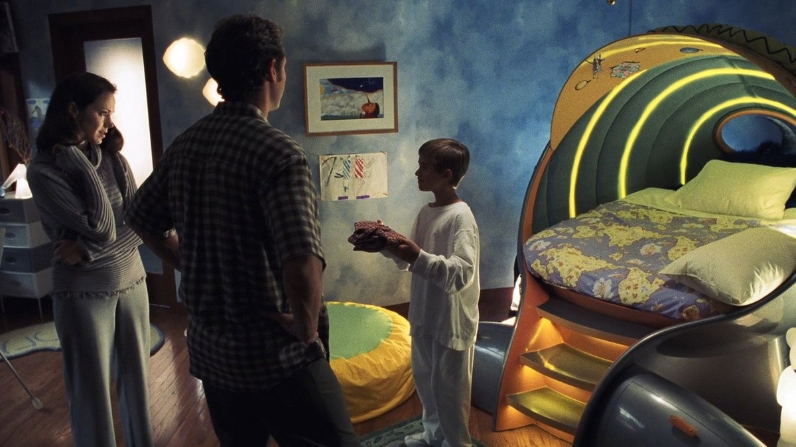
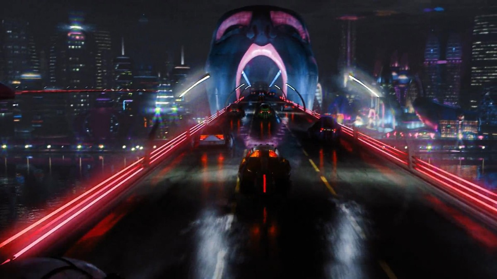
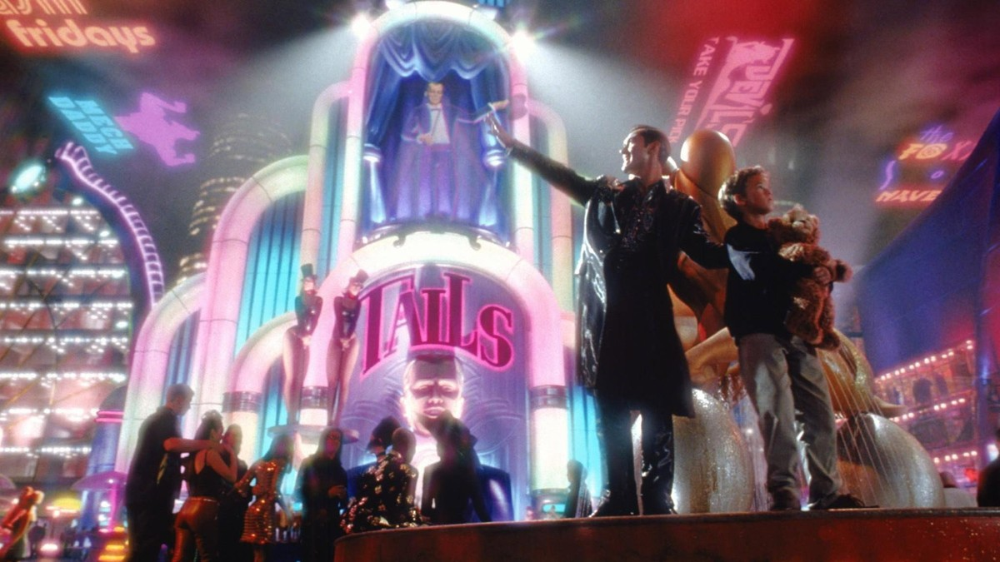
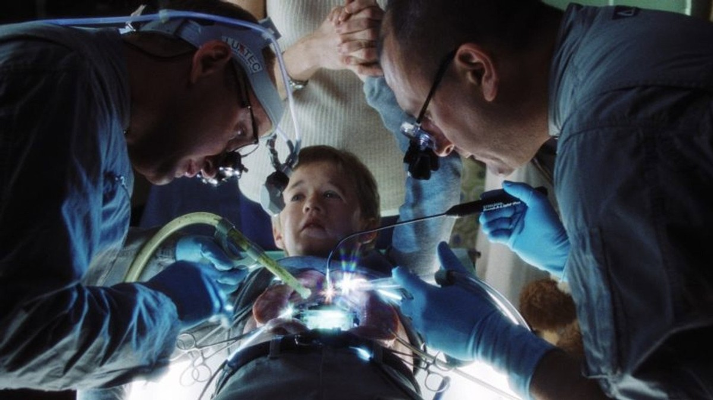
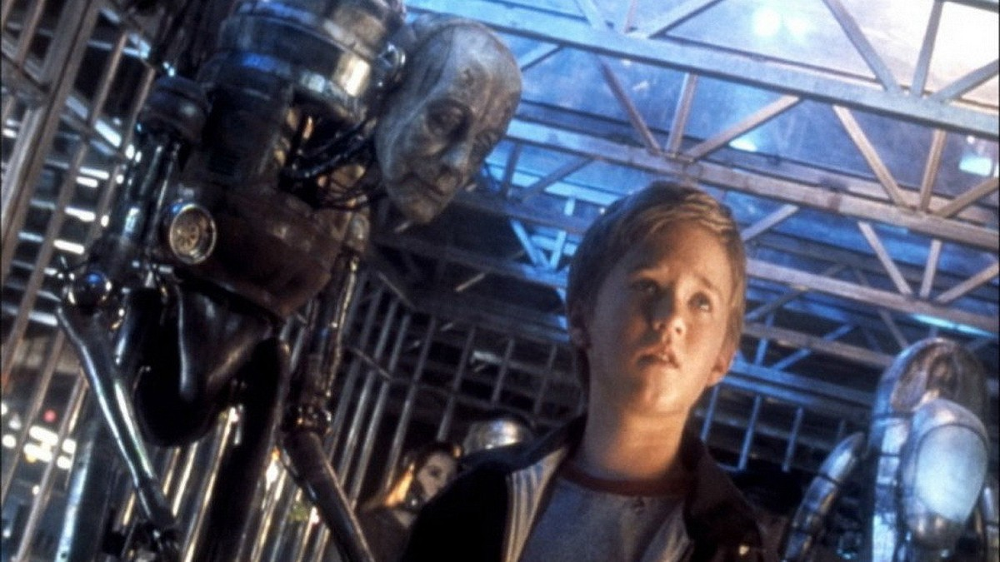
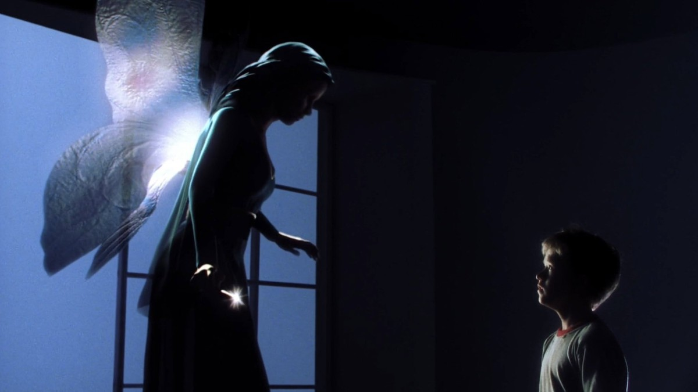

<!-- 본문 시작 -->


A.I. 인공지능 공식 포스터.

2001년, 스티븐 스필버그는 스탠리 큐브릭이 수십 년 준비한 프로젝트를 이어받아 한 편의 SF 드라마를 완성했다.
사랑을 느끼도록 프로그래밍된 소년 로봇 데이비드의 이야기다.
146분짜리 이 영화는 전 세계 2억 3,590만 달러를 벌었고, 25년이 지난 지금 감정을 가진 기계라는 질문을 다시 던진다.

```blog
type: text
runs:
  - text: "사랑을 느끼도록 설계된 소년 로봇 데이비드는 가족에게 버려진 뒤 '진짜 소년'이 되기 위해 파란 요정을 찾아 떠난다. 2001년 스티븐 스필버그 감독의 146분짜리 SF 드라마로, 전 세계 2억 3,590만 달러를 벌며 감정을 가진 기계라는 질문을 던진 작품이다."
    style: {bold: true, color: "#007aa6"}
```

기계가 인간의 곁에 서는 이야기는 [아이, 로봇의 로봇 3원칙과 기계의 마음](https://blog.naver.com/3700708/224477518995)에서도 이어진다.

| 항목 | 내용 |
| --- | --- |
| 제목 | A.I. 인공지능 (A.I. Artificial Intelligence) |
| 개봉 | 2001년 (미국 2001-06-29, 한국 2001-08-10) |
| 감독 | 스티븐 스필버그 |
| 각본 | 스티븐 스필버그, 이안 왓슨 (원작: 브라이언 올디스 단편 '슈퍼토이즈') |
| 주요 출연 | 헤일리 조엘 오스먼트(데이비드), 주드 로(지고로 조), 프랜시스 오코너(모니카), 윌리엄 허트(호비 교수), 샘 로바즈(헨리) |
| 러닝타임 | 2시간 26분 (146분) |
| 등급 | 12세 관람가 |
| 평점 | TMDB 7.1/10 (약 6,900개 평가, 2026-11-23 확인), IMDb 7.2/10, 로튼토마토 76% |
| 시청처 | 넷플릭스 스트리밍·웨이브 대여 1,320원 HD·구매 4,950원 HD (2026-11-23 확인) |

```blog
type: heading
level: 2
runs:
  - text: "사랑을 느끼도록 만든 소년 로봇, 가족이 될 수 있나"
    style: {bold: true, color: "#007aa6"}
```

22세기, 빙하가 녹아 해안 도시들이 물에 잠긴 미래다. 인구는 줄었고, 인간을 닮은 로봇 '메카'가 일상의 빈자리를 메운다. 사이버트로닉스의 호비 교수는 그 다음 단계에 도전한다. 사랑을 느끼는 소년 로봇을 만드는 것이다.

```blog
type: text
runs:
  - text: "용어: 메카"
    style: {bold: true, color: "#ff008c"}
  - text: " 영화 속 인간형 로봇의 총칭이다. 정원사, 가정부, 연인까지 인간의 일을 대신하는 존재로 그려진다."
```

그렇게 태어난 데이비드가 스윈턴 부부에게 맡겨진다. 부부의 친아들 마틴은 희귀병으로 냉동 수면 상태에 있다. 데이비드는 마틴이 돌아올 때까지의 임시 아들이다. 모니카는 데이비드에게 사랑을 각인한다. 그 순간부터 데이비드에게 모니카는 세상의 전부가 된다.


모니카가 데이비드에게 사랑을 각인하는 장면. 의자에 앉은 데이비드 앞에 무릎을 꿇고 숟가락 그림이 그려진 종이를 들어 보인다.

```blog
type: text
runs:
  - text: "데이비드의 정체: "
    style: {bold: true, color: "#ff008c"}
  - text: "데이비드(헤일리 조엘 오스먼트)는 사랑을 느끼도록 설계된 최초의 소년형 메카로, 스윈턴 부부의 임시 아들이 된다."
```


스윈턴 부부의 집, 데이비드의 방. 모니카와 헨리가 테디를 안은 데이비드를 바라본다.

그런데 마틴이 회복돼 집으로 돌아온다. 두 소년 사이에 긴장이 자란다. 데이비드의 행동이 마틴을 위험에 빠뜨리는 사건이 일어나고, 모니카는 결단을 내린다. 데이비드를 파괴하지 않고 숲에 버리는 것이다. 데이비드 곁에는 슈퍼토이 곰 인형 테디만 남는다.

```blog
type: heading
level: 2
runs:
  - text: "버려진 데이비드는 왜 파란 요정을 찾아 떠나나"
    style: {bold: true, color: "#007aa6"}
```

데이비드는 피노키오 이야기를 믿는다. 파란 요정이 피노키오를 진짜 소년으로 만들어줬듯, 자신도 진짜 소년이 되면 엄마가 다시 사랑해줄 거라 믿는다. 그래서 데이비드는 테디와 함께 파란 요정을 찾아 떠난다.


파란 요정을 찾아 떠나는 길. 비에 젖은 도로 너머로 루즈 시티의 거대한 얼굴 아치가 보인다.

길에서 데이비드는 연인형 메카 지고로 조를 만난다. 조는 인간의 사랑을 흉내 내도록 설계된 로봇이다. 사랑을 '느끼는' 데이비드와 사랑을 '흉내 내는' 조, 두 로봇의 동행이 시작된다.

```blog
type: text
runs:
  - text: "지고로 조의 역할: "
    style: {bold: true, color: "#ff008c"}
  - text: "조(주드 로)는 연인형 메카로, 데이비드와 함께 루즈 시티를 누비며 인간 사회의 뒷면을 보여주는 길잡이다."
```


루즈 시티의 네온 간판 앞에서 지고로 조와 데이비드. 조가 앞을 가리키고, 데이비드는 테디를 안고 있다.

두 사람은 화려한 도시 루즈 시티에 닿는다. 하지만 그 뒤에는 구식 메카를 오락 삼아 파괴하는 행사, 플레시 페어가 있다. 데이비드와 조는 그곳에서 간신히 빠져나온다. 단서를 찾아간 닥터 노는 맨해튼을 가리킨다. 데이비드의 여정은 이제 파란 요정이 있다는 곳으로 향한다.

```blog
type: text
runs:
  - text: "데이비드의 여정은 '로봇이 인간이 되는 이야기'가 아니라, 사랑을 각인받은 존재가 버림받은 뒤에도 사랑을 놓지 않는 이야기로 풀이된다."
    style: {bold: true, background: "#FFF3CD"}
```

기계가 만든 현실과 인간의 현실이 겹치는 이야기는 [매트릭스의 현실과 시뮬레이션 질문](https://blog.naver.com/3700708/224478573702)에서도 이어진다.

```blog
type: heading
level: 2
runs:
  - text: "인간과 기계의 경계, 영화는 어디에 선을 긋나"
    style: {bold: true, color: "#007aa6"}
```

호비 교수의 실험은 질문 하나에서 시작한다. 사랑을 느끼는 기계를 만들면, 그 기계는 인간과 무엇이 다른가. 데이비드는 인간처럼 울고, 그리워하고, 집착한다. 그런데도 인간들은 데이비드를 가족으로 받아들이지 않는다. 사랑을 느끼는 존재가 사랑을 돌려받지 못하는 구조가 영화의 중심에 있다.


기술자들이 데이비드의 가슴을 열어 내부를 들여다본다. 빛나는 기계 장치가 드러나 데이비드가 로봇임을 보여준다.

메카는 인간의 일을 대신하지만, 인간의 자리는 대신하지 못한다. 정원사 메카, 가정부 메카, 연인 메카가 있어도 사람들은 메카를 사람으로 대하지 않는다. 영화는 이 모순을 끝까지 붙잡는다. 감정을 가진 기계가 인간의 사랑을 원할 때, 인간은 어떤 책임을 져야 하는가.


플레시 페어의 철창 안에 모인 낡은 메카들 사이에 선 데이비드. 쓸모가 없어진 로봇들이 갇혀 있다.

```blog
type: text
runs:
  - text: "1억 달러를 들여 만들어 전 세계 2억 3,590만 달러를 벌었지만, 평가는 갈렸다. 로튼토마토 신선도 76%와 달리 관객 평점(팝콘미터)은 64%에 그쳤다."
    style: {bold: true, background: "#FFF3CD"}
```

**이 글은 작품 중반부까지의 내용만 다룬다. 결말에 대한 설명은 일절 없으니, 처음 보는 사람도 안심하고 읽어도 된다.**

```blog
type: heading
level: 2
runs:
  - text: "이 작품이 던지는 AI 질문"
    style: {bold: true, color: "#007aa6"}
```

첫째, 사랑을 프로그래밍할 수 있나. 데이비드는 사랑을 '느끼도록' 설계됐다. 2026년의 현실에서도 사람과 대화하며 위로를 건네는 AI 동반자 서비스가 일상이 됐다. 감정을 흉내 내는 것과 감정을 느끼는 것은 같은 것일까, 다른 것일까. 데이비드가 던진 질문은 지금 감정 AI 논쟁의 한가운데에 있다.


파란 요정 동상 앞에 선 데이비드. 날개 달린 동상이 빛을 받으며 데이비드를 내려다본다.

둘째, 기계가 인간의 일을 대신하면, 인간은 무엇으로 남나. 영화 속 메카는 정원사부터 연인까지 인간의 역할을 맡는다. 2026년에는 AI가 글쓰기, 코딩, 상담을 대신하고, 휴머노이드 로봇이 공장과 가정에 들어오고 있다. 기계가 일을 대신하는 세상에서 인간의 역할은 무엇인지, 영화는 2001년에 이미 묻고 있었다.

셋째, 로봇에게도 권리가 필요할까. 플레시 페어에서 구식 메카는 오락 삼아 파괴된다. 인간에게 쓸모가 없어진 기계는 부숴도 되는 존재로 취급된다. 2017년에는 사우디아라비아가 휴머노이드 로봇 소피아에게 시민권을 줬다. 기계의 지위를 어디까지 인정할 것인가는 지금도 답이 없는 논쟁이다.

```blog
type: heading
level: 2
runs:
  - text: "시청 전 체크리스트"
    style: {bold: true, color: "#007aa6"}
```

2026년 11월 23일 기준으로 정리한다. 국내에서는 넷플릭스에서 스트리밍으로 볼 수 있고, 웨이브에서는 대여 1,320원 HD·구매 4,950원 HD로 볼 수 있다. 왓챠는 TMDB·JustWatch 목록에는 있으나 왓챠 작품 페이지에서 "서비스 중인 콘텐츠가 아니에요"로 확인돼 현재 미제공이다. 각 앱에서 직접 확인하는 것이 좋다.

러닝타임은 2시간 26분(146분)이다. 등급은 12세 관람가다. 자막과 더빙 여부는 각 앱에서 직접 확인하는 것이 좋다.

## 마무리
2001년에 나온 영화가 2026년의 질문과 겹치는 건 우연이 아니다.
사랑을 느끼도록 설계된 소년의 이야기는, 감정을 흉내 내는 기계가 일상이 된 지금 더 또렷해진다.
기계가 인간의 일을 하나씩 맡아가는 시대에, 인간으로 남는다는 게 무엇인지 묻는 영화다.
결말이 아니라 질문이 남는 작품이라, 여운이 오래 간다.

## 자주 묻는 질문
**A.I. 인공지능은 스탠리 큐브릭의 영화인가요, 스티븐 스필버그의 영화인가요?**
스티븐 스필버그 감독의 영화다. 다만 스탠리 큐브릭이 수십 년간 준비한 프로젝트를 스필버그가 이어받아 연출했다. 각본은 스필버그와 이안 왓슨이 썼고, 원작은 브라이언 올디스의 단편 '슈퍼토이즈'다.

**데이비드는 왜 파란 요정을 찾나요?**
피노키오 이야기에서 파란 요정이 피노키오를 진짜 소년으로 만들어줬듯, 데이비드도 진짜 소년이 되면 엄마 모니카가 다시 사랑해줄 거라 믿기 때문이다. 파란 요정은 데이비드에게 '진짜가 되는 방법'의 상징이다.

**한국에서 어디서 볼 수 있나요?**
2026년 11월 23일 기준으로 넷플릭스에서 스트리밍으로, 웨이브에서 대여 1,320원 HD·구매 4,950원 HD로 볼 수 있다. 왓챠는 현재 미제공이다.

## 함께 보면 좋은 글
[매트릭스｜현실이 코드였던 136분, 빨간 알약을 고른 날](https://blog.naver.com/3700708/224478573702)
[아이, 로봇｜로봇 3원칙이 무너지는 순간, 기계는 어디까지 가나](https://blog.naver.com/3700708/224477518995)

<!-- 본문 끝 -->

## 작업용 출처·이미지 정보 (업로드 제외)

## 출처 목록 (발행본 제외, 2026-11-23 확인)
- TMDB 페이지 (A.I. Artificial Intelligence, ID 644, 평점 약 7.1/10·약 6,900개 평가·공식 시놉시스·주요 출연·러닝타임 2시간 26분)
- 영어 위키백과 (감독 스티븐 스필버그·각본 스필버그·이안 왓슨·원작 브라이언 올디스·개봉 2001-06-29·러닝타임 146분·제작비 1억 달러·흥행 2억 3,590만 달러·아카데미 시각효과상·음악상 후보 2개 부문·줄거리 범위)
- 한국어 위키백과 (감독 스티븐 스필버그·각본 스필버그·이안 왓슨·개봉일 2001-06-29·2001-08-10·제작비 1억 달러·흥행 2억 3,592만 달러·새턴상 수상)
- whatsafterthemovie.com (IMDb 7.2/10·로튼토마토 76%·팝콘미터 64%·메타크리틱 65·TMDB 70%·제작비 1억 달러·흥행 2억 3,590만 달러·개봉 2001-06-29)
- TMDB 시청 페이지·JustWatch 한국 (2026-11-23 브라우저 직접 확인, 지역 대한민국): 스트리밍 넷플릭스·넷플릭스 광고형, 대여 웨이브 1,320원 HD, 구매 웨이브 4,950원 HD. 왓챠는 두 사이트 목록에는 있으나 왓챠 작품 페이지(https://watcha.com/ko/contents/m2WyDM5)에서 "서비스 중인 콘텐츠가 아니에요"로 확인돼 미제공으로 정정. flickfinder의 Watcha 표기는 구 정보로 판단.
- 기타 사실 (2017년 사우디아라비아, 휴머노이드 로봇 소피아 시민권 부여 — 공개 보도 기준)
