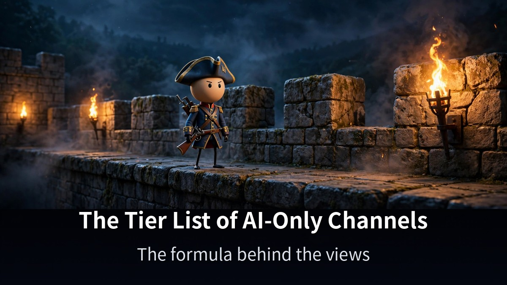
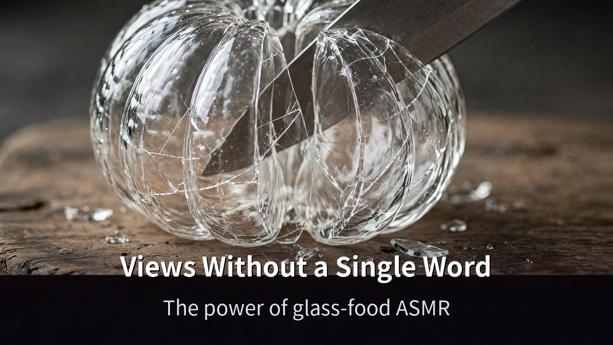
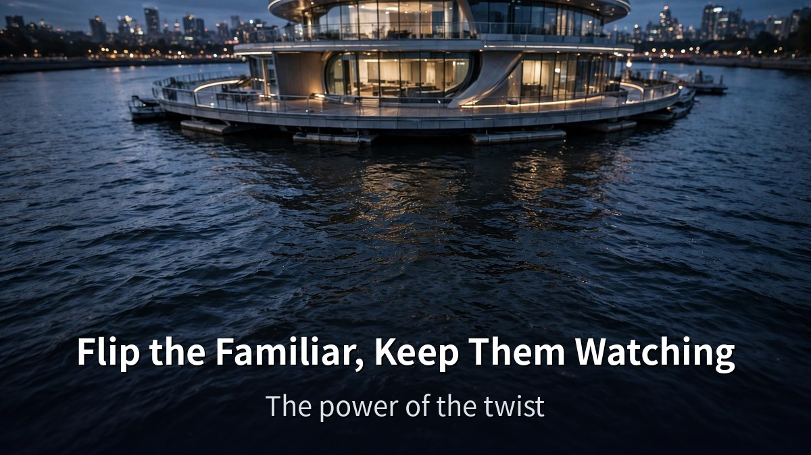
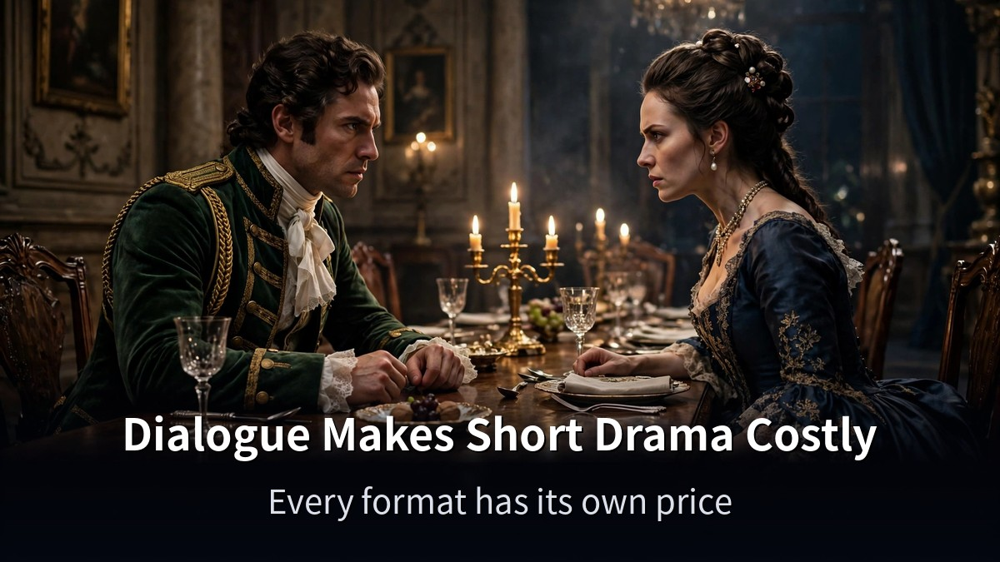

<!-- 본문 시작 -->



Only 3 of 10 AI-only channels made the top tier.
In a video posted on November 23, honjobs ranked ten channels on three measures: views, ease of copying, and cost.
This post walks through the ranking, what one Short costs to make, and what to watch out for before copying any of them.

```blog
type: text
runs:
  - text: "A one-minute video with no human in it passed 1.28 million views. Honjobs sorted ten AI-only channels by views, ease of copying, and cost: the top tier was Rix Clips, Mysterious Architecture Dictionary, and Dopamine Film, while the fifth-tier channel Civilization has lost monetization. A Short costs from 8.5 credits, and monetization starts with 1,000 subscribers plus a watch-time condition."
    style: {bold: true, color: "#007aa6"}
```

How to make AI Shorts with a single line of instruction is covered in [Make AI Shorts With One Claude Line](https://blog.naver.com/3700708/224485641382), which walks through the Higgsfield Shorts Studio steps.

```blog
type: heading
level: 2
runs:
  - text: "What sets the top three apart?"
    style: {bold: true, color: "#007aa6"}
```



One stick figure made 35 million views, and the secret was not the drawing but how the story ends.

The first top-tier channel is Rix Clips. It has 206,000 subscribers, and one Short passed 35 million views while another passed 31 million. A round-headed stick figure becomes a soldier or a commoner from history and explains one surprising fact in under a minute. The drawings are simple, but each story ends with a why, so viewers watch to the end and watch again. The production has four steps: ask ChatGPT for about ten surprising historical facts, pick one and write a one-minute script split into 10-second scenes, generate video scene by scene from a single character drawing, then add a voice and stitch the scenes together. One Short cost 3.5 credits for the image and 5 credits for the video, 8.5 credits in all.

The second is Mysterious Architecture Dictionary. It has 836,000 subscribers, and its videos run about a minute. Realistic-looking AI footage carries a calm voiceover. A video about a salt field in the mountains posted three days earlier passed 1.28 million views, and one about a white lump on a rice paddy passed 700,000. The trick sits in the first line of the title: take a scene everyone has seen once and reveal that it is something else entirely. An unexpected answer makes viewers stay to find out why. The host recreated the process in Higgsfield using Seoul's Sebitseom building. A scene image came from GPT Image 2, and an 8-second clip came from Google Veo 3.1. The total was 3.5 credits for the image and 32 credits for the video, 35.5 credits in all.

The third is Dopamine Film. It has 40,000 subscribers, and a K-drama-style romance fantasy Short passed 1.2 million views. Western nobles meet Korean melodrama formulas: a slap is blocked or water is thrown in the first scene, and each episode ends with a reason to watch the next. There are two ways to make it. The Shorts Drama menu on the Higgsfield website takes a script and builds the characters, places, and scenes. The other way is to connect Higgsfield to Claude and give spoken instructions. The host used the second method for a 30-second short drama. Three reference drawings cost 10.5 credits, and two 15-second scenes with dialogue cost 210 credits, 220.5 credits in all.

```blog
type: text
runs:
  - text: "Ranking criteria "
    style: {bold: true, color: "#ff008c"}
  - text: "Do the views come in, is it easy for anyone to copy, and is it cheap to make? These three measures are the host's own yardstick. The tier list is the host's judgment, not an official YouTube ranking."
```

| Tier | Channel | Subscribers | Top video views |
| --- | --- | --- | --- |
| Tier 1 | Rix Clips | 206,000 | 35 million |
| Tier 1 | Mysterious Architecture Dictionary | 836,000 | 1.28 million |
| Tier 1 | Dopamine Film | 40,000 | 1.2 million |
| Tier 2 | Joseon Hip-Hop | 335,000 | 2.6 million |
| Tier 2 | Hyperthetically | 344,000 | 6.5 million |
| Tier 2 | Nubi Hyeon | 27,000 | 1.2 million |
| Tier 3 | Economics Toktok | 256,000 | 1.17 million |
| Tier 3 | Demon Flying Fox | 508,000 | 14.93 million |
| Tier 4 | AI Sensory Playground | 64,000 | 2.9 million |
| Tier 5 | Civilization | 192,000 | 1.3 million |

Tier 2 includes Joseon Hip-Hop. Animated characters in hanbok perform hip-hop mixed with traditional Korean instruments. A teaser Short for a new song passed 2.6 million views, and the songs themselves become work: local governments and sports teams commission cheer songs. Song, artwork, and dance video together cost 23.6 credits. The overseas channel Hyperthetically holds a story for over ten minutes with a single what-if question, such as a day in the life of a black-market surgeon. That video passed 6.5 million views. Nubi Hyeon feeds modern food such as ramen to people in the Joseon era. It has 27,000 subscribers, and its video about selling ramen in Joseon passed 1.2 million views, more than 40 times its subscriber count.

In tier 3, Economics Toktok has 256,000 subscribers and its most-viewed video reached 1.17 million views, though most recent videos sit in the tens of thousands, which earned it a middle score. A round-headed character calmly explains money topics such as exchange rates, dividends, and quitting a job for over ten minutes. Demon Flying Fox, an overseas channel with 508,000 subscribers, passed 14.93 million views with a Balenciaga Harry Potter video from three years ago. It treats absurd premises, such as an eagle and a Canada goose at war, with documentary seriousness.

Tier 4 is AI Sensory Playground. It has 64,000 subscribers, and one video of glass food passed 2.9 million views. Glass tangerines and glass kimbap are sliced and grilled, foods that cannot exist. There is not a single spoken word, so the video works for viewers in any country. Copying it is easy: no script, no voice. But the host judged that the entry barrier is so low that copying it rarely reproduces the same result.

Tier 5 is Civilization. It has 192,000 subscribers, and its first episode, 50 Years After the Fall, passed 1.3 million views. A small black character walks through a city 50 years after humanity vanished. The backgrounds look real and the character is simple, so it stands out. As a series, one episode leads viewers to the next. Yet the channel has lost monetization. The host guessed the cause: the same character keeps appearing in similar scenes. For viewing pleasure, the host still called it tier 1.

```blog
type: text
runs:
  - text: "The tier list is the host's judgment. Subscriber and view counts are figures from when the video was published, and the ranking is not an official YouTube list. Channel names and figures were checked against the original transcript."
    style: {bold: true, background: "#FFF3CD"}
```

```blog
type: heading
level: 2
runs:
  - text: "What does one Short cost to make?"
    style: {bold: true, color: "#007aa6"}
```



The same Short can cost 8.5 credits or 220 credits, depending on the model used.

Costs split widely by model. By the host's own builds, a stick-figure Short cost 8.5 credits, a glass-food ASMR clip 8 credits, a reversal Short using Veo 3.1 cost 35.5 credits, and a short drama with dialogue cost 220.5 credits. One image costs 3.5 credits with GPT Image 2, a 5-second Seedance 2.0 Mini clip costs 5 credits, and an 8-second Veo 3.1 clip costs 32 credits. Dialogue pushes the per-scene cost up sharply.

Official pricing makes the picture clearer. Higgsfield charges $19 a month for 270 credits on Starter, $59 a month for 1,200 credits on Plus, and $129 a month for 3,000 credits on Ultra. Annual billing drops Plus to $47 a month and Ultra to $99 a month. With Ultra's 3,000 credits, an 8.5-credit Short works out to about 350 Shorts by simple division, though failed takes and retries bring the real number down.

```blog
type: text
runs:
  - text: "Term: credit "
    style: {bold: true, color: "#ff008c"}
  - text: "The usage unit of AI generation tools. Each generation, one image or five seconds of video, deducts a set number of credits. A costlier model, a longer clip, or higher resolution costs more. A monthly plan gives a set number of credits each month."
```

| Tool | Plan | Monthly price | Monthly credits |
| --- | --- | --- | --- |
| Higgsfield | Starter | $19/month | 270 |
| Higgsfield | Plus | $59/month ($47 annually) | 1,200 |
| Higgsfield | Ultra | $129/month ($99 annually) | 3,000 |
| Google Flow | AI Plus | 7,500 KRW/month | 200 |
| Google Flow | AI Pro | 29,000 KRW/month | 1,000 |

Google Flow pricing is confirmed too. AI Plus costs 7,500 KRW a month for 200 credits, and AI Pro costs 29,000 KRW a month for 1,000 credits. Veo 3.1 costs 10 credits for Lite, 20 for Fast, and 100 for Quality. On AI Plus, one Quality clip works out to about 3,750 KRW. That lines up with the host's figure of 3,500 to 4,200 KRW per Short. The host said the calculation assumed a Google Flow plan of 9,000 KRW a month, which differs from the official plans, so it is recorded here as the host's own calculation.

The way to save credits is the same principle covered in [Claude Code 4K Video](https://blog.naver.com/3700708/224486678576), where 560 credits became 204: do not run the expensive model from the start, pick the keepers with a cheap model, and render only the final cut in high quality.

```blog
type: text
runs:
  - text: "Prices are as of November 24, 2026. Higgsfield is running a Black Friday sale, so listed prices may change. The video mentioned a 63% discount as the host's own statement; the sale prices confirmed are Plus at $33 a month and Ultra at $50 a month on annual billing."
    style: {bold: true, background: "#FFF3CD"}
```

```blog
type: heading
level: 2
runs:
  - text: "What to watch out for before copying"
    style: {bold: true, color: "#007aa6"}
```



A channel can do well on views and still lose its income when the same character repeats the same scenes.

The Civilization case comes first. Its views pass a million, but monetization has stopped. The host guessed the cause is the same character appearing in similar scenes over and over. YouTube's own policy backs up that reading. On July 15, 2025, YouTube renamed its repetitious content policy to the inauthentic content policy and clarified its scope. Mass-produced or template-like content, and videos that keep putting the same characters in the same situations, are excluded from monetization. Whether AI made it is not the test; whether the content carries original value is.

The monetization threshold needs a separate check. The YouTube Partner Program requires 1,000 subscribers plus 4,000 watch hours in 12 months, or 10 million Shorts views in 90 days. For a Shorts-only channel, the 10 million views in 90 days is the bar. From February 1, 2027, the bar rises for new applicants: 1,000 subscribers plus 8,000 watch hours, or 20 million Shorts views. Getting in before the change is the better position.

Disclosure matters too when realistic scenes are synthesized. If AI makes a real person appear to say or do something they did not, or creates a realistic scene that never happened, the AI use must be disclosed. Clearly unrealistic animation, or using AI for scripts and captions, is not covered by the disclosure rule. Stick figures and glass food sit on the side that needs no disclosure.

This video was made with support from Higgsfield. The host disclosed the support early in the video and mentioned the Black Friday sale alongside it. When a tool is recommended, the sponsorship is part of the picture. The host's closing point runs the same way: what was shown is reference material for building your own format and style, not something to copy as it is. Similar channels already exist in large numbers, and a channel that copies them exactly will struggle, in the host's judgment.

## Confirmed facts and claims, separated

What is confirmed is each channel's subscriber count and top video views, plus the credits each Short cost. The credit figures come from the host's own builds and were checked against the original transcript. Higgsfield and Google Flow prices were checked against official pricing pages and pricing guides on November 24, 2026. The Partner Program thresholds and the inauthentic content policy were checked against YouTube's help and policy pages.
What belongs on the claims side is the tier order itself. The three criteria are the host's own choice, and the same channel lands in a different tier if the criteria change. The cause of Civilization's lost monetization is also the host's guess. The policy comparison makes it plausible, but it cannot be stated as YouTube's ruling on that channel. The 9,000 KRW Google Flow plan and the 3,500 to 4,200 KRW per Short are the host's own figures, recorded separately from the official prices. The 63% discount is likewise the host's statement.

When I first saw the tier list, what stayed with me was that the gap between tier 1 and tier 5 was not skill. Civilization was not fifth because its videos are boring, but because the way the series continued did not fit the revenue structure. Views are not income, and this video shows it in a single table. The next time I look at an AI channel, I will probably check how it continues before I check how many views it has.

## Frequently asked questions

**Can an AI-only channel be monetized?**

Yes. YouTube does not ban AI use itself. But mass-produced or template-like repetitive content is excluded from monetization under the inauthentic content policy. Putting the same characters in the same situations repeatedly can stop the income even when views are high. The Partner Program bar of 1,000 subscribers plus 4,000 watch hours, or 10 million Shorts views, must also be cleared separately.

**Can I build an AI channel without Higgsfield?**

Yes. A common combination is Google Flow with Veo 3.1 for scenes and ChatGPT for scripts and images. Costs differ by model, though. One Veo 3.1 Quality clip works out to about 3,750 KRW on Google AI Plus. Whichever tool is used, the way to save is not to run the expensive model from the start.

**How many credits does one Short take?**

It depends on the format. A stick-figure Short took 8.5 credits, a glass-food ASMR clip 8 credits, a reversal Short using Veo 3.1 took 35.5 credits, and a short drama with dialogue took 220.5 credits. All are figures the host confirmed while building them. On Ultra's 3,000 credits a month, an 8.5-credit Short works out to about 350 Shorts by simple division.

## Further reading

[Claude Code 4K Video | How 560 Credits Became 204](https://blog.naver.com/3700708/224486678576)

[A.I. Artificial Intelligence | The Robot Boy Programmed to Love](https://blog.naver.com/3700708/224488130424)

<!-- 본문 끝 -->

## 작업용 출처·이미지 정보 (업로드 제외)

**Sources**
- honjobs, "AI로만 만든 채널 10곳, 직접 따라 만들어 보고 티어 매겼습니다" (10 AI-only channels, ranked), November 23, 2026 (original transcript, captured from the YouTube script panel on November 24, 2026)
- Higgsfield official pricing (checked November 24, 2026: Starter $19/month, 270 credits; Plus $59/month, 1,200 credits; Ultra $129/month, 3,000 credits)
- Google Flow pricing (checked November 24, 2026: AI Plus 7,500 KRW/month, 200 credits; AI Pro 29,000 KRW/month, 1,000 credits; Veo 3.1 Lite 10, Fast 20, Quality 100 credits)
- YouTube Partner Program requirements and inauthentic content policy (checked November 24, 2026, including the February 1, 2027 threshold change)
