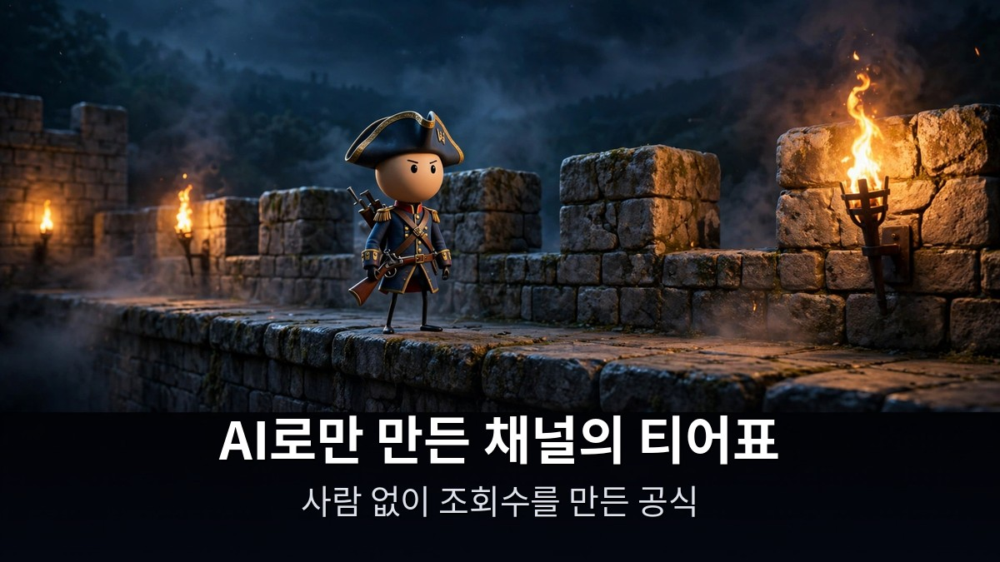
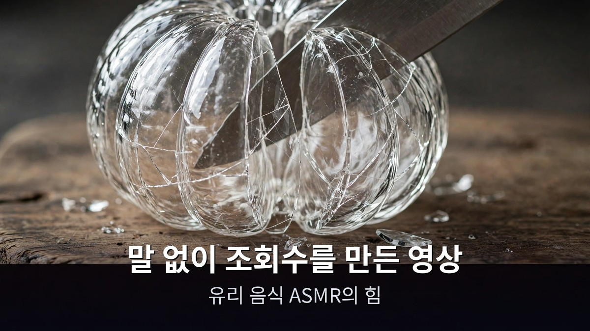
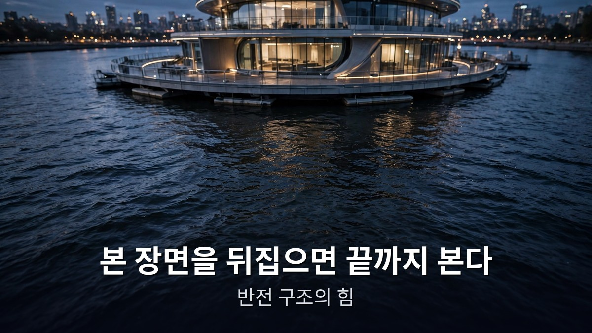
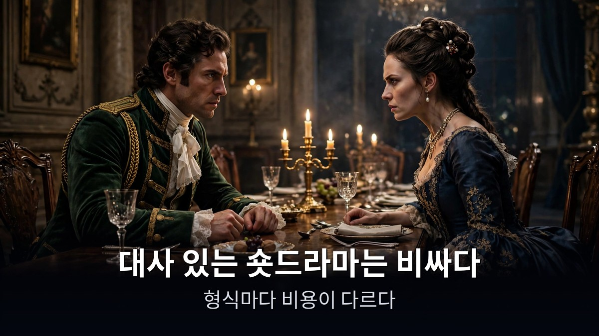

<!-- 본문 시작 -->



AI로만 만든 채널 10곳 가운데 1티어는 단 3곳이다.
혼잡스가 11월 23일 올린 영상에서 조회수·따라하기·비용 세 가지 기준으로 티어를 매겼다.
티어표의 결론과 쇼츠 1편에 드는 비용, 따라 만들 때의 주의점을 순서대로 정리한다.

```blog
type: text
runs:
  - text: "사람이 한 번도 안 나오는 1분짜리 영상이 128만 회를 넘겼다. 혼잡스가 AI로만 만든 채널 10곳을 조회수·따라하기·비용으로 나눈 결과, 1티어는 릭스클립스·신비한 건축 사전·도파민 필름 3곳이었고, 5티어 문명 채널은 수익 창출이 멈춘 상태였다. 비용은 쇼츠 1편에 8.5크레딧부터, 수익화에는 구독자 1,000명과 시청 조건이 먼저다."
    style: {bold: true, color: "#007aa6"}
```

AI 쇼츠를 한 줄 명령으로 만드는 방법은 [클로드 한 줄로 AI 쇼츠 만들기](https://blog.naver.com/3700708/224485641382) 글에서 다룬 힉스필드 쇼츠 스튜디오 순서와 이어진다.

```blog
type: heading
level: 2
runs:
  - text: "1티어 3곳은 뭐가 다른가"
    style: {bold: true, color: "#007aa6"}
```



막대기 인간 하나가 3,500만 회를 만든 비결은 그림이 아니라 이야기의 끝맺음이다.

1티어 첫 번째는 릭스클립스다. 구독자는 20만 6,000명인데 쇼츠 하나가 3,500만 회, 또 하나가 3,100만 회를 넘었다. 동그란 머리의 막대기 인간이 옛날 군인이나 백성이 되어 역사 속 신기한 사실 하나를 1분 안에 풀어준다. 그림은 단순한데 이야기가 왜 그랬을까로 끝나서 끝까지 보고 다시 보게 만든다. 만드는 순서는 네 단계다. 챗GPT로 역사 속 신기한 사실 아이디어를 열 개쯤 뽑고, 하나를 골라 1분 대본을 쓰고 10초씩 장면을 나누고, 캐릭터 그림 한 장을 기준으로 장면마다 영상을 만들고, 목소리를 입혀 이어붙인다. 쇼츠 1편에 든 건 이미지 3.5크레딧에 영상 5크레딧, 모두 8.5크레딧이다.

두 번째는 신비한 건축 사전이다. 구독자는 83만 6,000명, 영상은 1분 남짓이다. 실제 촬영한 것 같은 AI 영상 위로 낮은 목소리가 이야기를 들려준다. 사흘 전에 올린 산골 염전 영상이 128만 회, 논 위에 하얀 덩어리 영상이 70만 회를 넘었다. 잘되는 이유는 제목 첫 줄에 있다. 누구나 한 번쯤 본 장면을 꺼내고 다른 것이라는 반전을 준다. 예상과 다른 답이 나오니까 이유가 궁금해서 끝까지 보게 된다. 진행자는 이 순서를 힉스필드로 직접 따라 만들었다. 한강 세빛섬을 소재로 GPT 이미지 2로 장면 이미지를 만들고 구글 비오 3.1로 8초 영상을 뽑았다. 여기까지 든 건 이미지 3.5크레딧에 영상 32크레딧, 모두 35.5크레딧이다.

세 번째는 도파민 필름이다. 구독자는 4만 명인데 K막장 로맨스 판타지 쇼츠가 120만 회를 넘었다. 서양 귀족이 나오는 로맨스 판타지에 한국 막장 드라마 공식을 섞었다. 첫 장면에 뺨을 막거나 물을 뒤집어쓰는 장면이 나오고, 회차마다 다음 편이 궁금하게 끝난다. 만드는 법은 두 가지다. 힉스필드 웹사이트의 숏드라마 메뉴에 대본을 올리면 인물과 장소를 만들고 장면까지 이어준다. 클로드에 힉스필드를 연결해 말로 시키는 방법도 있다. 진행자는 두 번째 방법으로 30초짜리 숏드라마를 만들었다. 기준 그림 세 장에 10.5크레딧, 15초 장면 두 개에 210크레딧, 모두 220.5크레딧이 들었다.

```blog
type: text
runs:
  - text: "티어 기준 "
    style: {bold: true, color: "#ff008c"}
  - text: "조회수가 잘 나오는가, 누구나 따라하기 쉬운가, 만드는 비용이 싼가. 세 가지 기준은 진행자가 직접 정한 평가 축이다. 티어 자체는 진행자의 판단이지 유튜브 공식 순위가 아니다."
```

| 티어 | 채널 | 구독자 | 대표 영상 조회수 |
| --- | --- | --- | --- |
| 1티어 | 릭스클립스 | 20만 6,000명 | 3,500만 회 |
| 1티어 | 신비한 건축 사전 | 83만 6,000명 | 128만 회 |
| 1티어 | 도파민 필름 | 4만 명 | 120만 회 |
| 2티어 | 조선힙합 | 33만 5,000명 | 260만 회 |
| 2티어 | 하이퍼세티컬리 | 34만 4,000명 | 650만 회 |
| 2티어 | 누비현 | 2만 7,000명 | 120만 회 |
| 3티어 | 경제학 똑똑 | 25만 6,000명 | 117만 회 |
| 3티어 | 데몬 플라잉 폭스 | 50만 8,000명 | 1,493만 회 |
| 4티어 | AI 감각 놀이터 | 6만 4,000명 | 290만 회 |
| 5티어 | 문명 | 19만 2,000명 | 130만 회 |

2티어에는 조선힙합이 있다. 한복 입은 애니메이션 캐릭터가 국악 소리가 섞인 힙합을 부른다. 신곡 예고 쇼츠 하나가 260만 회를 넘었고, 지자체나 구단과 함께 응원가를 만들 수 있어 노래 자체가 일감이 된다고 진행자는 설명했다. 노래와 그림, 춤 영상까지 모두 23.6크레딧이 들었다. 해외 채널 하이퍼세티컬리는 만약 내가 암시장 의사라면 같은 질문 하나로 10분 넘게 이야기를 끌고 간다. 암시장 외과 의사의 하루를 다룬 영상이 650만 회를 넘었다. 누비현은 조선 시대 사람들에게 라면이나 불닭을 먹여 보는 채널이다. 구독자는 2만 7,000명인데 조선에서 라면 팔면 팔릴까가 120만 회를 넘었다. 구독자의 40배가 넘는 조회수다.

3티어 경제학 똑똑은 구독자 25만 6,000명, 가장 많이 본 영상이 117만 회다. 다만 최근 영상은 대부분 수만 회라 중간 점수를 받았다. 동그란 머리 캐릭터 그림 위로 환율이나 배당, 퇴사 같은 돈 이야기를 10분 넘게 차분히 설명한다. 데몬 플라잉 폭스는 해외 채널로 구독자 50만 8,000명이다. 3년 전에 올린 발렌시아가의 해리 포터가 1,493만 회를 넘었다. 독수리와 캐나다 거위가 전쟁을 벌이는 엉뚱한 설정을 실사 다큐처럼 진지하게 만든다.

4티어 AI 감각 놀이터는 구독자 6만 4,000명인데 유리로 만든 음식 영상 하나가 290만 회를 넘었다. 유리귤, 유리 김밥처럼 있을 수 없는 음식을 썰고 굽는 영상이다. 말이 한 마디도 없어서 어느 나라 사람이 봐도 그대로 통한다. 따라하기는 쉽다. 대본도 목소리도 없다. 다만 진입 장벽이 너무 낮아서 똑같이 만들어도 이 채널처럼 잘되기는 쉽지 않다고 진행자는 평가했다.

5티어 문명은 구독자 19만 2,000명, 첫 화인 멸망 후 50년이 130만 회를 넘었다. 사람이 사라진 지 50년 뒤 도시를 작은 검은 캐릭터 하나가 걸어다닌다. 배경은 진짜처럼 보이고 캐릭터는 단순해서 눈에 확 들어온다. 회차가 이어지는 시리즈라 한 편을 보면 다음 편을 찾게 된다. 그런데 이 채널은 지금 수익 창출이 멈춘 상태다. 비슷한 캐릭터가 비슷한 장면으로 계속 이어지는 게 원인으로 보인다고 진행자는 말했다. 보는 재미로는 1티어라고 덧붙이기도 했다.

```blog
type: text
runs:
  - text: "티어표는 진행자의 평가다. 조회수와 구독자 수는 영상 공개 시점 수치이고, 티어의 순서는 유튜브 공식 순위가 아니다. 채널 이름과 수치는 자막 원문과 대조해 적었다."
    style: {bold: true, background: "#FFF3CD"}
```

```blog
type: heading
level: 2
runs:
  - text: "쇼츠 1편 만드는 데 얼마가 드나"
    style: {bold: true, color: "#007aa6"}
```



같은 쇼츠라도 쓰는 모델에 따라 크레딧이 8.5개에서 220개까지 갈린다.

비용은 쓰는 모델에 따라 크게 갈린다. 진행자가 직접 만든 기준으로, 막대기 인간 쇼츠는 8.5크레딧, 유리 음식 ASMR은 8크레딧, 비오 3.1을 쓴 반전 쇼츠는 35.5크레딧, 대사가 있는 숏드라마는 220.5크레딧이 들었다. 이미지 한 장은 GPT 이미지 2 기준 3.5크레딧, 시덴스 2.0 미니 5초 영상은 5크레딧, 비오 3.1 8초 영상은 32크레딧이다. 대사가 들어가면 장면당 비용이 뛰는 구조다.

요금제를 공식 가격으로 따져보면 그림이 또렷해진다. 힉스필드 월 요금제는 Starter 월 19달러에 270크레딧, Plus 월 59달러에 1,200크레딧, Ultra 월 129달러에 3,000크레딧이다. 연간 결제는 Plus 월 47달러, Ultra 월 99달러로 내려간다. Ultra 3,000크레딧이면 8.5크레딧짜리 쇼츠를 단순 계산으로 약 350편 만들 수 있는 분량이다. 다만 실패작과 재시도분을 감안해야 하니 실제 편수는 이보다 적다.

```blog
type: text
runs:
  - text: "용어: 크레딧 "
    style: {bold: true, color: "#ff008c"}
  - text: "AI 생성 도구의 이용권 단위다. 이미지 1장, 영상 5초 같은 생성 1회마다 정해진 크레딧이 차감된다. 모델이 비싸고 길이가 길수록, 화질이 높을수록 더 든다. 월 요금제는 매달 정해진 크레딧을 준다."
```

| 도구 | 요금제 | 월 가격 | 월 크레딧 |
| --- | --- | --- | --- |
| 힉스필드 | Starter | 월 19달러 | 270 |
| 힉스필드 | Plus | 월 59달러(연간 47달러) | 1,200 |
| 힉스필드 | Ultra | 월 129달러(연간 99달러) | 3,000 |
| 구글 플로우 | AI Plus | 월 7,500원 | 200 |
| 구글 플로우 | AI Pro | 월 29,000원 | 1,000 |

구글 플로우 쪽도 공식 가격을 확인했다. AI Plus는 월 7,500원에 200크레딧, AI Pro는 월 29,000원에 1,000크레딧이다. 비오 3.1은 Lite 10크레딧, Fast 20크레딧, Quality 100크레딧이 든다. AI Plus 기준으로 Quality 클립 1개는 3,750원꼴이다. 진행자가 말한 쇼츠 1편 3,500~4,200원은 이 Quality 클립 1개 분량과 맞닿아 있다. 진행자는 구글 플로우를 월 9,000원 요금제 기준으로 계산했다고 말했는데, 공식 요금제와는 달라 진행자 계산으로 적는다.

크레딧을 아끼는 순서는 [클로드 코드 4K 영상](https://blog.naver.com/3700708/224486678576) 글에서 다룬 560에서 204로 줄인 방법과 같은 원리다. 비싼 모델을 처음부터 돌리지 않고 싼 모델로 골라낸 뒤 마지막에만 고화질로 뽑는 순서다.

```blog
type: text
runs:
  - text: "가격은 2026년 11월 24일 기준이다. 힉스필드는 블랙프라이데이 세일 중이라 표시 가격이 달라질 수 있다. 영상에서는 요금제 63% 할인을 알렸다고 진행자가 언급했으나, 확인된 세일가는 Plus 월 33달러·Ultra 월 50달러(연간 결제 기준)다."
    style: {bold: true, background: "#FFF3CD"}
```

```blog
type: heading
level: 2
runs:
  - text: "따라 만들 때 조심할 것은"
    style: {bold: true, color: "#007aa6"}
```



같은 캐릭터와 같은 장면만 반복하면 채널은 잘돼도 수익은 멈출 수 있다.

가장 먼저 봐야 할 건 문명 채널의 사례다. 조회수는 100만 회가 넘는데 수익 창출이 멈췄다. 진행자는 비슷한 캐릭터가 비슷한 장면으로 계속 이어지는 점을 원인으로 추정했다. 유튜브 정책을 대조하면 이 추정에 무게가 실린다. 유튜브는 2025년 7월 15일 반복 콘텐츠 정책을 비진정성 콘텐츠 정책으로 이름을 바꾸고 범위를 분명히 했다. 대량생산되거나 템플릿 형태의 콘텐츠, 같은 캐릭터를 같은 상황에 계속 두는 영상은 수익화 대상에서 제외된다. AI로 만들었는지 여부가 아니라, 원래 가치가 있는 콘텐츠인지가 기준이다.

수익화의 문턱도 따로 확인해야 한다. 유튜브 파트너 프로그램은 구독자 1,000명에 시청시간 4,000시간(12개월) 또는 쇼츠 1,000만 회(90일)를 요구한다. 쇼츠 전용 채널은 90일 1,000만 회가 기준이다. 2027년 2월 1일부터는 신규 신청 기준이 올라간다. 구독자 1,000명에 시청시간 8,000시간 또는 쇼츠 2,000만 회가 새 기준이다. 지금 기준을 넘겨두면 새 기준이 적용되기 전에 들어갈 수 있다.

현실적인 장면을 합성으로 만들 때는 고지 의무도 있다. 실제 사람이 하지 않은 말을 하는 것처럼 보이게 하거나, 일어나지 않은 현실적인 장면을 만들면 AI 사용을 밝혀야 한다. 분명히 비현실적인 애니메이션이나 대본·자막 작업에 AI를 쓴 경우는 고지 대상이 아니다. 막대기 인간이나 유리 음식 같은 영상은 고지 없이도 되는 쪽에 가깝다.

이 영상은 힉스필드 지원을 받아 제작됐다. 진행자는 영상 초반에 지원을 받았다고 밝히고, 블랙프라이데이 세일도 함께 알렸다. 도구 추천을 볼 때는 협찬 여부를 함께 보는 게 좋다. 진행자의 마지막 말도 같은 방향이다. 오늘 보여준 방법은 그대로 베끼는 용도가 아니라, 나만의 포맷과 스타일을 만들기 위한 참고자료라는 것이다. 비슷한 채널은 이미 많고, 똑같이 베낀 채널은 잘되기 어렵다는 게 진행자의 판단이다.

## 확인된 사실과 주장은 이렇게 나뉜다

확인된 건 채널별 구독자 수와 대표 영상의 조회수, 그리고 쇼츠 1편에 든 크레딧이다. 진행자가 직접 만들며 화면에 보인 크레딧 수치를 자막 원문에서 확인해 적었다. 힉스필드와 구글 플로우의 요금제는 2026년 11월 24일 공식 가격 페이지와 가격 안내 글을 대조해 적었다. 유튜브 파트너 프로그램 기준과 비진정성 콘텐츠 정책은 유튜브 도움말과 정책 안내를 대조했다.
주장으로 봐야 할 건 티어의 순서다. 조회수·따라하기·비용이라는 기준 자체가 진행자가 정한 것이고, 같은 채널도 기준을 바꾸면 티어가 달라진다. 문명 채널의 수익 중단 원인도 진행자의 추정이다. 정책 대조로 그럴듯하다는 쪽에 무게를 둘 수는 있지만, 유튜브가 해당 채널에 내린 판단이라고 단정할 수는 없다. 구글 플로우 월 9,000원 요금제와 쇼츠 1편 3,500~4,200원이라는 계산도 진행자의 수치라 공식가와는 따로 적었다. 63% 할인이라는 말도 진행자의 언급으로 표기했다.

티어표를 처음 봤을 때, 1티어와 5티어의 차이가 실력은 아니라는 데 생각이 머물렀다. 문명 채널의 영상이 재미없어서 5티어가 아니라, 수익 구조와 맞지 않는 방식으로 이어졌기 때문이라는 설명이 더 와닿았다. 조회수가 곧 수익이 아니라는 걸, 이 영상은 티어표 한 장으로 보여준 셈이다. 다음에 AI 채널을 본다면 조회수보다 그 채널이 어떻게 이어지는지를 먼저 보게 될 것 같다.

## 자주 묻는 질문

**AI로만 만든 채널도 수익화가 되나요?**

된다. 유튜브는 AI 사용 자체를 금지하지 않는다. 다만 대량생산되거나 템플릿 같은 반복 콘텐츠는 비진정성 콘텐츠 정책으로 수익화에서 제외된다. 같은 캐릭터를 같은 상황에 계속 두는 식이면 조회수가 나와도 수익이 멈출 수 있다. 구독자 1,000명과 시청시간 4,000시간 또는 쇼츠 1,000만 회라는 파트너 프로그램 기준도 따로 넘어야 한다.

**힉스필드 없이도 AI 채널을 만들 수 있나요?**

있다. 구글 플로우에서 비오 3.1로 장면을 만들고 챗GPT로 대본과 이미지를 준비하는 조합이 대표적이다. 다만 모델마다 크레딧 소모가 달라 쇼츠 1편 비용이 달라진다. 비오 3.1 Quality 클립 1개는 구글 AI Plus 기준 3,750원꼴이다. 어떤 도구를 쓰든 비싼 모델을 처음부터 돌리지 않는 게 비용을 아끼는 순서다.

**쇼츠 1편 만드는 데 크레딧이 얼마나 드나요?**

형식에 따라 다르다. 막대기 인간 쇼츠는 8.5크레딧, 유리 음식 ASMR은 8크레딧, 비오 3.1을 쓴 반전 쇼츠는 35.5크레딧, 대사가 있는 숏드라마는 220.5크레딧이 들었다. 모두 진행자가 직접 만들며 확인한 수치다. Ultra 요금제 월 3,000크레딧이면 8.5크레딧짜리 쇼츠를 단순 계산으로 약 350편 만들 수 있는 분량이다.

## 함께 보면 좋은 글

[클로드 코드 4K 영상｜크레딧 560을 204로 줄인 순서](https://blog.naver.com/3700708/224486678576)

[A.I. 인공지능｜사랑을 배우는 로봇 소년의 여정](https://blog.naver.com/3700708/224488130424)

<!-- 본문 끝 -->

## 작업용 출처·이미지 정보 (업로드 제외)

**출처**
- honjobs, "AI로만 만든 채널 10곳, 직접 따라 만들어 보고 티어 매겼습니다", 2026-11-23 (자막 원문, 2026-11-24 브라우저 스크립트 패널 확보)
- 힉스필드 공식 요금제 안내 (2026-11-24 확인: Starter 월 19달러·270크레딧, Plus 월 59달러·1,200크레딧, Ultra 월 129달러·3,000크레딧)
- 구글 Flow 요금제 안내 (2026-11-24 확인: AI Plus 월 7,500원·200크레딧, AI Pro 월 29,000원·1,000크레딧, Veo 3.1 Lite 10·Fast 20·Quality 100크레딧)
- 유튜브 파트너 프로그램 기준·비진정성 콘텐츠 정책 (2026-11-24 확인, 2027-02-01 기준 상향 포함)
