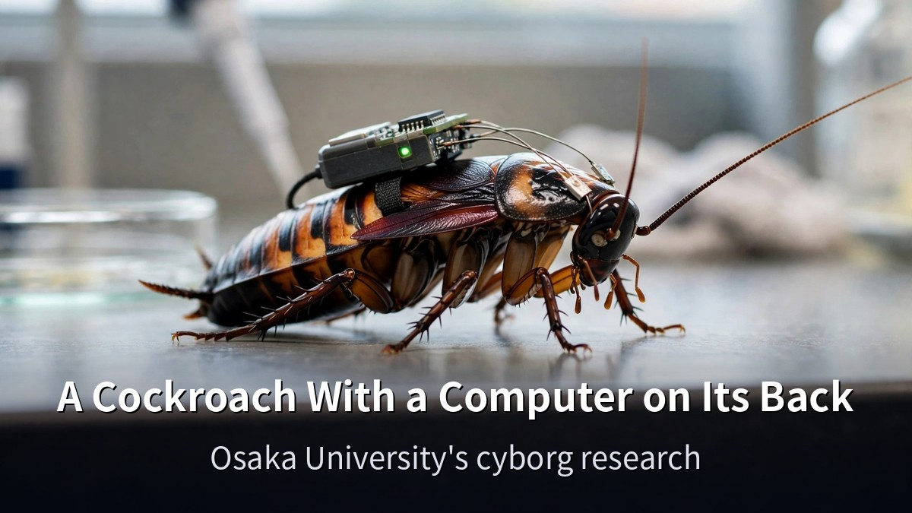
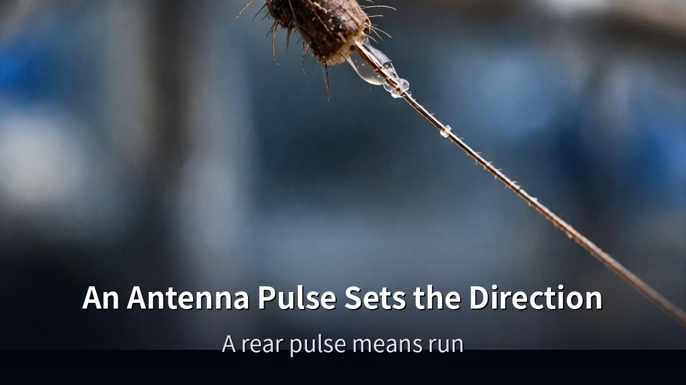
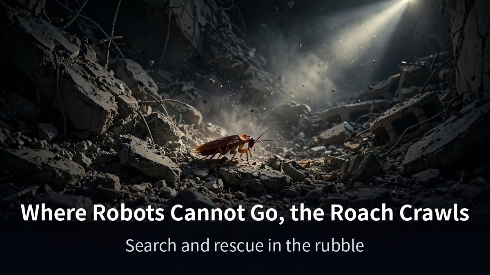
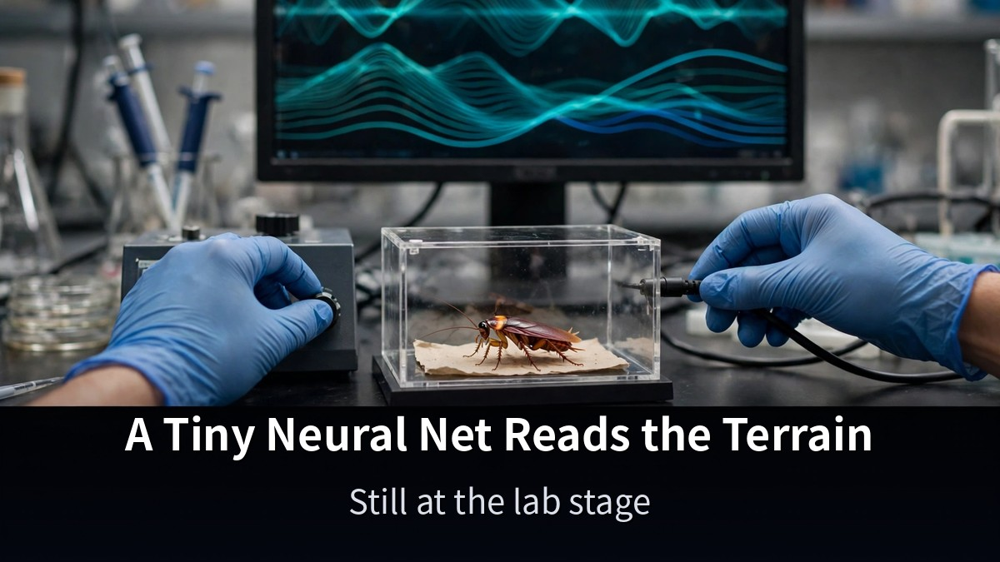

<!-- 본문 시작 -->



About 92% accuracy at telling terrain apart.
A small computer on a cockroach's back recognizes a climb and stops steering.
Here is what the University of Osaka team published in 2026, and what still stands between the lab and the field.

```blog
type: text
runs:
  - text: "A living cockroach carries a small computer on its back, and a neural network inside it reads sensory signals from the antennae and steers the insect. The University of Osaka team's cyborg cockroach, published in 2026, tells flat ground, climbs, drops, and holes apart with about 92% accuracy, and hands control back to the roach when a climb starts. It is still at the lab stage, but it is a new branch of rescue robotics for places where robots cannot go, inside collapsed buildings."
    style: {bold: true, color: "#007aa6"}
```

For the question of where AI decides to stop intervening, [OpenAI Director Warns](https://blog.naver.com/3700708/224487805993) covers the control problem from the other side.

```blog
type: heading
level: 2
runs:
  - text: "How is a cockroach steered?"
    style: {bold: true, color: "#007aa6"}
```



A pulse to the antenna turns it. A pulse to the rear makes it run. That is the whole steering system.

The subject is the Madagascar hissing cockroach. A backpack holding a tiny computer sits on its back. Thin wires run to its antennae and to its rear. An electric pulse to the antenna makes it turn, and a pulse to the rear makes it run. The type of pulse divides direction from speed.

The core is the tiny neural network inside the backpack. It processes sensory signals from the antennae and tells whether the ground ahead is flat, a climb, a drop, or a hole. Accuracy is about 92%. The difference from older systems is right here. Older systems steered the insect around every small stone, even ones a roach could climb. The new system stops steering when a climb starts and lets the roach climb on its own. The AI does not get in the way of the climbing ability the roach already has.

The team did not build new legs. The roach's legs stay as they are, and only the senses and the judgment are borrowed. Building small robot legs from scratch is hard; borrowing a living insect's body removes that need, in the team's account. The video shows the study's source on screen as Ariyanto et al., Device (2026). The work comes from the Ariyanto team at Osaka University and Diponegoro University.

```blog
type: text
runs:
  - text: "Term: electrode stimulation "
    style: {bold: true, color: "#ff008c"}
  - text: "A way of guiding movement by running an electric current through a nerve. A pulse to the antenna turns the insect, and a pulse to the rear makes it run. Where the pulse lands divides direction from speed."
```

```blog
type: text
runs:
  - text: "Term: biohybrid navigation "
    style: {bold: true, color: "#ff008c"}
  - text: "A way of finding the way that joins a living body with electronic devices. The machine does not drive every movement directly; it borrows the animal's senses and motion and only sets the direction. This is the approach the Osaka University team used."
```

```blog
type: heading
level: 2
runs:
  - text: "What does the 92% actually measure?"
    style: {bold: true, color: "#007aa6"}
```



The 92% is terrain recognition accuracy. It is not a field performance score.

The 92% figure is terrain-sensing accuracy. It is the rate at which the backpack's sensory data alone sorted four kinds of ground: flat, climb, drop, and hole. Out of 100 tries, 92 were right and 8 were wrong. What the number says is how precise the steering is, not how well the system performs at a disaster site. The Osaka version is still at the lab stage. It has no record of finding anyone in a collapsed building.

Several teams are trying similar ideas. Nanyang Technological University in Singapore fitted Madagascar cockroaches with a microcomputer, gas sensors, an infrared thermal camera, and solar panels. One insect can survey about 100 square meters on its own. Its steering is remote-controlled, so the decision-maker differs from Osaka's approach. The University of Queensland went one step further. Under the name Paraborg, it built cyborg insects carrying a medical injector, aiming to deliver drugs to trapped people on the spot. The paper came out in August 2026.

| Team | Method | Onboard equipment | Current stage |
| --- | --- | --- | --- |
| Osaka University | Neural network reads terrain, judges autonomously | Tiny computer, electrodes | Lab stage |
| NTU (Singapore) | Remote steering plus sensor detection | Thermal camera, gas sensors, solar panels | Field deployment experience |
| University of Queensland | Injector delivers drugs | Medical injector | Paper published |

As AI that judges and moves on its own, it connects with the agents covered in [6 AI Agents Compared](https://blog.naver.com/3700708/224487993632). But the roach's neural network is closer to a small judge that decides when to stop steering than to an agent that sets its own goals.

A case from last year shows the gap to the field. The Singapore team sent 10 cyborg cockroaches into rubble after the Myanmar earthquakes. The result: they found no one. Being deployed and finding someone are different stories. Osaka's 92% has to be read with the same yardstick. A lab terrain score does not turn directly into rescue success in the field.

```blog
type: text
runs:
  - text: "The 92% is a lab figure. It is not field performance, and it is not a rescue success rate. The Osaka version is at the lab stage, and the Singapore deployment sent 10 insects and found no one. When reading a number, check first where it was measured."
    style: {bold: true, background: "#FFF3CD"}
```

```blog
type: heading
level: 2
runs:
  - text: "When will they reach the field?"
    style: {bold: true, color: "#007aa6"}
```



The picture of a roach going where robots cannot is persuasive. What remains is proving it in the field.

The use case named is search and rescue inside collapsed buildings. The roach crawls through narrow, uneven rubble where robots cannot enter, looking for people and things. Its small body and its ability to climb and slip out on its own cover ground that robot legs struggle to build. The team names the same direction. Exploring pipes or the inside of collapsed buildings is mentioned, as is passing lightly through delicate archaeological sites. Because cockroaches endure low-oxygen environments, deep-sea or space exploration is raised too.

Three things remain. First, whether the lab's 92% holds up in real rubble. Second, how many insects to run at once, how to steer them, and how a find turns into a rescue. The NTU team's estimate is about 500 insects for one large building, and that many operators alongside them. Third, the ethics of using animals. Scientists disagree on whether cockroaches can subjectively feel pain. The team states the work was carried out with the animals' welfare in mind.

How far the technology goes is not settled. The Osaka team's next step is testing outside the lab. Whether the research widens the range where the roach judges for itself, or makes human steering more precise, is not yet known. What is confirmed is the 92% lab figure for terrain sensing and the approach of handing the stop-steering decision to the neural network. The rest remains in the realm of outlook.

```blog
type: text
runs:
  - text: "No military use has been confirmed. The use the team and the video name is search and rescue inside collapsed buildings. Reports that widen the use and the team's own statements should be read apart."
    style: {bold: true, background: "#FFF3CD"}
```

## Confirmed facts and claims, separated

What is confirmed is the Osaka University team's method and figures. That Madagascar hissing cockroaches carry a backpack, that an antenna pulse turns them and a rear pulse makes them run, and that four kinds of terrain are sorted with about 92% accuracy, is where the original English transcript and research coverage overlap. The Singapore team's Myanmar deployment last year and the result of finding no one is told by both the video and the coverage. The on-screen source, Ariyanto et al., Device (2026), is confirmed as shown.
What belongs on the claims side is the outlook for use. Becoming a rescue robot that finds people in collapsed buildings is the research goal, not a confirmed result. Deep-sea or space uses are possibilities the team raises, not verified stages. The NTU figure of 500 insects should be read as an estimate for surveying a large building. Some lines in the Korean dubbed subtitles do not appear in the original English transcript, so they were not used in this post.

At first the cockroach subject felt strange enough to laugh at. But as I read on, what stood out was the choice to borrow the insect's legs instead of building robot legs. The 92% figure looks impressive, but once it is clear that it is a lab number, the distance to the field comes into view. The line that 10 insects found no one in Myanmar shows that distance best. Asking how far a technology has come matters less than asking how far it has been confirmed, and this story confirmed that again.

## Frequently asked questions

**Does steering hurt the cockroach?**

There is no settled answer. Scientists disagree on whether cockroaches can subjectively feel pain. The team states the work was carried out with the animals' welfare in mind. Because electrode stimulation changes the animal's behavior, the ethics question will come up more often as the research moves toward the field.

**Why use a cockroach instead of building a robot?**

Designing new small robot legs is hard. A cockroach already crawls through narrow gaps and rights itself after falling over. The team chose to borrow that ability and let the electronics only set the direction. Borrowing a living body removes the need to build legs from scratch, in the team's account.

**When will this be seen in the field?**

No schedule is set. The Osaka version is at the lab stage, and the Singapore team's field deployment found no one. Whether the lab terrain score holds up in real rubble, and how a find turns into a rescue, must be verified first. The only confirmed figure is the 92% lab score.

## Further reading

[6 AI Agents Compared | Prices and Features at a Glance](https://blog.naver.com/3700708/224487993632)

[A.I. Artificial Intelligence | The Robot Boy Programmed to Love](https://blog.naver.com/3700708/224488130424)

<!-- 본문 끝 -->

## 작업용 출처·이미지 정보 (업로드 제외)

**Sources**
- Matt Wolfe, "They built cyborg cockroaches with built-in AI...", November 22, 2026 (original English transcript, captured from the YouTube script panel on November 24, 2026)
- Hackster.io, coverage of the Ariyanto team's biohybrid navigation work at Osaka University and Diponegoro University (updated November 16, 2026)
- NTU Singapore cyborg cockroach coverage: thermal camera and gas sensors onboard, about 100 sq m surveyed per insect, Myanmar earthquake deployment
- University of Queensland Paraborg coverage (November 2, 2026): medical injector onboard, August 2026 paper
