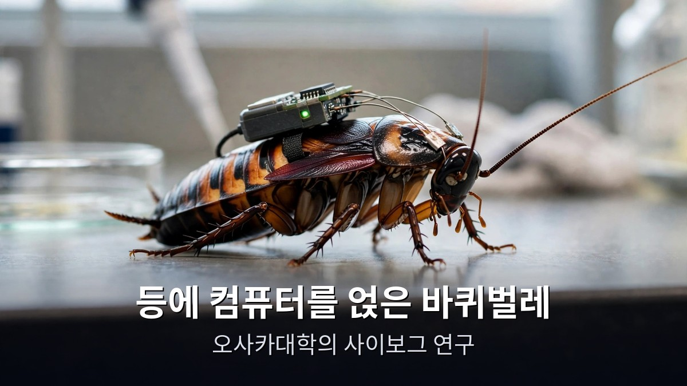
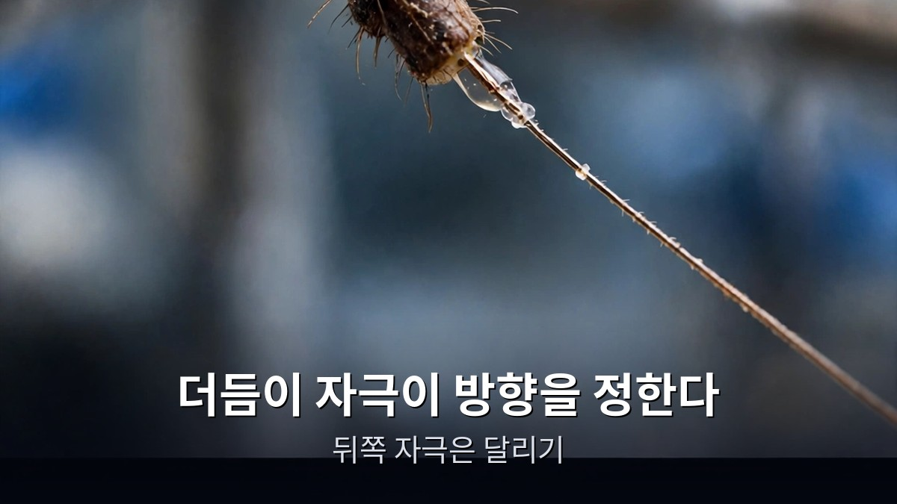
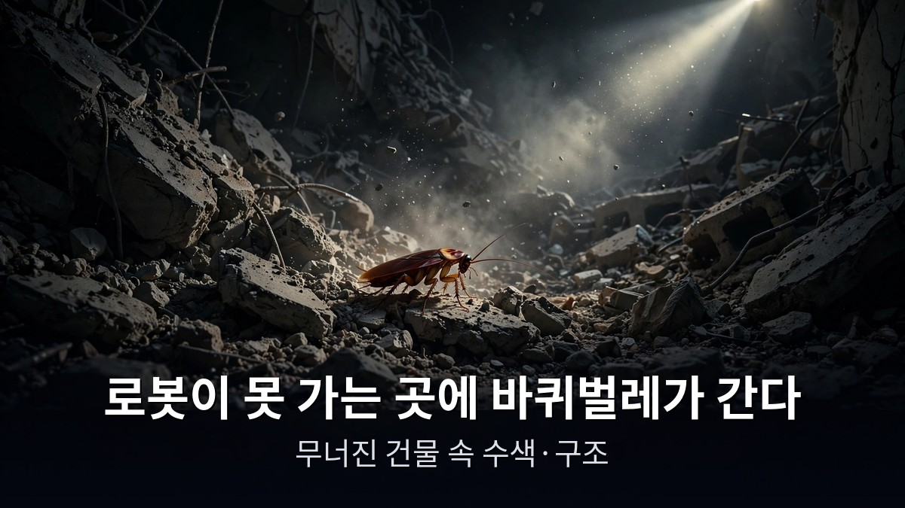
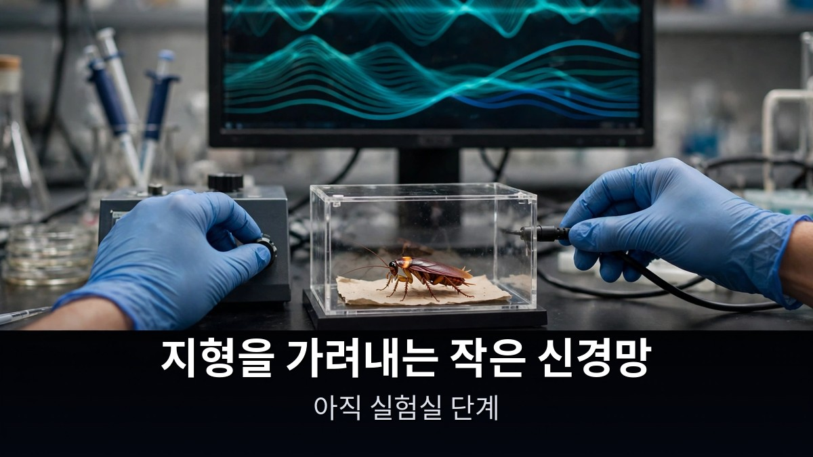

<!-- 본문 시작 -->



지형을 맞히는 정확도 약 92%.
바퀴벌레 등에 얹은 작은 컴퓨터가 오르막을 알아보고 조종을 멈춘다.
오사카대학 연구팀이 2026년 발표한 사이보그 바퀴벌레가 뭘 해냈고, 현장 투입까지 뭐가 남았는지 순서대로 짚는다.

```blog
type: text
runs:
  - text: "살아 있는 바퀴벌레 등에 작은 컴퓨터를 얹고, 그 안에 든 신경망이 더듬이에서 들어오는 감각 정보를 처리해 바퀴벌레를 조종한다. 오사카대학 연구팀이 2026년 발표한 사이보그 바퀴벌레는 평지·오르막·내리막·구멍을 약 92% 정확도로 가려내고, 오르막에서는 조종을 멈추고 바퀴벌레에게 맡긴다. 아직 실험실 단계지만, 로봇이 못 가는 무너진 건물 속을 기어갈 구조 로봇의 새 갈래다."
    style: {bold: true, color: "#007aa6"}
```

AI가 스스로 판단해 개입을 멈추는 지점이 궁금하다면 [오픈AI 이사 경고](https://blog.naver.com/3700708/224487805993) 글에서 다룬 통제 문제를 함께 읽어두면 좋다.

```blog
type: heading
level: 2
runs:
  - text: "바퀴벌레는 어떻게 조종되나"
    style: {bold: true, color: "#007aa6"}
```



더듬이에 자극을 주면 방향을 틀고, 뒤쪽에 자극을 주면 달린다. 조종의 전부다.

주인공은 마다가스카르 휘파람 바퀴벌레다. 등에 초소형 컴퓨터가 든 백팩을 얹었다. 더듬이와 뒤쪽에 가는 전선이 연결돼 있다. 더듬이에 전기 자극을 주면 방향을 틀고, 뒤쪽에 자극을 주면 달린다. 자극의 종류가 방향과 속도를 나누는 셈이다.

핵심은 백팩 안에 든 작은 신경망이다. 더듬이에서 들어오는 감각 정보를 신경망이 처리하고, 지금이 평지인지 오르막인지 내리막인지 구멍인지를 가려낸다. 정확도는 약 92%다. 이전 방식과의 차이도 여기에 있다. 예전 시스템은 바퀴벌레가 충분히 오를 수 있는 작은 돌멩이까지 일일이 피해 조종했다. 새 시스템은 오르막이 시작되면 AI가 조종을 멈추고 바퀴벌레가 스스로 오르게 둔다. 바퀴벌레가 원래 가진 오르는 능력을 AI가 방해하지 않는 구조다.

연구팀이 새로 만든 건 다리가 아니다. 바퀴벌레의 다리는 그대로 두고, 감각과 판단만 빌려 오는 방식이다. 작은 로봇을 처음부터 설계하는 대신 살아 있는 곤충의 몸을 빌리면, 다리를 새로 만들 필요가 없다는 게 연구팀의 설명이다. 영상 화면에는 연구 출처로 Ariyanto 연구팀의 Device(2026) 논문이 표시됐다. 연구를 이끈 건 오사카대학과 디포네고로대학의 Ariyanto 연구팀이다.

```blog
type: text
runs:
  - text: "용어: 전극 자극 "
    style: {bold: true, color: "#ff008c"}
  - text: "전기를 흘려 신경을 자극해 움직임을 유도하는 방식이다. 더듬이에 자극을 주면 방향을 틀고, 뒤쪽에 자극을 주면 달리게 한다. 자극의 위치가 방향과 속도를 나눈다."
```

```blog
type: text
runs:
  - text: "용어: 바이오하이브리드 내비게이션 "
    style: {bold: true, color: "#ff008c"}
  - text: "살아 있는 생물의 몸과 전자 장치를 합쳐 길을 찾는 방식이다. 기계가 모든 움직임을 직접 조종하는 게 아니라, 생물이 가진 감각과 운동 능력을 빌리고 전자 장치는 방향만 잡아준다. 오사카대학 연구팀이 쓴 접근법이다."
```

```blog
type: heading
level: 2
runs:
  - text: "92%는 뭘 측정한 수치인가"
    style: {bold: true, color: "#007aa6"}
```



92%는 지형 네 가지를 맞히는 정확도다. 현장 투입 성적표가 아니다.

92%라는 숫자는 지형 감지 정확도다. 평지·오르막·내리막·구멍 네 가지를 백팩의 감각 정보만으로 가려낸 비율이다. 100번 중 92번은 맞히고 8번은 틀린다는 뜻이다. 이 숫자가 말해주는 건 조종의 정밀함이지, 구조 현장에서의 성공률이 아니다. 오사카 버전은 아직 실험실 단계다. 무너진 건물에서 사람을 찾은 실적은 없다.

비슷한 시도를 한 팀은 여럿 있다. 싱가포르 난양공대 연구팀은 마다가스카르 바퀴벌레에 마이크로컴퓨터와 가스 센서, 적외선 열화상 카메라, 태양광 패널을 얹었다. 한 마리가 독립적으로 조사할 수 있는 면적은 약 100㎡다. 원격 조종으로 방향을 잡는 방식이라 오사카 방식과는 조종의 주체가 다르다. 퀸즐랜드대학 연구팀은 한 발 더 나아갔다. 파라보그라는 이름으로 의료용 주사기를 단 사이보그 곤충을 만들었다. 갇힌 사람에게 현장에서 약물을 전달하는 게 목표다. 2026년 8월 논문으로 발표됐다.

| 연구팀 | 방식 | 탑재 장비 | 현재 단계 |
| --- | --- | --- | --- |
| 오사카대학 | 신경망이 지형을 가려 자율 판단 | 초소형 컴퓨터·전극 | 실험실 단계 |
| 난양공대(싱가포르) | 원격 조종 + 센서 탐지 | 열화상 카메라·가스 센서·태양광 패널 | 현장 투입 경험 있음 |
| 퀸즐랜드대학 | 주사기 탑재 약물 전달 | 의료용 주사기 | 논문 발표 단계 |

스스로 판단해 움직이는 AI라는 점에서는 [AI 에이전트 6종 비교](https://blog.naver.com/3700708/224487993632) 글에서 다룬 에이전트들과도 이어진다. 다만 바퀴벌레의 신경망은 스스로 목표를 정하는 에이전트가 아니라, 지형을 가려 조종을 멈출지를 판단하는 작은 판단기에 가깝다.

작년 사례가 현장의 간극을 보여준다. 싱가포르 팀은 미얀마 지진 후 잔해에 사이보그 바퀴벌레 10마리를 투입했다. 결과는 아무도 찾지 못했다. 투입했다는 것과 사람을 찾았다는 것은 다른 이야기다. 오사카 연구팀의 92%도 같은 잣대로 읽어야 한다. 실험실의 지형 감지 성적이 현장의 구조 성공으로 바로 이어지지는 않는다.

```blog
type: text
runs:
  - text: "92%는 실험실 수치다. 현장 투입 실적이 아니고, 구조 성공률도 아니다. 오사카 버전은 실험실 단계, 싱가포르 투입은 10마리로 사람을 찾지 못했다. 숫자를 볼 때는 어디서 잰 수치인지부터 확인해야 한다."
    style: {bold: true, background: "#FFF3CD"}
```

```blog
type: heading
level: 2
runs:
  - text: "언제 현장에 투입되나"
    style: {bold: true, color: "#007aa6"}
```



로봇이 못 가는 곳에 바퀴벌레가 간다는 그림은 그럴듯하다. 남은 건 그 그림을 현장에서 증명하는 일이다.

활용처로 거론되는 건 무너진 건물 속 수색·구조다. 로봇이 들어갈 수 없는 좁고 울퉁불퉁한 잔해 속을 바퀴벌레가 기어들어가 사람과 물건을 찾는 그림이다. 작은 몸집과 스스로 오르고 빠져나오는 능력이 로봇 다리로는 만들기 어려운 부분이다. 연구팀이 거론하는 용도도 이 방향이다. 파이프나 무너진 건물 내부를 탐색하거나, 섬세한 유적지를 가볍게 지나치는 쓰임도 함께 언급된다. 바퀴벌레가 산소가 적은 환경에서도 견딘다는 점에서 심해나 우주 탐사까지 거론되기도 한다.

남은 과제는 세 가지로 갈린다. 첫째, 실험실의 92%를 현장의 잔해에서도 유지할 수 있는지다. 둘째, 한 번에 몇 마리를 어떻게 조종하고, 찾은 사람을 어떻게 구조로 이어붙일지다. 난양공대 팀의 계산으로는 큰 건물 한 채를 조사하는 데 약 500마리가 필요하고, 그만큼의 조종자도 함께 필요하다. 셋째, 동물을 쓰는 연구라는 점에서 오는 윤리 문제다. 바퀴벌레가 고통을 느끼는지를 두고 과학자들의 의견은 갈린다. 연구팀은 동물의 복지를 고려해 연구를 수행했다고 밝히고 있다.

이 기술이 어디까지 갈지는 아직 정해지지 않았다. 오사카 연구팀의 다음 단계는 실험실 밖에서의 검증이다. 바퀴벌레가 스스로 판단하는 구간을 넓히는 쪽으로 연구가 이어질지, 사람의 조종을 더 정밀하게 만드는 쪽으로 갈지는 아직 알 수 없다. 확인된 건 지형 감지 92%라는 실험실 수치와, 조종을 멈추는 판단까지 신경망에 맡겼다는 접근법이다. 나머지는 전망의 영역으로 남는다.

```blog
type: text
runs:
  - text: "군사적 용도는 확인된 바 없다. 연구팀과 영상에서 밝힌 용도는 무너진 건물 속 수색·구조다. 용도를 넓혀 말하는 보도와 연구팀의 발표를 구분해 읽어야 한다."
    style: {bold: true, background: "#FFF3CD"}
```

## 확인된 사실과 주장은 이렇게 나뉜다

확인된 건 오사카대학 연구팀의 방식과 수치다. 마다가스카르 휘파람 바퀴벌레에 백팩을 얹고, 더듬이 자극으로 방향을 틀고 뒤쪽 자극으로 달리게 하며, 지형 네 가지를 약 92% 정확도로 가려낸다는 점은 영상 자막 원문과 연구 보도가 겹치는 대목이다. 작년 싱가포르 팀의 미얀마 투입과 사람을 찾지 못했다는 결과도 영상과 보도가 함께 전한다. 연구 출처로 화면에 표시된 Ariyanto 연구팀의 Device(2026) 논문 표기도 확인된다.
주장으로 봐야 할 건 활용 전망이다. 무너진 건물에서 사람을 찾는 구조 로봇이 될 것이라는 말은 연구의 목표이지 확인된 실적이 아니다. 심해나 우주 탐사 같은 쓰임도 연구팀이 거론하는 가능성일 뿐, 검증된 단계가 아니다. 난양공대 팀의 500마리 계산도 큰 건물을 조사할 때의 추정치로 읽어야 한다. 한국어 더빙 자막에만 나오는 표현은 영어 원문 자막에 없는 내용이다.

처음에는 바퀴벌레라는 소재가 낯설어서 웃음이 먼저 나왔다. 그런데 읽을수록 이 연구가 로봇 다리를 만드는 대신 곤충의 다리를 빌린 선택이라는 점이 눈에 들어왔다. 92%라는 숫자는 대단해 보이지만, 실험실 수치라는 점을 알고 나면 현장까지의 거리가 보인다. 미얀마에서 10마리가 사람을 찾지 못했다는 대목이 그 거리를 가장 잘 보여준다. 기술이 어디까지 왔는지를 묻는 것보다, 어디까지 확인됐는지를 묻는 게 먼저라는 걸 다시 확인한 셈이다.

## 자주 묻는 질문

**바퀴벌레가 조종당하면서 아픈 건 아닌가요?**

확정된 답은 없다. 바퀴벌레가 주관적으로 고통을 느끼는지를 두고 과학자들의 의견은 갈린다. 연구팀은 동물의 복지를 고려해 연구를 수행했다고 밝히고 있다. 전극 자극이 동물의 행동을 바꾸는 방식이라, 윤리 문제는 연구가 현장으로 나갈수록 더 자주 거론될 대목이다.

**로봇을 새로 만들면 될 텐데 왜 바퀴벌레를 쓰나요?**

작은 로봇 다리를 새로 설계하는 게 어렵기 때문이다. 바퀴벌레는 이미 좁은 틈을 기어오르고, 넘어져도 스스로 일어나는 능력을 갖고 있다. 연구팀은 이 능력을 빌리고 전자 장치는 방향만 잡아주는 방식을 택했다. 살아 있는 몸을 빌리면 다리를 새로 만들 필요가 없다는 게 연구팀의 설명이다.

**이 기술은 언제쯤 현장에서 볼 수 있나요?**

아직 정해진 일정이 없다. 오사카 버전은 실험실 단계이고, 싱가포르 팀의 현장 투입은 사람을 찾지 못했다. 실험실의 지형 감지 성적을 현장의 잔해에서도 유지할 수 있는지, 찾은 사람을 구조로 어떻게 이어붙일지가 먼저 검증돼야 한다. 확인된 건 92%라는 실험실 수치뿐이다.

## 함께 보면 좋은 글

[AI 에이전트 6종 비교｜가격·기능 한눈에 보기](https://blog.naver.com/3700708/224487993632)

[A.I. 인공지능｜사랑을 배우는 로봇 소년의 여정](https://blog.naver.com/3700708/224488130424)

<!-- 본문 끝 -->

## 작업용 출처·이미지 정보 (업로드 제외)

**출처**
- Matt Wolfe, "They built cyborg cockroaches with built-in AI...", 2026-11-22 (자막 원문, 2026-11-24 브라우저 스크립트 패널 확보, 영어 원문 기준)
- Hackster.io, 오사카대학·디포네고로대학 Ariyanto 연구팀 바이오하이브리드 내비게이션 보도 (2026-11-16 갱신)
- 난양공대 사이보그 바퀴벌레 보도: 열화상 카메라·가스 센서 탑재, 1마리당 약 100㎡ 수색, 미얀마 지진 후 투입 사례
- 퀸즐랜드대학 파라보그 보도 (2026-11-02): 의료용 주사기 탑재, 2026-08 논문
