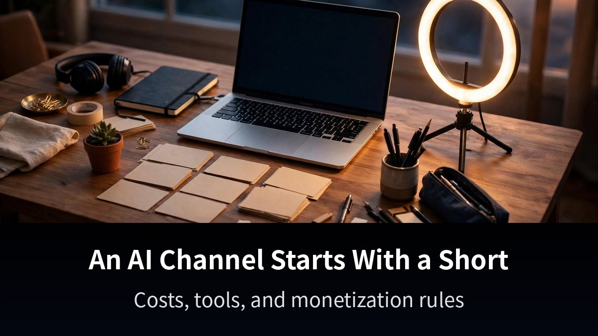
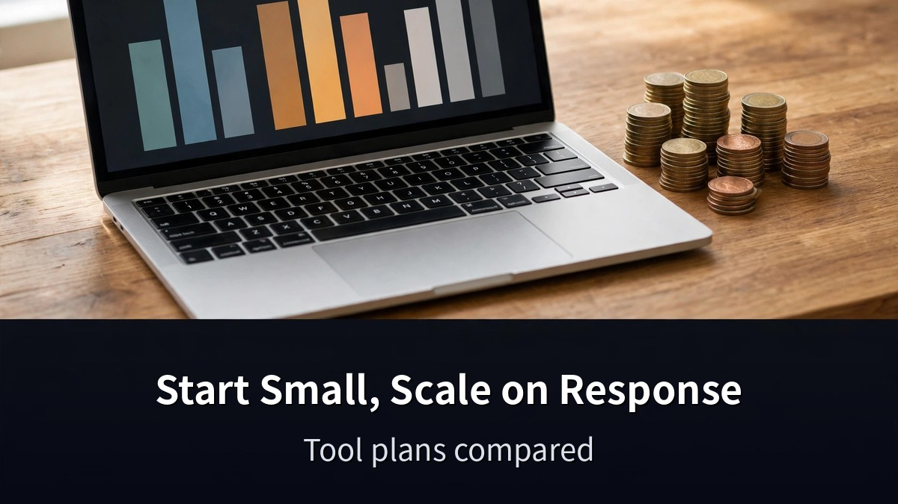
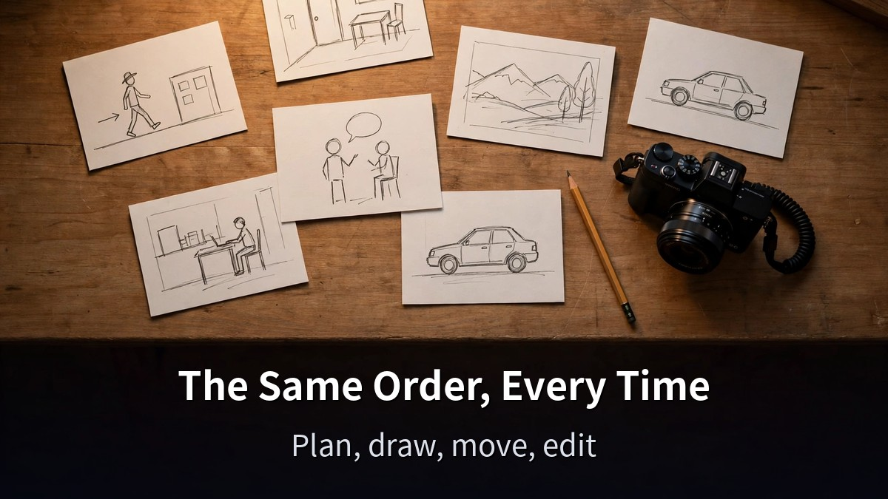
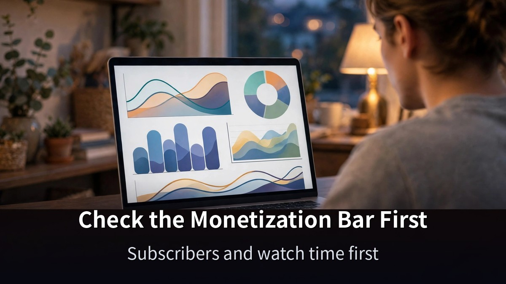

<!-- 본문 시작 -->



An AI-only channel can start at 8.5 credits per Short.
But monetization needs 1,000 subscribers plus a watch condition, and repeating the same scenes can stop the income.
Costs, the production order, and the monetization rules are set out here at official prices as of November 24, 2026.

```blog
type: text
runs:
  - text: "Starting an AI-only channel means knowing three things first. One Short takes 8.5 to 220 credits depending on the format, tools run from Higgsfield at $19 a month to Google Flow at 7,500 KRW a month, and monetization requires 1,000 subscribers plus 4,000 watch hours or 10 million Shorts views. Repeating the same scenes can stop the income even with views, so the policy check comes before the first upload."
    style: {bold: true, color: "#007aa6"}
```

How to make AI Shorts with a single line of instruction is covered in [Make AI Shorts With One Claude Line](https://blog.naver.com/3700708/224485641382), which walks through the Higgsfield Shorts Studio steps.

```blog
type: heading
level: 2
runs:
  - text: "How much does an AI channel cost?"
    style: {bold: true, color: "#007aa6"}
```



The format sets the price of one Short. A stick figure costs 8.5 credits, a short drama 220.5 credits.

Start with the credits one Short takes. These are figures honjobs confirmed while building them. A stick-figure Short took 3.5 credits for the image and 5 for the video, 8.5 in all. A glass-food ASMR clip took 8 credits, a reversal Short using Veo 3.1 took 35.5 credits, and a short drama with dialogue took 220.5 credits. Dialogue pushes the per-scene cost up sharply.

Tool prices at official rates are below. Higgsfield charges $19 a month for 270 credits on Starter, $59 a month for 1,200 credits on Plus, and $129 a month for 3,000 credits on Ultra. Annual billing drops Plus to $47 a month and Ultra to $99 a month. Google Flow costs 7,500 KRW a month for 200 credits on AI Plus and 29,000 KRW a month for 1,000 credits on AI Pro. ChatGPT Plus is $20 a month, and ElevenLabs Starter is $6 a month for 30,000 credits.

| Tool | Use | Plan | Monthly price | Monthly credits |
| --- | --- | --- | --- | --- |
| Higgsfield | Image, video, voice in one | Starter | $19/month | 270 |
| Higgsfield | Image, video, voice in one | Plus | $59/month ($47 annually) | 1,200 |
| Higgsfield | Image, video, voice in one | Ultra | $129/month ($99 annually) | 3,000 |
| Google Flow | Veo 3.1 video | AI Plus | 7,500 KRW/month | 200 |
| Google Flow | Veo 3.1 video | AI Pro | 29,000 KRW/month | 1,000 |
| ChatGPT | Scripts, images | Plus | $20/month | — |
| ElevenLabs | Voice, music | Starter | $6/month | 30,000 credits |

A monthly budget makes it concrete. Ultra at $129 a month gives 3,000 credits, which works out to about 350 Shorts at 8.5 credits each by simple division, though failed takes and retries bring the real number down. Google AI Plus at 7,500 KRW a month gives 200 credits, which is 10 Veo 3.1 Fast clips at 20 credits each, or 2 Quality clips at 100 credits each. One Quality clip works out to about 3,750 KRW.

A free start is possible too. Google Flow gives 50 credits a day for free. ChatGPT and ElevenLabs also have free tiers. Set the format inside the free allowance first, and pay only for the format that gets a response. Higgsfield is running a Black Friday sale, so listed prices may change. The 63% discount mentioned in the video is the host's own statement; the sale prices confirmed are Plus at $33 a month and Ultra at $50 a month on annual billing.

```blog
type: text
runs:
  - text: "Prices are as of November 24, 2026. Credit use changes with the model, length, and resolution, and plans can change with sales or updates. Checking the official pricing page once more before paying is the safe move."
    style: {bold: true, background: "#FFF3CD"}
```

```blog
type: heading
level: 2
runs:
  - text: "How is it made? Four steps"
    style: {bold: true, color: "#007aa6"}
```



Four steps: plan it, draw it, move it, then add voice and captions.

The production order has four steps, and the skeleton stays the same across formats. First, plan. Ask ChatGPT to set the topic, write the script, and split it scene by scene. The stick-figure channel picked about ten surprising historical facts and chose one. The reversal channel picked material that turns what everyone knows upside down. The material is the format. Second, images. Keep one character drawing as the reference so the same drawing style holds across scenes. With GPT Image 2, one image costs 3.5 credits. Third, video. Feed the image in as the opening frame and move it with Seedance 2.0 Mini or Veo 3.1. A 5-second clip costs 5 credits, and an 8-second clip costs 20 to 32 credits depending on the model. Fourth, voice and editing. Add a voice with ElevenLabs, cut at the end of each sentence in CapCut, and attach captions.

What changes by format is the weight of the third and fourth steps. A glass-food ASMR clip has no script and no voice. A sound-capable video model generates the scenes, and only the good ones are kept and stitched together. A short drama is the opposite. Reference drawings come first so the same face holds across episodes, and scenes with dialogue are generated and joined. Higgsfield has a Shorts Drama feature that takes a script and builds the characters, places, and scenes. Connecting Higgsfield to Claude and giving spoken instructions is another way.

```blog
type: text
runs:
  - text: "Ease of copying "
    style: {bold: true, color: "#ff008c"}
  - text: "The easiest format has no words. A glass-food ASMR clip needs no script, no voice, and no captions, only well-picked scenes. The hardest are long-form stories over ten minutes that must stay interesting, and live-action documentaries that must match dozens of scenes to the same texture."
```

The way to save credits is the same principle covered in [Claude Code 4K Video](https://blog.naver.com/3700708/224486678576), where 560 credits became 204: do not run the expensive model from the start, pick the keepers with a cheap model, and render only the final cut in high quality. The same 4K video took 560 credits when four cuts were rendered in 4K from the start, but 204 credits when four cuts were picked at 480p and only one was rendered in 4K. The same rule holds for Shorts: pick scenes with the cheap model and re-render only the keepers with the expensive one.

```blog
type: text
runs:
  - text: "Term: credit "
    style: {bold: true, color: "#ff008c"}
  - text: "The usage unit of AI generation tools. Each generation, one image or five seconds of video, deducts a set number of credits. A costlier model, a longer clip, or higher resolution costs more. A monthly plan gives a set number of credits each month."
```

```blog
type: heading
level: 2
runs:
  - text: "What are the monetization rules?"
    style: {bold: true, color: "#007aa6"}
```



Views are not income. The monetization threshold and the policy need separate checks.

Monetization starts with joining the YouTube Partner Program. Ad revenue requires 1,000 subscribers plus 4,000 watch hours in 12 months, or 10 million Shorts views in 90 days. For a Shorts-only channel, the 10 million views in 90 days is the bar. A lower tier opens fan funding only: 500 subscribers plus 3,000 watch hours, or 3 million Shorts views, unlocks memberships and Super Chat. The creator share of Shorts ad revenue is 45%.

The bar is also rising. From February 1, 2027, new applicants will need 1,000 subscribers plus 8,000 watch hours, or 20 million Shorts views. Channels already in the program keep their standing. Starting now and clearing the bar before the change is the better position.

Clearing the bar is not the end. On July 15, 2025, YouTube renamed its repetitious content policy to the inauthentic content policy and clarified its scope. Mass-produced or template-like content, and videos that keep putting the same characters in the same situations, are excluded from monetization. Whether AI made it is not the test; whether the content carries original value is. The Civilization case sits close to this policy. Its views pass a million, monetization has stopped, and the host guessed the cause is the same character and scenes repeating.

Disclosure is also required when realistic scenes are synthesized. If AI makes a real person appear to say or do something they did not, or creates a realistic scene that never happened, the AI use must be disclosed. Clearly unrealistic animation, or using AI for scripts and captions, is not covered. Disclosing does not reduce reach or earnings.

Finally, the host's point is worth repeating: a channel that copies as it is will struggle. Similar channels already exist in large numbers, and an exact copy loses the views race. The costs and steps set out here are only the starting point; the format has to become your own. That comes before chasing views.

```blog
type: text
runs:
  - text: "The Civilization case is the host's guess. It is not a confirmed ruling by YouTube on that channel; the policy comparison only makes it plausible. To keep your own channel out of the same spot, change the grain of the story from episode to episode."
    style: {bold: true, background: "#FFF3CD"}
```

## Frequently asked questions

**Can I start for free?**

Yes. Google Flow gives 50 credits a day for free. ChatGPT and ElevenLabs also have free tiers. Set the format inside the free allowance first, and pay only for the format that gets a response. Free tiers may limit commercial use, though, so check the paid plan's terms if monetization is the goal.

**Can I build a channel without showing my face?**

Yes. All ten channels covered here show no person on camera. Stick-figure animation, glass-food ASMR, and reversal architecture videos all earn views without a face. The character or the material becomes the channel's face. The hardest part is keeping the character's look identical from scene to scene.

**Should I make it in English for more views?**

Not necessarily. A wordless format such as glass-food ASMR works for viewers in any country. A Korean-themed format such as Joseon-era ramen faces the problem of awkward Korean dialogue. Format comes before language. Wordless formats cross languages, and story-driven formats make language itself the advantage.

## Further reading

[Make AI Shorts With One Claude Line | Higgsfield Shorts Studio](https://blog.naver.com/3700708/224485641382)

[A.I. Artificial Intelligence | The Robot Boy Programmed to Love](https://blog.naver.com/3700708/224488130424)

<!-- 본문 끝 -->

## 작업용 출처·이미지 정보 (업로드 제외)

**Sources**
- honjobs, "AI로만 만든 채널 10곳, 직접 따라 만들어 보고 티어 매겼습니다" (10 AI-only channels, ranked), November 23, 2026 (original transcript, captured from the YouTube script panel on November 24, 2026)
- Higgsfield official pricing (checked November 24, 2026: Starter $19/month, 270 credits; Plus $59/month, 1,200 credits; Ultra $129/month, 3,000 credits)
- Google Flow pricing (checked November 24, 2026: free 50 credits a day, AI Plus 7,500 KRW/month, 200 credits; AI Pro 29,000 KRW/month, 1,000 credits; Veo 3.1 Lite 10, Fast 20, Quality 100 credits)
- ChatGPT Plus $20/month, ElevenLabs Starter $6/month (checked November 24, 2026)
- YouTube Partner Program requirements, inauthentic content policy, and the 45% Shorts revenue share (checked November 24, 2026, including the February 1, 2027 threshold change)
