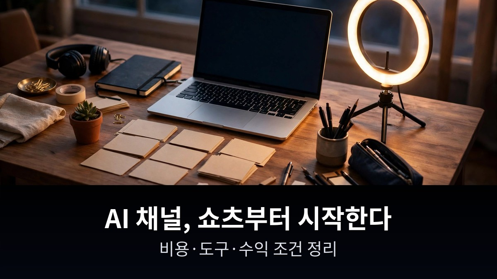
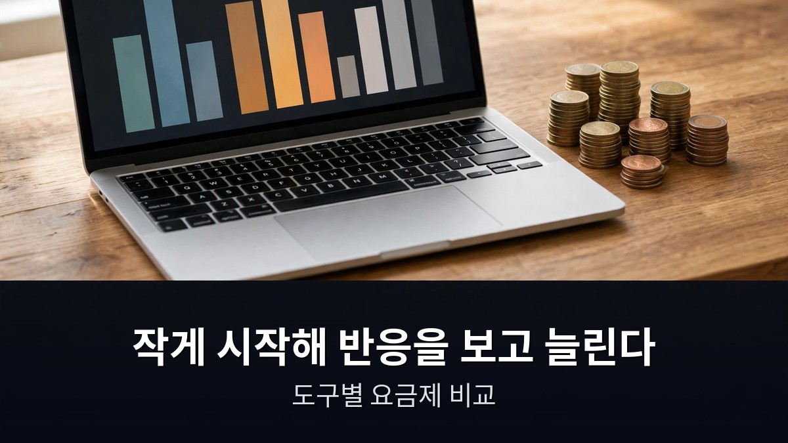
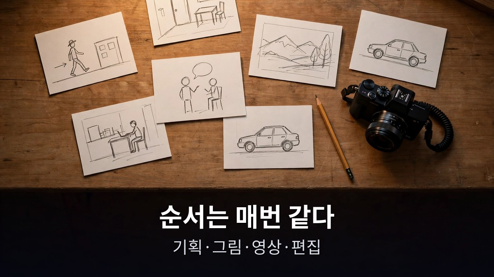
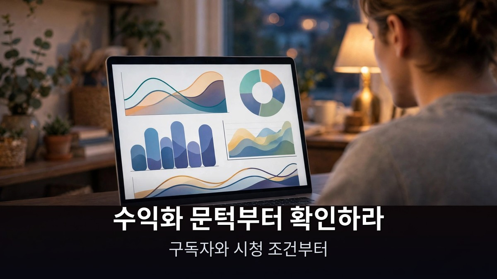

<!-- 본문 시작 -->



AI로만 만든 채널은 쇼츠 1편에 8.5크레딧부터 만들 수 있다.
다만 수익화까지는 구독자 1,000명과 시청 조건을 넘어야 하고, 같은 장면을 반복하면 수익이 멈출 수 있다.
비용·만드는 순서·수익 조건을 2026년 11월 24일 기준 공식 가격으로 정리한다.

```blog
type: text
runs:
  - text: "AI로만 만든 채널을 시작하려면 세 가지를 먼저 알아야 한다. 쇼츠 1편에 드는 크레딧은 8.5개부터 220개까지 형식마다 다르고, 도구는 힉스필드 월 19달러부터 구글 플로우 월 7,500원까지 고를 수 있으며, 수익화는 구독자 1,000명에 시청시간 4,000시간 또는 쇼츠 1,000만 회가 기준이다. 같은 장면만 반복하면 조회수가 나와도 수익이 멈출 수 있으니, 시작 전에 정책을 먼저 확인하는 게 순서다."
    style: {bold: true, color: "#007aa6"}
```

AI 쇼츠를 한 줄 명령으로 만드는 방법은 [클로드 한 줄로 AI 쇼츠 만들기](https://blog.naver.com/3700708/224485641382) 글에서 다룬 힉스필드 쇼츠 스튜디오 순서와 이어진다.

```blog
type: heading
level: 2
runs:
  - text: "AI 채널 만드는 데 얼마가 드나"
    style: {bold: true, color: "#007aa6"}
```



쇼츠 1편 비용은 형식이 정한다. 막대기 인간은 8.5크레딧, 숏드라마는 220.5크레딧이다.

먼저 쇼츠 1편에 드는 크레딧부터 본다. 혼잡스가 직접 만들며 확인한 수치다. 막대기 인간 쇼츠는 이미지 3.5크레딧에 영상 5크레딧, 모두 8.5크레딧이다. 유리 음식 ASMR은 8크레딧, 비오 3.1을 쓴 반전 쇼츠는 35.5크레딧, 대사가 있는 숏드라마는 220.5크레딧이 들었다. 대사가 들어가면 장면당 비용이 뛰는 구조다.

도구별 요금제를 공식 가격으로 정리했다. 힉스필드는 Starter 월 19달러에 270크레딧, Plus 월 59달러에 1,200크레딧, Ultra 월 129달러에 3,000크레딧이다. 연간 결제는 Plus 월 47달러, Ultra 월 99달러로 내려간다. 구글 플로우는 AI Plus 월 7,500원에 200크레딧, AI Pro 월 29,000원에 1,000크레딧이다. 챗GPT Plus는 월 20달러, 일레븐랩스 Starter는 월 6달러에 3만 크레딧이다.

| 도구 | 용도 | 요금제 | 월 가격 | 월 크레딧 |
| --- | --- | --- | --- | --- |
| 힉스필드 | 이미지·영상·음성 통합 | Starter | 월 19달러 | 270 |
| 힉스필드 | 이미지·영상·음성 통합 | Plus | 월 59달러(연간 47달러) | 1,200 |
| 힉스필드 | 이미지·영상·음성 통합 | Ultra | 월 129달러(연간 99달러) | 3,000 |
| 구글 플로우 | 비오 3.1 영상 | AI Plus | 월 7,500원 | 200 |
| 구글 플로우 | 비오 3.1 영상 | AI Pro | 월 29,000원 | 1,000 |
| 챗GPT | 대본·이미지 | Plus | 월 20달러 | — |
| 일레븐랩스 | 목소리·음악 | Starter | 월 6달러 | 3만 크레딧 |

월 예산으로 바꿔보면 감이 온다. Ultra 월 129달러로 3,000크레딧을 받으면, 8.5크레딧짜리 쇼츠를 단순 계산으로 약 350편 만들 수 있는 분량이다. 다만 실패작과 재시도분을 감안해야 하니 실제 편수는 이보다 적다. 구글 AI Plus 월 7,500원으로 200크레딧을 받으면 비오 3.1 Fast 클립(20크레딧) 10개, Quality 클립(100크레딧) 2개 분량이다. Quality 클립 1개는 3,750원꼴이다.

무료로 시작하는 길도 있다. 구글 플로우는 무료로 하루 50크레딧을 준다. 챗GPT와 일레븐랩스에도 무료 요금제가 있다. 무료 범위 안에서 형식을 먼저 정하고, 반응이 오는 형식에만 유료 요금제를 붙이는 게 돈을 아끼는 순서다. 힉스필드는 블랙프라이데이 세일 중이라 표시 가격이 달라질 수 있다. 영상에서 알린 63% 할인이라는 말은 진행자의 언급으로, 확인된 세일가는 Plus 월 33달러·Ultra 월 50달러(연간 결제 기준)다.

```blog
type: text
runs:
  - text: "가격은 2026년 11월 24일 기준이다. 크레딧 소모는 모델·길이·화질에 따라 달라지고, 요금제는 세일이나 개편으로 바뀔 수 있다. 결제 전에 공식 가격 페이지에서 한 번 더 확인하는 게 안전하다."
    style: {bold: true, background: "#FFF3CD"}
```

```blog
type: heading
level: 2
runs:
  - text: "어떻게 만드나? 순서 4단계"
    style: {bold: true, color: "#007aa6"}
```



순서는 네 단계다. 기획하고, 그림을 만들고, 영상으로 움직이고, 목소리와 자막을 붙인다.

만드는 순서는 네 단계로 같다. 형식이 달라도 뼈대는 같다. 첫째, 기획이다. 챗GPT에 주제를 정해달라고 하고, 대본을 쓴 뒤 장면마다 나눈다. 막대기 인간 채널은 역사 속 신기한 사실 아이디어를 열 개쯤 뽑아 하나를 골랐다. 반전 채널은 다들 아는 걸 뒤집을 만한 소재를 골랐다. 소재가 곧 포맷이다. 둘째, 이미지다. 캐릭터 그림 한 장을 기준으로 삼아 장면마다 같은 그림체를 유지한다. GPT 이미지 2 기준 장당 3.5크레딧이다. 셋째, 영상이다. 이미지를 시작 장면으로 넣어 시덴스 2.0 미니나 비오 3.1로 움직인다. 5초 영상은 5크레딧, 8초 영상은 모델에 따라 20~32크레딧이다. 넷째, 목소리와 편집이다. 일레븐랩스로 목소리를 입히고 캡컷에서 문장이 끝나는 자리마다 자르고 자막을 붙인다.

형식마다 달라지는 건 세 번째와 네 번째 단계의 무게다. 유리 음식 ASMR은 대본도 목소리도 없다. 소리까지 함께 나오는 영상 모델로 장면을 뽑고 좋은 장면만 골라 이어붙이면 끝이다. 숏드라마는 반대다. 기준 그림을 먼저 만들어 회차가 바뀌어도 얼굴이 그대로이게 하고, 대사가 들어간 장면을 뽑아 이어붙인다. 힉스필드에는 대본만 넣으면 인물과 장소를 만들고 장면까지 이어주는 숏드라마 기능이 있다. 클로드에 힉스필드를 연결해 말로 시키는 방법도 있다.

```blog
type: text
runs:
  - text: "따라하기 기준 "
    style: {bold: true, color: "#ff008c"}
  - text: "가장 쉬운 건 말이 없는 형식이다. 유리 음식 ASMR처럼 대본·목소리·자막이 없는 영상은 장면만 잘 뽑으면 된다. 가장 어려운 건 10분 넘는 이야기를 지루하지 않게 쓰는 롱폼과, 수십 장면을 같은 질감으로 맞추는 실사 다큐다."
```

크레딧을 아끼는 순서는 [클로드 코드 4K 영상](https://blog.naver.com/3700708/224486678576) 글에서 다룬 560에서 204로 줄인 방법과 같은 원리다. 비싼 모델을 처음부터 돌리지 않고 싼 모델로 골라낸 뒤 마지막에만 고화질로 뽑는 순서다. 4K 영상을 만들 때도 처음부터 4K로 네 판을 뽑으면 560크레딧이 들지만, 480p로 네 판을 뽑아 고른 뒤 4K 한 판만 뽑으면 204크레딧으로 줄었다. 같은 원리로 쇼츠도 싼 모델로 장면을 고르고, 쓸 장면만 비싼 모델로 다시 뽑으면 된다.

```blog
type: text
runs:
  - text: "용어: 크레딧 "
    style: {bold: true, color: "#ff008c"}
  - text: "AI 생성 도구의 이용권 단위다. 이미지 1장, 영상 5초 같은 생성 1회마다 정해진 크레딧이 차감된다. 모델이 비싸고 길이가 길수록, 화질이 높을수록 더 든다. 월 요금제는 매달 정해진 크레딧을 준다."
```

```blog
type: heading
level: 2
runs:
  - text: "수익화 조건은? 채널이 멈추지 않으려면"
    style: {bold: true, color: "#007aa6"}
```



조회수가 곧 수익은 아니다. 수익화의 문턱과 정책은 따로 확인해야 한다.

수익화는 유튜브 파트너 프로그램 가입부터 시작한다. 광고 수익을 받으려면 구독자 1,000명에 시청시간 4,000시간(12개월) 또는 쇼츠 1,000만 회(90일)를 넘어야 한다. 쇼츠 전용 채널은 90일 1,000만 회가 기준이다. 팬 후원만 여는 낮은 단계도 있다. 구독자 500명에 시청시간 3,000시간 또는 쇼츠 300만 회면 멤버십과 슈퍼챗 같은 후원 기능을 쓸 수 있다. 쇼츠 광고 수익의 크리에이터 몫은 45%다.

기준이 올라간다는 점도 알아둬야 한다. 2027년 2월 1일부터 신규 신청 기준은 구독자 1,000명에 시청시간 8,000시간 또는 쇼츠 2,000만 회로 상향된다. 이미 프로그램에 들어간 채널은 지위가 유지된다. 시작한다면 상향 전에 기준을 넘겨두는 게 유리하다.

기준을 넘겼다고 끝이 아니다. 유튜브는 2025년 7월 15일 반복 콘텐츠 정책을 비진정성 콘텐츠 정책으로 이름을 바꾸고 범위를 분명히 했다. 대량생산되거나 템플릿 형태의 콘텐츠, 같은 캐릭터를 같은 상황에 계속 두는 영상은 수익화 대상에서 제외된다. AI로 만들었는지 여부가 아니라 원래 가치가 있는 콘텐츠인지가 기준이다. 문명 채널의 사례가 이 정책과 맞닿아 있다. 조회수는 100만 회가 넘는데 수익 창출이 멈췄고, 진행자는 비슷한 캐릭터와 장면의 반복을 원인으로 추정했다.

현실적인 장면을 합성으로 만들 때는 고지 의무도 있다. 실제 사람이 하지 않은 말을 하는 것처럼 보이게 하거나, 일어나지 않은 현실적인 장면을 만들면 AI 사용을 밝혀야 한다. 분명히 비현실적인 애니메이션이나 대본·자막 작업에 AI를 쓴 경우는 고지 대상이 아니다. 고지를 했다고 도달률이나 수익이 줄지는 않는다.

마지막으로, 그대로 베끼는 채널은 잘되기 어렵다는 진행자의 말을 되새길 필요가 있다. 비슷한 채널은 이미 많고, 똑같이 베낀 채널은 조회수 경쟁에서 밀린다. 오늘 정리한 비용과 순서는 출발점일 뿐, 포맷은 나만의 것으로 바꿔야 한다. 그게 조회수보다 먼저 정해야 할 일이다.

```blog
type: text
runs:
  - text: "문명 채널 사례는 진행자의 추정이다. 유튜브가 해당 채널에 내린 판단을 확인한 게 아니라, 정책 대조로 그럴듯하다는 쪽에 무게를 둔 것이다. 내 채널이 같은 상황에 놓이지 않으려면 회차마다 이야기의 결을 바꾸는 게 먼저다."
    style: {bold: true, background: "#FFF3CD"}
```

## 자주 묻는 질문

**무료로 시작할 수 있나요?**

있다. 구글 플로우는 무료로 하루 50크레딧을 준다. 챗GPT와 일레븐랩스에도 무료 요금제가 있다. 무료 범위 안에서 형식을 먼저 정하고, 반응이 오는 형식에만 유료 요금제를 붙이는 게 돈을 아끼는 순서다. 다만 무료 요금제는 상업적 이용에 제한이 있을 수 있으니, 수익화를 노린다면 유료 요금제의 이용 조건을 확인해야 한다.

**얼굴이 안 나와도 채널을 만들 수 있나요?**

있다. 이번에 정리한 10곳은 모두 사람이 직접 나오지 않는 채널이다. 막대기 인간 애니메이션, 유리 음식 ASMR, 반전 건축 영상처럼 얼굴 없이도 조회수가 나오는 형식이 여럿 있다. 얼굴 대신 캐릭터나 소재가 채널의 얼굴이 된다. 다만 캐릭터의 생김새를 장면마다 똑같이 맞추는 게 가장 어려운 부분이다.

**영어로 만들어야 조회수가 더 잘 나오나요?**

반드시 그렇지는 않다. 유리 음식 ASMR처럼 말이 없는 영상은 어느 나라 사람이 봐도 통한다. 반면 조선 시대 라면처럼 한국적인 소재는 한국어 대사의 어색함이 과제가 된다. 언어보다 형식이 먼저다. 말이 없는 형식은 언어를 타지 않고, 이야기가 중심인 형식은 언어가 곧 경쟁력이다.

## 함께 보면 좋은 글

[클로드 한 줄로 AI 쇼츠 만들기｜힉스필드 쇼츠 스튜디오](https://blog.naver.com/3700708/224485641382)

[A.I. 인공지능｜사랑을 배우는 로봇 소년의 여정](https://blog.naver.com/3700708/224488130424)

<!-- 본문 끝 -->

## 작업용 출처·이미지 정보 (업로드 제외)

**출처**
- honjobs, "AI로만 만든 채널 10곳, 직접 따라 만들어 보고 티어 매겼습니다", 2026-11-23 (자막 원문, 2026-11-24 브라우저 스크립트 패널 확보)
- 힉스필드 공식 요금제 안내 (2026-11-24 확인: Starter 월 19달러·270크레딧, Plus 월 59달러·1,200크레딧, Ultra 월 129달러·3,000크레딧)
- 구글 Flow 요금제 안내 (2026-11-24 확인: 무료 하루 50크레딧, AI Plus 월 7,500원·200크레딧, AI Pro 월 29,000원·1,000크레딧, Veo 3.1 Lite 10·Fast 20·Quality 100크레딧)
- 챗GPT Plus 월 20달러·일레븐랩스 Starter 월 6달러 (2026-11-24 확인)
- 유튜브 파트너 프로그램 기준·비진정성 콘텐츠 정책·쇼츠 수익 배분 45% (2026-11-24 확인, 2027-02-01 기준 상향 포함)
