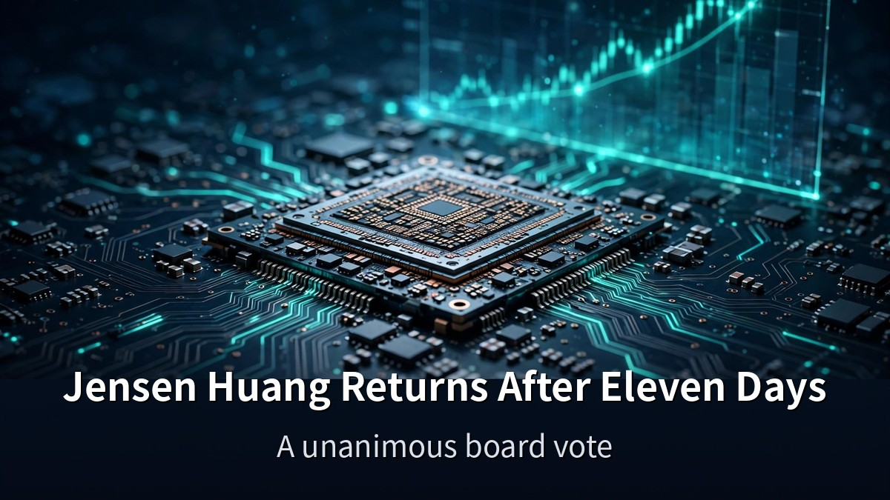
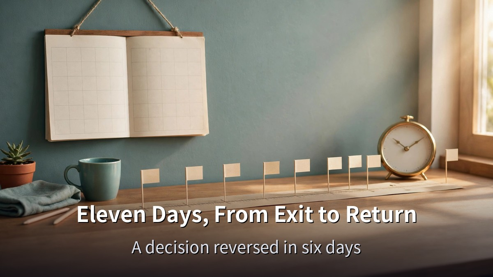
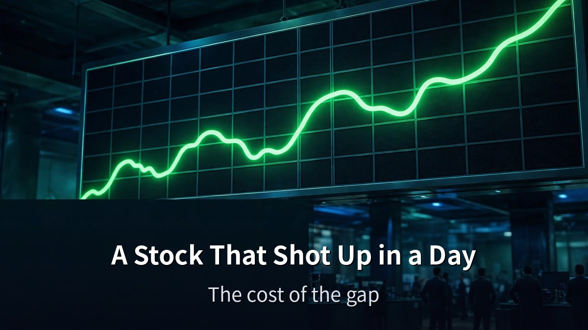
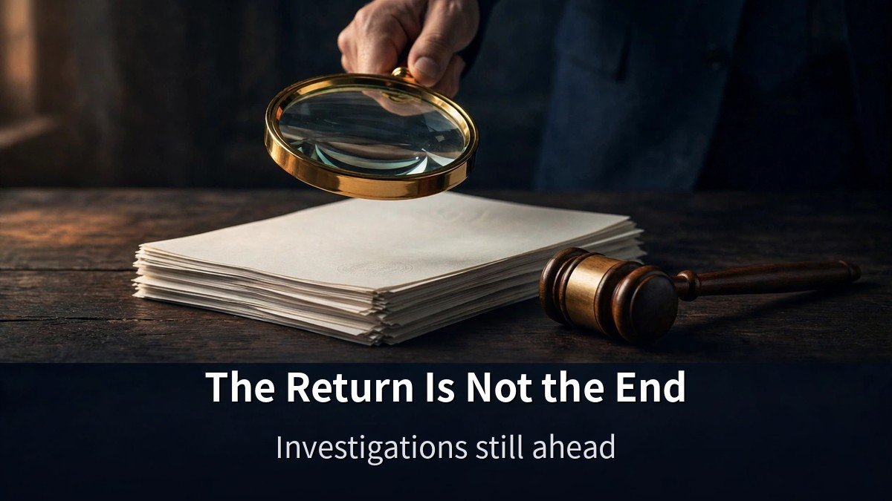

<!-- 본문 시작 -->



Nvidia's board put Jensen Huang back in the CEO chair on November 23.
Eleven days after his resignation, the unanimous vote to reinstate him sent the stock up more than 30% in a day.
The return is not the end of the story, though. An independent board investigation and House interviews are still ahead.

```blog
type: text
runs:
  - text: "Eleven days after he resigned, Nvidia's board voted unanimously to reinstate Jensen Huang, and the stock opened at $167.04 on November 23, more than 30% above the previous close. The board said it had heard from senior U.S. government officials and was confident the return posed no national security risk, and President Trump welcomed the decision. But the independent inquiry into claims that Huang was targeted by a foreign intelligence operation continues, and a California subpoena and December 1 House interviews are still pending."
    style: {bold: true, color: "#007aa6"}
```

The resignation eleven days earlier is covered in [Jensen Huang Resigns as Nvidia CEO｜After 33 Years, What Is Confirmed and What Is Not](https://aitechnotesen.wordpress.com/2026/11/13/jensen-huang-resigns-as-nvidia-ceo%ef%bd%9cafter-33-years-what-is-confirmed-and-what-is-not/).

```blog
type: heading
level: 2
runs:
  - text: "From resignation to return: how did 11 days unfold?"
    style: {bold: true, color: "#007aa6"}
```



Six days earlier the board had ruled out a return. Then it reversed course over a single weekend.

It began on November 8, when Jensen Huang told employees in a message that he had been unfaithful to his wife and had no excuse. The person named was Alice Huang, a former executive at Megaspeed, a Singapore cloud company. U.S. intelligence officials are reported to view her as a collaborator with a Chinese intelligence agency. China denied that as baseless speculation, and the U.S. Justice Department said it had reached no conclusion that she is a spy. Then came reports of a relationship with a direct subordinate, and on November 12 Huang stepped down as president, CEO, and director. Chief Financial Officer Colette Kress took over on an interim basis.

At first the board drew a line against a return. At the earnings announcement on November 17, board chair Harvey Jones said the board had unanimously accepted Huang's resignation and had no intention of putting him back as CEO. The same day Huang posted on X, admitting a serious personal mistake while saying he would be honored to return if the board wanted him. On November 20, President Trump said America is a country of second chances and that he wanted to give Huang another one.

The decision came over the weekend. The board and Huang sat down together on Saturday, November 21, for the first time since the resignation, and a second meeting on Sunday settled the return. Then on November 23, the same board that had unanimously accepted the resignation six days earlier voted unanimously to reinstate him. The board said that after a series of discussions and meetings with Huang, it was satisfied with his candor and his ability to lead the company. Jones added that Huang is the right person to lead Nvidia and that his return is in the best interest of shareholders, employees, partners, and customers.

| Date | What happened |
| --- | --- |
| November 8 | Huang tells employees he was unfaithful |
| November 12 | Resigns as president, CEO, and director; Colette Kress becomes interim CEO |
| November 17 | Earnings call: chair rules out a return; Huang posts he would return if asked |
| November 20 | President Trump speaks of a second chance |
| November 21-22 | Two weekend meetings |
| November 23 | Board votes unanimously to reinstate Huang |

```blog
type: text
runs:
  - text: "Term: board vote "
    style: {bold: true, color: "#ff008c"}
  - text: "The power to hire and fire a CEO sits with the board, not with shareholders. A unanimous vote means every director agreed, and in this case both the November 17 acceptance of the resignation and the November 23 reinstatement were unanimous."
```

```blog
type: text
runs:
  - text: "The claim that Alice Huang cooperated with a Chinese intelligence agency is reported as the view of U.S. intelligence officials. China denied it, and the U.S. Justice Department said it had reached no conclusion that she is a spy. It is not an established fact, so it should not be read as one."
    style: {bold: true, background: "#FFF3CD"}
```

```blog
type: heading
level: 2
runs:
  - text: "Why did the stock jump more than 30% in a single day?"
    style: {bold: true, color: "#007aa6"}
```



From a November 20 close of $125.53 to a November 23 open of $167.04, the stock recovered much of a drop of nearly a third.

The market moved immediately. Nvidia closed at $125.53 on Friday, November 20, and opened Monday at $167.04, up $33.07, more than 30%, from the previous close. It traded as high as $171.50 during the session and closed at $165.05, a one-day gain of 31.48%. The close on November 6, just before Huang disclosed the affair, was $186.64, so in a single day the stock recovered much of a drop of nearly a third. Market value rose by about $938 billion in the day, to roughly $3.96 trillion.

No single reason explains the whole move. The return of the founder was the trigger, and news of strong third-quarter results at the November 17 earnings call arrived in the same week. Wall Street also pointed to forecasts that AI spending is growing faster than expected. But a rising stock is the market's reaction to the decision, not proof that the allegations are false. That distinction has to stay in place.

| Date | Price | Note |
| --- | --- | --- |
| Nov 6 close | $186.64 | Just before the disclosure |
| Nov 12 close | $166.19 | Resignation day, down 4.34% |
| Nov 20 close | $125.53 | Just before the return decision |
| Nov 23 open | $167.04 | Up $33.07 from the previous close |
| Nov 23 close | $165.05 | One-day gain of 31.48% |

```blog
type: text
runs:
  - text: "Term: market capitalization "
    style: {bold: true, color: "#ff008c"}
  - text: "The share price multiplied by the number of shares outstanding, the market's valuation of the whole company. The one-day increase of about $938 billion was described as one of the largest single-day gains on record for any company."
```

The leadership vacuum came as the whole AI industry faced fresh uncertainty, the same theme as [OpenAI Director Warns｜AI Takeover Risk in 6 to 12 Months](https://aitechnotesen.wordpress.com/2026/11/23/openai-director-warns%ef%bd%9cai-takeover-risk-in-6-to-12-months/).

```blog
type: heading
level: 2
runs:
  - text: "He is back, so why do the investigations continue?"
    style: {bold: true, color: "#007aa6"}
```



The reinstatement statement says there is no national security risk, but the inquiries into the allegations have not ended.

The board said its independent directors' committee will keep investigating the claim that Huang became a target of a foreign intelligence operation, and Huang said he will cooperate. A separate committee has been set up to oversee export controls and national security risks, and the company is creating a chief compliance officer role to watch over compliance across the company. The board said it heard the views of senior U.S. government officials in the process and is confident, on that basis, that Huang's return poses no national security risk. Citing the government's judgment while announcing a CEO appointment is unusual. President Trump called the decision right and appropriate, adding that the attorney general had confirmed there was no evidence of wrongdoing by Huang.

Investigations outside the company continue as well. California's attorney general sent Nvidia an investigative subpoena on November 19, and Huang is scheduled to attend closed-door interviews with three House committees on December 1. The return fills the leadership gap; it is not a final judgment on the allegations. How the investigations turn out could change the assessment again.

```blog
type: text
runs:
  - text: "A return is not a clearance. The independent directors' committee inquiry, the California subpoena, and the December 1 House interviews are all still open. Until their results are known, the return should not be read as proof the allegations are resolved."
    style: {bold: true, background: "#FFF3CD"}
```

## What is confirmed, and what is still a claim

Confirmed are the board's vote and its date, the share prices and the market value gained, and the schedule of the remaining investigations. The November 23 reinstatement, the November 20 close of $125.53 against the November 23 open of $167.04 and close of $165.05, were checked against market reporting. That the board heard from senior government officials is in the board's own statement.
The judgments are the evaluations. The board's satisfaction with Huang's candor and leadership, and the president's description of the decision as right and appropriate, are opinions rather than facts. Reading the rally as the market welcoming the founder's return is also an interpretation. The view that strong results and AI spending forecasts helped is analysis whose separate weights cannot be measured.

Eleven days feels strikingly short. The board that accepted the resignation said six days later that a return was out of the question, then six days after that voted unanimously to bring him back. The stock jumped more than 30% in a day, showing the cost of the gap, and the board cited government views as it moved fast. With the December 1 House interviews and the independent committee inquiry still ahead, though, this story is not over. The right order is to watch what comes out of those interviews.

## Frequently asked questions

**How much did Jensen Huang's stake gain on the day he returned?**

Holding about 3.5% of Nvidia, Huang's wealth rose by about $36.6 billion in a single day, moving him to 13th on the Forbes global list, according to reports. That is the stock gain reflected directly in the value of his stake, and it moves again with the share price.

**How were the third-quarter results announced on November 17?**

At the same earnings call where the board chair ruled out a return, Nvidia also reported strong third-quarter results. Wall Street pointed to forecasts that AI spending is growing faster than expected, and the good results landing in the same week as the return became part of the backdrop for the rebound.

**Will the December 1 House interviews be public?**

The interviews with three House committees are scheduled as closed-door sessions. Their contents will not be released the same day, and any account will have to wait for statements from the committees or Nvidia. The interviews could still produce new facts separate from the independent committee inquiry.

## Together with this post

[Jensen Huang Resigns as Nvidia CEO｜After 33 Years, What Is Confirmed and What Is Not](https://aitechnotesen.wordpress.com/2026/11/13/jensen-huang-resigns-as-nvidia-ceo%ef%bd%9cafter-33-years-what-is-confirmed-and-what-is-not/)

[A.I. Artificial Intelligence｜The Robot Boy Programmed to Love](https://aitechnotesen.wordpress.com/2026/11/23/ai-artificial-intelligence%ef%bd%9cthe-robot-boy-programmed-to-love/)

<!-- 본문 끝 -->

## 작업용 출처·이미지 정보 (업로드 제외)

**Sources**
- AI Slash, "[Quick SLASH] Jensen Huang's return as CEO confirmed... Nvidia stock soars 30%", 2026-11-23 (full transcript captured from the YouTube script panel, 2026-11-25)
- Nvidia share prices and market value: Motley Fool, Gulf News, ANI/Republic World, Admiral Markets, Afriupdate (cross-checked in reporting from 2026-11-23~24 — Nov 20 close $125.53, Nov 23 open $167.04, close $165.05, intraday high $171.50, market value up about $938 billion)
- Huang's stake value: Decrypt report (checked 2026-11-24: about 3.5% stake, about $36.6 billion gained in a day, 13th on Forbes)
- Figures checked as of: November 25, 2026
