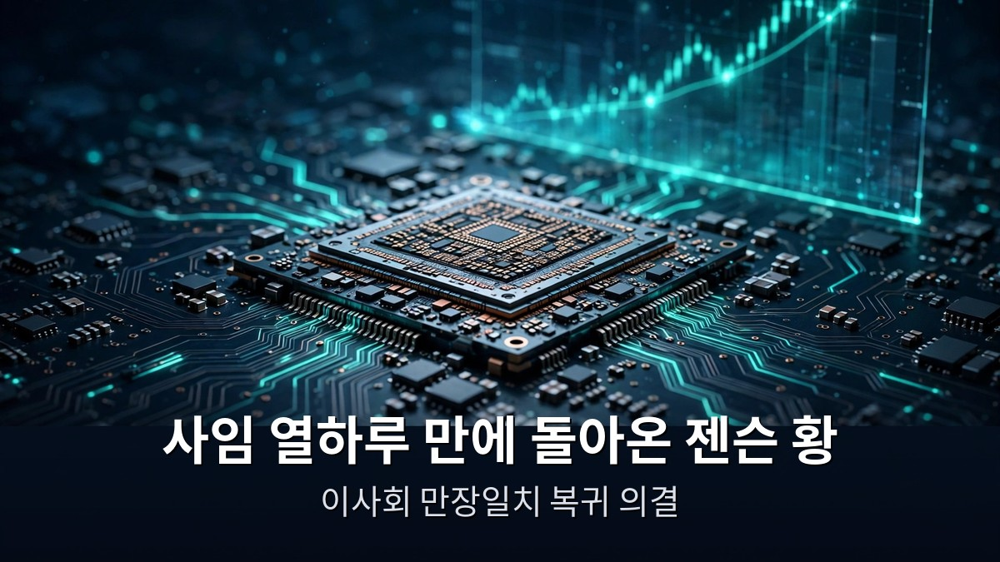
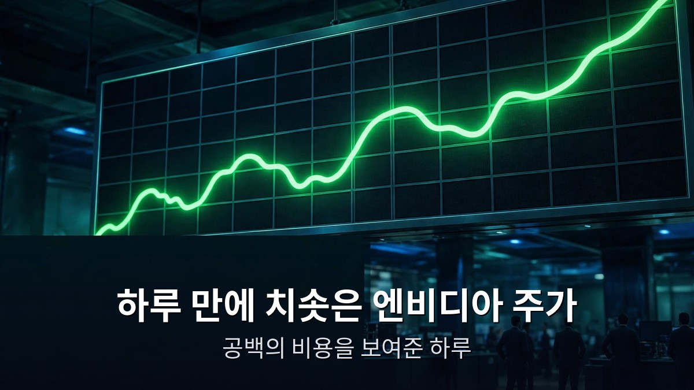
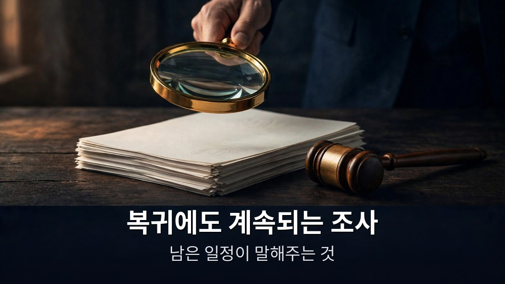

<!-- 본문 시작 -->



엔비디아 이사회가 11월 23일 젠슨 황을 CEO로 다시 앉혔다.
사임한 지 열하루 만의 만장일치 복귀 결정에 주가는 하루 만에 30% 넘게 뛰었다.
다만 복귀가 의혹의 끝은 아니다. 독립 이사 위원회 조사와 하원 면담이 그대로 남아 있다.

```blog
type: text
runs:
  - text: "사임 11일 만에 이사회가 만장일치로 젠슨 황의 복귀를 의결했고, 엔비디아 주가는 23일 시초 167.04달러로 전날 종가보다 30% 넘게 뛰었다. 이사회는 미국 정부 고위급의 의견을 들은 끝에 국가안보에 위험이 없다고 밝혔고, 트럼프 대통령도 결정을 반겼다. 다만 외국 정보기관 표적 의혹에 대한 독립 조사는 계속되고, 캘리포니아 법무부 소환장과 12월 1일 하원 면담이 남아 있다."
    style: {bold: true, color: "#007aa6"}
```

열하루 전 사임 소식은 [젠슨 황, 엔비디아 CEO 사임｜33년 만에 바뀐 AI 칩의 얼굴, 확인된 사실과 의혹](https://blog.naver.com/3700708/224475163043) 글에서 다룬 경위와 이어진다.

```blog
type: heading
level: 2
runs:
  - text: "사임에서 복귀까지, 11일은 어떻게 흘렀나"
    style: {bold: true, color: "#007aa6"}
```


엿새 전만 해도 복귀는 없다고 했던 이사회가 주말 사이 결정을 뒤집었다.

시작은 11월 8일 젠슨 황이 직원들에게 보낸 메시지였다. 아내에게 충실하지 못했고 변명의 여지도 없다고 털어놨다. 상대로 지목된 사람은 싱가포르 클라우드 회사 메가스피드의 전 임원 앨리스 황이다. 미국 정보당국은 이 인물을 중국 정보기관의 협력자로 보고 있는 것으로 알려졌고, 중국 정부는 근거 없는 추측이라고 부인했다. 미국 법무부도 이 인물이 간첩이라는 결론은 내리지 않았다고 밝혔다. 여기에 직속 부하 직원과의 관계 의혹까지 불거지자, 젠슨 황은 11월 12일 사장과 CEO, 이사 자리에서 모두 물러났다. 빈자리는 최고재무책임자 콜레트 크레스가 임시로 맡았다.

이사회는 처음에는 복귀에 선을 그었다. 11월 17일 실적 발표 자리에서 하비 존스 이사회 의장은 이사회가 젠슨 황의 사임을 만장일치로 받아들였고 그를 다시 CEO로 앉힐 생각이 없다고 못 박았다. 같은 날 젠슨 황은 X에 글을 올려 개인적으로 심각한 실수를 했다고 인정하면서도, 이사회가 원한다면 영광스럽게 돌아가겠다고 밝혔다. 11월 20일에는 트럼프 대통령이 미국은 두 번째 기회를 주는 나라라며 젠슨 황에게 다시 기회를 주고 싶다고 말했다.

결정은 주말 사이에 내려졌다. 이사회와 젠슨 황은 11월 21일 토요일 사임 뒤 처음 마주 앉았고, 이튿날인 일요일 두 번째 회의에서 복귀를 정한 것으로 알려졌다. 그리고 11월 23일, 엿새 전 만장일치로 사임을 받아들였던 그 이사회가 이번에는 만장일치로 젠슨 황의 복귀를 의결했다. 이사회는 젠슨 황과 여러 차례 대화하고 만나 본 끝에 그의 솔직함과 회사를 이끌 능력에 만족했다고 밝혔다. 하비 존스 의장도 젠슨 황이 엔비디아를 이끌 적임자이며, 그의 복귀가 주주와 직원, 협력사와 고객 모두에게 가장 이롭다고 말했다.

| 날짜 | 일어난 일 |
| --- | --- |
| 11월 8일 | 젠슨 황, 직원 메시지로 외도 인정 |
| 11월 12일 | 사장·CEO·이사직 사임, 콜레트 크레스 임시 CEO |
| 11월 17일 | 실적 발표, 이사회 의장 복귀 불가 못박음 · 황 X 글 복귀 의사 |
| 11월 20일 | 트럼프 대통령, 두 번째 기회 언급 |
| 11월 21~22일 | 주말 회의 두 차례 |
| 11월 23일 | 이사회 만장일치 복귀 의결 |

```blog
type: text
runs:
  - text: "용어: 이사회 의결 "
    style: {bold: true, color: "#ff008c"}
  - text: "CEO를 앉히고 내리는 권한은 주주가 아니라 이사회에 있다. 만장일치 의결은 이사 전원이 같은 결론에 동의했다는 뜻으로, 이번 건에서는 17일 사임 수락과 23일 복귀 의결이 모두 만장일치였다."
```

```blog
type: text
runs:
  - text: "앨리스 황이 중국 정보기관의 협력자라는 말은 미국 정보당국의 시각으로 알려진 내용이다. 중국 정부는 부인했고, 미국 법무부는 간첩이라는 결론을 내리지 않았다고 밝혔다. 확정된 사실이 아니므로 단정해서 읽으면 안 된다."
    style: {bold: true, background: "#FFF3CD"}
```

```blog
type: heading
level: 2
runs:
  - text: "주가는 왜 하루 만에 30% 넘게 뛰었나"
    style: {bold: true, color: "#007aa6"}
```



20일 종가 125.53달러에서 23일 시초 167.04달러, 하루 만에 3분의 1 가까이 빠졌던 낙폭을 상당 부분 되찾았다.

시장은 곧바로 움직였다. 11월 20일 125.53달러로 거래를 마쳤던 엔비디아 주가는 11월 23일 167.04달러로 출발하며 전날 종가보다 33.07달러, 30% 넘게 올랐다. 장중에는 171.50달러까지 올랐고, 종가는 165.05달러로 하루 상승률 31.48%를 기록했다. 외도를 털어놓기 직전인 11월 6일 종가가 186.64달러였으니, 3분의 1 가까이 빠졌던 주가를 하루 만에 상당 부분 되찾은 셈이다. 시가총액은 하루에 약 9,380억 달러가 늘어 약 3조 9,600억 달러가 됐다.

오른 이유를 한 가지로만 설명하기는 어렵다. 복귀 결정 자체가 창업자의 귀환을 반긴 것이고, 17일 실적 발표에서 3분기 실적이 좋았다는 소식도 같은 주에 나왔다. 월가에서는 AI 지출이 예상보다 빠르게 늘고 있다는 전망도 함께 거론됐다. 다만 주가가 뛴 것은 복귀 결정에 대한 시장의 반응이지, 의혹이 사실이 아니라는 증명이 아니다. 그 구분은 끝까지 남겨둬야 한다.

| 날짜 | 주가 | 비고 |
| --- | --- | --- |
| 11월 6일 종가 | 186.64달러 | 외도 고백 직전 |
| 11월 12일 종가 | 166.19달러 | 사임 발표일, 4.34% 하락 |
| 11월 20일 종가 | 125.53달러 | 복귀 결정 직전 |
| 11월 23일 시초 | 167.04달러 | 전날 종가보다 33.07달러 상승 |
| 11월 23일 종가 | 165.05달러 | 하루 상승률 31.48% |

```blog
type: text
runs:
  - text: "용어: 시가총액 "
    style: {bold: true, color: "#ff008c"}
  - text: "주가에 발행 주식 수를 곱한 값으로, 회사 전체의 시장 평가액이다. 23일 하루 증가분 약 9,380억 달러는 한 회사의 하루 증가분으로는 역대 최대급이라는 평가가 나왔다."
```

AI 업계 전체가 흔들리던 흐름은 [오픈AI 이사 경고｜AI takeover 6~12개월 위험](https://blog.naver.com/3700708/224487805993) 글에서 다룬 6~12개월 경고와 같은 맥락이다. 한 회사의 리더십 공백이 업계 전체의 불확실성으로 번지던 시기였다.

```blog
type: heading
level: 2
runs:
  - text: "복귀했는데, 조사는 왜 계속되나"
    style: {bold: true, color: "#007aa6"}
```



복귀 의결문에 국가안보 위험 없음이 들어갔지만, 의혹을 들여다보는 조사는 끝나지 않았다.

이사회는 젠슨 황이 외국 정보기관의 표적이 됐다는 의혹을 들여다보는 독립 이사 위원회의 조사를 끝까지 진행하겠다고 밝혔다. 젠슨 황도 조사에 협조하겠다고 했다. 수출 통제와 국가안보 위험을 감독하는 위원회도 최근 따로 꾸렸고, 회사 전체가 규정을 지키는지 살필 최고준법책임자 자리를 새로 만들어 사람을 찾고 있다. 이사회는 이 과정에서 미국 정부 고위급의 의견을 들었고, 이를 바탕으로 젠슨 황의 복귀가 국가안보에 아무 위험이 되지 않는다고 확신한다고 밝혔다. 회사의 최고경영자 인사를 발표하며 정부의 판단을 근거로 든, 흔치 않은 결정이다. 트럼프 대통령은 이 결정을 옳고 적절한 결정이라고 반기며, 법무장관이 젠슨 황의 위법 행위에 대한 증거가 없다고 확인했다고 덧붙였다.

회사 밖의 조사도 이어진다. 캘리포니아 주 법무부가 11월 19일 엔비디아에 조사 소환장을 보냈고, 젠슨 황은 다음 달 1일 미국 하원 위원회 세 곳의 비공개 면담에 나설 예정이다. 복귀는 경영 공백을 메운 결정이지, 의혹에 대한 최종 판단이 아니다. 조사 결과가 어떻게 나오느냐에 따라 평가는 다시 달라질 수 있다.

```blog
type: text
runs:
  - text: "복귀했다고 의혹이 정리된 것은 아니다. 독립 이사 위원회 조사, 캘리포니아 법무부 소환장, 12월 1일 하원 면담이 모두 진행 중이다. 조사 결과를 보기 전에는 복귀를 의혹 해소로 읽으면 안 된다."
    style: {bold: true, background: "#FFF3CD"}
```

## 확인된 사실과 주장은 이렇게 나뉜다

확인된 건 이사회 의결 날짜와 만장일치 여부, 주가 수치와 시가총액 증가분, 그리고 남아 있는 조사 일정이다. 11월 23일 복귀 의결, 20일 종가 125.53달러에서 23일 시초 167.04달러, 종가 165.05달러는 보도와 시장 데이터로 대조했다. 정부 고위급의 의견을 들었다는 점도 이사회 발표에 나온 내용이다.
주장으로 봐야 할 건 평가의 말들이다. 이사회가 밝힌 솔직함과 이끌 능력에 대한 만족, 트럼프 대통령의 옳고 적절하다는 평가는 판단이지 사실이 아니다. 주가 상승을 두고 창업자 귀환을 시장이 반겼다고 읽는 것도 해석이다. 실적 호조와 AI 지출 전망이 함께 작용했다는 분석 역시, 비중을 따로 잴 수 없는 해석에 가깝다.

열하루라는 시간이 유난히 짧게 느껴진다. 사임을 받아들인 이사회가 엿새 만에 복귀 불가라고 못 박았다가, 다시 엿새 만에 만장일치로 복귀를 의결했기 때문이다. 주가는 하루 만에 30% 넘게 뛰며 공백의 비용을 보여줬고, 이사회는 정부 의견까지 근거로 들며 결정을 서둘렀다. 다만 12월 1일 하원 면담과 독립 위원회 조사가 남아 있는 한, 이 이야기는 아직 끝나지 않았다. 다음 달 면담에서 무슨 말이 나오는지를 지켜보는 게 순서다.

## 자주 묻는 질문

**젠슨 황의 지분 가치는 복귀 당일 얼마나 올랐나?**

약 3.5% 지분을 가진 젠슨 황의 재산은 복귀 당일 하루에 약 366억 달러가 늘어 포브스 세계 부자 순위 13위에 올랐다고 전해졌다. 주가 상승분이 그대로 지분 가치에 반영된 결과다. 다만 하루 평가액이라 주가에 따라 다시 달라진다.

**11월 17일 실적 발표에서 3분기 실적은 어땠나?**

이사회 의장이 복귀 불가 입장을 밝힌 바로 그 자리에서 3분기 실적이 좋았다는 소식도 함께 나왔다. 월가에서는 AI 지출이 예상보다 빠르게 늘고 있다는 전망이 거론됐고, 실적 호조가 복귀 결정과 같은 주에 겹치며 주가 반등의 배경이 됐다.

**12월 1일 하원 면담은 공개되나?**

미국 하원 위원회 세 곳과의 면담은 비공개로 예정돼 있다. 당일 내용이 바로 공개되지는 않으며, 이후 위원회나 엔비디아 쪽에서 나오는 설명을 기다려야 한다. 면담 결과에 따라 독립 위원회 조사와는 별개로 새로운 사실이 나올 수도 있다.

## 함께 보면 좋은 글

[젠슨 황, 엔비디아 CEO 사임｜33년 만에 바뀐 AI 칩의 얼굴, 확인된 사실과 의혹](https://blog.naver.com/3700708/224475163043)

[A.I. 인공지능｜사랑을 배우는 로봇 소년의 여정](https://blog.naver.com/3700708/224488130424)

<!-- 본문 끝 -->

## 작업용 출처·이미지 정보 (업로드 제외)

**출처**
- AI 슬래시, "[Quick SLASH] '왕의 귀환' 젠슨 황 CEO 복귀 확정...엔비디아 주가 30% 폭등", 2026-11-23 (자막 원문, 2026-11-25 브라우저 스크립트 패널 확보)
- 엔비디아 주가·시가총액: Motley Fool, Gulf News, ANI/Republic World, Admiral Markets, Afriupdate (2026-11-23~24 보도 대조 — 11/20 종가 125.53달러, 11/23 시초 167.04달러·종가 165.05달러·장중 고가 171.50달러, 시가총액 약 9,380억 달러 증가)
- 젠슨 황 지분 가치: Decrypt 보도 (2026-11-24 확인: 약 3.5% 지분, 하루 약 366억 달러 증가, 포브스 13위)
- 수치 확인 기준: 2026년 11월 25일
