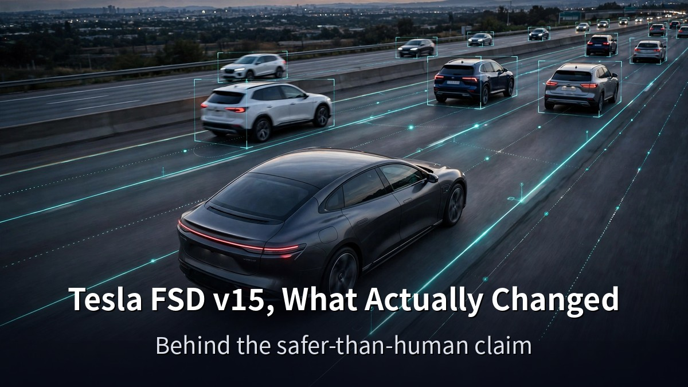
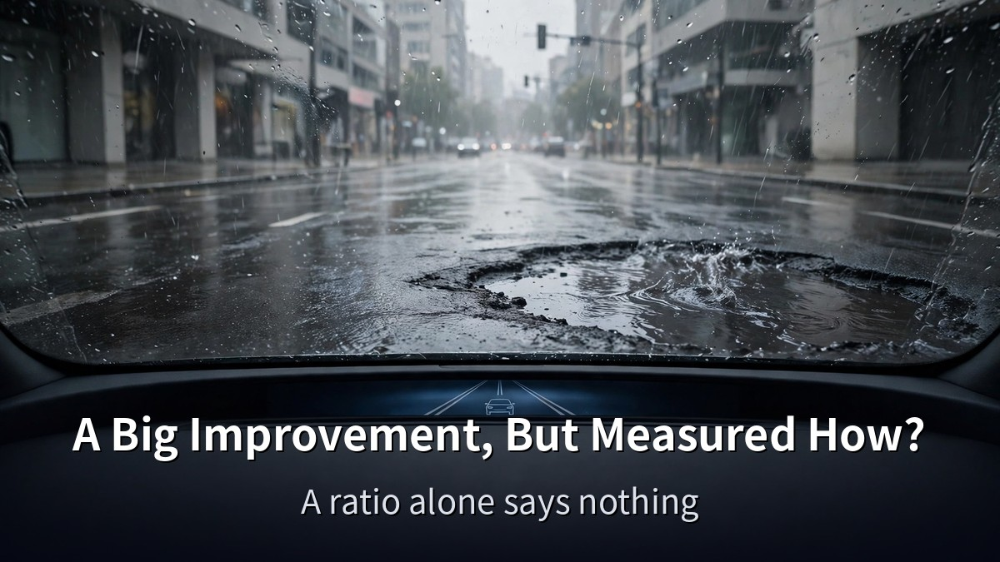
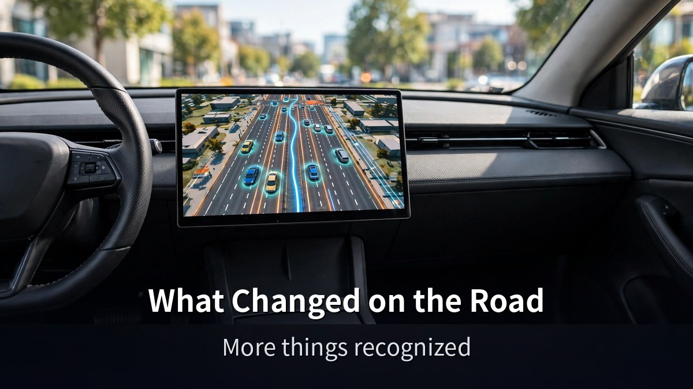
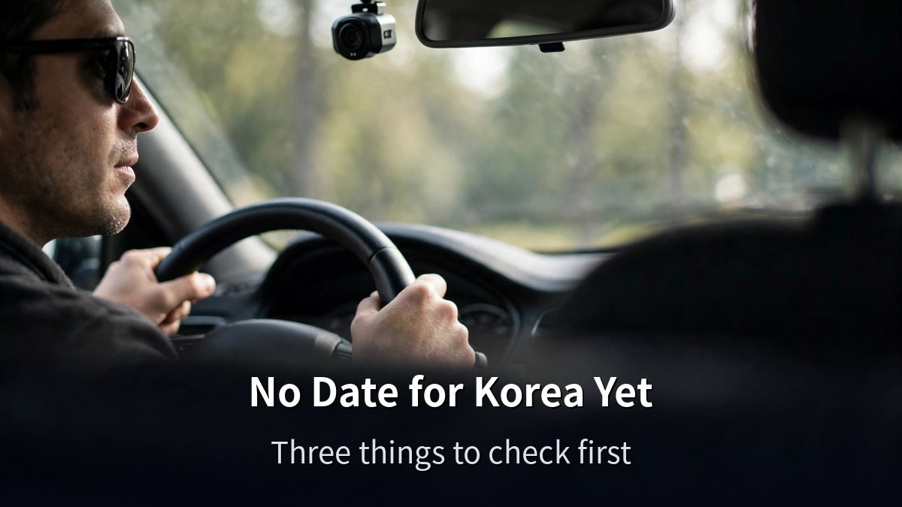

<!-- 본문 시작 -->



Tesla began rolling out FSD v15, the new version of its driving software, on November 21.
Tesla says the rate at which a driver must intervene in dangerous moments has improved 25 times.
But the basis for the claim in the official video — that it is 9 times safer than a human — has not been disclosed.

```blog
type: text
runs:
  - text: "Tesla began rolling out FSD v15 on November 21, saying the intervention rate in dangerous situations improved 25 times, and CEO Elon Musk said it now drives better than a human. The official video even carries the line that it is 9 times safer than a human — yet Tesla has not disclosed what the 25x and 9x figures were measured against, or how many interventions actually happen. Pothole avoidance also reads differently in the video than in the release notes, so whether the car actually steers around potholes is unconfirmed, and the announcement carried no schedule for Korea."
    style: {bold: true, color: "#007aa6"}
```

AI directly steering a machine is the same trend as the [Cyborg cockroaches, the AI-steered rescue robots](https://aitechnotesen.wordpress.com/2026/11/24/cyborg-cockroaches-the-aisteered-rescue-robot-today/) covered earlier.

```blog
type: heading
level: 2
runs:
  - text: "A 25x improvement — but measured how?"
    style: {bold: true, color: "#007aa6"}
```



The 25x figure does not cover driving as a whole. It comes from the vision encoder, the part that reads camera footage.

FSD is Tesla's driving software that lets the car find its own way while the driver supervises. Version 15 reworks the whole neural network that does the driving, and the 25x figure comes from one part of it: the vision encoder, which reads camera images. Tesla trained this vision encoder on millions of internet videos and made it shared by FSD, the driverless taxi service Robotaxi, and the humanoid robot Optimus. The aim is for it to work even in situations it has never seen and to learn from less data, and Tesla wrote in the release notes that this improved the intervention rate in dangerous situations 25 times.

CEO Elon Musk posted on X the same day that it is a completely new architecture and now drives better than a human. The official video even carries the line that it is 9 times safer than a human. But Tesla has not disclosed what the 25x and 9x figures were measured against, or how many interventions actually happen. To judge whether the 25x improvement claim holds up, you need to know what the original intervention count was — and that number is missing. A ratio alone cannot tell you the absolute level of safety.

```blog
type: text
runs:
  - text: "Term: intervention rate "
    style: {bold: true, color: "#ff008c"}
  - text: "How often a driver must step in at a dangerous moment. Saying the intervention rate improved 25 times means that where a driver once had to step in 25 times over the same distance, it now happens about once. That is Tesla's own wording."
```

| What improved | Tesla's description | Verified? |
| --- | --- | --- |
| Vision encoder | Trained on millions of internet videos, intervention rate improved 25x | Basis and actual counts undisclosed |
| 9 times safer than a human | Wording in the official video | Basis undisclosed |
| Pothole avoidance | Video shows avoidance, notes say better recognition | Actual avoidance unconfirmed |
| Driver monitoring | Hat and sunglasses detection expanded, monitoring eased in the faster driving setting | Confirmed in release notes |

```blog
type: text
runs:
  - text: "The claim that it is 9 times safer than a human is Tesla's claim. What it was measured against, and how many interventions actually happen, have not been disclosed. A ratio alone is not a reason to conclude it is safe."
    style: {bold: true, background: "#FFF3CD"}
```

```blog
type: heading
level: 2
runs:
  - text: "What changed from the driver's seat?"
    style: {bold: true, color: "#007aa6"}
```



The car recognizes more things on the road, and the driver's screen now shows a new view of the plan FSD has drawn up.

It recognizes more on the road. According to the release notes Tesla published with the update, v15 is better at recognizing road signs, small animals, and objects dropped on the road. It adjusts speed more naturally in school zones and speed-limit zones and in bad weather, and slows down on its own in front of speed cameras. Navigation was reworked so that route preferences are learned from the driving records of the fleet. It applies first to the departure and arrival segments, then expands to the whole route in a later update. Parking spots are picked using the driver's own history. A new bike rack mode lets FSD be used with a bike rack fitted.

The longest-awaited item is potholes. V15 is better at recognizing potholes — dips and holes in the road surface — and road conditions, and it steers around deep puddles. Pothole avoidance is a feature Musk promised in 2019 and said again at the end of August this year that it was coming soon, so 7 years after the promise it has finally appeared in the release notes as an improved item. But while the official video presents it as pothole avoidance, the release notes only say the car recognizes them better, so whether it actually steers around them is still unconfirmed. Read literally, the notes say potholes are better recognized, and deep puddles are avoided.

The driver's screen gained a new Tesla Reality View. It draws the driving scene in real time to show what FSD is about to do. The driver does not only watch the plan FSD has drawn up on this screen — they can change it directly. The release notes call the same feature Tesla Augmented Reality. Driver monitoring was also reworked, widening camera-based attention checks so they work even when the driver wears a hat or sunglasses. But in the faster driving setting, monitoring was made less strict — a point that cannot be brushed past, since FSD is a feature the driver must supervise.

```blog
type: text
runs:
  - text: "Term: vision encoder "
    style: {bold: true, color: "#ff008c"}
  - text: "The part of the neural network that reads camera footage to understand the road. In v15 this part was retrained so that FSD, Robotaxi, and Optimus share the same encoder. Tesla says it was trained on millions of internet videos."
```

One neural network shared by a car, a taxi service, and a robot belongs to the same family as the systems that set their own steps and finish a task, explained in [What is an AI agent](https://aitechnotesen.wordpress.com/2026/11/22/what-is-an-ai-agent-agentic-ai-and-computer-use-explained/).

```blog
type: heading
level: 2
runs:
  - text: "When is it coming to Korea, and what to check before buying?"
    style: {bold: true, color: "#007aa6"}
```



The rollout has begun, but the announcement says nothing about which cars get it first, or when it reaches Korea.

Tesla says it has only just begun sending out v15. A small group of early-access users gets it first, with a wider rollout expected next month. But which cars get it first, and when it reaches Korea, were not in this announcement. In Korea, FSD has not officially launched yet, and as of November 2026 only basic driver assistance is offered. To use v15's features in Korea, an official launch announcement will have to come first.

There are three things to check before buying. First, FSD is supervised. No matter how good v15 gets, the driver must keep watching, and if an accident happens, the driver is responsible. Second, the 25x and 9x figures are ratios on Tesla's own basis. With the actual intervention counts undisclosed, how often you will have to step in can only be judged from users' records after the rollout. Third, pothole avoidance is still unconfirmed. Rather than taking the video's presentation at face value, the right order is to watch whether real driving records show it.

| Rollout stage | What it is | Verified? |
| --- | --- | --- |
| November 21 | Rollout begins with a first wave of early users | Confirmed in Tesla's announcement |
| December | Wider rollout expected | Confirmed in Tesla's announcement |
| Car models | Which cars get it first not announced | Not in this announcement |
| Korea | No launch schedule announced | Not in this announcement |

```blog
type: text
runs:
  - text: "Pothole avoidance reads differently in the video and in the release notes. The notes only say potholes are recognized better; what is written as avoided is deep puddles. Whether the car actually steers around potholes is unconfirmed."
    style: {bold: true, background: "#FFF3CD"}
```

## What is confirmed, and what is still a claim

What is confirmed is what the release notes say. The vision encoder upgrade and its sharing across FSD, Robotaxi, and Optimus, training on millions of internet videos, the wording of a 25x intervention-rate improvement, better recognition of signs, small animals, and debris, speed adjustment in school zones and in front of speed cameras, the addition of Tesla Reality View, the driver-monitoring changes, and the rollout starting November 21 with wider release in December were all checked against Tesla's announcement and the release notes.
What should be treated as claims are Musk's words and the video's wording. That it drives better than a human, and that it is 9 times safer than a human, are Tesla's claims, with the basis and actual figures undisclosed. The video's presentation of pothole avoidance also differs from the release notes and should be treated as a claim. And the reading that a 25x improvement brings driverless driving closer cannot be settled either, without the actual intervention counts.

The detail that stays with me is the pothole promise reaching the release notes 7 years later. A feature promised in 2019 has only now been listed as improved, and even then the wording is split between avoidance and better recognition. The 25x and 9x figures sound large, but without a basis there is no way to measure how large they are. What Tesla needs to disclose next is not a bigger ratio, but how many interventions actually happen. With no Korea schedule in this announcement, that basis matters more to readers in Korea than the rollout news itself.

## Frequently asked questions

**Can Teslas in Korea use FSD?**

As of November 2026, FSD has not officially launched in Korea, and only basic driver assistance is offered. To use v15's features in Korea, an official launch announcement will have to come first. This announcement carried no Korea schedule.

**Does a 25x improvement mean I can take my hands off now?**

No. FSD is a supervised feature: the driver must always keep watching, and the driver is responsible if an accident happens. A better intervention rate means stepping in less often, not that watching is no longer needed. The easing of monitoring in the faster driving setting is all the more reason to watch it closely.

**Are Robotaxi and FSD the same thing?**

No. FSD is the supervised driving feature in your own car, while Robotaxi is the driverless taxi service Tesla operates. They share the same vision encoder, but FSD is Level 2, where the driver is responsible, and Robotaxi is Level 4, with the driver's seat empty — different in form and in who is responsible. The distinction is explained in the glossary post on what an AI agent is, linked above.

## Together with this post

[10 AI-Only Channels, Ranked | The Formula Behind the Views](https://aitechnotesen.wordpress.com/2026/11/24/10-aionly-channels-ranked-the-formula-behind-the-views/)

[Passengers｜Two Awake 90 Years Early, an Android Asks Why](https://aitechnotesen.wordpress.com/2026/11/22/passengers%ef%bd%9ctwo-awake-90-years-early-an-android-asks-why/)

<!-- 본문 끝 -->

## 작업용 출처·이미지 정보 (업로드 제외)

**Sources**
- AI Slash, "[Quick SLASH] Musk says it 'drives better than a human'... the truth behind Tesla FSD v15, 9 times safer than a human", 2026-11-23 (full transcript captured from the YouTube script panel, 2026-11-25)
- Tesla FSD v15 release notes (software 2026.38.6.11, FSD v15.0.1): cross-checked in reporting by Not a Tesla App, Electrek, Tech Times, and FourWeekMBA (2026-11-21~23 — shared vision encoder, 25x intervention rate, Reality View, speed-camera slowing, pothole recognition, driver-monitoring changes)
- Musk X posts (2026-11-21~22: "completely new architecture", "drives better than a human", "banger release")
- Figures checked as of: November 25, 2026
