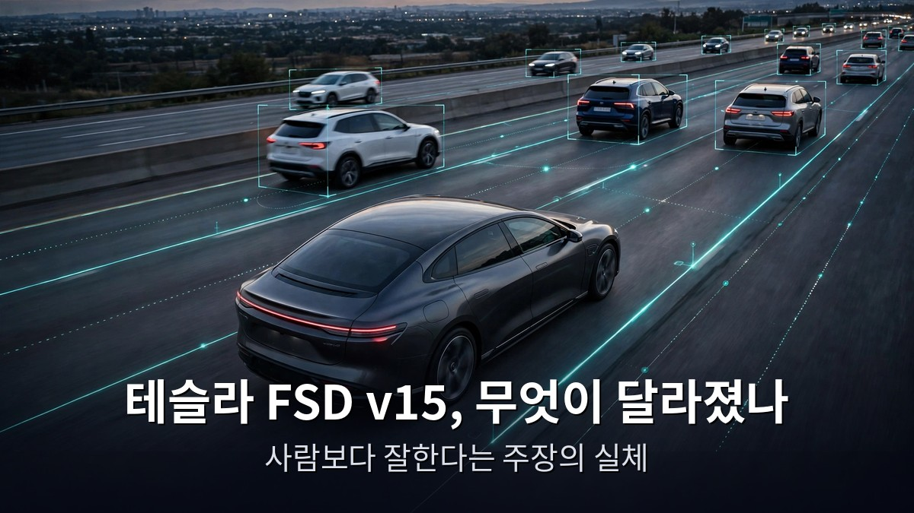
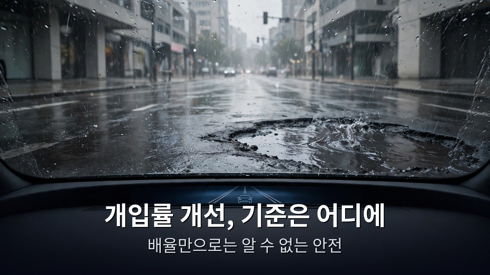
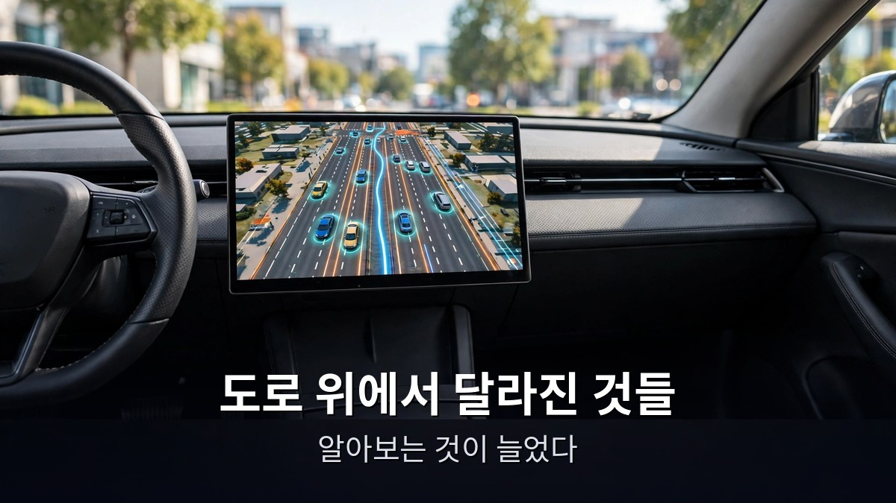
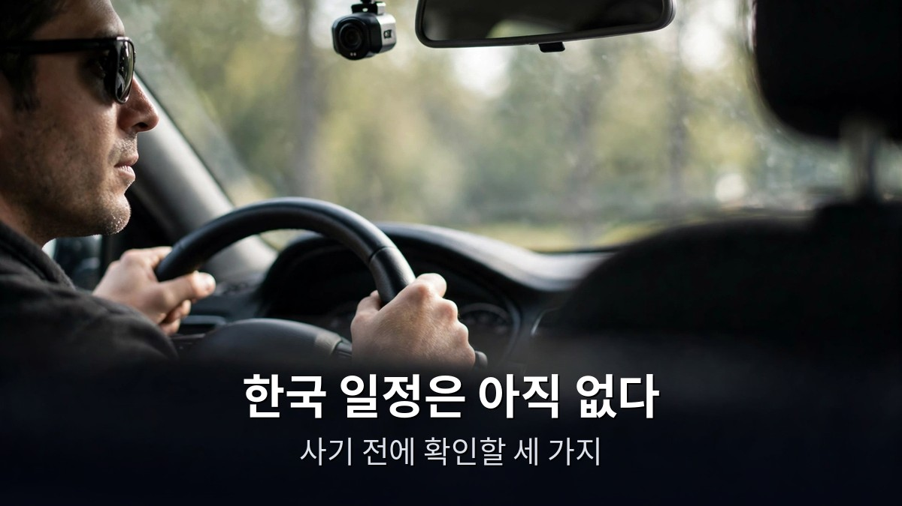

<!-- 본문 시작 -->



테슬라가 11월 21일 주행 소프트웨어 FSD의 새 버전 v15 배포를 시작했다.
위험한 순간에 사람이 끼어들어야 하는 비율이 25배 나아졌다는 게 테슬라의 설명이다.
다만 공식 영상에 나온 사람보다 9배 안전하다는 말의 기준은 공개되지 않았다.

```blog
type: text
runs:
  - text: "테슬라가 11월 21일 FSD v15 배포를 시작하며 위험 상황 개입률이 25배 나아졌다고 밝혔고, 머스크 CEO는 사람보다 운전을 잘한다고 말했다. 공식 영상에는 사람보다 9배 안전하다는 문구까지 나왔지만, 25배와 9배가 무엇을 기준으로 잰 숫자인지, 실제 개입 횟수는 얼마인지 테슬라는 공개하지 않았다. 포트홀 회피도 영상의 표현과 릴리스 노트 문구가 달라 실제 회피 여부는 확인되지 않았고, 한국 일정은 이번 발표에 담기지 않았다."
    style: {bold: true, color: "#007aa6"}
```

AI가 기계를 직접 조종하는 사례는 [AI가 조종하는 구조 로봇](https://blog.naver.com/3700708/224489435873) 글에서 다룬 바퀴벌레 구조 로봇과 같은 흐름이다.

```blog
type: heading
level: 2
runs:
  - text: "25배 좋아졌다는 숫자, 뭘 잰 건가"
    style: {bold: true, color: "#007aa6"}
```



25배라는 숫자는 운전 전체가 아니라, 카메라 영상을 읽는 비전 인코더에서 나왔다.

FSD는 운전자가 지켜보는 조건으로 차가 스스로 길을 찾아 달리게 하는 테슬라의 주행 소프트웨어다. 이번 v15는 운전을 맡는 신경망 전체를 손봤는데, 25배라는 숫자는 그 가운데 카메라 영상을 읽어 내는 부분인 비전 인코더에서 나왔다. 테슬라는 이 비전 인코더를 인터넷 영상 수백만 개로 학습시켰고, FSD와 무인 택시 로보택시, 휴머노이드 로봇 옵티머스가 함께 쓰게 했다. 처음 보는 상황에서도 잘 통하고 적은 데이터로도 배우게 하려는 목적이며, 테슬라는 이걸로 위험 상황의 개입률이 25배 나아졌다고 릴리스 노트에 적었다.

머스크 최고경영자도 같은 날 X에 완전히 새로운 구조라며, 이제 사람보다 운전을 잘한다고 적었다. 공식 영상에는 사람보다 9배 안전하다는 문구까지 나온다. 다만 테슬라는 25배와 9배가 무엇을 기준으로 잰 숫자인지, 실제 개입 횟수는 얼마인지 공개하지 않았다. 25배 개선이라는 말이 맞는지 따지려면 원래 개입 횟수가 얼마였는지를 알아야 하는데, 그 숫자가 없다. 배율만으로는 절대적인 안전 수준을 알 수 없는 구조다.

```blog
type: text
runs:
  - text: "용어: 개입률 "
    style: {bold: true, color: "#ff008c"}
  - text: "위험한 순간에 운전자가 직접 끼어들어야 하는 빈도다. 개입률이 25배 나아졌다는 말은, 같은 거리를 달리는 동안 사람이 25번 끼어들던 위험한 순간이 한 번꼴로 줄었다는 뜻이다. 테슬라의 표현 그대로다."
```

| 개선 항목 | 테슬라 설명 | 확인 여부 |
| --- | --- | --- |
| 비전 인코더 | 인터넷 영상 수백만 개 학습, 개입률 25배 개선 | 기준·실제 횟수 미공개 |
| 사람보다 9배 안전 | 공식 영상 문구 | 기준 미공개 |
| 포트홀 회피 | 영상은 회피, 노트는 인식 개선 | 실제 회피 미확인 |
| 운전자 감시 | 모자·선글라스 감지 확대, 고속 설정 감시 완화 | 릴리스 노트 확인 |

```blog
type: text
runs:
  - text: "9배 안전하다는 말은 테슬라의 주장이다. 무엇을 기준으로 잰 것인지, 실제 개입 횟수는 얼마인지 공개되지 않았다. 배율만 보고 안전하다고 단정하면 안 된다."
    style: {bold: true, background: "#FFF3CD"}
```

```blog
type: heading
level: 2
runs:
  - text: "운전석에서 뭐가 달라졌나"
    style: {bold: true, color: "#007aa6"}
```



도로 위에서 알아보는 것이 늘었고, 운전석 화면에는 FSD가 세운 계획을 보여주는 새 화면이 들어갔다.

도로 위에서 알아보는 것도 늘었다. 테슬라가 함께 낸 릴리스 노트에 따르면, v15는 도로 표지판과 작은 동물, 길에 떨어진 물건을 더 잘 알아본다. 스쿨존과 제한속도 구간, 궂은 날씨에서는 속도를 더 자연스럽게 맞추고, 단속 카메라 앞에서는 스스로 속도를 줄인다. 내비게이션도 손봐서, 경로 선호를 차량들의 주행 기록에서 배우는 방식으로 바꿨다. 처음에는 출발과 도착 구간부터 적용하고, 이후 업데이트에서 전체 구간으로 넓힌다고 했다. 주차할 자리도 운전자의 이력을 보고 고른다. 자전거 거치대를 단 채로 FSD를 쓸 수 있는 자전거 거치대 모드도 새로 들어갔다.

가장 오래 기다려 온 항목은 포트홀이다. v15는 도로가 움푹 팬 구멍인 포트홀과 노면 상태를 더 잘 알아보고, 깊게 고인 물웅덩이는 피해 가게 했다. 포트홀을 피해 가는 기능은 머스크 최고경영자가 2019년에 약속했고 올해 8월 말에도 곧 된다고 답했는데, 약속한 지 7년 만에 포트홀이 개선된 항목으로 적힌 셈이다. 다만 공식 영상은 포트홀 회피라고 내세웠지만 릴리스 노트에는 더 잘 알아본다고만 적혀 있어, 실제로 피해서 달리는지는 아직 확인되지 않았다. 노트 문구 그대로 읽으면 포트홀은 인식 개선, 물웅덩이는 회피다.

운전석 화면에는 Tesla Reality View가 새로 들어갔다. FSD가 지금 무엇을 하려는지 주행 장면을 실시간으로 그려 보여 주는 화면이다. 운전자는 이 화면에서 FSD가 세운 계획을 보기만 하는 것이 아니라, 직접 바꿀 수도 있다. 릴리스 노트에서는 같은 기능을 Tesla Augmented Reality라고도 적었다. 운전자를 살피는 방식도 손봐, 모자나 선글라스를 써도 카메라로 시선을 살필 수 있게 넓혔다. 그러나 빠르게 달리도록 고른 주행 설정에서는 감시를 덜 엄격하게 바꿨는데, FSD가 운전자가 지켜봐야 하는 기능이라 더더욱 가볍게 넘길 수 없는 대목이다.

```blog
type: text
runs:
  - text: "용어: 비전 인코더 "
    style: {bold: true, color: "#ff008c"}
  - text: "카메라 영상을 읽어 도로 상황을 이해하는 신경망의 일부다. v15에서는 이 부분을 새로 학습시켜 FSD와 로보택시, 옵티머스가 같은 인코더를 쓰게 했다. 테슬라는 인터넷 영상 수백만 개로 학습시켰다고 밝혔다."
```

하나의 신경망을 차와 택시, 로봇이 나눠 쓰는 구조는 [AI 에이전트 뜻](https://blog.naver.com/3700708/224486778572) 글에서 정리한 스스로 단계를 정해 일을 끝내는 시스템과 같은 계열이다.

```blog
type: heading
level: 2
runs:
  - text: "한국에는 언제 오나, 사기 전에 확인할 것"
    style: {bold: true, color: "#007aa6"}
```



배포는 시작됐지만, 어떤 차부터 받는지, 한국에는 언제 들어오는지는 이번 발표에 담기지 않았다.

테슬라는 v15를 이제 막 내보내기 시작했다고 밝혔다. 처음에는 새 버전을 먼저 받아 보는 일부 이용자부터 받은 뒤 다음 달 더 넓게 풀릴 것으로 알려졌다. 다만 어떤 차부터 받는지, 한국에는 언제 들어오는지는 이번 발표에 담기지 않았다. 한국에서는 FSD가 아직 정식 출시되지 않았고, 2026년 11월 기준으로 기본 주행 보조까지만 제공된다. v15의 기능을 한국에서 쓰려면 정식 출시 발표를 기다려야 한다.

사기 전에 확인할 것은 세 가지다. 첫째, FSD는 감독형이다. v15가 아무리 좋아져도 운전자가 지켜봐야 하는 기능이며, 사고가 나면 책임은 운전자에게 있다. 둘째, 25배와 9배는 테슬라가 정한 기준의 배율이다. 실제 개입 횟수가 공개되지 않았으니, 내 차에서 얼마나 자주 끼어들게 될지는 배포 뒤 이용자들의 기록을 봐야 한다. 셋째, 포트홀 회피는 아직 확인되지 않았다. 영상의 표현을 그대로 믿기보다, 실제 주행 기록이 나오는지를 지켜보는 게 순서다.

| 배포 단계 | 내용 | 확인 여부 |
| --- | --- | --- |
| 11월 21일 | 첫 물결 일부 이용자부터 배포 시작 | 테슬라 발표 확인 |
| 12월 | 더 넓게 확대 예정 | 테슬라 발표 확인 |
| 차종 | 어떤 차부터 받는지 미발표 | 이번 발표에 없음 |
| 한국 | 출시 일정 미발표 | 이번 발표에 없음 |

```blog
type: text
runs:
  - text: "포트홀 회피는 영상의 표현과 릴리스 노트 문구가 다르다. 노트에는 포트홀을 더 잘 알아본다고만 적혀 있고, 회피한다고 적힌 것은 깊은 물웅덩이다. 실제로 포트홀을 피해서 달리는지는 확인되지 않았다."
    style: {bold: true, background: "#FFF3CD"}
```

## 확인된 사실과 주장은 이렇게 나뉜다

확인된 건 릴리스 노트에 적힌 내용이다. 비전 인코더 업그레이드와 FSD·로보택시·옵티머스 공용, 인터넷 영상 수백만 개 학습, 개입률 25배 개선이라는 문구, 표지판·작은 동물·낙하물 인식 개선, 스쿨존·단속카메라 속도 조절, Tesla Reality View 추가, 운전자 감시 변경, 11월 21일 배포 시작과 12월 확대는 테슬라 발표와 릴리스 노트로 대조했다.
주장으로 봐야 할 건 머스크의 말과 영상의 문구다. 사람보다 운전을 잘한다는 말, 사람보다 9배 안전하다는 문구는 테슬라의 주장으로, 기준과 실제 수치가 공개되지 않았다. 포트홀 회피라는 영상의 표현도 릴리스 노트와 달라 주장으로 봐야 한다. 25배 개선이 곧바로 무인 주행에 가깝다는 해석 역시, 실제 개입 횟수가 없어 단정할 수 없다.

포트홀 약속이 7년 만에 개선 항목으로 적힌 대목이 오래 남는다. 2019년에 약속한 기능을 이제야 노트에 올렸고, 그나마 회피인지 인식 개선인지 문구가 엇갈린다. 숫자 25배와 9배는 크게 들리지만, 기준이 없으면 크기를 잴 수 없다. 테슬라가 다음에 공개해야 할 것은 더 큰 배율이 아니라, 개입이 실제로 몇 번 일어나는지다. 한국 일정이 없는 지금, 국내 독자에게는 배포 소식보다 그 기준이 먼저다.

## 자주 묻는 질문

**한국 테슬라는 FSD를 쓸 수 있나?**

2026년 11월 기준으로 한국에서는 FSD가 정식 출시되지 않았고, 기본 주행 보조까지만 제공된다. v15의 기능을 한국에서 쓰려면 정식 출시 발표를 기다려야 한다. 이번 발표에는 한국 일정이 담기지 않았다.

**25배 개선이면 이제 손을 놓고 타도 되나?**

안 된다. FSD는 감독형 기능으로, 운전자가 항상 지켜봐야 하고 사고 책임도 운전자에게 있다. 개입률이 좋아졌다는 말은 끼어들 일이 줄었다는 뜻이지, 지켜보지 않아도 된다는 뜻이 아니다. 고속 주행 설정에서 감시가 완화된 점은 오히려 주의해서 볼 대목이다.

**로보택시와 FSD는 같은 건가?**

아니다. FSD는 내 차에 들어가는 감독형 주행 기능이고, 로보택시는 테슬라가 운영하는 무인 택시 서비스다. 같은 비전 인코더를 쓰지만, FSD는 운전자가 책임지는 레벨 2, 로보택시는 운전석이 비어 있는 레벨 4로 형태와 책임 주체가 다르다. 자세한 구분은 오늘 함께 나간 용어 정리 글에서 다룬다.

## 함께 보면 좋은 글

[AI로만 만든 채널 10곳｜티어표로 보는 성공 공식](https://blog.naver.com/3700708/224489352086)

[패신저스｜90년 먼저 깬 두 사람, AI 바텐더](https://blog.naver.com/3700708/224488742149)

<!-- 본문 끝 -->

## 작업용 출처·이미지 정보 (업로드 제외)

**출처**
- AI 슬래시, "[Quick SLASH] \"사람보다 운전을 잘한다\"는 머스크… 사람보다 9배 안전하다는 테슬라 FSD v15의 실체", 2026-11-23 (자막 원문, 2026-11-25 브라우저 스크립트 패널 확보)
- 테슬라 FSD v15 릴리스 노트 (소프트웨어 2026.38.6.11, FSD v15.0.1): Not a Tesla App·Electrek·Tech Times·FourWeekMBA 보도 대조 (2026-11-21~23 — 비전 인코더 공용·개입률 25배·Reality View·단속카메라 감속·포트홀 인식·운전자 감시 변경)
- 머스크 X 게시글 (2026-11-21~22: "완전히 새로운 구조", "사람보다 운전을 잘한다", "banger release")
- 수치 확인 기준: 2026년 11월 25일
