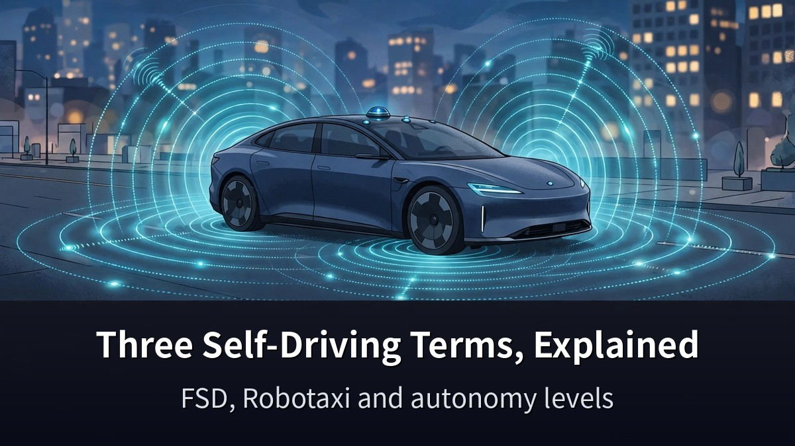

<!-- 본문 시작 -->

Since Tesla started rolling out FSD v15, three terms keep showing up together — FSD, robotaxi, and autonomy levels.
They sound like the same technology, but they split completely on one question: who is responsible for driving.
This post sorts out all three, checked against Tesla's official documentation and SAE J3016 as of November 25, 2026.

```blog
type: text
runs:
  - text: "FSD is supervised driver assistance that the driver must watch, a robotaxi is a driverless taxi service with an empty driver's seat, and autonomy levels are the names for steps 0 to 5 that divide up who holds driving responsibility."
    style: {bold: true, color: "#007aa6"}
```



```blog
type: heading
level: 2
runs:
  - text: "FSD: Why Watch Something Called Self-Driving?"
    style: {bold: true, color: "#007aa6"}
```


```blog
type: text
runs:
  - text: "Term: FSD "
    style: {bold: true, color: "#ff008c"}
  - text: "Short for Full Self-Driving (Supervised), Tesla's driving software. The car finds its own way to the destination, but the driver must watch the road at all times and be ready to step in. Tesla's own manual says it assumes a 'fully attentive driver'."
```

With FSD engaged, the car follows curves, stops at intersections, makes left and right turns, and enters and exits highways.
Tesla says it can be used on any type of road, including residential and city streets.

Version v15, which started rolling out on November 21, is the newest version of this software.
Tesla says the rate at which a person must step in at dangerous moments improved 25 times, but it has not disclosed what the number was measured against, or how many actual interventions took place.
A ratio alone cannot tell you how often you would have to step in.

The use is clear.
FSD is a feature inside your own car.
The key point is that it is driver assistance used while the driver is sitting in the car.

Here is the point people get wrong.
The name says 'Full Self-Driving', but it is not full autonomy.
Tesla's own manual states that FSD does not make the car autonomous.
That is why 'Supervised' sits in the name, in brackets.

```blog
type: text
runs:
  - text: "FSD is not a feature where the car drives — it is a feature where the car helps while the driver watches."
    style: {bold: true, background: "#FFF3CD"}
  - text: " If something goes wrong, the driver is responsible. No matter how much v15 improves, that premise does not change."
```

```blog
type: heading
level: 2
runs:
  - text: "Robotaxi: A Taxi With an Empty Driver's Seat"
    style: {bold: true, color: "#007aa6"}
```


```blog
type: text
runs:
  - text: "Term: Robotaxi "
    style: {bold: true, color: "#ff008c"}
  - text: "A driverless taxi service you call with an app. Tesla launched it in Austin, Texas, on June 22, 2025, with a safety monitor riding along at first. On June 3, 2026, Tesla said rides without a monitor were available across all of Austin."
```

Nobody in a robotaxi drives the car.
The driver's seat is empty, and the passenger rides in the back, calling and leaving through the app.
It runs only inside a set area, and it can stop running in bad weather.

It shares the same roots as FSD.
Tesla says FSD and Robotaxi share the same vision encoder.
Same eyes, different job.
FSD is a feature in your car; Robotaxi is a service Tesla operates.

The dividing line is responsibility.
With FSD, the driver is responsible; with Robotaxi, the operator of the service is.
Look at who is sitting in the driver's seat, and the two split apart at once.

```blog
type: text
runs:
  - text: "According to Tesla's first Robotaxi safety report, published October 21, 2026, cars in Austin drove 2,118,015 miles with no safety monitor on board through October 18."
    style: {bold: true, background: "#FFF3CD"}
  - text: " That number shows the scale at which monitor-free driving is running."
```

```blog
type: heading
level: 2
runs:
  - text: "Autonomy Levels: What Do the Numbers Divide?"
    style: {bold: true, color: "#007aa6"}
```


```blog
type: text
runs:
  - text: "Term: Autonomy levels "
    style: {bold: true, color: "#ff008c"}
  - text: "The 0-to-5 scale defined by SAE J3016. The test is not how good the car is, but who holds driving responsibility. At levels 0 to 2 the person drives; at levels 3 to 5 the system drives."
```

Level 0 has no driver assistance, Level 1 helps with either steering or speed, and Level 2 helps with steering and speed together.
Up to here, the driver must keep watching.
FSD sits here.

From Level 3, the system takes over driving.
At Level 3, though, the person must take over when the system asks.
Level 4 means the system takes full responsibility inside a set area, and Level 5 means the system drives under every condition a person could drive in.
No production system at Level 5 exists yet.

The dividing line falls between Level 2 and Level 3.
That is where the person in the driver's seat stops being the driver and becomes a passenger.

| Level | Who drives | What the person does |
| --- | --- | --- |
| 0 | Person | Drives everything |
| 1 | Person + system (steering or speed) | Keeps watching |
| 2 | Person + system (steering and speed) | Keeps watching |
| 3 | System (defined conditions) | Takes over when asked |
| 4 | System (defined area) | No need to take over |
| 5 | System (all conditions) | No need to take over |

**A level number is not a safety rating.**
The number only names who holds responsibility; how safe that system is has to be measured separately.

```blog
type: text
runs:
  - text: "Remember it this way — "
    style: {bold: true, color: "#ff008c"}
  - text: "FSD is a feature in your car that you watch, a robotaxi is a service with an empty driver's seat, and levels are names for dividing up responsibility."
```

Once the three terms are separated, the news reads differently.
Before the 25-times number, the first question is who is sitting in the driver's seat.
In FSD news, look at the driver; in robotaxi news, look at the operator; in level news, look at where responsibility changes hands.
When the next self-driving story arrives, check responsibility before the name.

## Frequently Asked Questions

**Can I use FSD in Korea?**

As of November 25, 2026, FSD has not officially launched in Korea. On November 20, the Korea Transportation Safety Authority, under the Ministry of Land, Infrastructure and Transport, turned down Tesla's special-approval application for China-made Teslas, citing insufficient documentation. US-made Teslas can use FSD because their compliance with US safety rules is recognized under the Korea-US Free Trade Agreement.

**If I buy a Level 2 car, will an update turn it into Level 4 later?**

No. A level describes who holds driving responsibility at the moment a feature is engaged. FSD is supervised, so it stays Level 2 even as the software improves, and driverless driving goes through separate approval and a separate service. Your car does not become a robotaxi.

**Is FSD called the same thing in every country?**

No. In Europe, regulators said the name could mislead consumers, so Tesla renamed it TAD (Tesla Assisted Driving). The name changed, but the supervised premise is the same.

## Good Reads

[10 AI-Only Channels, Ranked｜The Formula Behind the Views](https://aitechnotesen.wordpress.com/2026/11/24/10-aionly-channels-ranked-the-formula-behind-the-views/)

[What Is an AI Agent｜Agentic AI and Computer Use Explained](https://aitechnotesen.wordpress.com/2026/11/22/what-is-an-ai-agent-agentic-ai-and-computer-use-explained/)

<!-- 본문 끝 -->

## 작업용 출처·이미지 정보 (업로드 제외)

## Working sources and image info (do not upload)

**Sources**
- Tesla Model Y Owner's Manual, Full Self-Driving (Supervised) — https://www.tesla.com/ownersmanual/2020_2024_modely/en_us/GUID-2CB60804-9CEA-4F4B-8B04-09B991368DC5.html (supervised definition, driver must stay attentive, checked 2026-11-25)
- SAE J3016_202609, Taxonomy and Definitions for Terms Related to Driving Automation Systems — https://saemobilus.sae.org/standards/j3016_202609-taxonomy-definitions-terms-related-driving-automation-systems-road-motor-vehicles (levels 0-5, checked 2026-11-25)
- Engadget, Tesla's inaugural Robotaxi rides will have a human 'safety monitor' on board (2025-06-21) — https://www.engadget.com/transportation/tesla-inaugural-robotaxi-rides-will-have-a-human-safety-monitor-on-board-161307639.html (Austin launch, safety monitor)
- dockduty.com, Tesla Robotaxi Austin (checked 2026-10-27) — https://dockduty.com/blog/tesla-robotaxi-austin.html (June 3, 2026 unsupervised across Austin; first Robotaxi safety report Oct 21, 2026; 2,118,015 miles with no monitor through Oct 18)
- Korea Times, Korean authority rejects request for full self-driving for China-made Teslas (2026-11-20) — https://www.koreatimes.co.kr/amp/business/companies/20261120/korean-authority-rejects-request-for-full-self-driving-for-china-made-teslas (KOTSA rejection, US-made FTA recognition)
- Chosun, FSD renamed TAD in Europe (2026-11-06) — https://www.chosun.com/economy/economy_general/2026/11/06/GEYWIOLCMZQTKOBZGY3GEOBUGE/
- Definitions and dates checked on 2026-11-25
