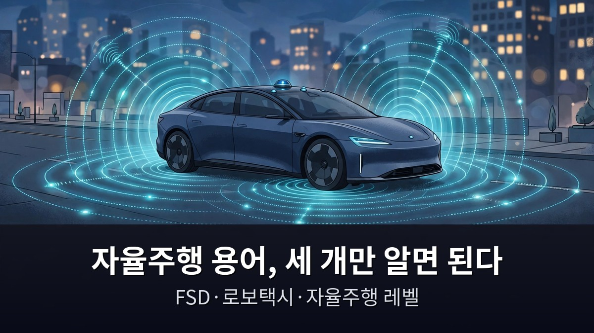
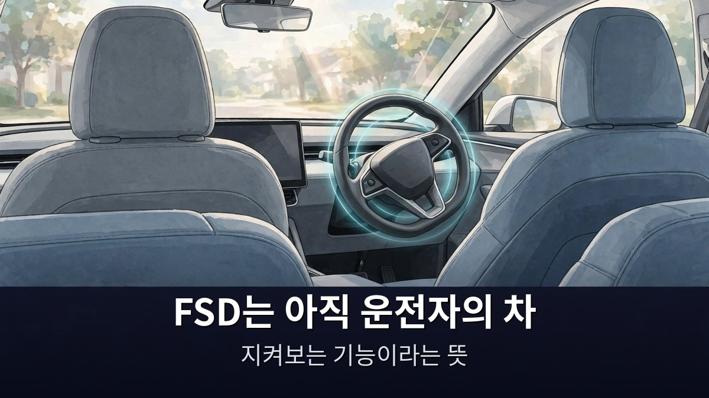
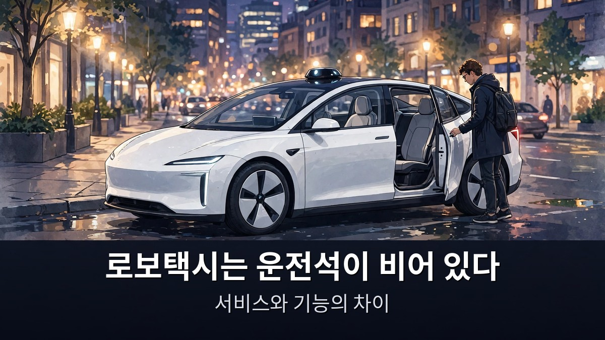

<!-- 본문 시작 -->

테슬라 FSD v15 배포 소식 이후 FSD, 로보택시, 자율주행 레벨이라는 말이 한꺼번에 쏟아진다.
세 말은 같은 기술처럼 들리지만, 누가 운전 책임을 지는지에서 완전히 갈린다.
이 글은 2026년 11월 25일 기준으로 테슬라 공식 문서와 SAE J3016 기준을 대조해 세 용어를 나눠 정리한다.

```blog
type: text
runs:
  - text: "FSD는 운전자가 지켜봐야 하는 감독형 주행 보조이고, 로보택시는 운전석이 비어 있는 무인 택시 서비스이며, 자율주행 레벨은 0부터 5까지 운전 책임이 누구에게 있는지를 나눈 이름이다."
    style: {bold: true, color: "#007aa6"}
```



```blog
type: heading
level: 2
runs:
  - text: "FSD, 이름은 셀프 드라이빙인데 왜 지켜봐야 하나?"
    style: {bold: true, color: "#007aa6"}
```



```blog
type: text
runs:
  - text: "용어: FSD "
    style: {bold: true, color: "#ff008c"}
  - text: "Full Self-Driving(Supervised)의 줄임말로, 테슬라의 주행 소프트웨어이다. 목적지까지 차가 스스로 길을 찾아 달리지만, 운전자는 항상 도로를 지켜보고 언제든 끼어들 준비를 해야 한다. 테슬라 공식 설명서는 '완전히 주의하는 운전자'를 전제로 한다고 적었다."
```

FSD가 켜지면 차는 곡선 도로를 따라가고, 교차로에서 멈추고, 좌우 회전을 하고, 고속도로에 들고 나는 일을 맡는다.
일반 도로와 주택가 길에서도 쓸 수 있다고 테슬라는 설명한다.

11월 21일 배포를 시작한 v15는 이 소프트웨어의 새 버전이다.
테슬라는 위험한 순간에 사람이 끼어들어야 하는 비율이 25배 나아졌다고 밝혔지만, 무엇을 기준으로 잰 숫자인지, 실제 개입 횟수는 얼마인지는 공개하지 않았다.
배율만으로는 내 차에서 얼마나 자주 끼어들게 될지 알 수 없다.

쓰임은 분명하다.
FSD는 내 차에 들어가는 기능이다.
운전자가 타 있는 내 차에서 쓰는 주행 보조라는 점이 핵심이다.

헷갈리는 지점은 이름이다.
'Full Self-Driving'이라는 말이 들어가도 완전자율이 아니다.
테슬라 공식 설명서도 FSD가 차를 자율주행차로 만들지 않는다고 못 박았다.
'감독형(Supervised)'이라는 괄호가 이름의 일부인 이유이다.

```blog
type: text
runs:
  - text: "FSD는 차가 운전하는 기능이 아니라, 운전자가 지켜보는 조건으로 차가 돕는 기능이다."
    style: {bold: true, background: "#FFF3CD"}
  - text: " 사고가 나면 책임은 운전자에게 있다. v15가 아무리 좋아져도 이 전제는 바뀌지 않는다."
```

```blog
type: heading
level: 2
runs:
  - text: "로보택시, 운전석이 비어 있는 택시"
    style: {bold: true, color: "#007aa6"}
```



```blog
type: text
runs:
  - text: "용어: 로보택시 "
    style: {bold: true, color: "#ff008c"}
  - text: "앱으로 불러 타는 무인 택시 서비스이다. 테슬라는 2025년 6월 22일 미국 오스틴에서 서비스를 시작했고, 처음에는 안전 모니터가 동승했다. 2026년 6월 3일에는 오스틴 전역에서 모니터 없이 탈 수 있게 됐다고 밝혔다."
```

로보택시는 차에 타는 사람이 운전하지 않는다.
운전석이 비어 있고, 승객은 뒷좌석에 앉아 앱으로 부르고 내린다.
정해진 구역 안에서만 다니고, 날씨가 나쁘면 운행을 멈추기도 한다.

FSD와 같은 뿌리를 쓴다.
테슬라는 FSD와 로보택시가 같은 비전 인코더를 나눠 쓴다고 밝혔다.
같은 눈을 쓰지만 쓰임은 다르다.
FSD는 내 차의 기능, 로보택시는 테슬라가 운영하는 서비스이다.

갈림길은 책임이다.
FSD에서는 운전자가 책임지고, 로보택시에서는 서비스를 운영하는 쪽이 책임을 진다.
운전석에 누가 앉아 있는지를 보면 둘을 바로 가를 수 있다.

```blog
type: text
runs:
  - text: "테슬라가 2026년 10월 21일 낸 첫 로보택시 안전 보고서에 따르면, 오스틴에서 안전 모니터 없이 달린 거리는 10월 18일까지 2,118,015마일이다."
    style: {bold: true, background: "#FFF3CD"}
  - text: " 모니터 없는 운행이 어느 규모로 굴러가는지를 보여주는 숫자이다."
```

```blog
type: heading
level: 2
runs:
  - text: "자율주행 레벨, 숫자는 무엇을 나누나"
    style: {bold: true, color: "#007aa6"}
```


```blog
type: text
runs:
  - text: "용어: 자율주행 레벨 "
    style: {bold: true, color: "#ff008c"}
  - text: "SAE J3016이 정한 0부터 5까지의 구분이다. 기준은 차의 성능이 아니라 운전 책임이 누구에게 있는가이다. 레벨 0~2에서는 사람이 운전하고, 레벨 3~5에서는 시스템이 운전한다."
```

레벨 0은 운전 보조가 없는 상태, 레벨 1은 조향이나 속도 중 하나만 돕고, 레벨 2는 조향과 속도를 함께 돕는다.
여기까지는 운전자가 계속 지켜봐야 한다.
FSD가 여기에 속한다.

레벨 3부터는 시스템이 운전을 맡는다.
다만 레벨 3에서는 시스템이 넘기라고 알리면 사람이 받아야 한다.
레벨 4는 정해진 구역 안에서 시스템이 끝까지 책임지고, 레벨 5는 사람이 운전할 수 있는 모든 조건에서 시스템이 운전한다.
레벨 5에 해당하는 상용 시스템은 아직 없다.

갈림길은 레벨 2와 3 사이다.
운전석에 앉은 사람이 운전자인가, 손님인가가 여기서 나뉜다.

| 레벨 | 누가 운전하나 | 운전자는 뭘 하나 |
| --- | --- | --- |
| 0 | 사람 | 전부 운전 |
| 1 | 사람 + 시스템(조향 또는 속도) | 계속 지켜봄 |
| 2 | 사람 + 시스템(조향과 속도) | 계속 지켜봄 |
| 3 | 시스템(정해진 조건) | 넘기라는 알림에 받음 |
| 4 | 시스템(정해진 구역) | 받을 필요 없음 |
| 5 | 시스템(모든 조건) | 받을 필요 없음 |

**레벨 숫자가 안전 등급은 아니다.**
숫자는 책임이 누구에게 있는지를 나눈 이름일 뿐, 그 시스템이 얼마나 안전한지는 따로 잰 숫자이다.

```blog
type: text
runs:
  - text: "이렇게 기억하면 된다 — "
    style: {bold: true, color: "#ff008c"}
  - text: "FSD는 지켜보는 내 차의 기능, 로보택시는 운전석이 빈 서비스, 레벨은 책임을 나눈 이름이다."
```

세 용어를 나누면 뉴스가 다르게 읽힌다.
숫자 25배보다 먼저 물을 것은 운전석에 누가 앉아 있는가이다.
FSD 소식에서는 운전자가, 로보택시 소식에서는 운영사가, 레벨 소식에서는 책임의 경계가 먼저 보인다.
다음 자율주행 소식이 나오면 이름보다 책임부터 확인하는 편이 안전하다.

## 자주 묻는 질문

**한국에서는 FSD를 쓸 수 있나?**

2026년 11월 25일 기준으로 한국에서는 FSD가 정식 출시되지 않았다. 11월 20일에는 국토교통부 산하 교통안전공단이 중국산 테슬라 차량에 대한 FSD 특례 신청을 자료 부족으로 반려했다. 미국산 테슬라는 한미 자유무역협정(FTA) 인정으로 FSD를 쓸 수 있다.

**레벨 2 차를 사면 나중에 업데이트로 레벨 4가 되나?**

아니다. 레벨은 켜진 기능이 그 순간 누구에게 운전 책임을 묻는지를 나눈 것이다. FSD는 감독형이라 소프트웨어가 좋아져도 레벨 2로 남고, 무인 주행은 별도 승인과 별도 서비스로 간다. 내 차가 로보택시가 되는 일은 없다.

**FSD라는 이름은 모든 나라에서 같나?**

아니다. 유럽에서는 규제 당국이 이름이 소비자를 오해하게 할 수 있다고 지적해 테슬라가 TAD(Tesla Assisted Driving)로 바꿨다. 이름이 달라도 감독형이라는 전제는 같다.

## 함께 보면 좋은 글

[AI로만 만든 채널 10곳｜티어표로 보는 성공 공식](https://blog.naver.com/3700708/224489352086)

[AI 에이전트 뜻｜에이전틱 AI·컴퓨터 유즈 정리](https://blog.naver.com/3700708/224486778572)

<!-- 본문 끝 -->

## 작업용 출처·이미지 정보 (업로드 제외)

**출처**
- Tesla Model Y Owner's Manual, Full Self-Driving (Supervised) — https://www.tesla.com/ownersmanual/2020_2024_modely/en_us/GUID-2CB60804-9CEA-4F4B-8B04-09B991368DC5.html (감독형 정의·운전자 상시 주의 의무, 2026-11-25 확인)
- SAE J3016_202609, Taxonomy and Definitions for Terms Related to Driving Automation Systems — https://saemobilus.sae.org/standards/j3016_202609-taxonomy-definitions-terms-related-driving-automation-systems-road-motor-vehicles (레벨 0~5 정의, 2026-11-25 확인)
- Engadget, Tesla's inaugural Robotaxi rides will have a human 'safety monitor' on board (2025-06-21) — https://www.engadget.com/transportation/tesla-inaugural-robotaxi-rides-will-have-a-human-safety-monitor-on-board-161307639.html (오스틴 출시·안전 모니터 동승)
- dockduty.com, Tesla Robotaxi Austin (2026-10-27 확인) — https://dockduty.com/blog/tesla-robotaxi-austin.html (2026-06-03 오스틴 전역 모니터 없는 운행 가능, 첫 로보택시 안전 보고서 2026-10-21, 모니터 없이 2,118,015마일~10월 18일)
- Korea Times, Korean authority rejects request for full self-driving for China-made Teslas (2026-11-20) — https://www.koreatimes.co.kr/amp/business/companies/20261120/korean-authority-rejects-request-for-full-self-driving-for-china-made-teslas (교통안전공단 특례 신청 반려·미국산 FTA 인정)
- Chosun, FSD 유럽 TAD 명칭 변경 (2026-11-06) — https://www.chosun.com/economy/economy_general/2026/11/06/GEYWIOLCMZQTKOBZGY3GEOBUGE/
- 정의·날짜 확인 기준일: 2026-11-25
