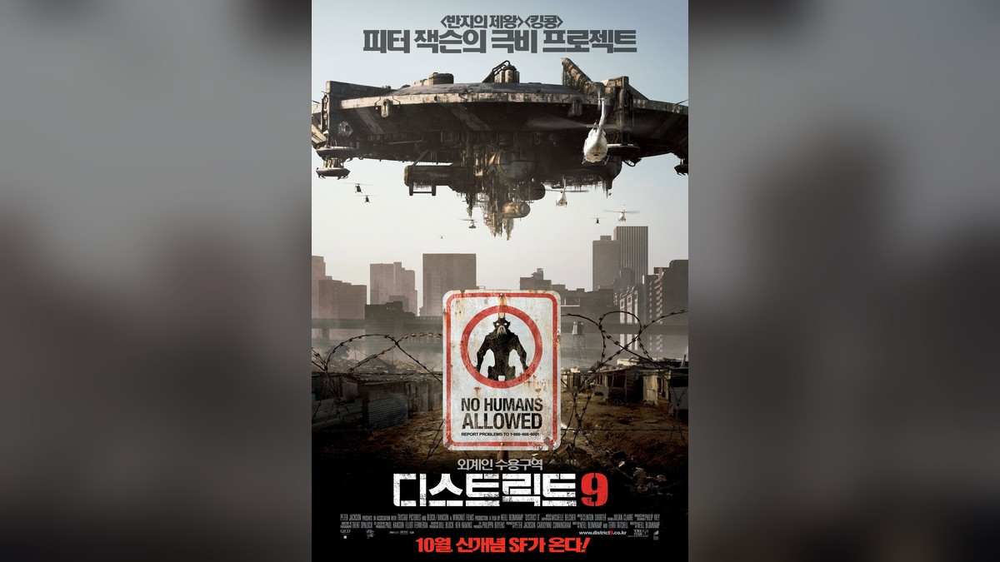
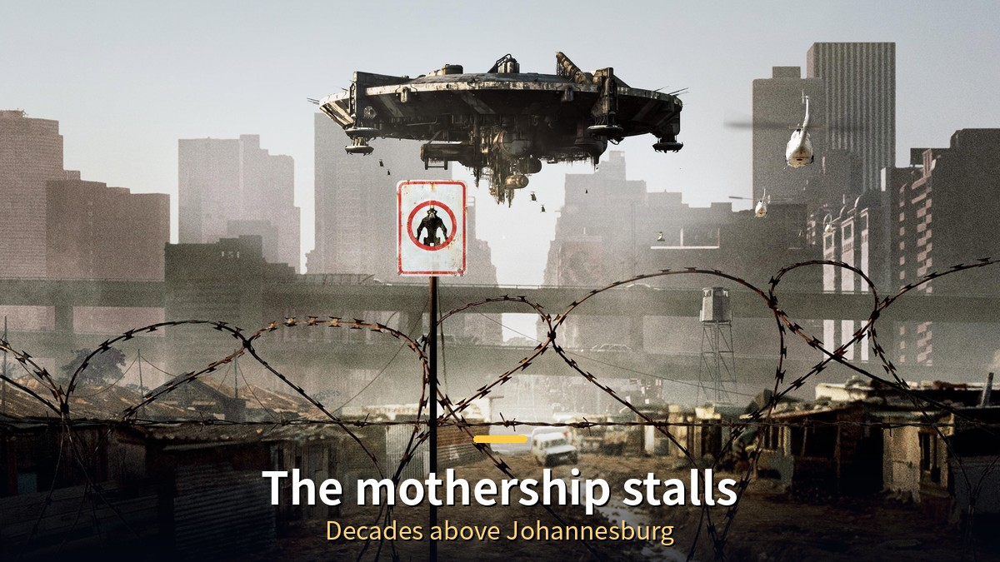
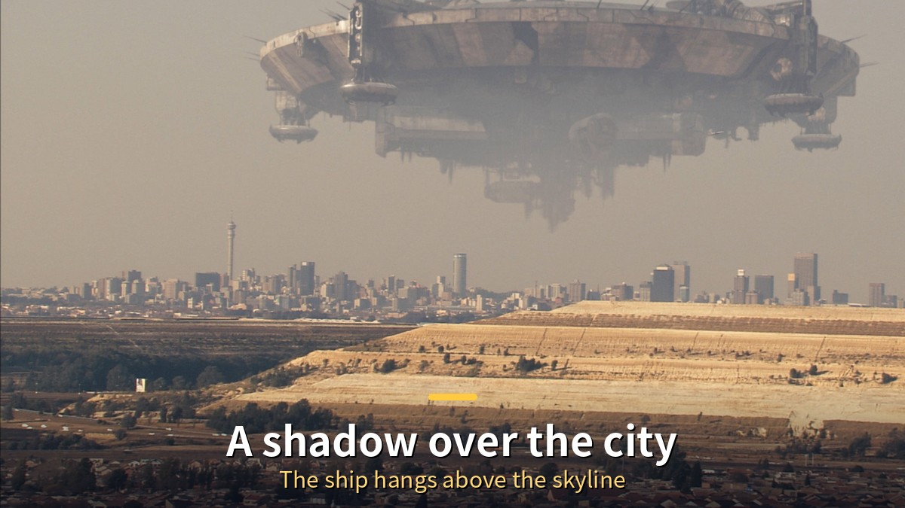
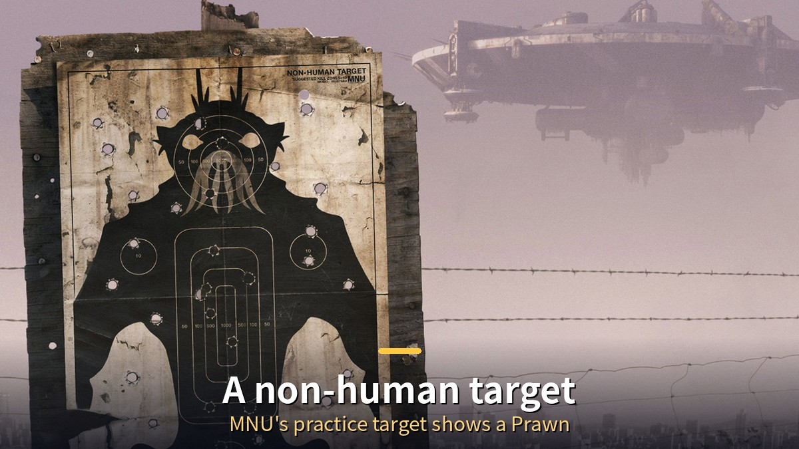
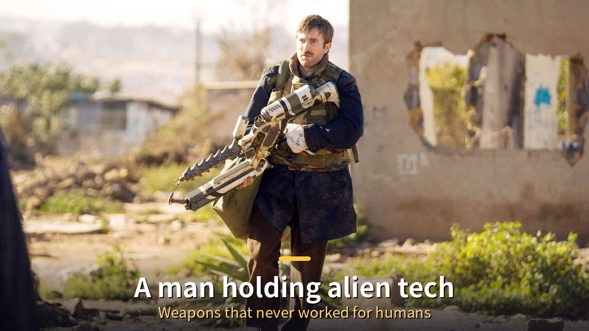
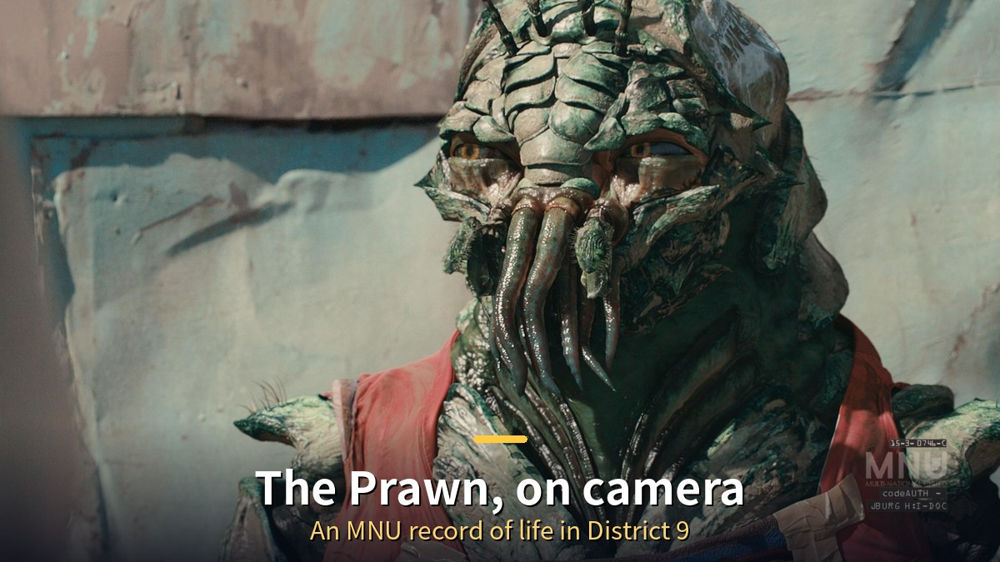
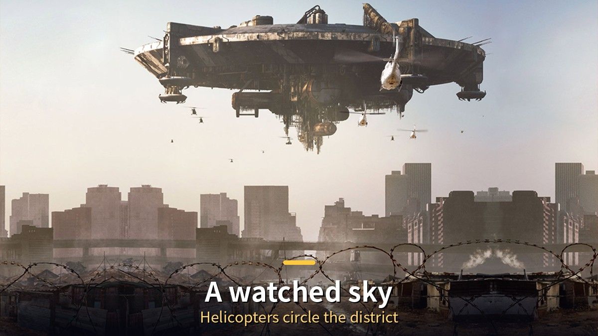
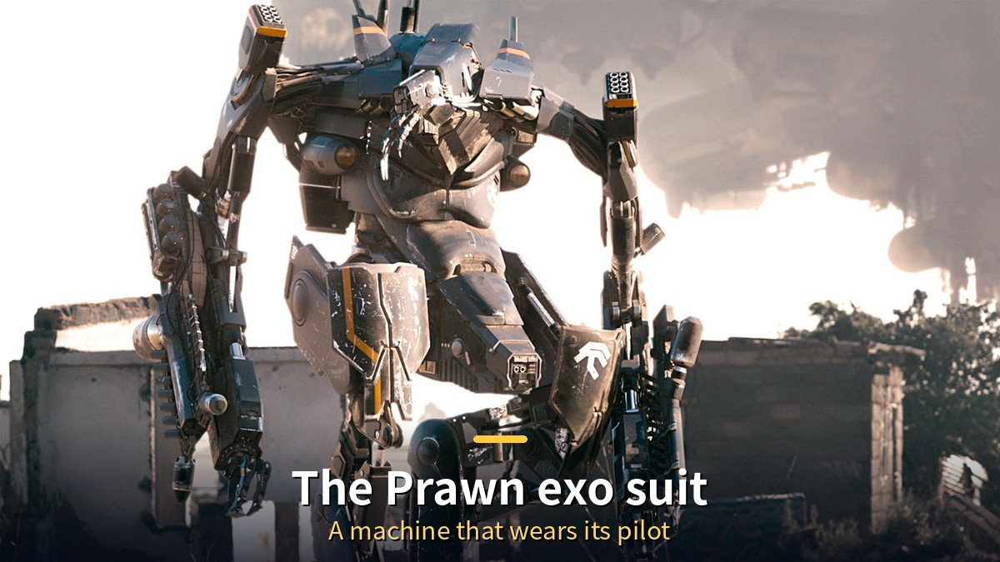

<!-- 본문 시작 -->


In 1982, a giant spaceship came to a stop above Johannesburg.
There was no attack, and no contact. Inside were one million starving alien refugees.
Twenty-eight years later, as the eviction of their district begins, the man in charge of the eviction starts to change.

```blog
type: text
runs:
  - text: "Alien refugees who came down from a mothership that stopped above Johannesburg in 1982 have lived for 28 years inside a containment zone called District 9. Wikus van der Merwe, an MNU employee in charge of the forced eviction, is exposed to an alien substance and slowly turns into one of the aliens, and his changing body becomes the only key that can operate alien weapons, making him a hunted man. Directed by Neill Blomkamp, this 2009 science-fiction action film runs 112 minutes, earned $210.9 million worldwide on a $30 million budget, and was nominated for four Academy Awards."
    style: {bold: true, color: "#007aa6"}
```

The story of technology that stays out of human reach continues in [A.I. Artificial Intelligence and the robot boy who learned to love](https://aitechnotesen.wordpress.com/2026/11/23/ai-artificial-intelligence%ef%bd%9cthe-robot-boy-programmed-to-love/).

| Item | Details |
| --- | --- |
| Title | District 9 |
| Released | 2009 (US August 14, 2009; Korea October 15, 2009) |
| Director | Neill Blomkamp |
| Screenplay | Neill Blomkamp, Terri Tatchell (based on Blomkamp's short film "Alive in Joburg") |
| Main cast | Sharlto Copley (Wikus van der Merwe), Jason Cope (Christopher Johnson), David James (Koobus Venter), Vanessa Haywood (Tania) |
| Runtime | 1 hour 52 minutes (112 minutes) |
| Rating | Ages 19 and up (Korea); R (US) |
| Score | TMDB 7.5/10 (about 10,900 votes, checked 2026-11-25), IMDb 7.9/10, Rotten Tomatoes 90% |
| Where to watch | Streaming on Watcha and Coupang Play in Korea (checked 2026-11-25) |

```blog
type: heading
level: 2
runs:
  - text: "A mothership stopped in the sky, a district built on the ground"
    style: {bold: true, color: "#007aa6"}
```

In 1982, a huge mothership appeared above Johannesburg, South Africa. When its doors opened, what came out was not an invasion force but one million starving alien refugees. The South African government pushed them into a temporary containment zone outside the city called District 9. The word temporary turned out to be a lie. Twenty-eight years later the zone was still there, a slum of corrugated shacks packed tight together.

```blog
type: text
runs:
  - text: "Term: Prawn"
    style: {bold: true, color: "#ff008c"}
  - text: " The slur humans use for the aliens, named for their resemblance to shrimp. Inside the film, the word shows how the aliens are treated as less than human."
```


Below the mothership stopped above Johannesburg, barbed wire, a "No Humans Allowed" sign, and the shacks of District 9 spread out.
This scene is where the film begins. The most advanced technology floats in the sky, while the oldest form of segregation plays out on the ground. The ship has stayed in the same spot for 28 years, and the aliens live under human watch inside the zone. The film shows this like a documentary. Interviews, news footage, and surveillance video take turns, so the audience watches the events as a record.


The giant mothership hangs over the hazy Johannesburg skyline, with mine dumps and city streets below.
That the mothership carried refugees, not invaders, matters. The aliens did not come to conquer. They arrived trapped in a broken ship. And yet humans did not welcome them as guests. They locked them in a zone. The film follows what that choice leads to, all the way through.

```blog
type: heading
level: 2
runs:
  - text: "Wikus, the man in charge of the eviction, starts to change"
    style: {bold: true, color: "#007aa6"}
```

In 2010, the government decides to clear out District 9. The job goes to MNU, a private military corporation. MNU employee Wikus van der Merwe enters the zone to collect forced relocation consent forms from the aliens. He is an ordinary office worker who got the lead role through his father-in-law. Then an accident in Christopher Johnson's shack changes everything. Wikus is exposed to "fluid," an alien substance.

```blog
type: text
runs:
  - text: "How Wikus changes: "
    style: {bold: true, color: "#ff008c"}
  - text: "Wikus (Sharlto Copley) is MNU's eviction lead. After the exposure, his left arm starts turning into an alien limb, and as the change spreads he becomes a hunted man in human society."
```


An MNU practice target shows an alien silhouette and the words "Non-Human Target," with the mothership floating faintly behind it.
One target board says everything about how MNU sees the aliens. They are not people to protect. They are practice targets. Once Wikus starts to change, MNU turns the same gaze on him. A colleague from yesterday becomes a target overnight. That structure sits at the center of the film.


Wikus stands before a ruined building in District 9, holding an alien weapon.
His changing body gives him something unexpected. Alien weapons that never worked in human hands start working in his. The key to the technology MNU has coveted for over 20 years turns out to be Wikus's changing body. MNU has no plan to cure him. Wikus becomes a fugitive and hides inside District 9.

```blog
type: text
runs:
  - text: "Made for $30 million, the film earned $210.9 million worldwide and was nominated for four Academy Awards: Best Picture, Adapted Screenplay, Visual Effects, and Film Editing. Rotten Tomatoes gave it 90% freshness, audiences gave it 82%, and Metacritic scored it 81, so critics and audiences agreed."
    style: {bold: true, background: "#FFF3CD"}
```

The question of what to do with the time after waking up continues in [Passengers and the two people who woke up 90 years early](https://aitechnotesen.wordpress.com/2026/11/22/passengers%ef%bd%9ctwo-awake-90-years-early-an-android-asks-why/).

```blog
type: heading
level: 2
runs:
  - text: "Why alien technology stays out of human hands"
    style: {bold: true, color: "#007aa6"}
```

The alien technology of District 9 does not open its doors to humans. Alien weapons work only with alien DNA, and the mothership has sat still in the sky for 28 years. Humans spent over 20 years taking the technology apart and studying it, but they never learned how to use it. The technology itself decides who may use it.

```blog
type: text
runs:
  - text: "What Christopher Johnson does: "
    style: {bold: true, color: "#ff008c"}
  - text: "Christopher Johnson (Jason Cope) is a Prawn living in District 9 who has spent 20 years collecting the fluid that can move the mothership again. Once Wikus hides in the district, their interests overlap and the story starts to move."
```


A close-up of a Prawn's face in a red vest, filmed as MNU record footage.
The film shoots the Prawns as neighbors, not monsters. The documentary-style camera looks at a Prawn's face up close and holds the shot. Where the human camera used to film aliens only as targets, here a Prawn speaks, makes plans, and looks after his family. The film's question about who owns technology turns into a question about the line between people and aliens.


Helicopters circle the mothership while barbed wire and shacks fill District 9 below.
The sky above the mothership is always watched. The helicopters guard the district, not the ship. The film's camera works the same way. Interviews and surveillance footage take turns, and who watches and who is watched keeps changing. The audience watches a record, but is asked whose hands made that record.

```blog
type: text
runs:
  - text: "The model for District 9 is the forced removal of District Six in Cape Town, South Africa. The real forced relocations that ran from the 1960s into the 1980s sit behind the alien containment zone."
    style: {bold: true, background: "#FFF3CD"}
```

**This article covers only up to the middle of the film. There is no description of the ending, so first-time viewers can read it without worry.**

```blog
type: heading
level: 2
runs:
  - text: "The AI questions this film asks"
    style: {bold: true, color: "#007aa6"}
```

First, who is body-keyed technology for? Prawn weapons work only with Prawn DNA. In 2026, fingerprints, faces, and irises already unlock doors and approve payments. In an age when the body itself becomes the password, who sets the standard for what technology recognizes as a person? The film asks that question in the shape of a weapon.


The Prawn exo suit stands over the ruins of District 9, alien weapons mounted on its arms.
Second, does a machine you wear help humans, or use humans as parts? The Prawn exo suit is a machine that moves only with a pilot inside. In 2026, powered exoskeletons are already used by soldiers, factory workers, and rehabilitation clinics. In an age when machines borrow human strength, where should the line between human and machine be drawn? The film sets that line right in front of the viewer in the shape of the suit.

Third, whose side is the recording camera on? The film borrows the documentary form to show interviews, news, and surveillance footage. In 2026, AI cameras and face recognition record the streets, and algorithms choose which footage people see. More records do not bring people closer to the truth. They make the viewpoint of whoever made the record sharper. Who becomes a target and who gets recorded is still decided by human hands.

```blog
type: heading
level: 2
runs:
  - text: "Checklist before you watch"
    style: {bold: true, color: "#007aa6"}
```

As of November 25, 2026: in Korea, it streams on Watcha and Coupang Play. Rental and purchase options also appear on the TMDB watch page, but the prices could not be confirmed, so check them directly in each app.

The runtime is 1 hour 52 minutes (112 minutes). It is rated ages 19 and up in Korea. It contains violent scenes, so check the rating before watching. Check subtitle and dub options directly in each app.

## Closing thoughts
That a film from 2009 overlaps with the questions of 2026 is no coincidence.
The story that who may use technology is decided by human hands only grows sharper now that biometric locks, exoskeletons, and surveillance cameras are part of everyday life.
The landscape of a district that caged aliens is not a far-off future. It is a story about how lines get drawn.
Because it asks where to draw the line instead of giving an answer, the film stays with you for a long time.

## Frequently asked questions
**Is District 9 based on a true story?**
No. It is a work of science-fiction. But the forced removal of District Six in Cape Town, South Africa, was its model. The film moves the real forced relocations that ran from the 1960s into the 1980s into the setting of an alien containment zone.

**What does Prawn mean?**
It is a slur humans use for the aliens. The name comes from the aliens' resemblance to shrimp, and inside the film it shows how the aliens are treated as less than human. It is a name humans gave them, not what the aliens call themselves.

**Where can I watch it in Korea?**
As of November 25, 2026, it streams on Watcha and Coupang Play in Korea. Rental and purchase prices could not be confirmed, so check them directly in each app.

## Good Reads Together
[A.I. Artificial Intelligence｜The Robot Boy Programmed to Love](https://aitechnotesen.wordpress.com/2026/11/23/ai-artificial-intelligence%ef%bd%9cthe-robot-boy-programmed-to-love/)
[Passengers｜Two Awake 90 Years Early, an Android Asks Why](https://aitechnotesen.wordpress.com/2026/11/22/passengers%ef%bd%9ctwo-awake-90-years-early-an-android-asks-why/)

<!-- 본문 끝 -->

## 작업용 출처·이미지 정보 (업로드 제외)

## Sources (not for publication, checked 2026-11-25)
- TMDB Korean page (District 9, ID 17654, score 7.479/10, 10,858 votes, official synopsis, director Neill Blomkamp, screenplay Terri Tatchell)
- TMDB watch page (checked in the browser on 2026-11-25, region Korea): streaming, rental, and purchase available, prices in KRW. Provider names were not exposed in the text crawl, so they were verified separately.
- English Wikipedia (director Neill Blomkamp, screenplay Blomkamp and Terri Tatchell, runtime 112 minutes, budget $30 million, box office $210.9 million, four Academy Award nominations, released 2009-08-14, based on the short "Alive in Joburg," District Six model)
- Korean Wikipedia (release date 2009-10-15)
- whatsafterthemovie.com (IMDb 7.9/10, Rotten Tomatoes 90%, Popcornmeter 82%, Metacritic 81, runtime 112 minutes, box office $210.9 million)
- NamuWiki English edition (domestic streaming Watcha and Coupang Play, Korea rating ages 19 and up, Korea admissions 841,125, cast Sharlto Copley, Jason Cope, David James, Vanessa Haywood, command module and fluid setup, crawled 2026-11-25)
- TMDB stills (image.tmdb.org/t/p/original, 8 images, poster gzMNQLELXzlssBUuTrZV3WmqBQO.jpg plus 7 backdrops, all visually checked)
