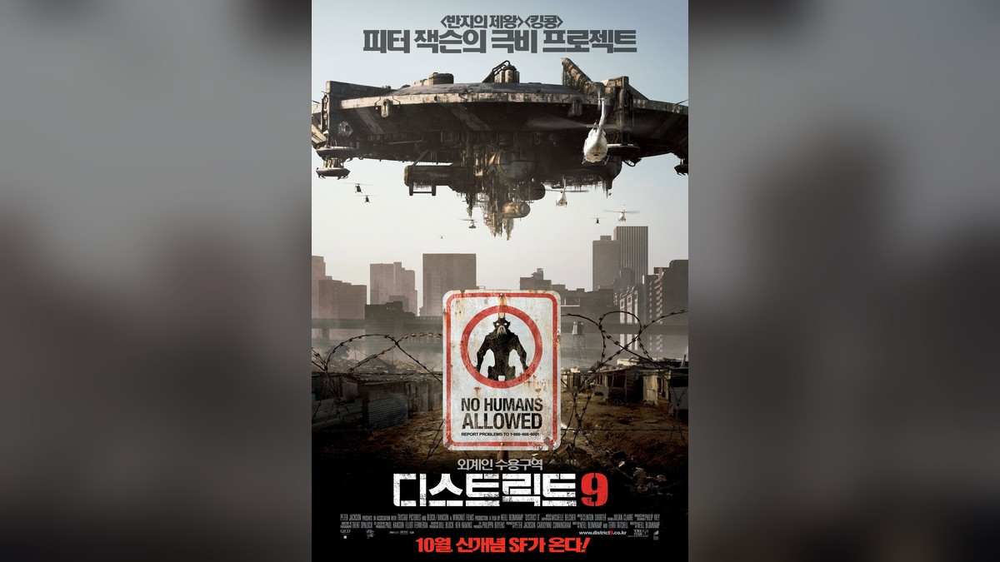
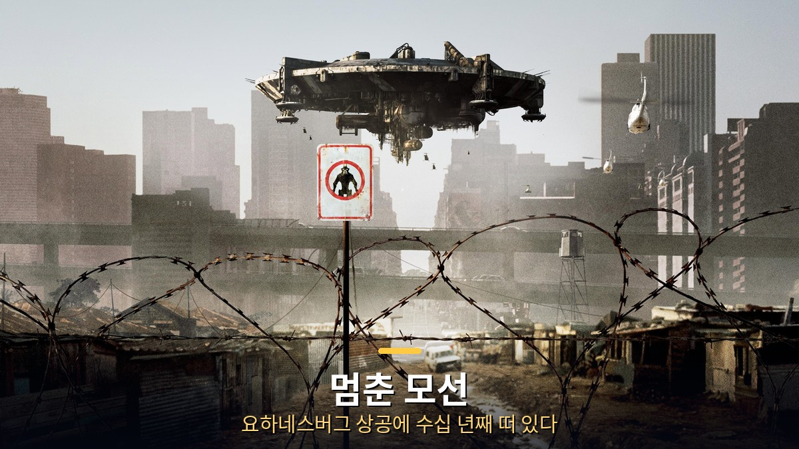
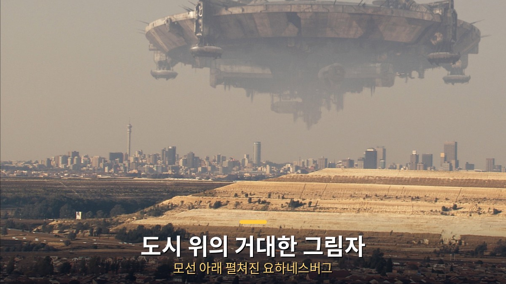
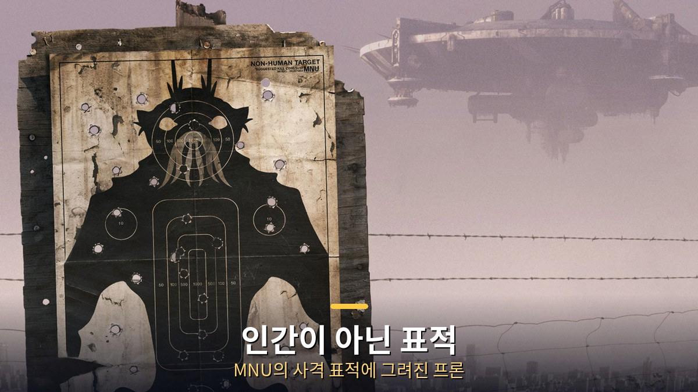
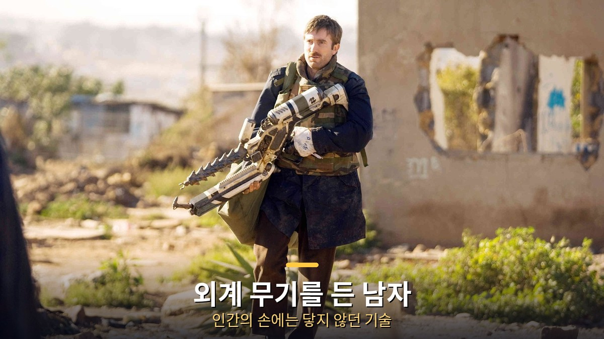
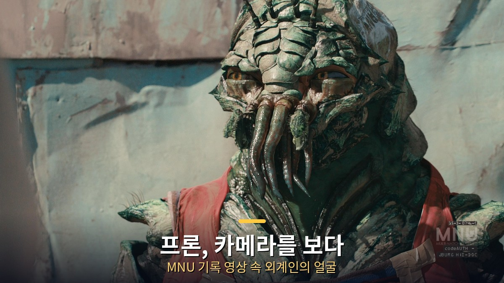
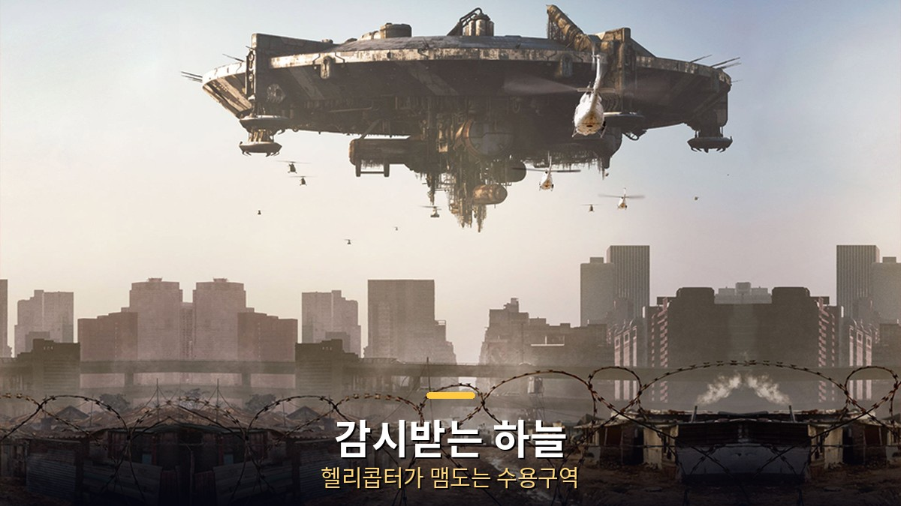
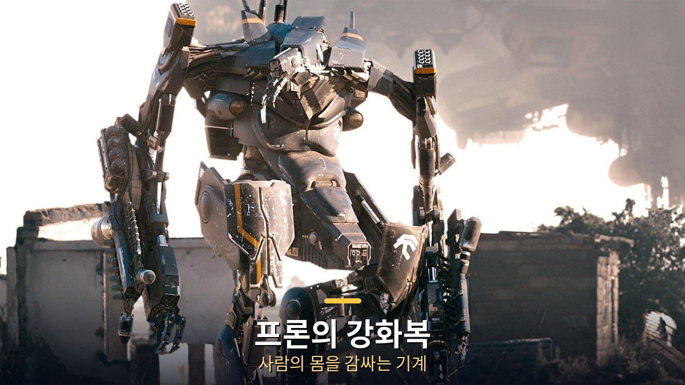

<!-- 본문 시작 -->


1982년, 요하네스버그 상공에 거대한 우주선이 멈춰 섰다.
공격도, 교신도 없었다. 배 안에는 굶주린 외계 난민 100만 명이 타고 있었다.
28년 뒤, 그들을 가둔 구역 '디스트릭트 9'의 철거가 시작되면서 철거 책임자 비커스의 몸에 이상한 변화가 찾아온다.

```blog
type: text
runs:
  - text: "1982년 요하네스버그 상공에 멈춰 선 모선에서 내린 외계 난민들은 '디스트릭트 9'라는 수용구역에 갇힌 채 28년을 산다. 강제 철거를 맡은 MNU 직원 비커스 반 데 메르베는 외계 물질에 노출돼 조금씩 외계인으로 변해가고, 그 몸이 외계 무기를 작동시키는 유일한 열쇠가 되면서 쫓기는 신세가 된다. 닐 블롬캠프 감독의 2009년 112분짜리 SF 액션으로, 제작비 3,000만 달러로 전 세계 2억 1,090만 달러를 벌고 아카데미 4개 부문 후보에 올랐다."
    style: {bold: true, color: "#007aa6"}
```

인간의 손에 닿지 않는 기술의 이야기는 [A.I. 인공지능의 사랑을 배우는 로봇 소년](https://blog.naver.com/3700708/224488130424)에서도 이어진다.

| 항목 | 내용 |
| --- | --- |
| 제목 | 디스트릭트 9 (District 9) |
| 개봉 | 2009년 (미국 2009-08-14, 한국 2009-10-15) |
| 감독 | 닐 블롬캠프 |
| 각본 | 닐 블롬캠프, 테리 태첼 (원작: 블롬캠프 단편 '얼라이브 인 요하네스버그') |
| 주요 출연 | 샬토 코플리(비커스 반 데 메르베), 제이슨 코프(크리스토퍼 존슨), 데이빗 제임스(쿠버스 벤터), 바네사 헤이우드(타니아) |
| 러닝타임 | 1시간 52분 (112분) |
| 등급 | 청소년 관람불가 |
| 평점 | TMDB 7.5/10 (약 10,900개 평가, 2026-11-25 확인), IMDb 7.9/10, 로튼토마토 90% |
| 시청처 | 왓챠·쿠팡플레이 스트리밍 (2026-11-25 확인) |

```blog
type: heading
level: 2
runs:
  - text: "하늘에 멈춘 모선, 땅에 생긴 구역"
    style: {bold: true, color: "#007aa6"}
```

1982년, 남아공 요하네스버그 상공에 거대한 모선이 나타났다. 배의 문이 열리자 안에 있던 건 침략군이 아니라 굶주린 외계 난민 100만 명이었다. 남아공 정부는 이들을 요하네스버그 외곽의 임시 수용구역 '디스트릭트 9'에 몰아넣었다. 임시라는 말과 달리 구역은 28년째 그대로였고, 판잣집이 빽빽한 빈민가로 변해 있었다.

```blog
type: text
runs:
  - text: "용어: 프론"
    style: {bold: true, color: "#ff008c"}
  - text: " 인간들이 외계인에게 붙인 멸칭이다. 새우를 닮았다고 해서 부르는 말로, 영화 안에서 외계인을 '인간이 아닌 존재'로 취급하는 시선을 그대로 보여준다."
```


요하네스버그 상공에 멈춰 선 거대한 모선 아래로 철조망과 '인간 출입 금지' 표지판, 판잣집이 늘어선 디스트릭트 9가 펼쳐진다.
이 장면이 영화의 출발점이다. 가장 앞선 기술이 하늘에 떠 있는데, 땅에서는 가장 오래된 방식의 격리가 벌어진다. 모선은 28년째 같은 자리에 떠 있고, 구역 안에서는 외계인들이 인간의 감시 아래 살아간다. 영화는 이 장면을 다큐멘터리처럼 보여준다. 인터뷰, 뉴스 화면, 감시 카메라 영상이 번갈아 나오면서 관객은 사건을 '기록'으로 보게 된다.


안개 낀 요하네스버그 스카이라인 위로 거대한 모선이 떠 있고, 아래로는 광산 폐석장과 시가지가 펼쳐진다.
모선은 침략자의 무기가 아니라 난민의 배였다는 점이 중요하다. 외계인들은 정복하러 온 게 아니라 고장 난 배에 갇혀 온 존재들이다. 그런데도 인간은 이들을 손님으로 맞이하지 않고 수용구역에 가뒀다. 영화는 그 선택이 어떤 결과를 낳는지 끝까지 따라간다.

```blog
type: heading
level: 2
runs:
  - text: "철거 책임자 비커스, 몸이 바뀌기 시작한다"
    style: {bold: true, color: "#007aa6"}
```

2010년, 정부는 디스트릭트 9를 정리하기로 한다. 철거를 맡은 건 민간 군사 기업 MNU다. MNU 직원 비커스 반 데 메르베는 외계인들의 강제 이주 동의서를 받으러 구역 안으로 들어간다. 그는 서류 작업만 하는 평범한 사무직 직원이었고, 장인 덕에 책임자 자리에 오른 인물이다. 그런데 크리스토퍼 존슨의 판잣집에서 일어난 사고가 모든 걸 바꾼다. 비커스가 외계 물질 '유체'에 노출된 것이다.

```blog
type: text
runs:
  - text: "비커스의 변이: "
    style: {bold: true, color: "#ff008c"}
  - text: "비커스(샬토 코플리)는 MNU의 철거 책임자로, 유체에 노출된 뒤 왼팔부터 조금씩 외계인의 몸으로 변해간다. 변이가 진행될수록 그는 인간 사회에서 쫓기는 존재가 된다."
```


MNU의 사격 표적판에는 외계인 실루엣과 '인간이 아닌 표적'이라는 문구가 적혀 있고, 뒤로 모선이 흐릿하게 떠 있다.
MNU가 외계인을 어떻게 보는지 이 표적판 하나에 담겨 있다. 외계인은 보호 대상이 아니라 사격 훈련의 표적이다. 비커스가 변해가기 시작하자 MNU의 시선은 그에게도 똑같이 향한다. 어제까지 동료였던 사람이 하루아침에 '표적'이 되는 구조가 영화의 중심에 있다.


디스트릭트 9의 폐허가 된 건물 앞에서 비커스가 외계 무기를 안고 서 있다.
변해가는 몸은 비커스에게 뜻밖의 능력을 준다. 인간의 손에는 절대 작동하지 않던 외계 무기가 그의 손에서는 작동하기 시작한다. MNU가 20년 넘게 탐내던 기술의 열쇠가 바로 변해가는 비커스의 몸이었던 셈이다. 그래서 MNU는 비커스를 치료해줄 생각이 없다. 비커스는 도망자가 되어 디스트릭트 9 안으로 숨어든다.

```blog
type: text
runs:
  - text: "제작비 3,000만 달러로 만든 영화가 전 세계 2억 1,090만 달러를 벌었고, 아카데미 작품상·각색상·시각효과상·편집상 4개 부문 후보에 올랐다. 로튼토마토 신선도 90%, 관객 평점 82%, 메타크리틱 81점으로 평론가와 관객의 호응을 함께 얻었다."
    style: {bold: true, background: "#FFF3CD"}
```

깨어난 뒤의 시간을 어떻게 쓸 것인가라는 질문은 [패신저스의 90년 먼저 깬 두 사람](https://blog.naver.com/3700708/224488742149)에서도 이어진다.

```blog
type: heading
level: 2
runs:
  - text: "외계 기술은 왜 인간의 손에 닿지 않나"
    style: {bold: true, color: "#007aa6"}
```

디스트릭트 9의 외계 기술은 인간에게 문을 열지 않는다. 외계 무기는 외계인의 DNA가 있어야만 작동하고, 모선은 28년째 하늘에 멈춘 채 움직이지 않는다. 인간은 20년 넘게 기술을 해체하고 연구했지만, 쓰는 법을 알아내지 못했다. 기술이 아무리 눈앞에 있어도 '누가 쓰느냐'를 기술 스스로 정하는 셈이다.

```blog
type: text
runs:
  - text: "크리스토퍼 존슨의 역할: "
    style: {bold: true, color: "#ff008c"}
  - text: "크리스토퍼 존슨(제이슨 코프)은 디스트릭트 9에 사는 프론으로, 모선을 다시 움직일 유체를 20년 동안 모아온 인물이다. 비커스가 숨어든 뒤 두 사람의 이해관계가 겹치면서 이야기가 움직이기 시작한다."
```


붉은 조끼를 입은 프론의 얼굴 클로즈업. MNU 기록 영상 화면에 찍힌 장면이다.
영화는 프론을 괴물이 아니라 이웃으로 찍는다. 다큐멘터리 형식의 카메라는 프론의 얼굴을 가까이에서 오래 들여다본다. 인간의 카메라가 외계인을 '표적'으로만 찍던 것과 달리, 이 장면에서는 프론이 말을 하고, 계획을 세우고, 가족을 챙기는 존재로 나온다. 기술의 주인이 누구인지 묻는 영화의 질문은 여기서 사람과 외계인의 경계에 대한 질문으로 바뀐다.


헬리콥터 여러 대가 모선 주위를 맴돌고, 아래로는 철조망과 판잣집이 늘어선 디스트릭트 9가 보인다.
모선이 떠 있는 하늘은 늘 감시받고 있다. 헬리콥터는 모선을 지키는 게 아니라 구역을 감시한다. 영화의 카메라도 마찬가지다. 인터뷰와 감시 영상이 번갈아 나오면서, 누가 보고 누가 보이는지가 계속 바뀐다. 관객은 기록을 보는 입장이지만, 기록이 누구의 손에서 만들어졌는지를 묻게 된다.

```blog
type: text
runs:
  - text: "디스트릭트 9의 모티프는 남아공 케이프타운의 디스트릭트 식스 강제 철거다. 1960년대부터 1980년대까지 이어진 실제 강제 이주 역사가 외계인 수용구역이라는 설정 뒤에 있다."
    style: {bold: true, background: "#FFF3CD"}
```

**이 글은 작품 중반부까지의 내용만 다룬다. 결말에 대한 설명은 일절 없으니, 처음 보는 사람도 안심하고 읽어도 된다.**

```blog
type: heading
level: 2
runs:
  - text: "이 작품이 던지는 AI 질문"
    style: {bold: true, color: "#007aa6"}
```

첫째, 몸이 열쇠가 되는 기술은 누구를 위한 것인가. 프론의 무기는 프론의 DNA가 있어야만 작동한다. 2026년의 현실에서도 지문, 얼굴, 홍채 같은 생체인증이 문을 열고 결제를 승인한다. 몸 자체가 비밀번호가 되는 시대에, 기술이 '누구인지'를 알아보는 기준은 누가 정하는가. 영화는 그 질문을 무기의 형태로 던진다.


프론의 강화복이 디스트릭트 9의 폐허 위에 서 있다. 팔에는 외계 무기가 장착돼 있다.
둘째, 몸을 입는 기계는 인간을 돕는 것인가, 인간을 부품으로 쓰는 것인가. 프론의 강화복은 타는 사람이 있어야 움직이는 기계다. 2026년에도 군대와 공장, 재활 의료 현장에서 동력 외골격이 쓰이고 있다. 기계가 인간의 힘을 빌려주는 시대에, 인간과 기계의 경계는 어디에서 그어야 하는가. 영화는 강화복이라는 존재로 그 경계를 눈앞에 세워둔다.

셋째, 기록하는 카메라는 누구의 편인가. 영화는 다큐멘터리 형식을 빌려 인터뷰, 뉴스, 감시 영상을 보여준다. 2026년에는 AI CCTV와 안면인식이 거리를 기록하고, 알고리즘이 영상을 골라 보여준다. 기록이 많아질수록 진실에 가까워지는 게 아니라, 기록을 만든 사람의 시선이 더 또렷해진다. 누가 표적이 되고 누가 기록되는지를 정하는 건 결국 사람의 손이다.

```blog
type: heading
level: 2
runs:
  - text: "시청 전 체크리스트"
    style: {bold: true, color: "#007aa6"}
```

2026년 11월 25일 기준으로 정리한다. 국내에서는 왓챠와 쿠팡플레이에서 스트리밍으로 볼 수 있다. 대여·구매처는 TMDB 시청 페이지에도 있으나, 가격은 확인하지 못했으므로 각 앱에서 직접 확인하는 것이 좋다.

러닝타임은 1시간 52분(112분)이다. 등급은 청소년 관람불가다. 폭력적인 장면이 있어 시청 전에 등급을 확인하는 것이 좋다. 자막과 더빙 여부는 각 앱에서 직접 확인하는 것이 좋다.

## 마무리
2009년에 나온 영화가 2026년의 질문과 겹치는 건 우연이 아니다.
기술을 누가 쓸 수 있는지를 정하는 건 결국 사람의 손에 달려 있다는 이야기는, 생체인증과 외골격과 감시 카메라가 일상이 된 지금 더 또렷해진다.
외계인을 가둔 구역의 풍경은 멀리 있는 미래가 아니라, 경계선을 긋는 방식에 대한 이야기다.
답을 주는 영화가 아니라 경계선을 어디에 그을지 묻는 영화라 오래 남는다.

## 자주 묻는 질문
**디스트릭트 9는 실화를 바탕으로 한 영화인가요?**
아니다. 허구의 SF 영화다. 다만 남아공 케이프타운의 디스트릭트 식스 강제 철거라는 실제 역사가 모티프가 됐다. 1960년대부터 1980년대까지 이어진 강제 이주 사건을 외계인 수용구역이라는 설정으로 옮긴 작품이다.

**프론은 무슨 뜻인가요?**
인간들이 외계인에게 붙인 멸칭이다. 외계인의 모습이 새우를 닮았다고 해서 부르는 말로, 영화 안에서는 외계인을 '인간이 아닌 존재'로 취급하는 시선을 보여준다. 외계인 스스로를 부르는 이름이 아니라 인간이 붙인 이름이라는 점이 중요하다.

**한국에서 어디서 볼 수 있나요?**
2026년 11월 25일 기준으로 왓챠와 쿠팡플레이에서 스트리밍으로 볼 수 있다. 대여·구매 가격은 확인하지 못했으므로 각 앱에서 직접 확인하는 것이 좋다.

## 함께 보면 좋은 글
[A.I. 인공지능｜사랑을 배우는 로봇 소년의 여정](https://blog.naver.com/3700708/224488130424)
[패신저스｜90년 먼저 깬 두 사람, AI 바텐더](https://blog.naver.com/3700708/224488742149)

<!-- 본문 끝 -->

## 작업용 출처·이미지 정보 (업로드 제외)

## 출처 목록 (발행본 제외, 2026-11-25 확인)
- TMDB 한국 페이지 (디스트릭트 9, ID 17654, 평점 7.479/10·10,858개 평가·공식 시놉시스·감독 닐 블롬캠프·각본 테리 태첼)
- TMDB 시청 페이지 (2026-11-25 브라우저 직접 확인, 지역 대한민국): 스트리밍·대여·구매 있음, 원화 가격 표시. 제공처 이름은 텍스트 크롤에 노출되지 않아 별도 확인.
- 영어 위키백과 (감독 닐 블롬캠프·각본 블롬캠프·테리 태첼·러닝타임 112분·제작비 3,000만 달러·흥행 2억 1,090만 달러·아카데미 4개 부문 후보·개봉 2009-08-14·원작 단편 '얼라이브 인 요하네스버그'·디스트릭트 식스 모티프)
- 한국어 위키백과 (개봉일 2009-10-15)
- whatsafterthemovie.com (IMDb 7.9/10·로튼토마토 90%·팝콘미터 82%·메타크리틱 81·러닝타임 112분·흥행 2억 1,090만 달러)
- 나무위키 영문판 (국내 스트리밍 왓챠·쿠팡플레이·국내 등급 청소년 관람불가·국내 관객 841,125명·출연 샬토 코플리·제이슨 코프·데이빗 제임스·바네사 헤이우드·지휘선/유체 설정, 2026-11-25 크롤 확인)
- TMDB 스틸 (image.tmdb.org/t/p/original, 8장, 포스터 gzMNQLELXzlssBUuTrZV3WmqBQO.jpg + 백드롭 7장, 전수 육안 확인)
