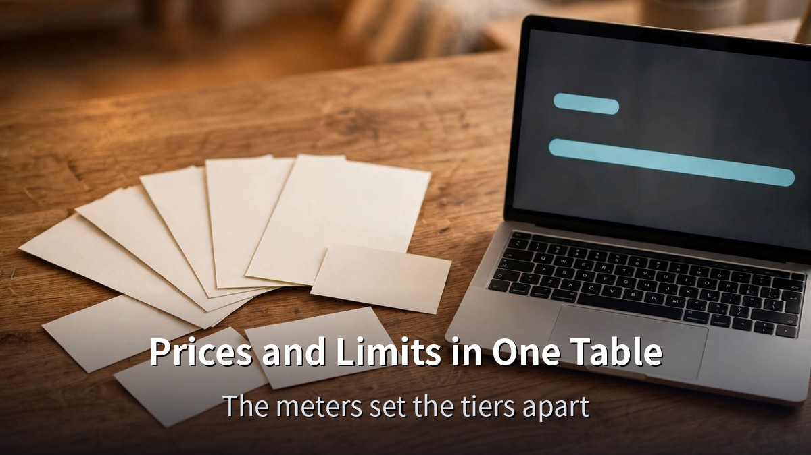
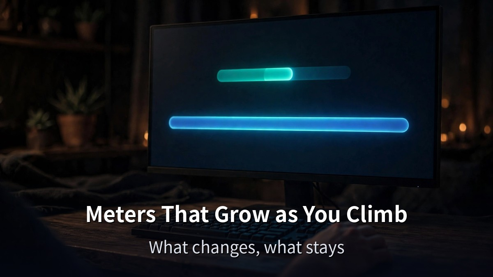

<!-- 본문 시작 -->


If you use Claude every day, Pro. If you keep hitting the limit all day, Max. If the five-hour wall keeps cutting your work off, Ultra.
Monthly prices across the four tiers run from free to $200, but the weekly usage per dollar is the same in all three paid tiers.
This post puts the prices, limits, and included features checked directly on Anthropic's official pricing page on November 26, 2026 into one table.

```blog
type: text
runs:
  - text: "Start with Free to try it, and Pro ($20 a month, or $17 on annual billing) is the starting point for an individual who uses it every day. Max ($100 a month) fits when you keep hitting the limit all day, and Ultra ($200 a month) fits when the five-hour wall breaks your work. What separates the tiers is not a smarter model but the usage limit. Opus is available from Pro, and Max and Ultra are plans for using the same models more."
    style: {bold: true, color: "#007aa6"}
```

To see how far the free tier goes first, [Claude Effort Levels｜How to Choose Low to Max](https://aitechnotesen.wordpress.com/2026/11/23/claude-effort-levels-how-to-choose-low-to-max/) shows an experiment that ran the same request through each effort level.

```blog
type: heading
level: 2
runs:
  - text: "Prices and limits, four tiers in one table"
    style: {bold: true, color: "#007aa6"}
```



Claude has four tiers.
Free, Pro, Max, and Ultra, in that order.
Prices below were checked directly on Anthropic's official pricing page on November 26, 2026, and are web billing prices in USD, excluding tax.

| Plan | Monthly price | Limit (Pro = 1x) | Top model and coding |
| --- | --- | --- | --- |
| Free | $0 | Limited | No Fable, no Claude Code |
| Pro | $20 ($17 annual) | 1x | Fable via usage credits, Claude Code included |
| Max | $100 | 5x | Fable up to 50% of the weekly limit, Claude Code included |
| Ultra | $200 | Weekly 10x, no five-hour limit | Fable up to 50% of the weekly limit, Claude Code included |

Annual discount exists only for Pro.
Paying a year at once brings Pro to $17 a month, or $200 a year.
Paying monthly for 12 months comes to $240 a year.
Annual billing saves $40.
Max and Ultra are monthly billing only, with no annual discount.

The limit is not a message count.
Anthropic states on its official page that there is no fixed message count.
Instead there are two meters.
A five-hour meter refills five hours after the first message, and a weekly meter refills on a set day for each account.
The meters drain faster with longer conversations, larger uploaded files, and higher models.
Chat, the desktop app, and Claude Code all draw from the same meters.

```blog
type: text
runs:
  - text: "Term: five-hour meter and weekly meter "
    style: {bold: true, color: "#ff008c"}
  - text: "The two meters that measure Claude usage. The five-hour meter refills five hours after the first message, and the weekly meter refills on a set day for each account. Ultra has no five-hour meter, for verified accounts only. The weekly meter still applies to Ultra."
```

```blog
type: text
runs:
  - text: "The limit is not counted in messages."
    style: {bold: true, background: "#FFF3CD"}
  - text: " Any number like 'messages per month' seen in a video or a comparison post is not an official figure. Anthropic does not publish a fixed message count; the limit is usage that varies with the model, conversation length, and file size. Only the multipliers in this post (1x, 5x, 10x) are official."
```

The free tier does more than expected.
You can chat on web, desktop, and mobile, search the web, create files, and run code.
Memory across conversations, connectors to other apps, and artifacts are included free.
Design, slides, and document creation are free too.
You can create up to five projects.
The models are Sonnet and Haiku.
Some things are locked, though.
There is no Claude Code, no Opus, and no Fable, the top model.
Research, which reads sources and writes up a report, is also unavailable on the free tier.

From Pro, the locks open.
Claude Code opens, Opus opens, and research opens.
Scheduling and handoff, Claude in Chrome, and Microsoft 365 integration start here too.
Projects have no count limit.
Fable opens, but with a condition.
On Pro, Fable is used through usage credits, which means paying separately.
There is also a way to keep going after the meters fill.
Turning on usage credits lets you continue at standard API rates.

```blog
type: heading
level: 2
runs:
  - text: "What changes as you climb, and what does not"
    style: {bold: true, color: "#007aa6"}
```



Max is five times Pro.
The five-hour meter is five times, and the weekly meter is five times.
Few new features open.
Instead, Fable, which cost extra on Pro, is included in the plan.
You can use Fable for up to 50% of the weekly limit.
Priority access when traffic is heavy and early access to new features are included.
A monthly API credit of $100 comes with it.
But this credit has a condition: it is for API use when building your own app or agent.
It cannot be used for Claude Code in the terminal or desktop, and it does not roll over to the next month.

Ultra was originally called Max 20x.
The name changed to Ultra, and existing subscribers were moved automatically at the same price, Anthropic says.
The biggest difference in this tier is that one meter disappears.
Ultra has no five-hour limit.
The weekly meter is 10 times Pro.
The API credit rises to $200 a month.
But the no-five-hour-limit promise has an asterisk.
It applies only to verified accounts.
Verification is not something you apply for; Anthropic decides automatically based on the account and payment history.
It is a different step from phone verification.
Before verification, a temporary limit applies and lifts automatically once verified.

```blog
type: text
runs:
  - text: "Term: usage credits "
    style: {bold: true, color: "#ff008c"}
  - text: "A pay-as-you-go allowance that lets you keep working at standard API rates after the meters fill. Available from Pro. The monthly API credits that come with Max and Ultra ($100 and $200) are for app and agent API use and cannot be used for Claude Code."
```

How fast the meters drain is shown well by the host's experiment.
Asked to build a workout-tracking app with Claude Code at the default effort level, the task used 3% of the Ultra weekly limit.
By the official multipliers, the same task is 6% of the Max weekly limit and 30% of the Pro weekly limit.
On Pro, building that app about three times a week would finish the weekly meter.
Drain speed varies by task, of course, so this is a rough size from one request.
These figures are the video host's experiment, not official numbers.

Some things stay the same across all three climbs.
The context window is up to 1 million tokens on all four tiers.
Sonnet and Haiku are the same models from Free to Ultra.
Opus is the same Opus from Pro to Ultra.
Moving to a higher tier does not make Claude smarter.
If the effort level is how long Claude works on one request, the plan is how long Claude can work across a week.

If you are unsure whether to lower the effort level on a request first or raise the plan, [What Is an AI Agent｜Agentic AI and Computer Use Explained](https://aitechnotesen.wordpress.com/2026/11/22/what-is-an-ai-agent-agentic-ai-and-computer-use-explained/) sorts out the agent terms that sit behind Claude Code and automated work.

```blog
type: heading
level: 2
runs:
  - text: "Which tier should you stop at?"
    style: {bold: true, color: "#007aa6"}
```


Priced per dollar, the weekly usage is the same in all three paid tiers.

| Plan | Monthly price | Weekly limit |
| --- | --- | --- |
| Pro | $20 | 1x |
| Max | $100 | 5x |
| Ultra | $200 | 10x |

A higher tier is not a cheaper way to buy the same usage.
The cheapest per unit is Pro on annual billing.
It costs $17 a month.

So what the extra money buys above Pro is not quantity but something else.
On Max, it is Fable included in the plan, priority access, and the API credit.
On Ultra, it is the five-hour wall disappearing on top of that.

By use, it lines up like this.
If searching and asking is all you do, Free is enough.
If you hand over assignments and office work every day, Pro.
If you have started attaching automations that run on their own and the weekly meter keeps running dry, Max.
If you run several jobs at once and the five-hour wall keeps breaking your work, Ultra.
If you build your own app or bot with the API, count the Max and Ultra credits before deciding.

There are tiers outside this ladder too.
Team plans for several people and Enterprise for companies.
Team plans start at $25 per seat per month, according to secondary sources based on the official page, and carry management and security features, so they are a different ladder and are left out of today's table.
Enterprise is $20 per seat per month plus usage charges billed separately, so the seat price alone should not be read as cheap.
For teams of two or more, or organizations of 20 or more, Team and Enterprise are worth comparing separately.

```blog
type: text
runs:
  - text: "Prices and limits are as checked on November 26, 2026."
    style: {bold: true, background: "#FFF3CD"}
  - text: " Prices are in USD, excluding tax, on web billing. Paying inside a phone app can cost differently, and Anthropic says prices and limits can change. These are the figures as of the check date, so it is worth confirming on the official pricing page once more before paying."
```

What became clearest while sorting this out is that a higher Claude tier does not buy a smarter Claude, only one that can work longer.
Same models, same context window, only the meters get longer, so the real question is one thing: how much do you ask it to do in a week.
The calculation that stayed with me longest is that annual Pro is the cheapest per unit.
Before pressing the pay button, checking whether the weekly meter runs dry around Wednesday seems like the thing to do before raising the tier.

## Frequently asked questions

**When does the free limit refill?**

The five-hour meter refills five hours after the first message. The weekly meter refills once a week, on a set day and time for each account. The weekly reset day for an account can be checked on the Usage screen in Settings.

**Is the Ultra no-five-hour-limit for everyone?**

No. It applies only to verified accounts. Anthropic verifies automatically based on the account and payment history, and it is a different step from phone verification. Before verification, a temporary limit applies and lifts automatically once verified. If the current session meter is not shown on the Usage screen in Settings, the account is verified.

**How much does annual Pro save?**

Paying monthly for 12 months comes to $240 a year. Annual billing is $200 paid at once, or $17 a month. The saving is $40 a year.

## Good Reads

[Claude Effort Levels｜How to Choose Low to Max](https://aitechnotesen.wordpress.com/2026/11/23/claude-effort-levels-how-to-choose-low-to-max/)

[District 9｜When Humans Caged Aliens, the Tech Picked a Side](https://aitechnotesen.wordpress.com/2026/11/25/district-9%ef%bd%9cwhen-humans-caged-aliens-the-tech-picked-a-side/)

<!-- 본문 끝 -->

## 작업용 출처·이미지 정보 (업로드 제외)

**Sources**
- honjobs, "Claude Free to Ultra: What Changes as the Limit Rises", November 25, 2026 (full transcript captured from the YouTube script panel, November 26, 2026, 0:00-10:50)
- Anthropic official pricing page https://claude.com/pricing (checked directly, November 26, 2026 — Free $0, Pro $20 / $17 annual, Max $100, Ultra $200, limit multipliers 1x, 5x, 10x, Fable access, API credits $100 for Max and $200 for Ultra per month, Enterprise $20 per seat plus usage)
- Claude Help Center — preferred language (Korean among 11 supported languages), dictation in Korean
- Claude Platform official documentation — multilingual support (Global-MMLU Korean scores)
- Team prices, seat counts (2-150), and usage multipliers from three secondary sources based on the official page (datastudios, sessionwatcher, enrichlabs) — used in the post only for prices and "more than Pro"
- Figures checked as of: November 26, 2026
