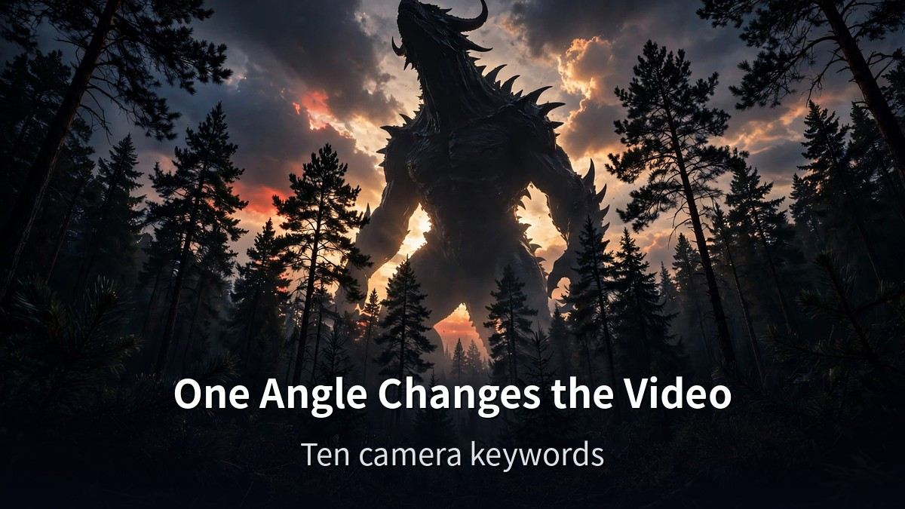
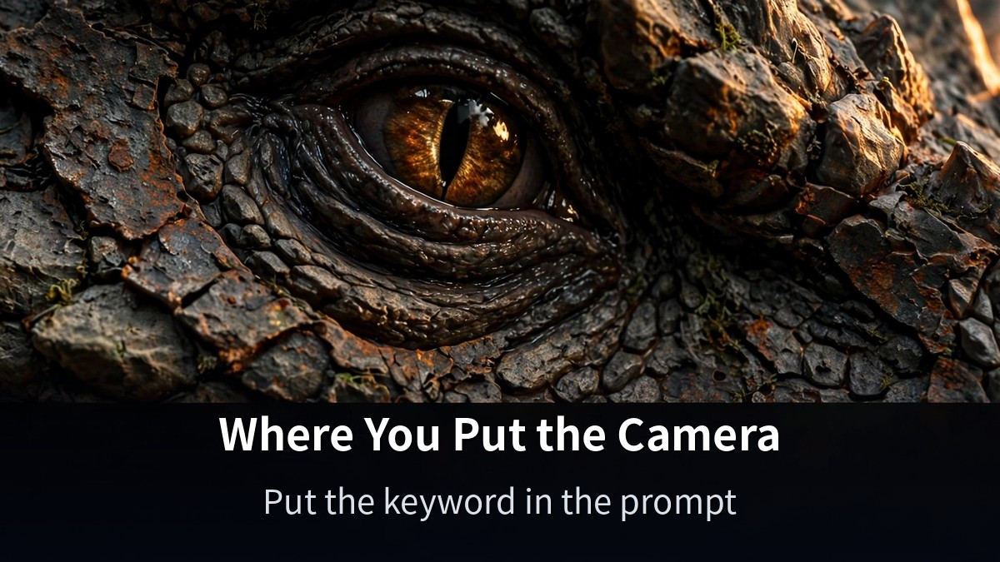
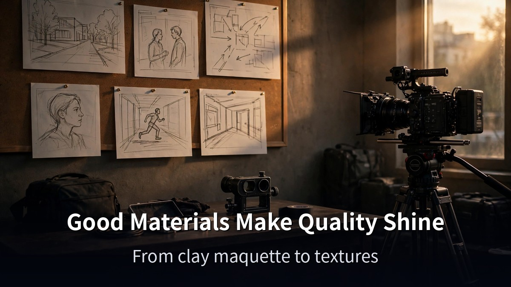
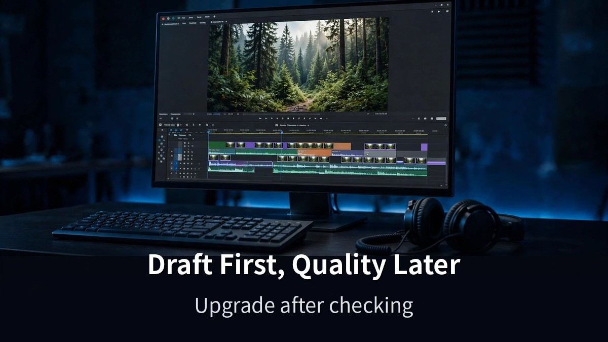

<!-- 본문 시작 -->



When you make a video with AI, typing "make it cool" burns credits and leaves almost nothing usable.
The real difference comes from one camera composition keyword.
This post covers ten composition keywords that change AI video quality, how to put them in prompts, and how to save credits along the way.

```blog
type: text
runs:
  - text: "In AI video, one line about where the camera sits changes the result more than the word 'cool.' The ten composition keywords, the rule of one composition and one movement per cut, and writing the place and light identically in every cut are what matter. Before rendering in 4K, check a cheap draft first to save credits."
    style: {bold: true, color: "#007aa6"}
```

For the bigger picture of building a channel, [10 AI-Only Channels, Ranked](https://aitechnotesen.wordpress.com/2026/11/24/10-aionly-channels-ranked-the-formula-behind-the-views/) shows how creators build channels with AI alone. Read it with today's composition keywords and you will see which shots to practice first.

```blog
type: heading
level: 2
runs:
  - text: "How do you put a composition keyword in a prompt?"
    style: {bold: true, color: "#007aa6"}
```



Camera composition means deciding where the camera sits, where it looks up from, and when it moves closer.
The same model produces completely different results depending on whether you set the composition.
The ten compositions from the video are in the table below.

| Composition | English keyword | When to use it |
| --- | --- | --- |
| Establishing Shot | Establishing Shot | Show the place and scale first, at the start or when the location changes |
| Low Angle Shot | Low Angle Shot | Introduce a character for the first time, add a sense of menace |
| Extreme Close-Up | Extreme Close-Up | Fill the frame with one detail, an eye, teeth, or skin texture |
| Over the Shoulder | Over the Shoulder Shot | Show who is looking at whom, build tension without dialogue |
| Two Shot | Two Shot | Put two subjects facing each other to show the size difference |
| Point of View | POV Shot | Become the subject's eyes for shots a real camera cannot take |
| Tracking Shot | Tracking Shot | Follow a falling or running subject to add speed |
| Whip Pan | Whip Pan | Whip the camera around so the blur hides a cut |
| Foreground Wipe | Foreground Wipe | Let a foreground object pass across to move to the next scene |
| Centered Symmetry | Centered Symmetry | Decisive moments, finishing moves, final poses, and thumbnails |

Putting them in a prompt is simple.
When you make several cuts at once, attach one composition to each cut.
In the video's example, the first 30 seconds had 12 cuts, each with its own composition.
The first cut approaches while looking up in a low angle, the second is an extreme close-up, the third is a whip pan, the fourth a tracking shot, and the fifth an establishing shot.

```blog
type: text
runs:
  - text: "One composition and one movement per cut."
    style: {bold: true, background: "#FFF3CD"}
  - text: " Put several compositions in one cut and the model gets confused about what to do, producing an awkward frame instead. If you need several compositions, split the cuts and attach one to each."
```

Write the place and light in the same sentence in every cut.
That is how changing compositions still looks like one film.
For example, write the same place and light every time, such as a pine forest on a mountain at dusk.
Change the composition and the place together, and each cut becomes a different movie.

For a low angle shot, write "low angle shot, looking up" in the prompt.
For a two shot, write the left and right sides separately.
Because reference images are used, sizes can drift from cut to cut unless you state them in words.
For a tracking shot, write how the camera follows whom and how fast, such as "the camera falls beside the jewel at the same speed."

```blog
type: heading
level: 2
runs:
  - text: "Why does the same model give different results?"
    style: {bold: true, color: "#007aa6"}
```



Composition alone is not enough.
Rendering properly in 4K is not just a matter of switching the model to 4K.
The sharper the picture gets, the more the materials and preparation have to be solid.
If the reference image is sloppy, the result comes out sloppy too.

The method in the video follows the same order 3D artists use.
First make a gray clay maquette with no color at all.
At this stage, never write a color name.
Write a color and the model paints the clay.
Just check that the pose and silhouette come out right.

Next, pull real material photos for each body part.
For a starfish monster, that means rusted iron plates with rivets, rusty chains, and scrap metal tangled with unbroken blades.
For a haetae, weathered granite or moss. For a dragon, carp scales, old deer antlers, and a horse mane.
Pick materials that fit each creature.
For scales, name a specific scale rather than any fish scale, or the detail will not come alive.

Give the maquette and the materials to the same image model and the character appears.
That is the material preparation.
Then, for better 4K video, make one sheet per creature showing the front, side, and back.
With only one side in the image, the model invents the shape when the camera angle changes, so the creature looks different in every cut.
The more a video leans on composition, the more this sheet matters.

```blog
type: text
runs:
  - text: "Term: 4K "
    style: {bold: true, color: "#ff008c"}
  - text: "A resolution of 3,840 by 2,160 pixels. With four times the pixels of 1080p, pores, fine hairs, and fabric texture show when you shoot a face or skin up close. In editing, you can crop or zoom in and still use the footage as sharp 1080p video."
```

The difference in 4K shows most up close.
Skin that used to look smooth and plastic-like now shows pores, fine hairs, and fabric texture.
That is why the extreme close-up shows the biggest difference in 4K.
At lower quality, moving close easily smears texture, but in 4K even rusted metal grain and cracks in stone stay alive.
Adding cuts where detail stays alive here and there makes the whole video feel far more real.

The tool in the video is Seedance 2.5 on Higgsfield.
It could already take up to 50 references and build scenes up to 30 seconds, but quality stopped at 1080p.
The update to 4K means it renders in 4K from the start.
That is different from making 1080p and upscaling it to 4K.
The composition keywords, material preparation, and draft-checking order work the same regardless of tool.
This post's method is not tied to one tool. It applies across AI video tools.

```blog
type: heading
level: 2
runs:
  - text: "How do you render in 4K without wasting credits?"
    style: {bold: true, color: "#007aa6"}
```



4K costs a lot of credits.
Rendering several times from the start burns an enormous amount when the result comes out wrong.
So the video recommends checking a draft first.

Seedance 2.5 has a draft option.
It renders at a fixed 480p for far fewer credits.
If you like it, you pay only the difference to upgrade to 4K.
Since 4K itself is an expensive option, verifying with a draft first and then upgrading is far more economical than rendering several times.

The order goes like this.
Put the reference sheets and the location in order.
In the prompt, set the seconds for each shot and describe in detail which composition, which camera lens, and what action it has.
Set the length to 30 seconds, the quality to 4K, and the aspect ratio to 16:9, or 21:9 if you want it to look like a film.
Once the draft looks right, upgrade it to 4K.
The composition stays the same and only the quality improves, so there is no need to render the confirmed composition again.

```blog
type: text
runs:
  - text: "Never render in 4K before checking a draft."
    style: {bold: true, background: "#FFF3CD"}
  - text: " Check the composition and movement first in a 480p draft, and pay the difference to upgrade to 4K only when you like it. Credits leak not from high quality, but from high quality that was never checked."
```

Save the centered symmetry composition for the right moment.
Put the creature exactly in the center with left and right matched, and the decisive moment reads instantly.
Use it for finishing moves or final poses, and it is also the best composition for a thumbnail.
Whip pan and foreground wipe hide cut changes.
AI video often looks awkward when cuts change, but if the change lands in the blur of a whip pan or behind a passing foreground object, the difference almost disappears.

```blog
type: text
runs:
  - text: "The prompt rules in one line "
    style: {bold: true, color: "#ff008c"}
  - text: "One composition and one movement per cut, the same place and light sentence in every cut, and upgrade to 4K only after checking a draft. Follow these three and the result looks far more like a film than a single line of 'make it cool.'"
```

## Closing thoughts

There is no need to memorize all ten compositions.
Start with just three: open with an establishing shot, introduce the character in a low angle, and show detail in an extreme close-up. The video changes already.
Pull out the other seven one by one when a cut change feels awkward or a decisive moment needs one.
The line that the same model gives completely different results depending on whether you know composition is one worth testing yourself.

## Frequently asked questions

**Can I write composition keywords in Korean?**

Yes. The video also explains them in Korean, such as establishing shot and low angle shot, and writes the English keyword together in the prompt. What matters is describing the camera position, direction, and movement in detail, not the language itself.

**What happens if I put several compositions in one cut?**

The model gets confused about what to do and the frame can come out awkward. If you need several compositions, split the cuts and attach one composition to each. Keep the place and light in the same sentence across all cuts.

**Is 4K really necessary?**

Not always. The difference in 4K shows most when you shoot a face or skin texture up close, and when you crop or zoom in during editing. For scenes shot mostly from far away, 1080p is enough. Check a draft first and upgrade to 4K only when you need it.

## Good reads

[10 AI-Only Channels, Ranked](https://aitechnotesen.wordpress.com/2026/11/24/10-aionly-channels-ranked-the-formula-behind-the-views/)

[District 9｜When Humans Caged Aliens, the Tech Picked a Side](https://aitechnotesen.wordpress.com/2026/11/25/district-9%ef%bd%9cwhen-humans-caged-aliens-the-tech-picked-a-side/)

<!-- 본문 끝 -->

## 작업용 출처·이미지 정보 (업로드 제외)

**출처**
- 성공지식백과, "치트키급입니다.. AI 영상 퀄리티 3배 올려주는 필수구도 10가지 공개.. ㄷㄷ", 2026-11-23 (자막 원문, 2026-11-27 06:02 브라우저 스크립트 패널 확보, 0:00~17:11 전문)
- 4K 픽셀 4배: 3840×2160 대 1920×1080 산술 확인
- Seedance 2.5 4K 업데이트·드래프트 480p·차액 업그레이드: 영상 진행자 설명
- 수치 확인 기준: 2026년 11월 27일

**원고 노트**
- 영문 URL: AI로만 만든 채널·디스트릭트 9 모두 2026-11-24·11-25 명세 기록의 wordpress-en 주소 사용
- 제외: 영상 후반 힉스필드 블랙프라이데이 할인·울트라 플랜 추천·100만 달러 콘테스트(접수 종료) — 홍보성·미검증 정보라 제외
