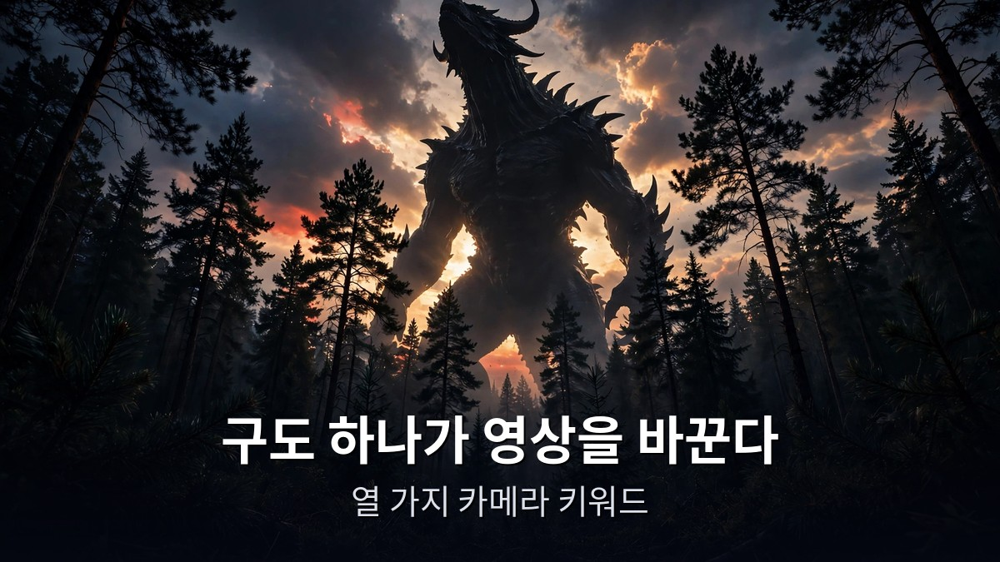
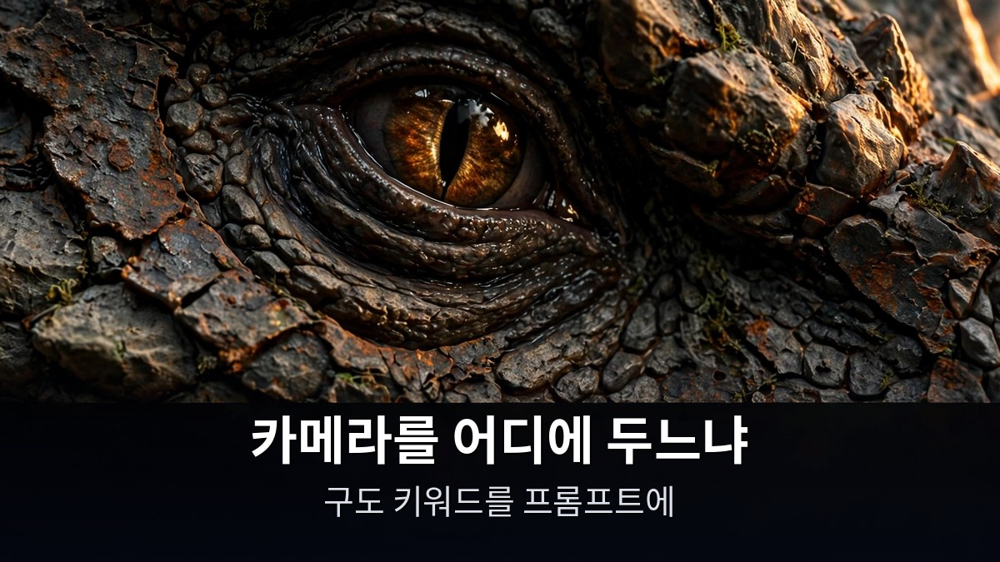
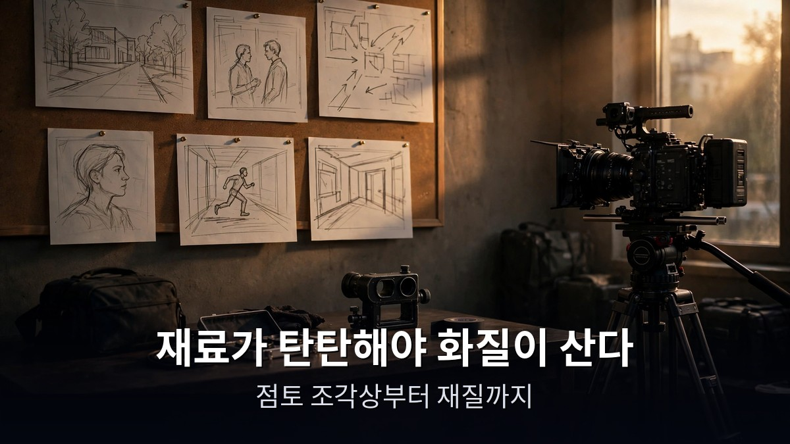
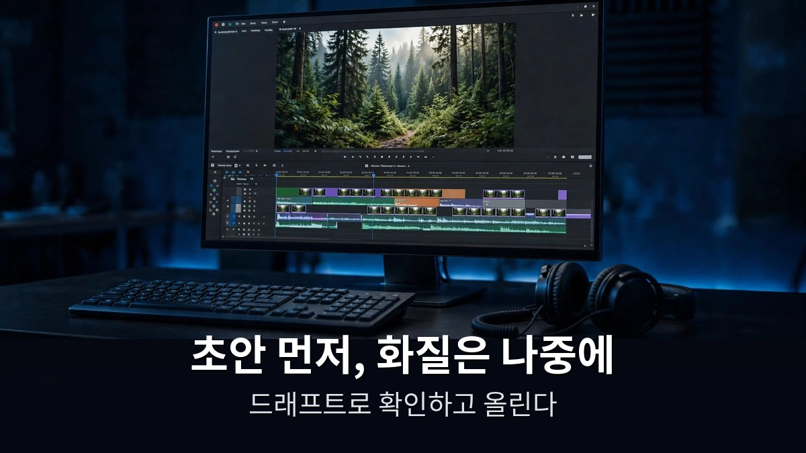

<!-- 본문 시작 -->



AI로 영상을 만들 때 "멋있게 만들어줘"라고 적으면 크레딧만 날아가고 쓸 만한 컷은 거의 안 나온다.
진짜 차이는 모델이 아니라 카메라 구도 키워드 하나에서 난다.
이 글은 AI 영상 퀄리티를 바꾸는 구도 열 가지와 프롬프트에 넣는 방법, 크레딧 아끼는 순서까지 정리한다.

```blog
type: text
runs:
  - text: "AI 영상은 '멋있게'라는 한 줄보다 '카메라를 어디에 두느냐'는 한 줄이 결과를 바꾼다. 구도 키워드 열 가지와 한 컷에 구도 하나·움직임 하나만 넣는 규칙, 장소와 빛을 모든 컷에 똑같이 적는 방법이 핵심이다. 4K로 뽑기 전에는 저렴한 초안으로 먼저 확인하면 크레딧을 아낄 수 있다."
    style: {bold: true, color: "#007aa6"}
```

AI로만 만든 채널을 어떻게 만드는지는 [AI로만 만든 채널 10곳, 직접 따라 만들어 보고 티어 매겼습니다](https://blog.naver.com/3700708/224489352086) 글에서 확인할 수 있다. 채널을 만드는 큰 그림과 오늘 글의 구도 키워드를 함께 보면, 어떤 컷부터 연습할지 감이 잡힌다.

```blog
type: heading
level: 2
runs:
  - text: "구도 키워드, 프롬프트에 어떻게 넣나"
    style: {bold: true, color: "#007aa6"}
```



카메라 구도란 카메라를 어디에 두고, 어디서 올려다보고, 언제 다가가는지를 정하는 것이다.
똑같은 모델로 만들어도 구도를 정해주느냐에 따라 결과가 완전히 달라진다.
영상에서 정리한 구도 열 가지는 아래 표와 같다.

| 구도 | 영어 키워드 | 언제 쓰나 |
| --- | --- | --- |
| 설정샷 | Establishing Shot | 장소·규모를 먼저 보여줄 때, 영상 첫머리나 장소가 바뀔 때 |
| 로우 앵글샷 | Low Angle Shot | 주인공을 처음 소개할 때, 위압감을 줄 때 |
| 익스트림 클로즈업 | Extreme Close-Up | 눈·이빨·피부결 하나만 꽉 잡아 디테일을 살릴 때 |
| 오버 더 숄더 | Over the Shoulder Shot | 누가 누구를 보는지, 대사 없이 긴장감을 만들 때 |
| 투샷 | Two Shot | 두 대상을 한 화면에 마주 세워 크기 차이를 보일 때 |
| 시점샷 | POV Shot | 대상의 눈이 되어 실제 카메라로 찍을 수 없는 장면을 만들 때 |
| 트래킹샷 | Tracking Shot | 떨어지거나 달리는 대상 옆에서 속도감을 줄 때 |
| 휩팬 | Whip Pan | 카메라를 휙 돌려 번지는 순간에 컷 전환을 가릴 때 |
| 전경 가림 전환 | Foreground Wipe | 앞 가림이 지나가며 다음 장면으로 자연스럽게 넘어갈 때 |
| 정면 대칭 | Centered Symmetry | 결정적 순간·필살기·마지막 포즈, 썸네일용 |

프롬프트에 넣는 방법은 단순하다.
한 번에 여러 컷을 만들 때는 컷마다 구도를 하나씩 붙인다.
영상에서 보여준 첫 30초 프롬프트는 12컷에 구도가 하나씩 다 붙어 있다.
첫 번째 컷은 로우 앵글로 올려다보면서 다가가기, 두 번째 컷은 익스트림 클로즈업, 세 번째 컷은 휩팬, 네 번째 컷은 트래킹샷, 다섯 번째 컷은 설정샷 식이다.

```blog
type: text
runs:
  - text: "한 컷에 구도 하나, 움직임 하나만 넣는다."
    style: {bold: true, background: "#FFF3CD"}
  - text: " 한 컷에 구도를 여러 개 넣으면 모델이 뭘 해야 할지 헷갈려서 오히려 어정쩡한 화면이 나온다. 구도가 여러 개 필요하면 컷을 나눈다."
```

장소와 빛은 모든 컷에 똑같은 문장으로 넣어준다.
그래야 구도를 계속 바꿔도 같은 영화처럼 보인다.
예를 들어 해질녘 소나무숲 산이라는 장소와 빛을 매 컷마다 같은 문장으로 적는 식이다.
구도를 바꾸는 것과 장소를 바꾸는 것을 한꺼번에 하면, 컷마다 다른 영화가 된다.

로우 앵글샷은 프롬프트에 "로우 앵글샷, 올려다보기"처럼 적는다.
투샷은 왼쪽과 오른쪽을 나눠 적는다.
레퍼런스 이미지를 넣어서 만들기 때문에 크기 자체를 말로 정해주지 않으면, 컷마다 괴수 크기가 바뀌기 쉽다.
트래킹샷은 "카메라가 여의주 옆에서 같은 속도로 같이 떨어진다"처럼 카메라가 누구를 얼마나 빠르게 따라가는지를 적는다.

```blog
type: heading
level: 2
runs:
  - text: "같은 모델인데 왜 결과가 다르나"
    style: {bold: true, color: "#007aa6"}
```



구도만으로는 부족하다.
4K 영상을 제대로 뽑으려면 모델만 4K로 바꾼다고 다 되는 게 아니다.
화면이 선명해질수록 준비물과 재료부터 탄탄해야 한다.
레퍼런스 이미지가 어설프면 결과까지 어설프게 나온다.

영상에서 쓴 방법은 3D 작업 순서를 그대로 따라가는 것이다.
먼저 색이 하나도 없는 회색 점토 조각상을 만든다.
이 단계에서는 색 이름을 절대 넣지 않는다.
색을 적으면 모델이 점토에 색을 칠해버리기 때문이다.
자세랑 실루엣만 제대로 나오는 걸 확인하면 된다.

그다음 부위마다 들어갈 실제 재질 사진을 뽑는다.
불가사리라면 리벳 박힌 녹슨 무쇠판과 녹슨 사슬, 못 부러진 칼날이 엉겨붙은 고철 덩어리 식이다.
해태라면 풍화된 화강암이나 이끼, 용이라면 잉어 비늘과 오래된 사슴뿔, 말갈기 식으로 해당 모델에 어울리는 재질을 고른다.
비늘도 아무 생선 비늘이 아니라 특정 비늘을 적어야 디테일이 산다.

조각상과 재질들을 주고 같은 이미지 모델로 만들면 캐릭터가 생긴다.
여기까지가 재료 준비다.
그리고 더 좋은 4K 영상을 만들기 위해 괴수마다 앞과 옆, 뒷모습이 담긴 시트를 한 장씩 만든다.
이미지가 한쪽 모습만 있으면 카메라 구도가 바뀔 때 모델이 모양을 지어내서 컷마다 괴수가 달라지기 때문이다.
구도를 중요하게 쓰는 영상일수록 이 시트가 중요하다.

```blog
type: text
runs:
  - text: "용어: 4K "
    style: {bold: true, color: "#ff008c"}
  - text: "가로 3,840, 세로 2,160 픽셀의 해상도다. 1080p보다 픽셀이 4배 많아, 얼굴이나 피부를 가까이 잡았을 때 모공이나 잔털, 옷감 결까지 보인다. 편집할 때 화면을 잘라내거나 확대해도 1080p 영상으로 선명하게 쓸 수 있다."
```

4K의 차이는 가까이 잡을 때 가장 크다.
기존에는 피부가 매끈하고 플라스틱처럼 보였다면, 4K에서는 모공이나 잔털, 옷감 결까지 보인다.
익스트림 클로즈업이 오늘 4K에서 제일 차이가 나는 구도인 이유다.
낮은 화질에서는 가까이 가면 질감이 뭉개지기 쉬운데, 4K에서는 녹슨 쇠결이나 돌틈까지 살아 있다.
그래서 중간중간 디테일이 살아 있는 컷을 붙여주면 영상이 실감이 확 살아난다.

영상에서 쓴 도구는 힉스필드의 Seedance 2.5다.
원래 레퍼런스를 최대 50개까지 넣어서 30초까지 장면을 만들 수 있었는데, 화질은 1080에서 멈춰 있었다.
이번에 4K로 업데이트되면서 처음부터 4K로 만든다.
1080을 만들고 4K로 키우는 게 아니라, 처음부터 4K로 만든다는 점이 다르다.
다만 구도 키워드와 재료 준비, 초안 확인 순서는 도구와 상관없이 그대로 쓸 수 있다.
이 글의 방법은 특정 도구 전용이 아니라, AI 영상 도구 전반에 적용되는 방식이다.

```blog
type: heading
level: 2
runs:
  - text: "크레딧 아끼면서 4K로 뽑는 방법은"
    style: {bold: true, color: "#007aa6"}
```



4K는 크레딧이 많이 드는 옵션이다.
처음부터 여러 번 뽑으면 잘못 나왔을 때 크레딧이 어마어마하게 깨진다.
그래서 영상에서 추천하는 순서는 초안부터 확인하는 것이다.

Seedance 2.5에는 드래프트라는 옵션이 있다.
고정적으로 480 화질로 저렴한 크레딧으로 만든다.
마음에 들면 크레딧 차액만 더 내고 4K로 업그레이드할 수 있다.
4K 자체가 크레딧이 많이 드는 옵션이기 때문에, 처음부터 여러 번 뽑지 않고 드래프트로 먼저 검증한 다음 업그레이드하면 훨씬 가성비 있게 만들 수 있다.

순서는 이렇다.
레퍼런스 시트와 장소를 순서대로 넣는다.
프롬프트에는 샷마다 초를 지정하고, 어떤 구도로 만들지, 어떤 카메라 렌즈인지, 액션은 어떻게 되는지를 자세하게 적는다.
영상 길이는 30초, 화질은 4K, 화면 비율은 16대 9나 영화처럼 만들고 싶으면 21대 9로 정한다.
드래프트로 만든 걸 보고 괜찮다고 판단되면, 그때 4K로 업그레이드한다.
구도가 똑같고 화질만 좋아지는 방식이라, 이미 확인한 구도를 다시 뽑을 필요가 없다.

```blog
type: text
runs:
  - text: "초안 확인 없이 4K부터 뽑지 않는다."
    style: {bold: true, background: "#FFF3CD"}
  - text: " 480 화질 초안으로 구도와 움직임을 먼저 확인하고, 마음에 들 때만 차액을 내고 4K로 올린다. 크레딧은 고화질이 아니라 '확인 안 된 고화질'에서 새는 경우가 많다."
```

정면 대칭 구도는 아껴 쓰는 게 좋다.
괴수를 화면 정가운데에 딱 세우고 좌우를 똑같이 맞추면, 결정적인 순간이라는 게 바로 전달된다.
필살기나 마지막 포즈 같은 제일 중요한 장면에 쓰고, 썸네일로 쓰기에도 제일 좋은 구도다.
휩팬과 전경 가림 전환은 컷 전환을 숨기는 용도다.
AI 영상은 컷마다 바뀔 때 어색한 경우가 많은데, 번지는 순간이나 앞 가림이 지나가는 순간에 전환을 넣으면 그 차이가 거의 안 보인다.

```blog
type: text
runs:
  - text: "프롬프트 규칙 한 줄 정리 "
    style: {bold: true, color: "#ff008c"}
  - text: "컷마다 구도 하나·움직임 하나, 장소·빛은 모든 컷에 같은 문장, 4K는 초안 확인 뒤 업그레이드. 이 세 가지만 지키면 '멋있게 만들어줘' 한 줄보다 훨씬 영화 같은 컷이 나온다."
```

## 마무리

구도 열 가지를 외울 필요는 없다.
처음에는 설정샷으로 장소를 열고, 로우 앵글로 주인공을 소개하고, 익스트림 클로즈업으로 디테일을 보여주는 세 가지만 넣어 봐도 영상이 달라진다.
나머지 일곱 가지는 컷 전환이 어색하거나 결정적 순간이 필요할 때 하나씩 꺼내 쓰면 된다.
같은 모델로 만들어도 구도를 아는 사람과 모르는 사람의 결과는 천지차이라는 말, 이번에는 직접 확인해 볼 차례다.

## 자주 묻는 질문

**구도 키워드를 한국말로 적어도 되나?**

된다. 영상에서도 설정샷·로우 앵글샷처럼 한국말로 설명하고, 프롬프트에는 영어 키워드를 함께 적는 방식을 썼다. 중요한 건 카메라 위치·방향·움직임을 구체적으로 적는 것이지, 언어 자체가 아니다.

**한 컷에 구도를 여러 개 넣으면 어떻게 되나?**

모델이 뭘 해야 할지 헷갈려서 어정쩡한 화면이 나올 수 있다. 구도가 여러 개 필요하면 컷을 나눠서 컷마다 구도 하나씩 붙이는 편이 낫다. 장소와 빛은 모든 컷에 같은 문장으로 유지한다.

**4K는 꼭 필요한가?**

꼭 그렇지는 않다. 4K의 차이는 얼굴이나 피부결을 가까이 잡을 때, 그리고 편집할 때 화면을 자르거나 확대할 때 가장 크다. 멀리서 찍은 장면 위주라면 1080p로도 충분하고, 초안 확인 뒤에 필요할 때만 4K로 올리면 된다.

## 함께 보면 좋은 글

[AI로만 만든 채널 10곳, 직접 따라 만들어 보고 티어 매겼습니다](https://blog.naver.com/3700708/224489352086)

[디스트릭트 9｜인간이 가둔 외계인, 기술은 누굴 택하나](https://blog.naver.com/3700708/224491209994)

<!-- 본문 끝 -->

## 작업용 출처·이미지 정보 (업로드 제외)

**출처**
- 성공지식백과, "치트키급입니다.. AI 영상 퀄리티 3배 올려주는 필수구도 10가지 공개.. ㄷㄷ", 2026-11-23 (자막 원문, 2026-11-27 06:02 브라우저 스크립트 패널 확보, 0:00~17:11 전문, 13:52~15:18 상영 구간 자막 없음)
- 4K 픽셀 4배: 3840×2160 대 1920×1080 산술 확인
- Seedance 2.5 4K 업데이트·드래프트 480p·차액 업그레이드: 영상 진행자 설명 (진행자 견해·도구별 사양으로 표기)
- 수치 확인 기준: 2026년 11월 27일

**원고 노트**
- 세 줄: ① 대상 독자 — AI 영상을 만들며 '같은 모델인데 왜 내 영상만 밋밋한지' 묻는 일반 독자 ② 해결할 질문 — AI 영상 구도 10가지는 무엇이고 프롬프트에 어떻게 넣나 ③ 추가 가치 — 구도별 쓰임 표 + 프롬프트 규칙(한 컷 한 구도·장소·빛 동일 문장) + 크레딧 절약 순서(초안 480p 확인 후 4K 업그레이드)
- 형식: ① 실용 가이드형 (로테이션 1→2 갱신, 11-28 용어브리핑형)
- 추천 링크 선정 근거: AI로만 만든 채널(같은 주제군, AI 영상 만들기) + 디스트릭트 9(다른 카테고리 최신 글)
- 중복 대조: 'AI 영상 구도' 주제 미사용 확인. 11-24-001 AI로만 만든 채널·11-25 제외된 AI 드라마 수익 글과 주제 다름(채널·수익 vs 구도 기법)
- 제외: 영상 후반 힉스필드 블랙프라이데이 할인·울트라 플랜 추천·100만 달러 콘테스트(접수 11월 12일~11월 26일, 이미 종료) — 홍보성·미검증 가격 정보라 원고에서 제외
- 영상 요약 비중: 자막 17분 중 구도·프롬프트·재료·절약법 위주 반영, 원고의 60% 이하 (표 정리·규칙·도구 무관 일반화 40% 이상)
- 인용: 진행자 발언 직접 인용 없음 (기법 설명만 정리)
