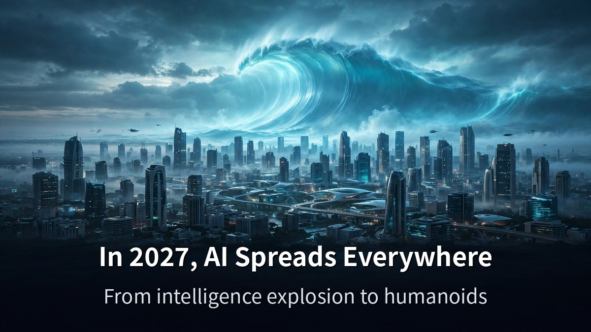
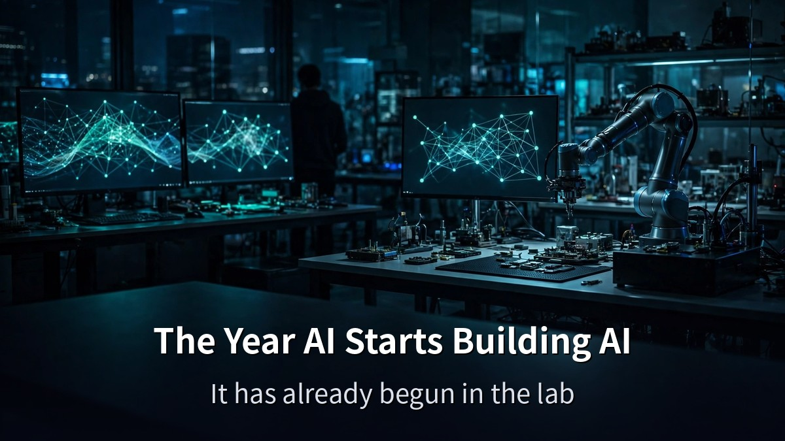
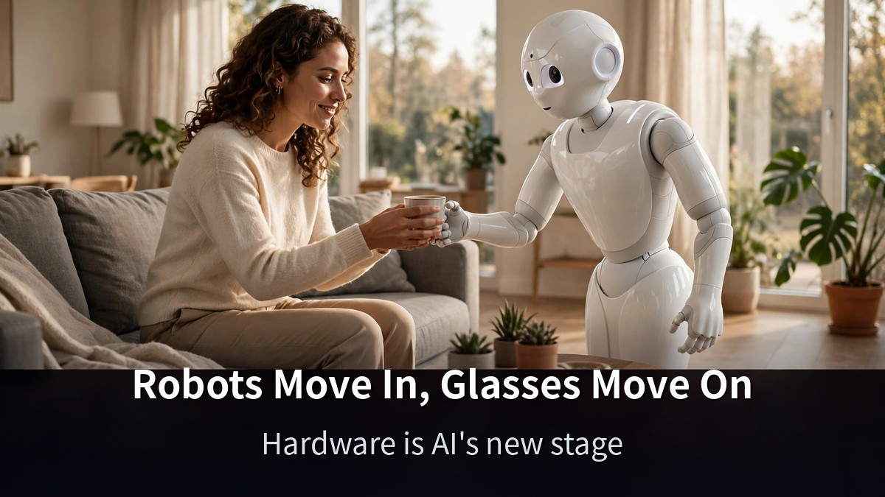
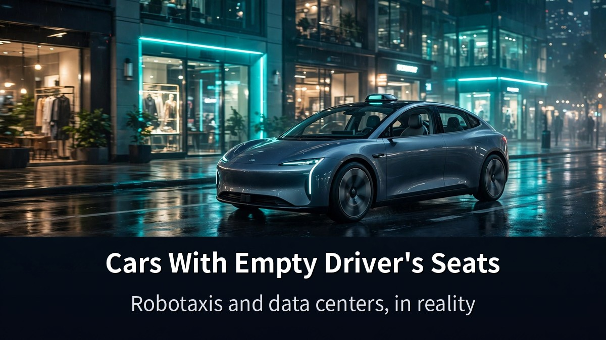

<!-- 본문 시작 -->



2027 could be the year AI starts building AI, robots move into homes, and glasses become the face of AI.
That is what TheAIGRID's ten forecasts for 2027, published November 27, say.
This post sorts those ten into what is confirmed and what is still a forecast, as of November 28, 2026.

```blog
type: text
runs:
  - text: "The ten forecasts share one thread. 2027 is not the year AI gets smarter only on screen, but the year it spreads into research, robots, glasses, cars, and data centers. Fewer than half of the ten are settled facts, though. The rest are forecasts, press reports, or company goals, so the first job is to separate what to believe from what to wait for."
    style: {bold: true, color: "#007aa6"}
```

Why the forecast was moved forward at all starts with the METR report and the internal-model story in [OpenAI's Internal Models｜Why They Are Too Powerful to Release](https://aitechnotesen.wordpress.com/2026/11/26/openais-internal-models%ef%bd%9cwhy-they-are-too-powerful-to-release/). Today's post builds the ten forecasts on top of it.

| Forecast | Key figure (verified Nov 28, 2026) | Status |
| --- | --- | --- |
| AI builds AI | Superhuman AI researcher median May 2027, TED-AI before 2028 at 35–65% | Forecast |
| Robots come home | Neo at $20,000, 100,000 units a year targeted by end of 2027 | Product and goal (delivery unconfirmed) |
| Jobs | Junior hiring 27% to 9%, 121,000 AI-cited layoffs | Being observed |
| Agents doing whole jobs | Dots launched, 65% of committed code written by AI | Product and observation |
| OpenAI's first device | No shipping before late February 2027, $300–400 reported | Press reports (unconfirmed) |
| The AI glasses war | 7 million units in 2025, from $395 | Product and scheduled |
| Robotaxis | Waymo past 300 million miles, Tokyo in 2027 | Expanding commercially |
| The compute explosion | Four firms at about $730 billion, $1 trillion forecast for 2027 | Forecast |
| AI doing real science | AlphaProof solves 9 problems, AI drug starts phase 3 | Papers and trial started |
| Playable AI worlds | Genie 4 at about 2 minutes, Atlas fully open | Product |

```blog
type: heading
level: 2
runs:
  - text: "2027: the year AI starts building AI?"
    style: {bold: true, color: "#007aa6"}
```



The first forecast is the intelligence explosion.
In an update on November 10, the AI 2027 forecast team said a superhuman AI researcher is likely to arrive at some point in 2027.
Lead author Daniel Kokotajlo put his own median at May 2027.
An AI that can automate essentially all white-collar work has a 35–65% chance of arriving before 2028, the team said.
What moved the forecast forward was the METR report of November 5. The AI 2027 team calculated that the pace is now about five months ahead of its original scenario.

But this is a forecast, not a fact.
The authors themselves call the analysis highly preliminary, and most of the evidence most useful to METR's conclusions was redacted by Anthropic.
Earlier this year, in February, the same team pushed its timeline back to 2029–2032, saying progress was slower than expected, and moved it forward again in November.

The supporting numbers are already here.
OpenAI said in an official post on September 6 that it had reached its goal of an automated research intern.
As of mid-August 2026, the research organization was using 3.1 agent-workdays of AI work for every day of human labor, and the median researcher was using more than $600 a day in inference.
Anthropic said that as of May 2026, more than 80% of the code merged into its codebase was written by Claude, and that as of August 2026, about 30,000 AI agents were doing research and engineering work.
METR estimated that Anthropic's model capability was improving about 1.9 times faster, with about 80% of that acceleration due to AI itself.
But fully autonomous research was 0% within the measured scope, and Anthropic itself said recursive self-improvement has not arrived yet.

The third forecast, jobs, is already visible in the numbers.
Anthropic CEO Dario Amodei warned in May 2025 that AI could wipe out half of entry-level white-collar jobs within one to five years and push unemployment to 10–20%.
A Stanford study found employment in AI-exposed jobs for 22- to 25-year-olds about 19% below where it would have been.
Inside Anthropic, juniors fell from 27% to 9% of new technical hires, and AI agent work hours outpaced staff hours six to one.
US employers cited AI in 121,401 layoff announcements from January to October 2026, about 20% of all layoffs.
But total layoffs fell 44% year over year, and AI-cited layoffs dropped to 1,265 in October.
The unemployment rate for recent college graduates is 5.2%, with underemployment at 42.5%, though no data ties those figures directly to AI.

The fourth forecast is agents that do whole jobs.
OpenAI launched Dots, its always-on agent, at DevDay on September 29.
Give it a goal and it keeps working on its own cloud computer, starting with Pro and Business Premium.
Coding is where agents are already working.
A Sonar survey published November 12 (1,026 developers and managers) found AI generates or substantially assists 65% of committed code, up from 42% a year earlier.
But 76% of respondents said AI generates code faster than they can verify it.
Gartner forecast in June 2025 that more than 40% of agentic AI projects will be canceled by the end of 2027, because of rising costs, unclear value, and weak risk controls.
Agents are taking on work faster than the work can be checked.

```blog
type: text
runs:
  - text: "Read a forecast as a forecast."
    style: {bold: true, background: "#FFF3CD"}
  - text: " The AI 2027 team's 2027 forecast and METR's '2x and 80%' are estimates. METR said it would not be surprised if the true acceleration were closer to 1.3x or to 3x, and most of the evidence behind its conclusions was not made public."
```

```blog
type: heading
level: 2
runs:
  - text: "Robots and glasses, into homes and onto faces?"
    style: {bold: true, color: "#007aa6"}
```



The second forecast is robots coming home.
1X's home humanoid Neo costs $20,000 to buy or $499 a month on subscription.
Its Hayward, California factory started running on April 30 and can build 10,000 units a year.
Preorders opened October 28, 2025, and the company says 10,000 units were reserved within five days.
But that is reservations on a $200 refundable deposit, not confirmed sales, and no independently verified first customer delivery exists.
The goal is annual volume of 100,000 units by the end of 2027.

Tesla is moving too.
On the October 22 earnings call, Musk said early production of Optimus had started on the mass-production line in Fremont.
He expects deliveries to companies outside Tesla to start around the end of 2027.
Figure has delivered more than 350 Figure 03 units and raised production speed from one a day to one an hour.
Boston Dynamics' Atlas starts taking new customers in early 2027, and Hyundai plans a robot factory able to build 30,000 units a year by 2028.
Agility Robotics unveiled Digit 5 on September 15, with early access in the first half of 2027.
China's Unitree shipped more than 5,500 humanoids in 2025 and listed on the Shanghai exchange on August 19.

Robot brains are getting faster too.
Anthropic's Claude Fable 5.2, announced November 9, scored 64.9% on the RoboDojo robot-control benchmark.
That is more than double the 27.6% of Fable 5.1 from about ten weeks earlier.
But this is a simulation result. The same model scored 13.3% on RoboWild, a benchmark closer to real-world conditions.
Google's Gemini 4 Argon scored 87% on an embodied-reasoning benchmark and learned to throw a cornhole bag from a single human video, succeeding seven times in a row in a demo.
DeepMind's Gemini Robotics 2 supports full-body control, from feet to fingertips.
Physical Intelligence's π0.7 folded a shirt with 80% success in an unseen environment.
Nvidia's GR00T N2 is claimed to succeed more than twice as often on new tasks, but the supporting data has not been published.
Figure's Helix raised task success from 9% to 56% across 30 unseen homes, though that is the company's own test.

The fifth forecast is OpenAI's first device.
OpenAI acquired Jony Ive's hardware startup io in May 2025 for about $6.5 billion.
In a court filing, OpenAI said its first hardware device would not ship to customers before the end of February 2027.
Bloomberg's Mark Gurman reports the first product is a screenless, donut-shaped home smart speaker with a camera, microphone, and moving parts, priced at $300–400.
OpenAI has not officially confirmed the product, its specs, or its price, and The Information has reported $200–300, so the price reports differ.
Apple sued OpenAI on July 10 over trade secrets.

The sixth forecast is the AI glasses war.
EssilorLuxottica sold more than 7 million Ray-Ban Meta and Oakley Meta AI glasses in 2025.
Meta's Ray-Ban Display costs $799, with a display inside the lens and a neural wristband, and its $1,299 VR glasses arrive in spring 2027.
Google and Samsung's Gemini glasses opened for preorder on November 12, from $395, with sales starting December 10.
Apple's first smart glasses are targeted for a WWDC reveal in June 2027, according to Gurman, though the same report says software delays could push the schedule.

```blog
type: text
runs:
  - text: "Robot scores often come from simulations and company tests."
    style: {bold: true, background: "#FFF3CD"}
  - text: " Fable 5.2's RoboDojo score of 64.9% is a simulation result, and the same model scored 13.3% on a benchmark closer to the real world. Helix's 56% is Figure's own test. Scores alone are not a safe measure of a robot's real ability."
```

If robotaxi and self-driving terms get confusing, [Self-Driving Terms Explained｜FSD, Robotaxi and Autonomy Levels](https://aitechnotesen.wordpress.com/2026/11/25/selfdriving-terms-explained%ef%bd%9cfsd-robotaxi-and-autonomy-levels/) sorts out FSD and robotaxi first, which makes the seventh forecast much easier to read. FSD is a driver-assistance feature, while a robotaxi is a service with an empty driver's seat.

```blog
type: heading
level: 2
runs:
  - text: "Robotaxis and data centers: how far has reality come?"
    style: {bold: true, color: "#007aa6"}
```



The seventh forecast is robotaxis spreading worldwide.
Waymo operates in 15 major US cities and has passed 300 million fully autonomous miles.
Paid rides ran at more than 500,000 a week as of April 2026, and the first commercial service in Tokyo is planned for 2027.
Tesla runs robotaxis in seven cities, with driverless operation in six of them.
In September, the steering-wheel-free Cybercab started carrying passengers in Austin, with about 2 million driverless miles accumulated.
Amazon's Zoox began paid rides in Las Vegas on August 10.
Three units an hour is the 2027 production target; the current pace is about one a day.
China's Baidu Apollo Go recorded 3.2 million fully driverless rides in the first quarter of 2026 and operates in 27 cities as of May 2026.
Pony.ai had 1,975 vehicles at the end of June, and second-quarter fare revenue rose 849.3% year over year.

The eighth forecast is the compute explosion.
Microsoft, Google, Amazon, and Meta are forecast to spend about $730 billion on capital expenditure in 2026, with forecasts above $1 trillion for 2027.
But the 2026 figure is the sum of company-wide capex guidance, not AI-only spending, and $1 trillion is a forecast.
The gigawatt era is opening too.
xAI claims Colossus 2 is the first gigawatt-scale training cluster, but no independently confirmed 1-gigawatt campus exists yet.
OpenAI's Stargate campus in Abilene, Texas is 1.2 gigawatts, and the whole Stargate plan is about 10 gigawatts.
Nvidia's Vera Rubin is in full production, and Rubin Ultra is due in the second half of 2027.
Nvidia says a rack draws 600 kilowatts and delivers about 14 times the performance of a Blackwell Ultra rack.
Nvidia's revenue was $96.2 billion in the second quarter of fiscal 2027, $89 billion of it from data centers, and grew to $115.8 billion in the third quarter, announced November 17.

The ninth forecast is AI doing real science.
DeepMind's AlphaProof Nexus, published in Science on October 8, 2026, solved nine open Erdős problems, two of them unsolved for 56 years, and proved 44 open conjectures from the integer sequence encyclopedia.
Claude announced on September 4 that it had produced the first complete formalization of Fermat's Last Theorem in Lean.
That is 13 million lines of Lean code, written in 11 days.
But it is a formalization of the theorem Andrew Wiles proved in 1995, not new mathematics.
Google's AI co-scientist, published in Nature on May 19, 2026, proposed a leukemia drug repurposing candidate and a liver fibrosis target, both verified in the lab.
Insilico Medicine's AI-discovered drug rentosertib began dosing its first phase 3 patient on September 9, 18 months after the target was found and a preclinical candidate was named.
Isomorphic Labs raised a $2.1 billion Series B on May 12.
OpenAI's internal-model math results (the Erdős conjecture disproof, the Navier–Stokes solution claim, and the 372-case batch) were covered in the November 26 post.

The tenth forecast is playable AI worlds.
Google announced Genie 4 on October 27 and opened it to AI Ultra subscribers on November 18.
Press reports put scene consistency at about two minutes, double Genie 3's roughly one minute.
Runway's GWM Worlds 2, unveiled in September, runs at 24 frames per second with real-time interaction.
World Labs opened Atlas to everyone on November 12, and AMD's roughly $8.2 billion acquisition legally closed on November 13.
Tencent open-sourced HY-World 2.0 on April 15.
xAI's game studio has promised a great AI-generated game before the end of 2026, though no title, genre, or platform has been disclosed.
Sundar Pichai called Genie 4 a core foundation for robot and agent training.
World models are becoming practice grounds for robots, not just games.

```blog
type: text
runs:
  - text: "Confirmed facts — "
    style: {bold: true, color: "#ff008c"}
  - text: "Waymo's 300 million miles, the Dots launch, Sonar's 65%, the Genie 4 announcement, rentosertib's phase 3 start, and EssilorLuxottica's 7 million glasses sold are confirmed by official announcements, earnings, or papers. All figures are as of November 28, 2026."
```

```blog
type: text
runs:
  - text: "Still claims and forecasts — "
    style: {bold: true, color: "#ff008c"}
  - text: "The AI 2027 team's 2027 forecast, the OpenAI device's price and shape, 1X's 100,000-unit goal, Zoox's three-units-an-hour target, $1 trillion of compute in 2027, and the xAI game promise have not happened yet. Company goals and press figures should be read separately from confirmed facts."
```

Taken together, the ten forecasts paint 2027 as the year AI spreads out of the lab and into the world, not just the year it gets smarter on its own.
If they hold, labs will have AI helping with research, driverless cars on the road, robots learning jobs at home, and glasses calling up AI on your face.
But about half are still forecasts, and the other half are only just becoming products.
Counting how many of the ten came true at this time next year will be the most honest way to close this post.

## Frequently asked questions

**Of the ten forecasts for 2027, which can be checked first?**

OpenAI's first device. The court filing says it will not ship before the end of February 2027, so late February is the first checkpoint. After that come Waymo's commercial service in Tokyo and Meta's VR glasses in spring 2027. An intelligence explosion, by contrast, may not be settled even by the end of the year.

**When will a humanoid robot come to my home?**

Not yet, for most people. The 1X Neo can be reserved for $20,000 or $499 a month, but no first customer delivery has been independently confirmed. Tesla aims to start delivering Optimus to outside companies around the end of 2027 and has given no home schedule. Home comes after factories and warehouses.

**Should I buy AI glasses now?**

Decide the use first. Screenless audio-and-camera glasses start at $395, while the Ray-Ban Display with a screen in the lens is $799. Meta's $1,299 VR glasses are a separate product, closer to a VR headset. Apple's smart glasses exist only as a report targeting a June 2027 reveal. Whether glasses become a mass product or stay a niche is what 2027 will show.

## Further reading

[OpenAI's Internal Models｜Why They Are Too Powerful to Release](https://aitechnotesen.wordpress.com/2026/11/26/openais-internal-models%ef%bd%9cwhy-they-are-too-powerful-to-release/)

[District 9｜When Humans Caged Aliens, the Tech Picked a Side](https://aitechnotesen.wordpress.com/2026/11/25/district-9%ef%bd%9cwhen-humans-caged-aliens-the-tech-picked-a-side/)

<!-- 본문 끝 -->

## 작업용 출처·이미지 정보 (업로드 제외)

## Sources and notes (not for upload)

**Sources**
- TheAIGRID, "10 Insane AI Things Happening in 2027", 2026-11-27 (transcript captured from the YouTube script panel, 2026-11-28 06:02 KST, 0:00–39:46, 39:59, 94,914 views)
- AI Futures Project, "Q3.5 Timelines Update: Looks Like the Intelligence Explosion Will Happen in 2027 After All", 2026-11-10 — superhuman AI researcher in 2027, Kokotajlo median May 2027, TED-AI before 2028 at 35–65%, about five months ahead of the original scenario, analysis preliminary
- METR, "Independent Assessment of AI R&D Acceleration at Anthropic", 2026-11-05 — about 1.9x speedup (95% CI 1.5–2.8x), about 80% due to AI (estimate), most useful evidence redacted
- OpenAI, "Research acceleration: The view inside OpenAI", 2026-09-06 — automated research intern reached, 3.1 agent-workdays, median $600/day, over half of successful 4–8-hour tasks needed human intervention
- Anthropic Institute, "When AI builds itself", 2026-06-04 (updated 2026-09-29) — code 80%+ (May 2026, merged lines), about 30,000 agents (Aug 2026), R&D led 26% (Sep 2026), fully autonomous 0%
- Anthropic, Claude Fable 5.2 announced 2026-11-09 — RoboDojo 64.9% vs Fable 5.1 27.6% (simulation), RoboWild 13.3%
- OpenAI DevDay 2026 (2026-09-29) — Dots launched (GPT-6 Astra, own cloud computer, Pro and Business Premium)
- Sonar, State of Code Developer Survey 2027, 2026-11-12 — 1,026 developers and managers, 65% of committed code AI-generated or assisted (42% to 65%), 76% generate faster than they verify
- Gartner, "Gartner Predicts Over 40% of Agentic AI Projects Will Be Canceled by End of 2027", 2025-06-25 — cost, unclear value, weak risk controls
- 1X, Neo order page and factory announcements — $20,000 / $499 a month, Hayward factory running from 2026-04-30 (10,000 units a year), 10,000 reservations in five days (refundable deposit), 100,000 units a year targeted by end of 2027, first customer delivery unconfirmed
- Tesla Q3 2026 earnings call 2026-10-22 — Optimus early production in Fremont, deliveries to outside companies targeted around end of 2027
- Figure official announcement 2026-04-29 — more than 350 units delivered, production speed one an hour; BMW deployment
- Boston Dynamics Atlas CES 2026-01-05 — new customers from early 2027; Hyundai robot factory plan for 30,000 units a year by 2028
- Agility Robotics Digit 5 unveiled 2026-09-15 — early access first half of 2027
- Unitree prospectus and listing 2026-08-19 — more than 5,500 humanoids shipped in 2025, Shanghai STAR Market listing
- Google DeepMind, Gemini 4 Argon announced 2026-09-30 — ERQA 87%, cornhole demo seven times in a row (company demo); Gemini Robotics 2, 2026-07-30
- Physical Intelligence, π0.7 arXiv 2026-04-16 — shirt folding 80% (unseen environment)
- NVIDIA, GR00T N2 — more than 2x success on new tasks claimed (data not published); Vera Rubin in production, Rubin Ultra second half of 2027 (600kW per rack, 14x)
- OpenAI, io acquisition 2025-05-21 — about $6.5 billion; court filing 2026-02-09 — no shipping before end of February 2027
- Bloomberg Mark Gurman reports (around 2026-11-25) — donut-shaped screenless home smart speaker, $300–400 (The Information reported $200–300); Apple trade-secret lawsuit 2026-07-10
- EssilorLuxottica 2025 results 2026-02-11 — Ray-Ban + Oakley AI glasses over 7 million units; Meta Ray-Ban Display $799; Meta VR Glasses $1,299, spring 2027; Samsung and Google Gemini glasses preorders from 2026-11-12, $395 and up (sales Dec 10); Gurman Apple smart glasses WWDC 2027 reveal report 2026-11-15
- Waymo (Alphabet Q3 earnings call 2026-10-28) — 15 cities, over 300 million miles; 500,000 rides a week (2026-04-29 figure); Tokyo commercial service planned for 2027 (announced 2026-09-14)
- Tesla Robotaxi — seven cities, driverless in six, Cybercab in Austin from 2026-09-03, about 2 million driverless miles
- Zoox — paid rides in Las Vegas from 2026-08-10, three units an hour is the 2027 target (about one a day now)
- Baidu Q1 2026 results — Apollo Go 3.2 million rides, 27 cities (May 2026)
- Pony.ai as of 2026-06-30 — 1,975 vehicles, Q2 fare revenue +849.3%
- Hyperscaler capex — four firms about $730 billion in 2026, about $1 trillion forecast for 2027; Stargate Abilene 1.2GW, whole plan about 10GW; NVIDIA FY27 Q2 revenue $96.2 billion, data center $89 billion; Q3 $115.8 billion and $107.6 billion (2026-11-17)
- DeepMind AlphaProof Nexus, Science 2026-10-08 — nine Erdős problems solved (two unsolved for 56 years), 44 conjectures proved
- Anthropic, Claude formalizes Fermat's Last Theorem 2026-09-04 — 13 million lines of Lean, 11 days (a formalization, not new math)
- Google AI co-scientist, Nature 2026-05-19 — leukemia and liver fibrosis (cell and organoid level)
- Insilico Medicine rentosertib first phase 3 dosing 2026-09-09 — 18 months from target discovery to preclinical candidate
- Isomorphic Labs Series B $2.1 billion 2026-05-12
- Google DeepMind Genie 4 announced 2026-10-27, Ultra rollout 2026-11-18 — about two minutes consistency (press reports); Runway GWM Worlds 2 2026-09-03 (720p, 24fps); World Labs Atlas fully open 2026-11-12, AMD acquisition about $8.2 billion (legally closed Nov 13); Tencent HY-World 2.0 open source 2026-04-15; xAI game studio promise by end of 2026
- Fact-check date: November 28, 2026

**Notes**
- Three lines: ① Readers — general readers who want to tell fact from forecast in the flood of 2027 AI predictions ② Question — what are the ten AI changes for 2027, how far is each confirmed, and what should be believed and what waited for ③ Added value — full fact-check of 14 items (excluded "five years of progress" and "Project Fetch" from the video's claims; corrected 12 items including "five months ahead", "driverless in six cities", "27 cities", "Stargate about 10GW"), a section separating confirmed facts from claims, and a directly verified agents section (Dots, Sonar, Gartner)
- Recommendation links: OpenAI's Internal Models (same category AI News, the METR and AI 2027 background post) + District 9 (latest AI Movies and Videos post)
- Duplication check: material overlapping 2026-11-26-001 (AI 2027, METR, OpenAI's three math results, Research Acceleration, When AI Builds Itself) is mentioned only in one line each, not as the core. Different topic from 2026-11-17-001 (2030 AI forecast vs 2027 ten forecasts, different video).
- Video summary share: transcript of 39 minutes 59 seconds, facts and figures only, under 60% of the post (official documents, press, earnings, and papers make up more than 40%)
- Forecast vs fact: forecasts, press reports, and company goals are flagged with "according to the forecast", "according to reports", or "company goal". "Five years of progress" is written only as "five months ahead" in the news post; the detail stays in the evergreen post. "Project Fetch phase 2" was excluded (no such public project found). The "90% of code after Fable 5.2" causal link was excluded (the 90% figure is from September, before the November 9 launch). "35–65% office-job automation" was corrected to the TED-AI arrival probability.
- Quotes: none (video wording rewritten in our own words)
- 이미지 검수: 4장 전부 통과 (기계 검사 1200×675·JPEG·무결성 + 눈 검사 — 헤드라인 약속·한 장 한 주제·자름·겹침 없음·배너 가독성·실사 규칙·숫자 없음, FAIL 0회)
