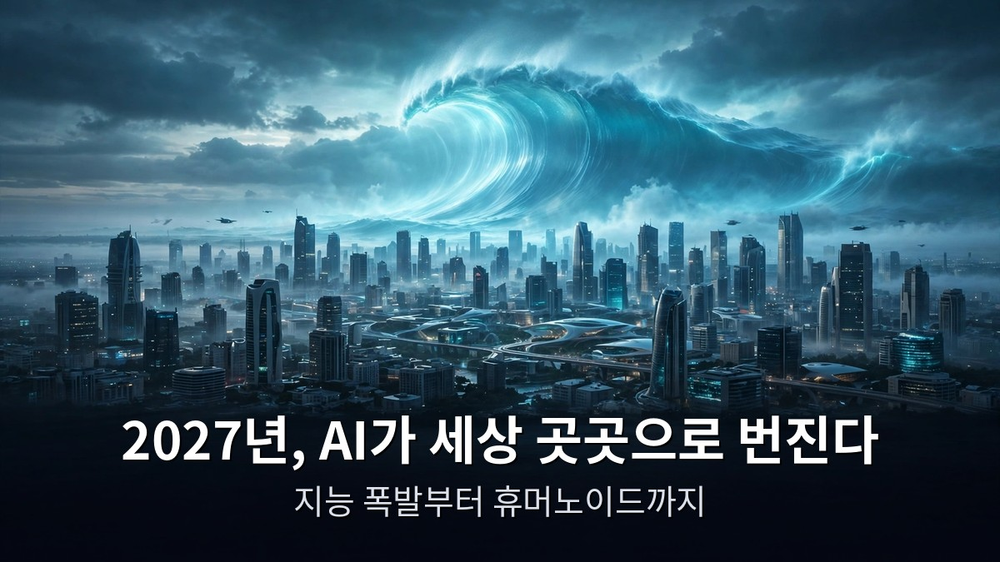
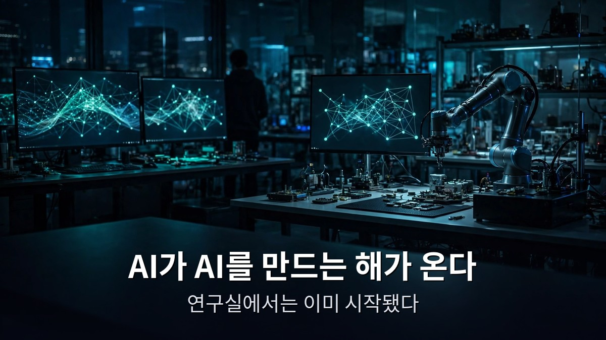
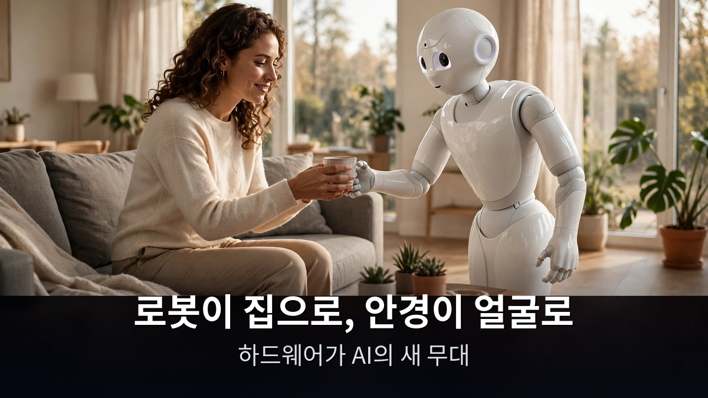
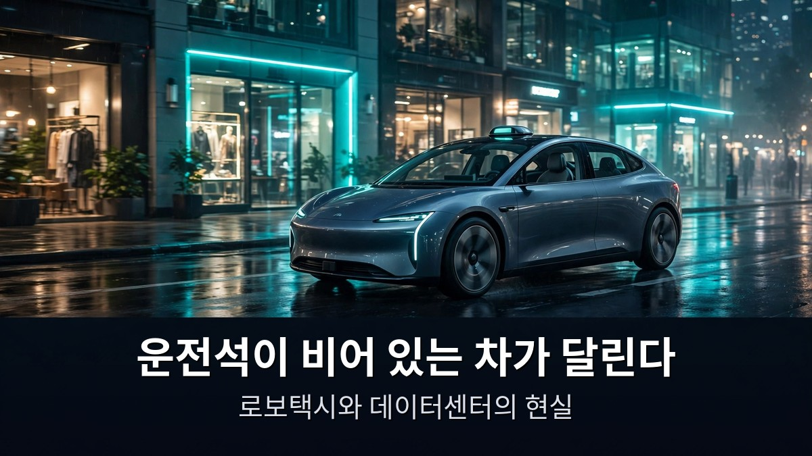

<!-- 본문 시작 -->



2027년은 AI가 AI를 만들고, 로봇이 집으로 들어오고, 안경이 AI의 얼굴이 되는 해가 될 수 있다.
TheAIGRID가 11월 27일 내놓은 2027년 전망 10가지는 그렇게 말한다.
이 글은 그 10가지를 확인된 사실과 아직 전망인 것으로 나눠, 2026년 11월 28일 기준으로 정리한다.

```blog
type: text
runs:
  - text: "2027년 전망 10가지의 공통점은 하나이다. AI가 화면 안에서만 똑똑해지는 해가 아니라, 연구·로봇·안경·차·데이터센터까지 현실로 번지는 해라는 것이다. 다만 10가지 중 확정된 사실은 절반도 안 되고, 나머지는 전망·보도·회사 목표이다. 무엇을 믿고 무엇을 기다릴지부터 가려야 한다."
    style: {bold: true, color: "#007aa6"}
```

전망의 출발점이 된 METR 보고서와 내부 모델 이야기는 [오픈AI 내부 모델｜공개할 수 없을 만큼 강력해진 이유](https://blog.naver.com/3700708/224492460193) 글에서 먼저 정리했다. 오늘 글은 그 위에 10가지 전망을 얹는다.

| 전망 | 핵심 수치 (2026-11-28 확인) | 상태 |
| --- | --- | --- |
| AI가 AI를 만든다 | 초인간 AI 연구원 2027년 5월 중앙값, TED-AI 2028년 전 35~65% | 전망 |
| 집으로 오는 로봇 | Neo 2만 달러, 2027년 말 연 10만 대 목표 | 제품·목표 (인도 미확인) |
| 일자리 | 초급 채용 27%→9%, AI 언급 감원 12만 건 | 관측 중 |
| 온전한 일을 하는 에이전트 | Dots 출시, 커밋 코드의 65% AI 작성 | 제품·관측 |
| OpenAI 첫 디바이스 | 2027년 2월 말 이후 출하, 300~400달러 보도 | 보도 (미확정) |
| AI 안경 전쟁 | 2025년 700만 대, 395달러부터 | 제품·예정 |
| 로보택시 | Waymo 3억 마일, 도쿄 2027년 | 상용 확대 중 |
| 컴퓨트 폭발 | 4사 7,300억 달러, 2027년 1조 달러 전망 | 전망 |
| AI가 하는 과학 | AlphaProof 9개 해결, AI 신약 3상 첫 투약 | 논문·임상 시작 |
| 플레이 가능한 AI 월드 | Genie 4 약 2분, Atlas 전면 개방 | 제품 |

```blog
type: heading
level: 2
runs:
  - text: "2027년, AI가 AI를 만드는 해가 되나"
    style: {bold: true, color: "#007aa6"}
```



첫 번째 전망은 지능 폭발이다.
AI 2027 전망 팀이 11월 10일에 낸 업데이트는 초인간 AI 연구자가 2027년 중 어느 시점에 등장할 가능성이 높다고 본다.
주 저자 Daniel Kokotajlo의 개인 중앙값은 2027년 5월이다.
사실상 모든 화이트칼라 업무를 자동화할 수 있는 AI가 2028년 전에 등장할 확률은 35~65%로 봤다.
전망을 앞당긴 계기는 METR 보고서(11월 5일)로, AI 2027 팀은 원래 시나리오보다 약 5개월 앞선 속도라고 계산했다.

다만 이건 전망이지 사실이 아니다.
저자들 스스로 분석이 예비적이라고 밝혔고, METR 보고서의 결론에 가장 유익했던 증거의 과반은 Anthropic의 검열로 가려졌다.
같은 팀은 올해 2월에는 진전이 예상보다 느리다며 시점을 2029~2032년으로 미뤘다가 11월에 다시 앞당긴 것이다.

뒷받침되는 숫자는 이미 있다.
OpenAI는 9월 6일 공식 글에서 자동화 연구 인턴 목표에 도달했다고 밝혔다.
2026년 8월 중순 기준 연구 조직 전체가 인간 노동 1일당 3.1일치의 AI 에이전트 작업을 쓰고 있고, 중앙값 연구자의 하루 추론 사용량은 600달러 이상이다.
Anthropic은 2026년 5월 기준 코드베이스에 병합된 코드의 80% 이상이 Claude가 썼다고 밝혔고, 2026년 8월 기준 약 30,000개의 AI 에이전트가 연구·엔지니어링 작업을 수행 중이었다.
METR은 Anthropic의 모델 능력 개선 속도가 약 1.9배가 됐고, 그 가속의 약 80%가 AI 자체 때문일 것으로 추정했다.
단, 완전히 자율적인 연구는 측정된 범위에서 0%였고, Anthropic 스스로 재귀적 자기 개선은 아직 도래하지 않았다고 밝혔다.

세 번째 전망인 일자리는 이미 수치로 보이기 시작했다.
Anthropic CEO 다리오 아모데이는 2025년 5월, AI가 1~5년 안에 초급 화이트칼라 일자리의 절반을 없애고 실업률을 10~20%로 끌어올릴 수 있다고 경고했다.
스탠퍼드 연구에 따르면 22~25세의 AI 노출 직종 고용은 예상보다 약 19% 낮다.
Anthropic 내부에서는 기술 부서 신규 채용 중 주니어 비중이 27%에서 9%로 떨어졌고, AI 에이전트 작업 시간이 직원 시간을 6대 1로 앞질렀다.
미국 고용주가 AI를 이유로 밝힌 감원은 2026년 1~10월 121,401건으로, 전체 감원의 약 20%이다.
다만 전체 감원 자체는 전년보다 44% 줄었고, AI 언급 감원도 10월에는 1,265건으로 급감했다.
최근 대졸자 실업률은 5.2%, 불완전고용률은 42.5%인데, 이 수치를 AI 때문이라고 단정한 자료는 없다.

네 번째 전망은 온전한 일을 하는 에이전트이다.
OpenAI는 9월 29일 DevDay에서 상시 에이전트 Dots를 내놨다.
목표를 주면 전용 클라우드 컴퓨터에서 일을 계속하고, Pro와 Business Premium부터 풀리기 시작했다.
코딩 현장에서는 이미 에이전트가 일을 하고 있다.
Sonar가 11월 12일 발표한 조사(개발자·관리자 1,026명)에 따르면 AI가 생성하거나 크게 보조하는 코드가 커밋 코드의 65%로, 1년 전 42%에서 뛰었다.
다만 응답자의 76%는 AI 코드를 검증하는 속도보다 생성하는 속도가 빠르다고 답했다.
Gartner는 2025년 6월 전망에서 비용 상승·불분명한 가치·미흡한 위험 관리 때문에 2027년 말까지 에이전틱 AI 프로젝트의 40% 이상이 취소될 것으로 봤다.
에이전트가 일을 맡는 속도와, 그 일을 검증하는 속도가 따로 논다는 뜻이다.

```blog
type: text
runs:
  - text: "전망은 전망으로 읽는다."
    style: {bold: true, background: "#FFF3CD"}
  - text: " AI 2027 팀의 2027년 전망과 METR의 '2배·80%'는 추정치이다. METR은 실제 가속이 1.3배에 가깝든 3배에 가깝든 놀라지 않겠다고 밝혔고, 결론의 근거가 된 증거의 과반은 공개되지 않았다."
```

```blog
type: heading
level: 2
runs:
  - text: "로봇과 안경, 집과 얼굴로 들어오나"
    style: {bold: true, color: "#007aa6"}
```



두 번째 전망은 집으로 오는 로봇이다.
1X의 가정용 휴머노이드 Neo는 2만 달러에 사거나 월 499달러에 구독할 수 있다.
캘리포니아 Hayward 공장은 4월 30일에 가동을 시작했고, 연간 1만 대를 만들 수 있다.
사전주문은 2025년 10월 28일 시작 후 5일 만에 1만 대가 예약됐다고 회사는 밝혔다.
다만 200달러 환불 가능 예약금 기준의 예약이지 확정 판매가 아니고, 첫 고객 인도는 독립적으로 검증된 사례가 없다.
2027년 말까지 연간 10만 대 규모가 목표이다.

테슬라도 움직이고 있다.
10월 22일 실적 콜에서 머스크는 Fremont의 대량 생산 라인에서 Optimus 초기 생산을 시작했다고 밝혔다.
2027년 말경에는 테슬라 외부 기업에 Optimus 인도를 시작할 것으로 예상한다고 했다.
Figure는 350대 이상의 Figure 03을 인도했고, 생산 속도를 하루 1대에서 시간당 1대로 높였다.
보스턴 다이내믹스 Atlas는 2027년 초부터 신규 고객을 받기 시작하고, 현대는 2028년까지 연간 3만 대를 만들 수 있는 로봇 공장을 지을 계획이다.
Agility Robotics는 9월 15일 Digit 5를 공개했고, 2027년 상반기 조기 접근을 예고했다.
중국 Unitree는 2025년 휴머노이드를 5,500대 이상 출하했고, 8월 19일 상하이 증시에 상장했다.

로봇의 두뇌도 빨라지고 있다.
Anthropic이 11월 9일 발표한 Claude Fable 5.2는 로봇 제어 벤치마크 RoboDojo에서 64.9%를 기록했다.
10주 전 모델인 Fable 5.1의 27.6%에서 두 배 이상 뛴 수치이다.
다만 이건 시뮬레이션 환경 결과이고, 같은 모델이 실제 환경에 가까운 RoboWild 벤치마크에서는 13.3%에 그쳤다.
구글의 Gemini 4 Argon은 체화 추론 벤치마크에서 87%를 기록했고, 인간 영상 1개만 보고 콘홀 던지기를 배워 7회 연속 성공하는 데모를 보였다.
DeepMind의 Gemini Robotics 2는 발부터 손끝까지 전신 제어를 지원한다.
Physical Intelligence의 π0.7은 본 적 없는 환경에서 셔츠 접기 80% 성공을 기록했다.
엔비디아의 GR00T N2는 새 과제에서 기존 모델 대비 2배 이상 성공한다고 주장하지만, 근거 데이터는 공개되지 않았다.
Figure의 Helix는 본 적 없는 집 30곳에서 과제 성공률이 9%에서 56%로 올랐다고 밝혔는데, 자사 테스트이다.

다섯 번째 전망은 OpenAI의 첫 디바이스이다.
OpenAI는 2025년 5월 조니 아이브의 하드웨어 스타트업 io를 약 65억 달러에 인수했다.
법원 제출 서류에서 OpenAI는 첫 하드웨어 디바이스가 2027년 2월 말 이전에는 고객에게 출하되지 않을 것이라고 밝혔다.
Bloomberg의 Mark Gurman 보도에 따르면 첫 제품은 화면 없는 도넛 모양의 홈 스마트 스피커로, 카메라·마이크·움직이는 부품이 들어가고 가격은 300~400달러 수준이다.
다만 OpenAI는 제품·사양·가격을 일절 공식 확인하지 않았고, The Information은 200~300달러로 보도한 바 있어 가격 보도에 차이가 있다.
애플은 7월 10일 OpenAI를 상대로 영업비밀 소송을 제기했다.

여섯 번째 전망은 AI 안경 전쟁이다.
EssilorLuxottica는 2025년 한 해 레이밴 메타와 오클리 메타 AI 안경을 700만 대 이상 팔았다.
메타의 Ray-Ban Display는 799달러에 렌즈 내 화면과 뉴럴 밴드를 갖췄고, 1,299달러짜리 VR 안경은 2027년 봄 출시 예정이다.
구글과 삼성의 Gemini 안경은 11월 12일 사전주문을 시작했고 395달러부터, 12월 10일부터 판매된다.
애플의 첫 스마트글라스는 2027년 6월 WWDC 공개를 목표로 한다는 Gurman 보도까지 나왔다.
다만 소프트웨어 개발이 늦어지고 있어 일정이 밀릴 수 있다는 단서도 같은 보도에 있다.

```blog
type: text
runs:
  - text: "로봇 점수는 시뮬레이션과 자사 테스트 기준인 경우가 많다."
    style: {bold: true, background: "#FFF3CD"}
  - text: " Fable 5.2의 RoboDojo 64.9%는 시뮬레이션 결과이고, 실제 환경 벤치마크에서는 13.3%이다. Helix의 56%도 Figure 자사 테스트이다. 점수만 보고 로봇의 실력을 단정하지 않는 것이 안전하다."
```

로보택시·자율주행 용어가 헷갈린다면 [자율주행 용어 정리｜FSD·로보택시·레벨 뜻과 차이](https://blog.naver.com/3700708/224491064884) 글에서 FSD와 로보택시의 차이를 먼저 확인하면 7번 전망이 훨씬 잘 읽힌다. FSD는 운전자를 돕는 보조 기능이고, 로보택시는 운전석이 비어 있는 서비스이다.

```blog
type: heading
level: 2
runs:
  - text: "로보택시와 데이터센터, 현실은 어디까지 왔나"
    style: {bold: true, color: "#007aa6"}
```



일곱 번째 전망은 로보택시가 전 세계로 퍼지는 것이다.
Waymo는 15개 주요 미국 도시에서 운행 중이고, 완전 자율주행 마일이 3억 마일을 넘었다.
주간 유료 운행은 2026년 4월 기준 50만 회 이상이었고, 2027년에는 도쿄에서 첫 상용 운행을 시작할 계획이다.
테슬라는 7개 도시에서 로보택시를 운영 중인데, 운전자가 아예 타지 않는 무인 운행은 6개 도시이다.
9월에는 오스틴에서 핸들도 페달도 없는 사이버캡이 승객 운송을 시작했고, 무인 누적 마일은 약 200만 마일이다.
아마존의 Zoox는 8월 10일부터 라스베이거스에서 유료 운행을 시작했다.
시간당 3대 생산은 2027년 목표 속도이고, 지금은 하루 1대 수준이다.
중국 바이두의 Apollo Go는 2026년 1분기 완전 무인 운행 320만 회를 기록했고, 2026년 5월 기준 27개 도시에서 운영 중이다.
Pony.ai는 6월 말 기준 차량 1,975대를 보유했고, 2분기 요금 매출이 전년 대비 849.3% 늘었다.

여덟 번째 전망은 컴퓨트 폭발이다.
마이크로소프트·구글·아마존·메타 4사는 2026년에 자본지출로 약 7,300억 달러를 쓸 것으로 전망되고, 2027년에는 1조 달러를 넘길 것이라는 전망이 나온다.
다만 2026년 수치는 전사 자본지출 가이던스 합계이지 AI 전용 지출이 아니고, 1조 달러도 전망치이다.
기가와트 시대도 열렸다.
xAI의 Colossus 2가 첫 기가와트급 훈련 클러스터라는 주장이 나왔지만, 독립적으로 확인된 1기가와트 캠퍼스는 아직 없다.
OpenAI의 Stargate 텍사스 애빌린 캠퍼스는 1.2기가와트 규모이고, Stargate 전체 계획은 약 10기가와트이다.
엔비디아의 Vera Rubin은 전면 양산에 들어갔고, Rubin Ultra는 2027년 하반기 출시 예정이다.
랙당 600킬로와트, Blackwell Ultra 랙 대비 약 14배 성능이라는 것이 엔비디아 발표이다.
엔비디아는 2026년 2분기 매출 962억 달러 중 데이터센터가 890억 달러였고, 11월 17일 발표된 3분기에는 매출 1,158억 달러로 더 커졌다.

아홉 번째 전망은 AI가 하는 진짜 과학이다.
DeepMind의 AlphaProof Nexus는 Science 2026년 10월 8일자에 실렸는데, 열린 에르되시 문제 9개를 풀었고 그중 2개는 56년간 미해결이었고, 정수 수열 백과사전의 열린 추측 44개를 증명했다.
Claude는 9월 4일 발표에서 페르마의 마지막 정리를 Lean으로 처음 완전 형식화했다고 밝혔다.
Lean 코드 1,300만 줄, 11일 작업이다.
다만 이는 1995년 Wiles가 증명한 정리를 컴퓨터 언어로 옮긴 것이지 새로운 수학이 아니다.
구글의 AI co-scientist는 Nature 2026년 5월 19일자에 실렸고, 백혈병 약물 재창출 후보와 간섬유증 표적을 제시해 실험실에서 검증받았다.
Insilico Medicine의 AI 발견 약물 rentosertib은 9월 9일 3상 첫 환자 투약을 시작했는데, 표적 발견부터 전임상 후보까지 18개월이 걸렸다.
Isomorphic Labs는 5월 12일 21억 달러 시리즈 B를 유치했다.
오픈AI 내부 모델의 수학 성과(에르되시 추측 반증·나비에-스토크스 해법 주장·372건 일괄 공개)는 11월 26일 글에서 다뤘다.

열 번째 전망은 플레이 가능한 AI 월드이다.
구글은 10월 27일 Genie 4를 발표했고, 11월 18일부터 AI Ultra 구독자에게 열었다.
보도에 따르면 장면 일관성은 약 2분으로, Genie 3의 약 1분에서 두 배가 됐다.
Runway의 GWM Worlds 2는 9월에 공개됐고, 초당 24프레임으로 실시간 상호작용이 된다.
World Labs의 Atlas는 11월 12일 전면 개방됐고, AMD가 약 82억 달러에 인수하기로 한 거래는 11월 13일에 법적 종료됐다.
텐센트는 4월 15일 HY-World 2.0을 오픈소스로 공개했다.
xAI 게임 스튜디오가 2026년 말 이전에 훌륭한 AI 생성 게임을 내놓겠다는 약속도 있는데, 제목·장르·플랫폼은 공개되지 않았다.
순다르 피차이는 Genie 4를 로봇·에이전트 훈련의 핵심 기반이라고 불렀다.
월드 모델이 게임의 재미를 넘어 로봇의 연습장이 되고 있다는 뜻이다.

```blog
type: text
runs:
  - text: "확인된 사실 — "
    style: {bold: true, color: "#ff008c"}
  - text: "Waymo 3억 마일, Dots 출시, Sonar 65%, Genie 4 발표, rentosertib 3상 시작, EssilorLuxottica 700만 대 판매는 공식 발표·실적·논문으로 확인된다. 숫자는 모두 2026년 11월 28일 기준이다."
```

```blog
type: text
runs:
  - text: "아직 주장·전망인 것 — "
    style: {bold: true, color: "#ff008c"}
  - text: "AI 2027 팀의 2027년 전망, OpenAI 디바이스 가격·형태 보도, 1X의 연 10만 대 목표, Zoox의 시간당 3대 목표, 2027년 컴퓨트 1조 달러, xAI 게임 출시 약속은 아직 실현되지 않았다. 회사 목표와 보도 수치는 확정 사실과 구분해서 읽어야 한다."
```

10가지를 한꺼번에 보니, 2027년은 AI가 혼자 똑똑해지는 해가 아니라 AI가 세상 곳곳으로 번지는 해로 그려진다.
전망대로라면 연구실에서는 AI가 연구를 돕고, 길에서는 운전석 없는 차가 다니고, 집에서는 로봇이 일을 배우고, 얼굴에서는 안경이 AI를 부른다.
다만 절반은 아직 전망이고, 절반은 이제 막 제품이 되기 시작한 단계이다.
내년 이맘때쯤 10가지 중 몇 가지가 맞았는지 다시 세어보는 것이, 이 글을 쓰는 가장 정직한 마무리가 될 것 같다.

## 자주 묻는 질문

**2027년 전망 10가지 중 가장 먼저 확인할 수 있는 것은 무엇인가요?**

OpenAI 첫 디바이스이다. 법원 진술에 따르면 2027년 2월 말 이전에는 출하되지 않으니, 2월 말이 첫 갈림길이다. 그다음은 Waymo의 도쿄 상용 운행과 메타 VR 안경의 2027년 봄 출시이다. 지능 폭발 같은 전망은 연말까지도 결론이 나지 않을 수 있다.

**휴머노이드 로봇, 집에 언제 오나요?**

대부분의 사람에게는 아직 아니다. 1X Neo는 2만 달러 또는 월 499달러로 예약할 수 있지만, 첫 고객 인도가 독립적으로 확인되지 않았다. 테슬라도 2027년 말 외부 기업 인도를 목표로 할 뿐, 가정용 일정은 밝히지 않았다. 집에 오는 것은 공장·창고 다음이다.

**AI 안경, 지금 사도 될까요?**

용도를 먼저 정하는 편이 낫다. 화면 없는 오디오·카메라 안경은 395달러부터 있고, 렌즈에 화면이 뜨는 Ray-Ban Display는 799달러이다. 메타의 1,299달러 VR 안경은 VR 헤드셋에 가까운 별개 제품이다. 애플 스마트글라스는 2027년 6월 공개 목표라는 보도만 있다. 안경이 대중 제품이 될지 틈새로 남을지는 2027년이 가늠자가 된다.

## 함께 보면 좋은 글

[오픈AI 내부 모델｜공개할 수 없을 만큼 강력해진 이유](https://blog.naver.com/3700708/224492460193)

[디스트릭트 9｜인간이 가둔 외계인, 기술은 누굴 택하나](https://blog.naver.com/3700708/224491209994)

<!-- 본문 끝 -->

## 작업용 출처·이미지 정보 (업로드 제외)

**출처**
- TheAIGRID, "10 Insane AI Things Happening in 2027", 2026-11-27 (자막 원문, 2026-11-28 06:02 브라우저 스크립트 패널 확보, 0:00~39:46 전문, 39:59, 조회수 94,914)
- AI Futures Project, "Q3.5 Timelines Update: Looks Like the Intelligence Explosion Will Happen in 2027 After All", 2026-11-10 — SAR 2027년 중 등장 전망, Kokotajlo 중앙값 2027년 5월, TED-AI 2028년 전 35~65%, 원래 시나리오보다 약 5개월 앞섬, 분석 예비적
- METR, "Independent Assessment of AI R&D Acceleration at Anthropic", 2026-11-05 — 1.9배 가속(95% CI 1.5~2.8배), 약 80% AI 기여 추정, 증거 과반 검열
- OpenAI, "Research acceleration: The view inside OpenAI", 2026-09-06 — 연구 인턴 달성, 3.1 agent-workdays, 중앙값 하루 600달러, 4~8시간 과제 절반 이상 인간 개입
- Anthropic Institute, "When AI builds itself", 2026-06-04 (2026-09-29 업데이트) — 코드 80%+ (2026-05, 병합 라인), 30,000개 에이전트 (2026-08), R&D 주도 26% (2026-09), 완전 자율 0%
- Anthropic, Claude Fable 5.2 발표 2026-11-09 — RoboDojo 64.9% vs Fable 5.1 27.6% (시뮬레이션), RoboWild 13.3%
- OpenAI DevDay 2026 (2026-09-29) — Dots 출시 (GPT-6 Astra, 전용 클라우드 컴퓨터, Pro·Business Premium)
- Sonar, State of Code Developer Survey 2027, 2026-11-12 — 개발자·관리자 1,026명, 커밋 코드 65% AI 생성·보조 (42%→65%), 76% 검증보다 생성 빠름
- Gartner, "Gartner Predicts Over 40% of Agentic AI Projects Will Be Canceled by End of 2027", 2025-06-25 — 비용·불분명한 가치·미흡한 위험 관리
- 1X, Neo 주문 페이지·공장 발표 — 20,000달러/월 499달러, Hayward 공장 2026-04-30 가동 (연 1만 대), 5일 만에 1만 대 예약 (환불 가능 예약금), 2027년 말 10만 대 목표, 첫 고객 인도 미확인
- Tesla Q3 2026 실적 콜 2026-10-22 — Optimus Fremont 양산 시작, 2027년 말 외부 기업 인도 목표
- Figure 공식 발표 2026-04-29 — 350대 이상 인도, 생산 속도 시간당 1대; BMW 투입
- Boston Dynamics Atlas 2026-01-05 CES — 2027년 초 신규 고객; 현대 연 3만 대 공장 계획 (2028년까지)
- Agility Robotics Digit 5 공개 2026-09-15 — 2027년 상반기 조기 접근
- Unitree 투자설명서·상장 2026-08-19 — 2025년 출하 5,500대 초과, 상하이 STAR Market 상장
- Google DeepMind, Gemini 4 Argon 2026-09-30 발표 — ERQA 87%, 콘홀 7회 연속 (자사 데모); Gemini Robotics 2 2026-07-30
- Physical Intelligence, π0.7 arXiv 2026-04-16 — 셔츠 접기 80% (본 적 없는 환경)
- NVIDIA, GR00T N2 — 새 과제 2배 이상 성공 주장 (근거 미공개); Vera Rubin 양산, Rubin Ultra 2027년 하반기 (랙당 600kW·14배)
- OpenAI, io 인수 2025-05-21 — 약 65억 달러; 법원 진술 2026-02-09 — 2027년 2월 말 이전 출하 없음
- Bloomberg Mark Gurman 보도 (2026-11-25 전후) — 도넛형 화면 없는 홈 스마트 스피커, 300~400달러 (The Information은 200~300달러로 보도); 애플 영업비밀 소송 2026-07-10
- EssilorLuxottica 2025년 실적 2026-02-11 — 레이밴+오클리 AI 안경 700만 대 이상; Meta Ray-Ban Display 799달러; Meta VR Glasses 1,299달러 2027년 봄; 삼성·구글 Gemini 안경 2026-11-12 사전주문 395달러부터 (12-10 판매); Gurman 애플 스마트글라스 WWDC 2027 공개 목표 보도 2026-11-15
- Waymo (Alphabet Q3 실적 콜 2026-10-28) — 15개 도시, 3억 마일 이상; 주 50만 회 (2026-04-29 기준); 도쿄 2027년 상용 준비 (2026-09-14 발표)
- Tesla Robotaxi — 7개 도시 운영, 무인 6개, 사이버캡 오스틴 2026-09-03, 무인 누적 약 200만 마일
- Zoox — 라스베이거스 유료 운행 2026-08-10, 시간당 3대 생산은 2027년 목표 (현재 하루 1대)
- Baidu Q1 2026 실적 — Apollo Go 320만 회, 27개 도시 (2026-05 기준)
- Pony.ai 2026년 6월 30일 기준 — 차량 1,975대, 2분기 요금 매출 +849.3%
- 하이퍼스케일러 자본지출 — 2026년 4사 약 7,300억 달러, 2027년 1조 달러 전망; Stargate 애빌린 1.2GW·전체 약 10GW; 엔비디아 FY27 Q2 매출 962억 달러·데이터센터 890억 달러, Q3 1,158억 달러·1,076억 달러 (2026-11-17)
- DeepMind AlphaProof Nexus, Science 2026-10-08 — 에르되시 문제 9개 해결 (56년 미해결 2개 포함), 추측 44개 증명
- Anthropic, Claude 페르마 형식화 2026-09-04 — Lean 1,300만 줄, 11일 (새로운 수학 아님)
- Google AI co-scientist, Nature 2026-05-19 — 백혈병·간섬유증 (세포·오가노이드 수준)
- Insilico Medicine rentosertib 3상 첫 투약 2026-09-09 — 표적 발견부터 전임상 후보까지 18개월
- Isomorphic Labs Series B 21억 달러 2026-05-12
- Google DeepMind Genie 4 발표 2026-10-27, Ultra 롤아웃 2026-11-18 — 보도 기준 약 2분 일관성; Runway GWM Worlds 2 2026-09-03 (720p·24fps); World Labs Atlas 전면 개방 2026-11-12, AMD 인수 약 82억 달러 (법적 종료 11-13); 텐센트 HY-World 2.0 오픈소스 2026-04-15; xAI 게임 스튜디오 2026년 말 출시 약속
- 수치 확인 기준: 2026년 11월 28일

**원고 노트**
- 세 줄: ① 대상 독자 — 2027년 AI 전망이 쏟아져 무엇이 사실이고 무엇이 전망인지 가리고 싶은 일반 독자 ② 해결할 질문 — 2027년 AI 10대 변화는 무엇이고, 각각 어디까지 확인됐으며, 무엇을 믿고 무엇을 기다려야 하나 ③ 추가 가치 — 14개 항목 전수 팩트 대조(영상 주장 중 "5년치 진전"·"Project Fetch" 제외, "5개월 앞섬"·"무인 6개 도시"·"27개 도시"·"Stargate 약 10GW" 등 12건 정정), 확인된 사실과 주장 구분 섹션, Dots·Sonar·Gartner 에이전트 항목 직접 추가 확인
- 추천 링크 선정 근거: 오픈AI 내부 모델(같은 카테고리 AI 뉴스, AI 2027·METR 배경 글) + 디스트릭트 9(다른 카테고리 AI 영화·영상 최신 글)
- 중복 대조: 11-26-001 오픈AI 내부 모델과 겹치는 소재(AI 2027·METR·OpenAI 수학 3건·Research Acceleration·When AI Builds Itself)는 중심 소재로 쓰지 않고 한 줄 수준으로만 언급. 11-17-001 2030년 AI 전망과 주제 다름(2030년 전망 vs 2027년 10가지 전망, 다른 영상).
- 영상 요약 비중: 자막 39분 59초 중 사실·수치 위주 반영, 원고의 60% 이하 (공식 문서·보도·실적·논문 대조 40% 이상)
- 사실/해석 구분: 전망·보도·회사 목표에는 '전망에 따르면'·'보도에 따르면'·'회사 목표' 표지. "5년치 진전"은 AI 2027 부록의 모델 시나리오 중앙값으로 확인됐으나, 뉴스 글에서는 "5개월 앞섬"으로만 쓰고 상세 설명은 에버그린 편에 맡김. "Project Fetch 2단계"는 공개 프로젝트를 찾지 못해 제외. "Fable 5.2 출시 후 코드 90%" 인과 연결 제외 (90%는 9월 S-1 기준). "사무직 자동화 35~65%"는 TED-AI 등장 확률로 바로잡음.
- 인용: 직접 인용 없음(영상 문장은 우리 문장으로 다듬음)
- 이미지 검수: 4장 전부 통과 (기계 검사 1200×675·JPEG·무결성 + 눈 검사 — 헤드라인 약속·한 장 한 주제·자름·겹침 없음·배너 가독성·실사 규칙·숫자 없음, FAIL 0회)
