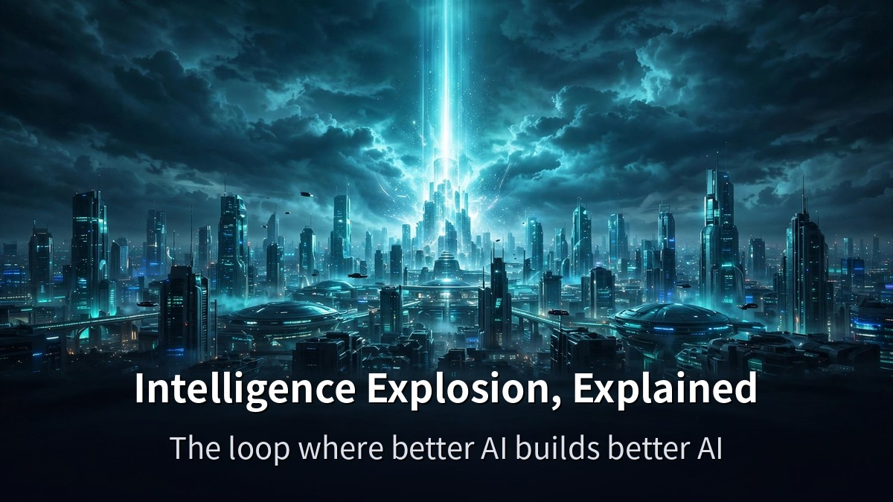
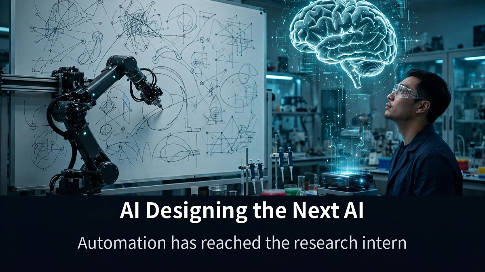
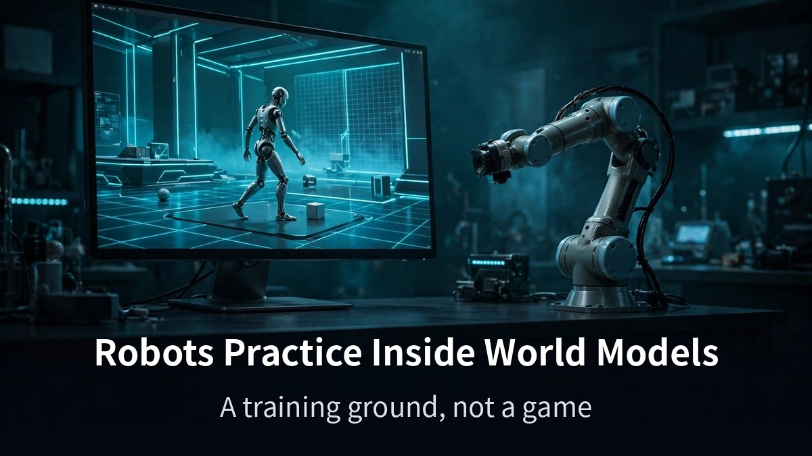

<!-- 본문 시작 -->



A video on AI in 2027 throws three terms at you at once.
Intelligence explosion, recursive self-improvement, and world model.
As of November 2026, the three point at the same news, but they mean different things and stand at different stages.

```blog
type: text
runs:
  - text: "An intelligence explosion is the process where AI building better AI crosses a tipping point, recursive self-improvement is the engine that drives that loop, and a world model is how learned understanding of the world becomes real action. Of the three, the first two are still forecasts, and only the world model is already a product."
    style: {bold: true, color: "#007aa6"}
```

Why the AI 2027 forecast was moved forward at all starts with the METR report and the internal-model story in [OpenAI's Internal Models｜Why They Are Too Powerful to Release](https://aitechnotesen.wordpress.com/2026/11/26/openais-internal-models%ef%bd%9cwhy-they-are-too-powerful-to-release/). Today's post untangles the three terms that forecast keeps using.

```blog
type: heading
level: 2
runs:
  - text: "Intelligence explosion: what is supposed to happen?"
    style: {bold: true, color: "#007aa6"}
```


An intelligence explosion is not one event but a loop that speeds up.
Each round builds a better AI, and the next round builds faster still.

```blog
type: text
runs:
  - text: "Intelligence explosion — "
    style: {bold: true, color: "#ff008c"}
  - text: "a chain reaction in which an ultraintelligent machine designs even better machines. British mathematician I.J. Good first proposed it in 1965, with the famous line that the first ultraintelligent machine may be the last invention humans ever need to make."
```

The point is speed.
If each round improves by a larger margin, intelligence passes a point and takes off. That is the picture the term paints.

It is back in the news because of the AI 2027 forecast update on November 10, 2026.
Every author on the team now expects a superhuman AI researcher to arrive at some point in 2027.
Lead author Daniel Kokotajlo put his own median at May 2027, about 19 months earlier than his August forecast.
The same update expects 2027 to pack in roughly five years' worth of normal AI progress.

But this is a forecast, not a fact.
The "five years" figure is the median of model scenarios the AI 2027 team ran after feeding in METR's acceleration numbers.
If the pace held flat at today's level, 2027 would contain about two years of progress, and the same team pushed its timeline back to 2029–2032 in February this year, saying progress was slower than expected, then moved it forward again in November.
The authors themselves call the analysis highly preliminary.

Use it when reading the news.
When "intelligence explosion in 2027" appears, first check whether it is presented as a settled schedule or as one forecasting team's latest judgment.

The confusing neighbor is the singularity.
An intelligence explosion is the process; the singularity is the point after it where prediction breaks down.
Vernor Vinge popularized the term singularity in a 1993 essay, and Ray Kurzweil put the singularity at 2045 in his 2005 book.
Both are dates attached to a flow, not facts.

```blog
type: text
runs:
  - text: "'Intelligence explosion in 2027' is not a fixed schedule."
    style: {bold: true, background: "#FFF3CD"}
  - text: " It is the AI 2027 team's forecast, and the same team pushed its timeline back to 2029–2032 in February this year. Read it with that caveat attached."
```

```blog
type: heading
level: 2
runs:
  - text: "Recursive self-improvement: how far has it come?"
    style: {bold: true, color: "#007aa6"}
```



What is confirmed so far is partial.

```blog
type: text
runs:
  - text: "Recursive self-improvement — "
    style: {bold: true, color: "#ff008c"}
  - text: "a feedback loop in which AI automates AI research and development to build a better successor system, which then builds the next generation even faster. If an intelligence explosion happens, this loop is its engine."
```

On September 6, 2026, OpenAI said in an official post that it had reached its goal of an automated research intern.
By mid-August 2026, its research organization was using 3.1 agent-workdays of AI effort for every day of human work, and the median researcher was spending over $600 a day on inference.
The same post notes that more than half of the successful 4-to-8-hour tasks needed at least one human intervention.

Anthropic's numbers need the same care.
As of May 2026, over 80% of the code merged into its codebase was written by Claude, and as of August 2026, about 30,000 AI agents were doing research and engineering work at any time.
The share of R&D that Claude leads rose from 1% in March 2026 to 26% in September 2026.
The "90%" figure often quoted next to these is a different number: it covers the Claude Code team's own code, not the whole company, so the two should not be mixed.
Fully autonomous work measured 0% in the measured range, and Anthropic itself says recursive self-improvement has not arrived yet.

The METR report came out on November 5, 2026.
The independent evaluation group, after 11 weeks inside Anthropic, estimated that model capability is improving about twice as fast as before, and that perhaps 80% of that speedup is due to AI itself.
But METR also said it would not be surprised if the real speedup were closer to 1.3x or 3x, and that most of the most useful evidence was redacted by Anthropic.

Use it when the phrase "AI improving itself" appears.
Ask how far it goes: is it writing code, or is it making research judgments too?

The confusing neighbor is the agent.
An agent is a system that acts toward an external goal, while recursive self-improvement is a loop whose target is AI research itself.
An agent doing your work and an agent building the next AI are different layers.

```blog
type: text
runs:
  - text: "METR's '2x and 80%' is an estimate from an independent evaluator, not a confirmed figure."
    style: {bold: true, background: "#FFF3CD"}
  - text: " The uncertainty range runs from 1.3x to 3x, and most of the evidence most useful to the conclusion was redacted. Read it as 'METR estimates,' not 'METR confirmed.'"
```

How an agent differs from recursive self-improvement becomes clearer once you check the definition of an agent in [What Is an AI Agent? | Agentic AI and Computer Use Explained](https://aitechnotesen.wordpress.com/2026/11/22/what-is-an-ai-agent-agentic-ai-and-computer-use-explained/). An agent decides its own next steps, and recursive self-improvement is the loop where that system takes over research itself.

```blog
type: heading
level: 2
runs:
  - text: "World model: how is it different from a game engine?"
    style: {bold: true, color: "#007aa6"}
```



It is different from a video generator.

```blog
type: text
runs:
  - text: "World model — "
    style: {bold: true, color: "#ff008c"}
  - text: "a model that learns how an environment works and predicts or generates the next scene from the current state and an action. David Ha and Jürgen Schmidhuber gave it its modern meaning in a 2018 paper."
```

A video generator hands you a finished clip, while a world model draws the next frame in response to each action you enter.
It is closer to stepping inside a world and moving around than to watching a video.

Products arrived one after another in October and November 2026.
Google announced Genie 4 on October 27, 2026, and opened it to AI Ultra subscribers through Project Genie on November 18.
Press reports put scene consistency at about 2 minutes, double Genie 3's roughly 1 minute.
Runway released GWM Worlds 2 on September 3, 2026, with real-time interaction at 720p and 24 frames per second and no preset session cap, which sets it apart from Genie 4.
World Labs opened Atlas to everyone on November 12, and AMD's roughly $8.2 billion acquisition legally closed on November 13.

On the robot side, 1X's world model stands out.
1XWM, pretrained on video, visualizes future scenes from text conditions, and an inverse dynamics model extracts the action trajectory between those scenes for the robot to execute.
1X says that because it learned world dynamics from internet-scale video, it generalizes to new objects and tasks without large-scale robot data pretraining.
The line "what the model can visualize, NEO usually can do" is the company's claim, so it should be read as a claim, not a fact.

Use it as a practice ground for robots, self-driving, and games.
Waymo has used Genie 3 as a world model for self-driving simulation.
The picture is AI practicing countless times inside a world model before acting in the real world.

There are two confusing neighbors.
First, game engines and physics simulators.
A simulator computes the world from rules people wrote by hand, while a world model draws the next scene from predictions learned from data.
It can produce a plausible scene without explicit rules, but it can also get the physics wrong or drift as time passes.
Second, computer use.
Computer use is a tool where AI looks at a screen and operates a mouse and keyboard, while a world model is a model that predicts the next scene of an environment.
Roughly the difference between a hand and a map.

| Term | One-line definition | Where it stands, November 2026 | Confusing neighbor |
| --- | --- | --- | --- |
| Intelligence explosion | The loop of AI building better AI crosses a tipping point | Forecast stage (AI 2027 update, Nov 10) | Singularity (process vs the point after) |
| Recursive self-improvement | AI automates AI research in a feedback loop | Partially realized (research intern reached, code 80%+, fully autonomous 0%) | Agent (external work vs research itself) |
| World model | Learns how an environment works, predicts the next scene | Products shipping (Genie 4, Atlas, 1XWM) | Game engine (hand-written rules vs learned prediction) |

```blog
type: text
runs:
  - text: "Remember it this way — "
    style: {bold: true, color: "#ff008c"}
  - text: "recursive self-improvement is the engine, the intelligence explosion is what that engine produces, and the world model is the road the engine drives on."
```

Separating the three terms makes the 2027 forecast read a little less frightening.
A forecast is a forecast, and a product is a product.
An intelligence explosion is not an observed fact yet, but a judgment that it could come in 2027 if recursive self-improvement keeps accelerating.
The world model, apart from that judgment, is already becoming something you can touch.
Next time a new term appears, I will start with its definition, as I did here, and check whether it is a forecast or a fact.

## Frequently asked questions

**If an intelligence explosion comes, what happens to my job?**

There is no settled answer yet. The AI 2027 team puts the chance of AI capable of automating essentially all white-collar work before 2028 at 35–65%. But the same team's forecast was pushed back once in February and moved forward again in November, and the METR evidence behind it carries a redaction caveat. Some effects are already visible in numbers: Stanford research finds employment for 22-to-25-year-olds in the most AI-exposed jobs about 19% below where it would otherwise be. Rather than taking the forecast as it is, it is better to ask first whether your own work is a target for automation.

**How is a world model different from a game?**

A game runs on rules people wrote, while a world model draws the next scene from predictions learned from data. A game engine cannot express what its rules do not cover, but a world model can produce a plausible scene without explicit rules. In return it can get physics wrong and drift over time. That is why world models serve as practice grounds for robots and agents, while physics simulators are used separately for precise verification.

**How far has recursive self-improvement come?**

To the research-intern level. OpenAI said in September 2026 that it had reached its automated research intern goal, and Anthropic recorded over 80% of merged code written by Claude and 26% of R&D led by Claude. But fully autonomous research measured 0%, and more than half of successful 4-to-8-hour tasks needed human intervention. "AI improving itself" is best read, for now, as research assistance becoming automated.

## Further reading

[7 New Claude Features｜What Changed in Meetings, Sheets, and Data](https://aitechnotesen.wordpress.com/2026/11/27/7-new-claude-features%ef%bd%9cwhat-changed-in-meetings-sheets-and-data/)

[District 9｜When Humans Caged Aliens, the Tech Picked a Side](https://aitechnotesen.wordpress.com/2026/11/25/district-9%ef%bd%9cwhen-humans-caged-aliens-the-tech-picked-a-side/)

<!-- 본문 끝 -->

## 작업용 출처·이미지 정보 (업로드 제외)

## Sources and notes (not for upload)

**Sources**
- TheAIGRID, "10 Insane AI Things Happening in 2027", 2026-11-27 (transcript captured from the YouTube script panel, 2026-11-28 06:02 KST, 0:00–39:46) — the source of the term bundle
- I.J. Good, "Speculations Concerning the First Ultraintelligent Machine", Advances in Computers Vol. 6, 1965 — definition of intelligence explosion
- AI Futures Project, "Q3.5 Timelines Update: Looks Like the Intelligence Explosion Will Happen in 2027 After All", 2026-11-10 — superhuman AI researcher in 2027, Kokotajlo median May 2027, five years of progress in 2027 (median of model scenarios; about two years if the pace holds flat), TED-AI before 2028 at 35–65%
- OpenAI, "Research acceleration: The view inside OpenAI", 2026-09-06 — automated research intern reached, 3.1 agent-workdays, median $600/day, over half of successful 4–8-hour tasks needed human intervention
- Anthropic Institute, "When AI builds itself", 2026-06-04 (updated 2026-09-29) — code 80%+ (May 2026), about 30,000 agents (Aug 2026), R&D led 26% (Sep 2026), fully autonomous 0%
- METR, "Independent Assessment of AI R&D Acceleration at Anthropic", 2026-11-05 — about 2x speedup (1.3–3x), about 80% due to AI, most useful evidence redacted
- DeepMind, Genie 4 announced 2026-10-27, Project Genie rollout to Ultra 2026-11-18 — about 2 minutes consistency (press reports)
- Runway, GWM Worlds 2 research preview 2026-09-03 — 720p, 24fps, no session cap
- World Labs, Atlas open to all 2026-11-12 — AMD acquisition about $8.2 billion (legally closed Nov 13, announced Nov 16)
- 1X, "1X World Model | From Video to Action" — 1XWM 14B backbone, 900 hours of first-person video + 70 hours of robot data, IDM trained on 400 hours of robot data, announced early 2026 (exact date unconfirmed)
- Fact-check date: November 28, 2026

**Notes**
- Three lines: ① Readers — general readers confused by intelligence explosion, recursive self-improvement, and world model pouring out of 2027 AI forecast news ② Question — what does each term mean, how far has it come, and how does it differ from the term it is confused with ③ Added value — direct cross-check of official sources (AI 2027, METR, OpenAI, Anthropic), separating forecasts from facts, including the METR redaction caveat, the separation of Anthropic's 90% figure, and the Genie launch-date correction, plus the link between the three terms
- Recommendation links: 7 New Claude Features (latest AI News post) + District 9 (latest AI Movies and Videos post)
- Duplication check: no overlap with 2026-11-22 term briefing 1 (AI agent, agentic AI, computer use) or 2026-11-25 self-driving terms (FSD, robotaxi, levels). Agent vs RSI and computer use vs world model are distinguished in one line each in the body.
- Video summary share: not applicable (term-briefing format; the video is only the starting point for term selection, the body is based on official sources)
- Forecast vs fact: "intelligence explosion in 2027", "five years of progress", METR "2x and 80%", Genie 4 "2 minutes" are all forecasts, estimates, or press-based — flagged with conditions in the body. The "September 1 first reveal" report for Atlas was dropped due to a conflict; only the November 12 full opening is used. AMD–World Labs is written as an "acquisition".
- Quotes: none (definitions rewritten in our own words)
- 이미지 검수: 4장 전부 통과 (기계 검사 1200×675·JPEG·무결성 + 눈 검사 — 헤드라인 약속·한 장 한 주제·자름·겹침 없음·배너 가독성·실사 규칙·숫자 없음, FAIL 0회)
