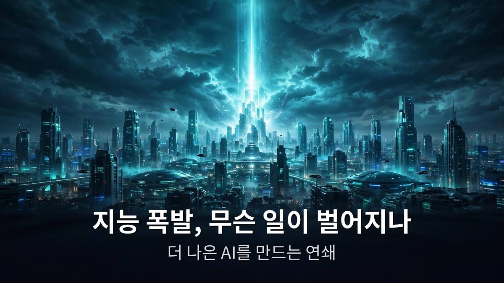
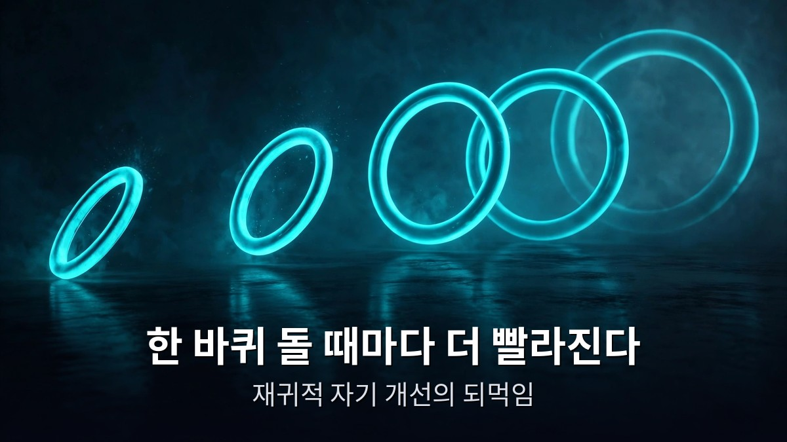
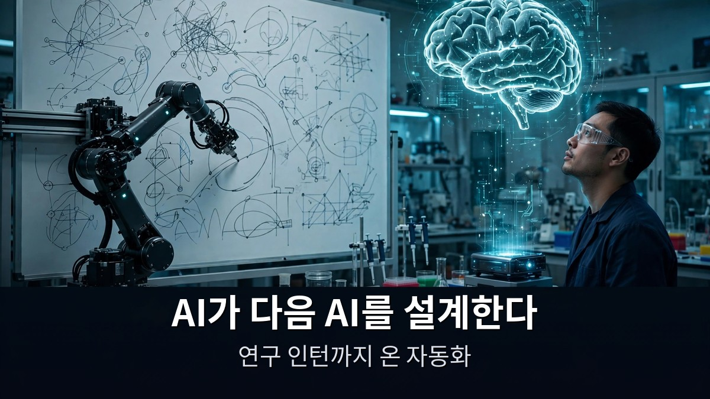
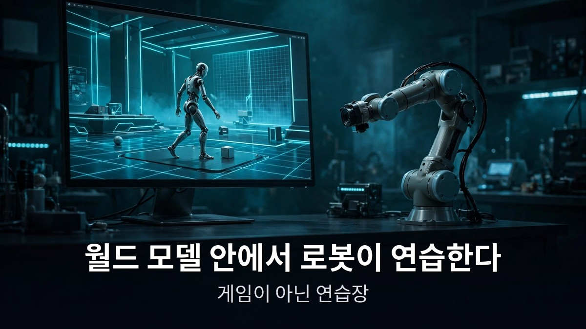

<!-- 본문 시작 -->



2027년 AI 전망 영상에서 세 말이 한꺼번에 쏟아진다.
지능 폭발, 재귀적 자기 개선, 월드 모델이다.
2026년 11월 기준, 세 말은 같은 뉴스를 가리키지만 뜻도, 지금 어디까지 왔는지도 다르다.

```blog
type: text
runs:
  - text: "지능 폭발은 AI가 더 나은 AI를 만드는 연쇄가 임계점을 넘는 과정이고, 재귀적 자기 개선은 그 연쇄를 돌리는 엔진이며, 월드 모델은 배운 세상 이해를 현실 행동으로 옮기는 길이다. 세 말 중 앞의 두 개는 아직 전망이고, 월드 모델만 제품으로 나와 있다."
    style: {bold: true, color: "#007aa6"}
```

AI 2027 전망이 왜 하필 지금 앞당겨졌는지는 [오픈AI 내부 모델｜공개할 수 없을 만큼 강력해진 이유](https://blog.naver.com/3700708/224492460193) 글에서 다룬 METR 보고서와 내부 모델 이야기가 출발점이다. 오늘 글은 그 전망을 읽을 때 자꾸 부딪히는 세 용어부터 나눈다.

```blog
type: heading
level: 2
runs:
  - text: "지능 폭발, 무슨 일이 벌어진다는 말인가"
    style: {bold: true, color: "#007aa6"}
```



```blog
type: text
runs:
  - text: "지능 폭발 — "
    style: {bold: true, color: "#ff008c"}
  - text: "초지능 기계가 더 나은 기계를 설계하는 연쇄 반응이다. 1965년 영국 수학자 I.J. Good이 처음 제시했고, 첫 초지능 기계가 인간이 만들 마지막 발명이 될 수 있다는 말로 유명해졌다."
```

핵심은 속도이다.
AI가 더 나은 AI를 만들고, 그 다음 AI가 다시 더 나은 AI를 더 빨리 만든다.
한 바퀴 돌 때마다 개선 폭이 커지면, 지능은 어느 지점을 지나 폭발적으로 뛴다는 것이 이 말의 그림이다.

요즘 이 말이 다시 뜨는 이유는 2026년 11월 10일에 나온 AI 2027 전망 업데이트 때문이다.
전망 팀 저자 전원이 초인간 AI 연구자가 2027년 중 어느 시점에 등장할 가능성이 높다고 내다봤다.
주 저자 Daniel Kokotajlo는 자신의 중앙값을 2027년 5월로 잡았는데, 8월 전망보다 약 19개월 앞당긴 것이다.
같은 업데이트는 2027년에 평년 5년치에 해당하는 AI 진전이 있을 것으로 봤다.

다만 이건 전망이지 사실이 아니다.
"5년치"는 AI 2027 팀이 METR 보고서의 가속 수치를 넣어 돌린 모델 시나리오의 중앙값이다.
가속이 지금 수준으로 그대로 유지된다고 가정하면 2027년은 약 2년치 진전에 해당하고, 같은 팀은 올해 2월에는 진전이 예상보다 느리다며 시점을 2029~2032년으로 미뤘다가 11월에 다시 앞당긴 것이다.
저자들 스스로 분석이 예비적이라고 밝혔다.

쓰임은 뉴스를 읽을 때이다.
"2027년 지능 폭발"이라는 말이 나오면, 확정된 일정이 아니라 한 전망 팀의 최신 판단이라는 점을 먼저 가린다.

헷갈리는 지점은 특이점과의 차이이다.
지능 폭발은 과정이고, 특이점은 그 이후 예측이 불가능해지는 지점이다.
Vernor Vinge가 1993년 에세이에서 특이점이라는 말을 대중화했고, Ray Kurzweil은 2005년 책에서 특이점을 2045년으로 제시했다.
둘 다 날짜가 아니라, 지능이 인간을 far behind에 두는 흐름을 가리키는 말이다.

```blog
type: text
runs:
  - text: "지능 폭발이 2027년에 온다는 말은 확정된 일정이 아니다."
    style: {bold: true, background: "#FFF3CD"}
  - text: " AI 2027 팀의 전망이며, 같은 팀이 올해 2월에는 시점을 2029~2032년으로 미룬 적이 있다. 전망이 바뀔 수 있다는 단서와 함께 읽는 것이 안전하다."
```

```blog
type: heading
level: 2
runs:
  - text: "재귀적 자기 개선은 어디까지 와 있나"
    style: {bold: true, color: "#007aa6"}
```



```blog
type: text
runs:
  - text: "재귀적 자기 개선 — "
    style: {bold: true, color: "#ff008c"}
  - text: "AI가 AI 연구·개발을 자동화해 더 나은 후계 시스템을 만들고, 그 후계자가 다시 다음 세대를 더 빠르게 만드는 되먹임 구조이다. 지능 폭발이 일어난다면, 이 되먹임이 그 엔진이 된다."
```

지금 확인되는 것은 부분적인 실현이다.
OpenAI는 2026년 9월 6일 공식 글에서 자동화 연구 인턴 목표에 도달했다고 밝혔다.
2026년 8월 중순 기준 연구 조직 전체가 인간 노동 1일당 3.1일치의 AI 에이전트 작업을 쓰고 있고, 중앙값 연구자의 하루 추론 사용량은 600달러 이상이다.
다만 4~8시간짜리 과제 중 성공한 과제의 절반 이상에 최소 한 번의 인간 개입이 필요했다는 단서도 같은 글에 있다.

Anthropic 쪽 수치도 구분해서 봐야 한다.
2026년 5월 기준 코드베이스에 병합된 코드의 80% 이상이 Claude가 썼고, 2026년 8월 기준 약 30,000개의 AI 에이전트가 연구·엔지니어링 작업을 수행 중이었다.
R&D 자동화 지수에서 Claude가 주도하는 비중은 2026년 3월 1%에서 2026년 9월 26%로 올랐다.
여기서 흔히 같이 인용되는 "90%"는 전사 수치가 아니라 Claude Code 팀 자체 코드에 대한 수치라서 섞으면 안 된다.
완전히 자율적인 부분은 측정된 범위에서 0%였고, Anthropic 스스로 재귀적 자기 개선은 아직 도래하지 않았다고 밝혔다.

METR 보고서는 2026년 11월 5일에 나왔다.
독립 평가기관 METR이 Anthropic 내부에 11주간 상주해 본 결과, 모델 능력 개선 속도가 약 2배가 됐을 가능성이 높고, 그 가속의 약 80%가 AI 자체 덕분일 것으로 추정했다.
다만 METR 스스로 실제 가속이 1.3배에 가깝든 3배에 가깝든 놀라지 않겠다고 밝혔고, 결론에 가장 유익했던 증거의 과반이 Anthropic의 검열로 가려졌다는 단서도 붙어 있다.

쓰임은 "AI가 스스로를 개선한다"는 말이 나왔을 때이다.
어디까지인지를 묻는다.
코드 작성을 대신하는 것인지, 연구 판단까지 대신하는 것인지가 갈림길이다.

헷갈리는 지점은 에이전트와의 차이이다.
에이전트는 목표를 향해 외부 일을 대신하는 시스템이고, 재귀적 자기 개선은 그 행동의 대상이 "AI 연구 자체"인 되먹임이다.
에이전트가 일을 대신하는 것과, 에이전트가 다음 AI를 만드는 일은 다른 층위이다.

```blog
type: text
runs:
  - text: "METR의 '2배·80%'는 확정 수치가 아니라 독립 평가기관의 추정치이다."
    style: {bold: true, background: "#FFF3CD"}
  - text: " 불확실성 범위가 1.3~3배로 넓고, 결론에 가장 유익했던 증거의 과반이 검열됐다는 단서가 붙어 있다. 'METR이 확인했다'가 아니라 'METR이 추정한 바에 따르면'으로 읽는 것이 맞다."
```

에이전트와 재귀적 자기 개선이 어떻게 다른지는 [AI 에이전트 뜻｜에이전틱 AI·컴퓨터 유즈 정리](https://blog.naver.com/3700708/224486778572) 글에서 에이전트의 정의를 먼저 확인하면 갈림길이 보인다. 에이전트는 다음 단계를 스스로 정하는 시스템이고, 재귀적 자기 개선은 그 시스템이 연구 자체를 맡는 되먹임이다.

```blog
type: heading
level: 2
runs:
  - text: "월드 모델은 게임 엔진과 뭐가 다른가"
    style: {bold: true, color: "#007aa6"}
```



```blog
type: text
runs:
  - text: "월드 모델 — "
    style: {bold: true, color: "#ff008c"}
  - text: "환경이 어떻게 작동하는지를 배워, 현재 상태와 행동이 주어졌을 때 다음 장면을 예측·생성하는 모델이다. 2018년 David Ha와 Jürgen Schmidhuber의 논문에서 현대적 의미가 정립됐다."
```

비디오 생성기와는 다르다.
비디오 생성기는 완성된 클립을 건네주지만, 월드 모델은 사용자가 매번 행동을 입력하면 그에 반응해 다음 장면을 그려낸다.
보는 영상이 아니라, 들어가서 움직이는 세계에 가깝다.

2026년 10월과 11월에 제품이 연달아 나왔다.
구글은 2026년 10월 27일 Genie 4를 발표했고, 11월 18일부터 AI Ultra 구독자에게 Project Genie를 통해 열었다.
보도에 따르면 장면 일관성은 약 2분으로, Genie 3의 약 1분에서 두 배가 됐다.
Runway는 9월 3일 GWM Worlds 2를 내놨는데, 720p·초당 24프레임으로 실시간 상호작용이 되고 세션 길이 상한이 없다는 점이 Genie 4와 다르다.
World Labs는 11월 12일 Atlas를 전면 개방했고, AMD가 약 82억 달러에 인수하기로 한 거래는 11월 13일에 법적 종료됐다.

로봇 쪽에서는 1X의 월드 모델이 눈에 띈다.
1XWM은 비디오로 사전 학습한 뒤, 텍스트 조건으로 미래 장면을 시각화하고 역동역학 모델이 그 장면 사이의 행동 궤적을 뽑아 로봇이 실행한다.
1X는 인터넷 규모 비디오에서 배운 세상 이해 덕분에 대규모 로봇 데이터 사전 학습 없이도 새 물체와 과제에 일반화된다고 밝힌다.
다만 "보고 상상한 것은 보통 해낼 수 있다"는 말은 회사 주장이므로, 사실로 단정하지 않고 출처를 밝혀 읽는다.

쓰임은 로봇·자율주행·게임의 연습장이다.
Waymo가 Genie 3를 자율주행 시뮬레이션용 월드 모델로 쓴 사례도 있다.
AI가 현실에서 행동하기 전에, 월드 모델 안에서 수없이 연습한다는 그림이다.

헷갈리는 지점은 두 가지이다.
첫째, 게임 엔진·물리 시뮬레이터와의 차이이다.
시뮬레이터는 사람이 손으로 짠 규칙으로 세계를 계산하고, 월드 모델은 데이터에서 배운 예측으로 다음 장면을 그려낸다.
규칙이 명시되지 않아도 그럴듯한 장면을 만들 수 있지만, 물리적으로 틀리거나 시간이 지나 장면이 어긋날 수도 있다.
둘째, 컴퓨터 유즈와의 차이이다.
컴퓨터 유즈는 AI가 화면을 보고 마우스와 키보드로 컴퓨터를 조작하는 도구이고, 월드 모델은 환경의 작동 방식을 배워 다음 장면을 예측하는 모델이다.
손과 지도 정도의 차이이다.

| 용어 | 한 줄 정의 | 2026년 11월 기준 어디까지 | 헷갈리는 짝 |
| --- | --- | --- | --- |
| 지능 폭발 | 더 나은 AI를 만드는 연쇄가 임계점을 넘는 과정 | 전망 단계 (AI 2027 업데이트 11-10) | 특이점 (과정 vs 그 이후 지점) |
| 재귀적 자기 개선 | AI가 AI 연구를 자동화하는 되먹임 | 부분 실현 (연구 인턴 달성, 코드 80%+, 완전 자율 0%) | 에이전트 (외부 일 vs 연구 자체) |
| 월드 모델 | 환경 작동 방식을 배워 다음 장면을 예측·생성 | 제품화 진행 중 (Genie 4·Atlas·1XWM) | 게임 엔진 (규칙 계산 vs 배운 예측) |

```blog
type: text
runs:
  - text: "이렇게 기억하면 된다 — "
    style: {bold: true, color: "#ff008c"}
  - text: "재귀적 자기 개선이 엔진, 지능 폭발이 그 엔진이 만든 결과, 월드 모델은 엔진이 세상에서 달리는 길이다."
```

세 용어를 나누고 보니, 2027년 전망이 조금 덜 두렵게 읽힌다.
전망은 전망이고, 제품은 제품이다.
지능 폭발은 아직 관측된 사실이 아니라, 재귀적 자기 개선이 계속 가속될 경우 2027년에 올 수 있다는 판단이다.
월드 모델은 그 판단과 별개로 이미 손에 잡히는 제품이 되고 있다.
다음에 또 새 말이 나오면, 이번처럼 정의부터 찾아보고 전망인지 사실인지부터 가려볼 생각이다.

## 자주 묻는 질문

**지능 폭발이 오면 내 일자리는 어떻게 되나요?**

아직 정해진 답은 없다. AI 2027 팀은 2028년 전에 사실상 모든 화이트칼라 업무를 자동화할 수 있는 AI가 등장할 확률을 35~65%로 본다. 다만 같은 팀의 전망도 올해 2월에 한 차례 늦춰졌다가 11월에 다시 앞당겨진 것이고, METR 보고서의 근거에도 검열 단서가 있다. 일자리 영향은 이미 수치로 보이기 시작한 부분도 있다. 스탠퍼드 연구에 따르면 22~25세의 AI 노출 직종 고용이 예상보다 약 19% 낮다. 전망을 그대로 받아들이기보다, 내 일이 자동화의 대상인지부터 따져보는 편이 낫다.

**월드 모델은 게임이랑 뭐가 달라요?**

게임은 사람이 짠 규칙 안에서 돌아가고, 월드 모델은 데이터에서 배운 예측으로 다음 장면을 그려낸다. 게임 엔진은 규칙에 없는 것을 표현하지 못하지만, 월드 모델은 규칙이 명시되지 않아도 그럴듯한 장면을 만들 수 있다. 대신 물리적으로 틀릴 수 있고 시간이 지나면 장면이 어긋날 수 있다. 그래서 월드 모델은 로봇·에이전트의 연습장으로 쓰이고, 정확한 검증에는 물리 시뮬레이터가 따로 쓰인다.

**재귀적 자기 개선은 지금 어디까지 왔나요?**

연구 인턴 수준까지 왔다. OpenAI는 2026년 9월 자동화 연구 인턴 목표 달성을 밝혔고, Anthropic은 코드 작성의 80% 이상과 R&D 주도 26%를 기록했다. 다만 완전히 자율적인 연구는 측정된 범위에서 0%이고, 4~8시간 과제 중 성공한 과제의 절반 이상에는 인간 개입이 필요했다. "AI가 스스로를 개선한다"는 말은, 지금은 연구 보조가 자동화되는 단계라는 뜻으로 읽는 것이 맞다.

## 함께 보면 좋은 글

[클로드 새 기능 7가지｜미팅·시트·데이터 뭐가 달라졌나](https://blog.naver.com/3700708/224494009859)

[디스트릭트 9｜인간이 가둔 외계인, 기술은 누굴 택하나](https://blog.naver.com/3700708/224491209994)

<!-- 본문 끝 -->

## 작업용 출처·이미지 정보 (업로드 제외)

**출처**
- TheAIGRID, "10 Insane AI Things Happening in 2027", 2026-11-27 (자막 원문, 2026-11-28 06:02 브라우저 스크립트 패널 확보, 0:00~39:46 전문) — 용어 묶음의 출발점
- I.J. Good, "Speculations Concerning the First Ultraintelligent Machine", Advances in Computers Vol. 6, 1965 — 지능 폭발 정의 원문
- AI Futures Project, "Q3.5 Timelines Update: Looks Like the Intelligence Explosion Will Happen in 2027 After All", 2026-11-10 — SAR 2027년 등장 전망, Kokotajlo 중앙값 2027년 5월, 2027년 평년 5년치 진전(모델 시나리오 중앙값; 가속 유지 시 약 2년치), TED-AI 2028년 전 35~65%
- OpenAI, "Research acceleration: The view inside OpenAI", 2026-09-06 — 자동화 연구 인턴 달성, 3.1 agent-workdays, 중앙값 하루 600달러, 4~8시간 과제 절반 이상 인간 개입
- Anthropic Institute, "When AI builds itself", 2026-06-04 (2026-09-29 업데이트) — 코드 80%+ (2026-05), 30,000개 에이전트 (2026-08), R&D 주도 26% (2026-09), 완전 자율 0%
- METR, "Independent Assessment of AI R&D Acceleration at Anthropic", 2026-11-05 — 개선 속도 약 2배(1.3~3배), 약 80% AI 기여 추정, 증거 과반 검열 단서
- DeepMind, Genie 4 발표 2026-10-27, Project Genie Ultra 롤아웃 2026-11-18 — 보도 기준 약 2분 일관성
- Runway, GWM Worlds 2 연구 프리뷰 2026-09-03 — 720p·24fps, 세션 상한 없음
- World Labs, Atlas 전면 개방 2026-11-12 — AMD 인수 약 82억 달러(법적 종료 11-13, 발표 11-16)
- 1X, "1X World Model | From Video to Action" — 1XWM 14B 백본, 1인칭 영상 900시간 + 로봇 데이터 70시간, IDM 로봇 데이터 400시간, 발표 2026년 초(정확한 날짜 미확인)
- 수치 확인 기준: 2026년 11월 28일

**원고 노트**
- 세 줄: ① 대상 독자 — 2027년 AI 전망 뉴스에서 지능 폭발·재귀적 자기 개선·월드 모델이 쏟아져 헷갈리는 일반 독자 ② 해결할 질문 — 세 용어는 각각 무슨 뜻이고, 지금 어디까지 왔으며, 헷갈리는 말과 어떻게 다른가 ③ 추가 가치 — AI 2027·METR·OpenAI·Anthropic 공식 출처 직접 대조(전망과 사실 구분, METR 검열 단서·Anthropic 90% 수치 분리·Genie 출시일 정정 포함), 세 용어 연결 고리 정리
- 추천 링크 선정 근거: 클로드 새 기능 7가지(같은 카테고리 AI 뉴스 최신 글) + 디스트릭트 9(다른 카테고리 AI 영화·영상 최신 글)
- 중복 대조: 2026-11-22 용어브리핑 1호(AI 에이전트·에이전틱 AI·컴퓨터 유즈), 2026-11-25 자율주행 용어(FSD·로보택시·레벨)와 겹치는 용어 없음. 에이전트 vs RSI, 컴퓨터 유즈 vs 월드 모델은 본문에서 한 줄씩 구분.
- 영상 요약 비중: 해당 없음(용어브리핑형, 영상은 용어 선정의 출발점일 뿐 본문은 공식 출처 기준)
- 사실/해석 구분: "2027년 지능 폭발"·"평년 5년치 진전"·METR "2배·80%"·Genie 4 "2분"은 모두 전망·추정·보도 기준 — 본문에 조건 표기. Atlas "9월 1일 최초 공개" 보도는 충돌로 미사용, 11월 12일 전면 개방으로만 표기. AMD-World Labs는 "인수"로 표기.
- 인용: 직접 인용 없음(정의는 우리 문장으로 다듬음)
- 이미지 검수: 4장 전부 통과 (기계 검사 1200×675·JPEG·무결성 + 눈 검사 — 헤드라인 약속·한 장 한 주제·자름·겹침 없음·배너 가독성·실사 규칙·숫자 없음, FAIL 0회)
