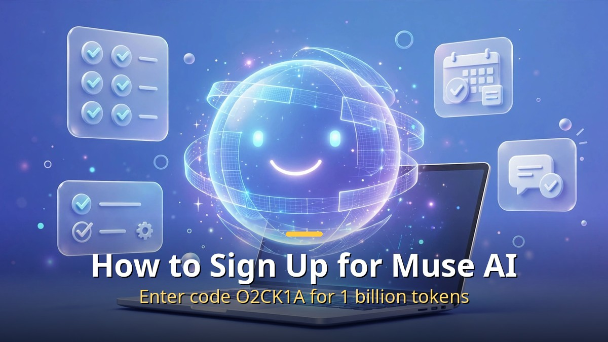
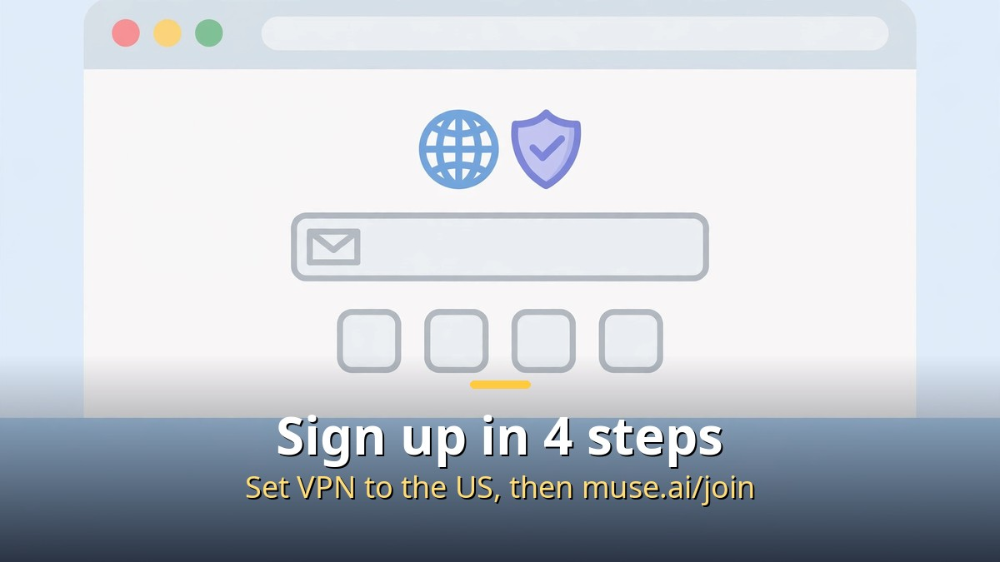
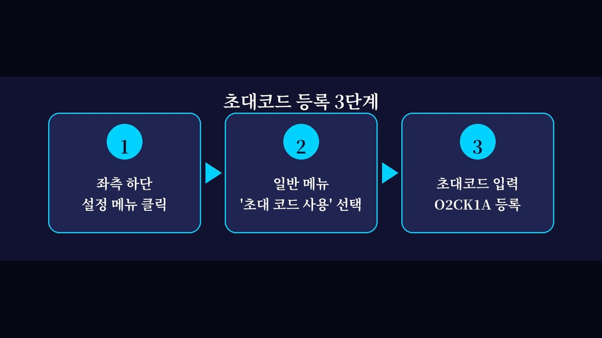

<!-- 본문 시작 -->

Looking for how to sign up for Muse AI? ChatGPT only answers questions, but Muse AI is an AI assistant that does the work for you. Built by Meta, it is a personal AI agent: give it a goal and it operates the browser itself, handling research and repetitive work.

Today, here is a step-by-step guide, from signing up for Muse AI to entering invite code O2CK1A to receive 1 billion tokens.

## 1. What is Muse AI?

Muse AI is a personal AI agent from Meta. The biggest difference from existing AI chatbots is execution.

- A regular chatbot: you ask a question, it answers in text.
- Muse AI: you set a goal, and it performs the work itself in the background.

It can check email, organize schedules, research the web, and handle repetitive work, which is why it is described as a second assistant.

## 2. Check before signing up (VPN required)

Muse AI currently accepts official sign-ups only in the US, Canada, and Mexico. A Korean IP is blocked from the sign-up screen, so you need a VPN set to a US IP to sign up.

- A free VPN (such as ProtonVPN or Windscribe) also works for signing up.
- Once sign-up is complete, you can turn the VPN off and use the service normally.

## 3. How to sign up for Muse AI (step by step)

Step 1. Turn on your VPN and set the server location to the United States.

Step 2. Go to the official sign-up address.
[https://muse.ai/join](https://muse.ai/join)

Step 3. Enter your email (Gmail recommended) or phone number, then enter the verification code.

Step 4. Done! After that, muse.ai works without a VPN.

Note: if you see "not available in your region," the sign-up did not go through — check your VPN status again.

## 4. Enter invite code O2CK1A and get 1 billion tokens

Signing up alone only gives you the basic token allowance. Enter the invite code and you can receive 1 billion (1 Billion) tokens free, so do not miss it.

Step 1. Open Muse AI and click the settings menu at the bottom left of the screen.

Step 2. In the General menu, select "Use invite code."

Step 3. Enter the code below exactly in the invite code field and press Register.

Invite code: O2CK1A

When it is registered correctly, a "1 Billion Tokens" credit pop-up appears. You can check right away on the dashboard that your token balance has increased.

Note: the benefit is said to apply only if you enter the code within 48 hours of signing up, so enter it as soon as you sign up. Promotion terms may change.

## 5. How to check your own invite code

Click the invite button at the top right of the main screen to see your own invite code. If a friend signs up with your code, you both receive token benefits, so share it with people you know.

## 6. FAQ

Q. Can I sign up without a VPN?
A. Korea is not an officially supported region yet, so a VPN is needed only at sign-up time.

Q. Do I have to enter the invite code?
A. It is not required, but entering it gives you 1 billion tokens free, so there is no reason not to.

Q. Where are the tokens used?
A. They are used when the AI agent performs work such as research, web browsing, and writing documents.

Q. Can I sign up from the mobile app?
A. Signing up on the PC web (muse.ai/join) is the simplest. The app may require a US store account.

In short: sign up for Muse AI at [https://muse.ai/join](https://muse.ai/join) (after setting your VPN to the US), and enter invite code O2CK1A. Get 1 billion tokens and start with your AI assistant.

<!-- 본문 끝 -->

## 작업용 출처·이미지 정보 (업로드 제외)

- Source: 로컬 초안 ~/workspace/naver-blog/muse-ai-signup.md 기준 복원 (윤문 없음, 목차·스타일 가이드 제외, 이미지 마커 전환, muse.ai/join 주소는 본문 지침이라 링크 유지)
- Images: images/01-hero-en.jpg ~ 03-img2-en.jpg / existing base illustration + English banner overlay (1200x675) / license: original
