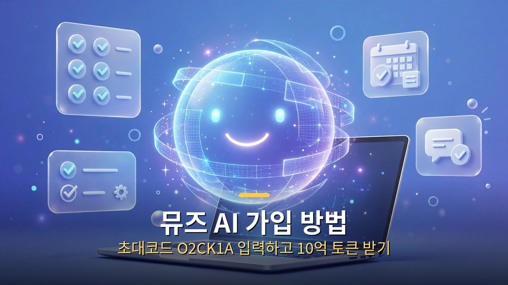
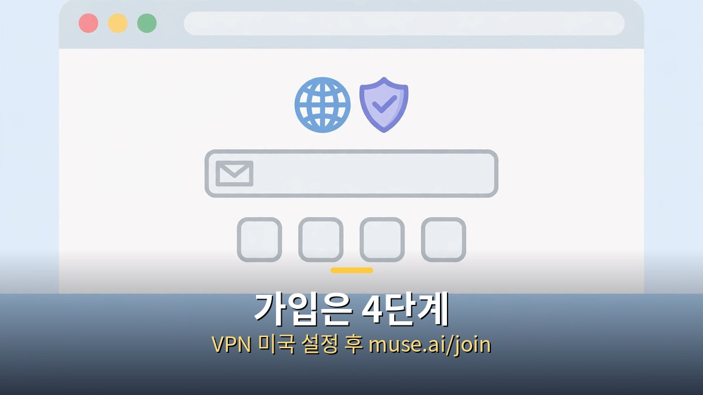
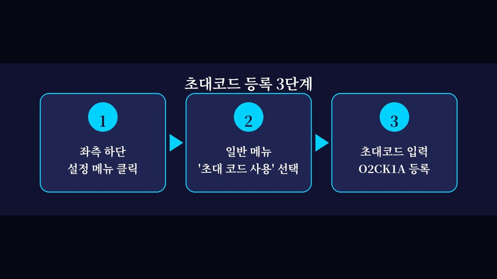

<!-- 본문 시작 -->

뮤즈 AI 가입 방법을 찾고 계신가요? 챗GPT는 질문에 답만 해주는데, 뮤즈 AI(Muse AI)는 일을 대신 해주는 AI 비서입니다. 메타(Meta)에서 만든 개인용 AI 에이전트로, 목표만 정해주면 브라우저를 직접 조작하며 자료 조사와 반복 업무를 처리해줍니다.

오늘은 뮤즈 AI 가입 방법부터 초대코드 O2CK1A를 입력하고 10억 토큰을 받는 법까지 단계별로 정리했습니다.

## 1. 뮤즈 AI란?

뮤즈 AI(Muse AI)는 메타에서 선보인 개인용 AI 에이전트입니다. 기존 AI 챗봇과의 가장 큰 차이는 실행력입니다.

- 일반 챗봇: 질문하면 텍스트로 답변
- 뮤즈 AI: 목표를 정해주면 백그라운드에서 직접 작업 수행

메일 확인, 일정 정리, 웹 자료 조사, 반복 업무까지 맡길 수 있어 두 번째 비서라는 평가를 받고 있습니다.

## 2. 가입 전 꼭 확인하세요 (VPN 필요)

현재 뮤즈 AI는 미국, 캐나다, 멕시코에서만 정식 가입이 가능합니다. 한국 IP에서는 가입 화면이 막혀 있어 VPN으로 미국 IP를 잡고 가입해야 합니다.

- 무료 VPN(ProtonVPN, Windscribe 등)으로도 가입 가능
- 가입이 끝난 뒤에는 VPN을 꺼도 정상 이용 가능

## 3. 뮤즈 AI 가입 방법 (단계별)

1단계. VPN을 켜고 서버 위치를 미국으로 설정합니다.

2단계. 공식 가입 주소에 접속합니다.
[https://muse.ai/join](https://muse.ai/join)

3단계. 이메일(지메일 권장) 또는 휴대폰 번호를 입력하고 인증코드를 입력합니다.

4단계. 가입 완료! 이후에는 VPN 없이도 muse.ai에 접속됩니다.

참고: '해당 지역에서는 사용할 수 없습니다'라는 문구가 나오면 가입이 정상 처리되지 않은 것이니 VPN 상태를 다시 확인하세요.

## 4. 초대코드 O2CK1A 등록하고 10억 토큰 받기

가입만 완료하면 기본 토큰만 지급됩니다. 초대코드를 입력하면 10억 개(1 Billion)의 토큰을 무료로 추가로 받을 수 있으니 절대 놓치지 마세요.

1단계. 뮤즈 AI에 접속해 화면 좌측 하단의 설정 메뉴를 클릭합니다.

2단계. 일반 메뉴에서 '초대 코드 사용'을 선택합니다.

3단계. 초대코드 입력란에 아래 코드를 정확히 입력하고 등록 버튼을 누릅니다.

초대코드: O2CK1A

정상 등록되면 '1 Billion Tokens' 적립 팝업이 표시됩니다. 대시보드에서 토큰 잔액이 늘어난 것을 바로 확인할 수 있습니다.

주의: 가입 후 48시간 이내에 입력해야 혜택이 적용된다고 알려져 있으니, 가입하자마자 바로 입력하는 것을 추천합니다. 프로모션 정책은 변경될 수 있습니다.

## 5. 내 초대코드 확인하는 방법

메인 화면 우측 상단의 초대 버튼을 클릭하면 내 초대코드를 확인할 수 있습니다. 친구가 내 코드로 가입하면 서로 토큰 혜택을 받으니 지인에게 공유해보세요.

## 6. 자주 묻는 질문

Q. VPN 없이 가입할 수 있나요?
A. 현재 한국은 정식 지원 지역이 아니라 가입 시점에만 VPN이 필요합니다.

Q. 초대코드는 꼭 입력해야 하나요?
A. 필수는 아니지만 입력하면 10억 토큰을 무료로 받으니 안 할 이유가 없습니다.

Q. 받은 토큰은 어디에 쓰나요?
A. 자료 조사, 웹 탐색, 문서 작성 등 AI 에이전트 작업 수행 시 사용됩니다.

Q. 모바일 앱으로도 가입할 수 있나요?
A. PC 웹(muse.ai/join) 가입이 가장 간단합니다. 앱은 미국 스토어 계정이 필요할 수 있습니다.

정리: 뮤즈 AI 가입은 [https://muse.ai/join](https://muse.ai/join) (VPN 미국 설정 후)에서, 초대코드는 O2CK1A를 입력하세요. 10억 토큰 받고 AI 비서를 시작해보세요.

<!-- 본문 끝 -->

## 작업용 출처·이미지 정보 (업로드 제외)

- 자료 출처: 로컬 초안 ~/workspace/naver-blog/muse-ai-signup.md 기준 복원 (윤문 없음, 목차·스타일 가이드 제외, 이미지 마커 전환, muse.ai/join 주소는 본문 지침이라 링크 유지)
- 이미지: images/01-hero.jpg ~ 03-img2.jpg / 기존 베이스 일러스트 + 배너 가공 (1200x675) / 사용권: 자작
