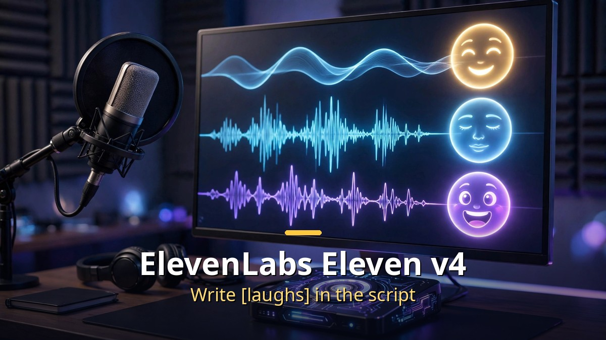
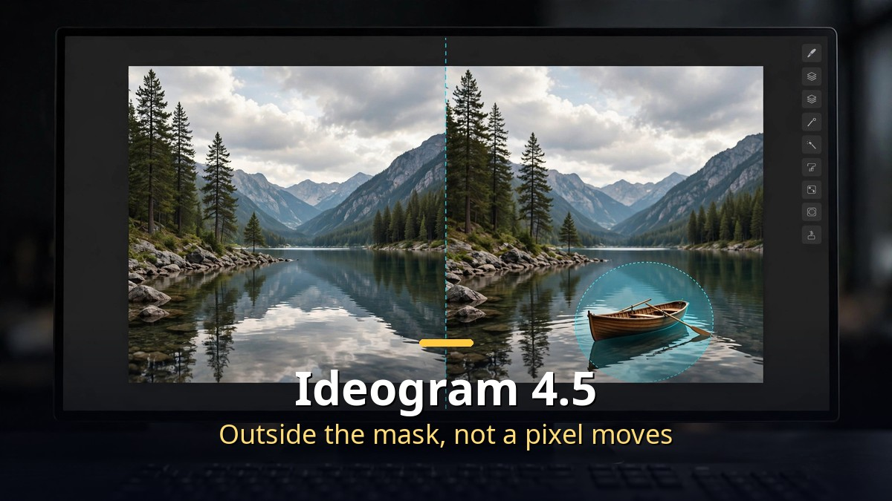

<!-- 본문 시작 -->

Voice and image generation AI keeps evolving. This time the question is not "how plausible can it make things" but "how precisely can you control it." Here is a recap of Eleven v4, an AI voice that takes acting directions written straight into the script, and Ideogram 4.5, an image AI that edits without breaking the rest.

## ElevenLabs Eleven v4 (September 28)

A new version of the AI that turns text into speech. The core of this update, in one word, is "control."

How do you control it?
- It supports natural-language directions and inline audio tags. Write tags such as [laughs], [said angrily in British accent], [light rain], or [phone buzzing] into the script, and they are reflected as written.
- Emotion, intonation, speed, and sound effects can be directed in words, and accuracy when giving several tags in a row has improved over the previous version.
- Note that the SSML break tag has been disabled. Pauses and breathing are controlled with natural-language tags instead.

Two models came out together.
- Eleven v4: the quality model, for long content such as audiobooks. Its "context stitching" makes a chapter sound recorded in a single take rather than a stitched clip, and the voice identity stays stable even when lines are regenerated (no vocal drift). Up to 10,000 characters per generation.
- v4 Turbo: for real-time conversation. Median inference latency around 100 ms, and about 150 ms until the first audio comes out. It supports two-way streaming, where audio streams out as the LLM produces text. (These figures are the vendor's own comparison, and the comparison with Cartesia Sonic 3.6 at 262 ms and OpenAI GPT-4o mini TTS at 814 ms is also the vendor's announcement.)

Other points worth knowing:
- It supports more than 90 languages (up from 70+ in the previous version).
- A voice can be cloned from just 10 seconds of recording, and pitch and tone stay stable even when the language or accent changes.
- Professional Voice Clones, missing from the previous version, are back. All 17,500+ voices in the library work with v4 (existing clones need retraining).
- Pricing is included in every plan. The free tier is 10,000 credits a month, and paid plans start at $6 a month.
- The vendor says it won about 75% preference in a blind listening test, but that is also a vendor-cited figure, so take it as a reference.

For practical use, the barrier to producing narration, dubbing, and audiobooks has dropped further, and the Turbo model for real-time conversation should widen use in AI consultation and voice assistant work.

## Ideogram 4.5 (September 30)

It takes on the chronic problem of image AI head-on: edit one thing and something else changes with it — clothes changed, and the face shifts slightly. This "drift" is what Ideogram 4.5 claims to fix, changing only the directed part and leaving the rest alone, and early testers have confirmed the consistency, according to reports.

It comes in two versions.
- Ideogram 4.5: for generation and editing. Up to 4 reference images, prompts up to 10,000 characters, Magic Prompt supported.
- Ideogram 4.5 Precise Edit: editing only. Everything outside the mask stays completely unchanged, pixel by pixel. Output is the same size as the input image, and one run produces 1 to 8 versions that can be reproduced with a seed.

Specs worth noting:
- Native 2K output. The price depends on speed, not resolution. Across four quality tiers (Turbo, Balanced, Quality, High), it costs 0.8 to 22 cents per image — an unusual price structure.
- It edits a 24.2-megapixel (4,016×6,016) original without downscaling. It works only on the cropped region, then joins the edges back to the original untouched, which is strong for large prints and close zooms (vendor claim).
- Text inside images can also be edited and translated. Fix a decorative font in place, or switch it to another language while keeping the layout — for example, demos showed a bakery sign in French and a coffee brand in Japanese.

The competitive picture is interesting too.
- GPT Image 2.5 splits into Flare (speed model, 2–4x faster) and Sunburst (precision model), supporting up to 16 references, about 99% character accuracy, and transparent backgrounds. The approaches clearly differ. Ideogram "forces the boundary with a mask," while OpenAI says "tell it in the prompt: change only X."
- Google's Nano Banana 2 Lite caps at 1K and costs $0.034 per image, a volume play. Ideogram differentiates with native 2K.

Launch integration partners include Picsart, Runway, Pika, and Leonardo AI, and an open-weight version has been teased.

In practice, this update matters most for work that needs "just this part" — thumbnails, ad drafts, and product image fixes. Swapping a product photo background, arranging furniture in an interior, or restoring an old photo are the representative uses.

## Closing

Voice and image AI are moving from "freedom to create" toward "precision to revise." A tool only becomes a real tool when you can shape the result after making it. Eleven v4 solves the "control" problem by writing acting directions into the script, and Ideogram 4.5 by forcing the edit range with a mask — each in its own way.

<!-- 본문 끝 -->

## 작업용 출처·이미지 정보 (업로드 제외)

- Source: 로컬 초안 ~/workspace/naver-blog/ainews-series-03-media.md 기준 복원 (윤문 없음, 연관글·더 보기 링크 제외, 이미지 마커 전환)
- Images: images/01-hero-en.jpg ~ 03-img2-en.jpg / existing base illustration + English banner overlay (1200x675) / license: original
