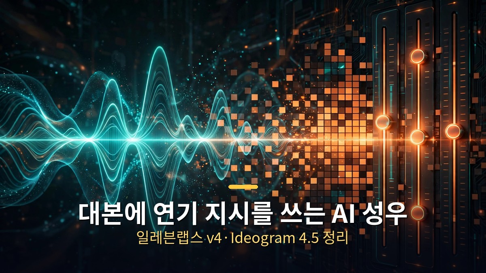
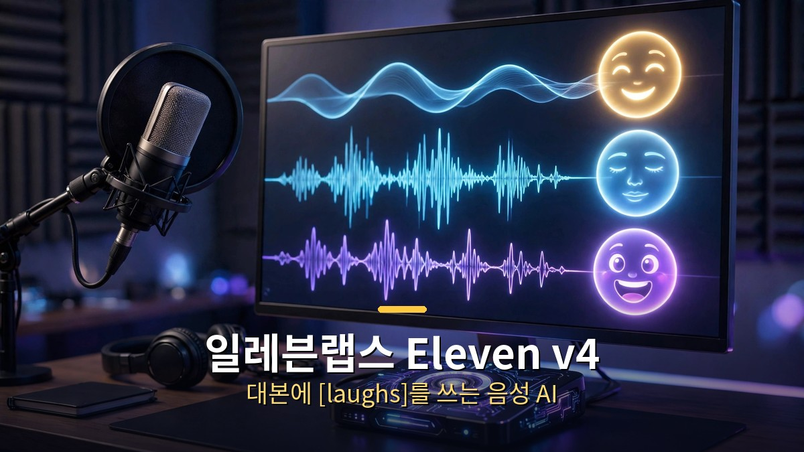
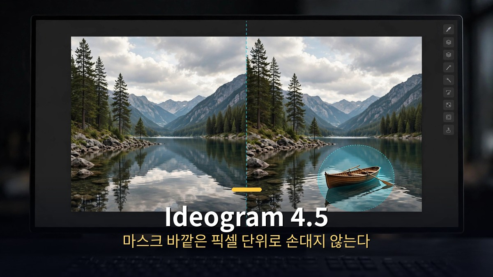

<!-- 본문 시작 -->

목소리와 이미지를 다루는 생성 AI도 진화 중입니다. 이번에는 '얼마나 그럴듯하게 만드느냐'가 아니라 '얼마나 정밀하게 조종하느냐'가 화두입니다. 대본에 연기 지시를 직접 쓰는 음성 AI Eleven v4와, 편집해도 다른 부분이 망가지지 않는 이미지 AI Ideogram 4.5 소식을 정리했습니다.

## 일레븐랩스 Eleven v4 (9월 28일)

텍스트를 음성으로 바꾸는 AI의 새 버전입니다. 이번 업데이트의 핵심은 한마디로 '조종'입니다.

어떻게 조종하나요?
- 자연어 지시와 인라인 오디오 태그를 지원합니다. 예를 들어 대본에 [laughs], [said angrily in British accent], [light rain], [phone buzzing] 같은 태그를 넣으면 그대로 반영됩니다.
- 감정, 억양, 속도, 효과음을 글로 지시할 수 있고, 이전 버전보다 태그를 연속으로 지시했을 때 이행 정확도가 올라갔습니다.
- 참고로 SSML의 break 태그는 비활성화됐습니다. 쉼표나 호흡도 자연어 태그로 제어하는 방식입니다.

두 가지 모델이 함께 나왔습니다.
- Eleven v4: 품질형. 오디오북처럼 긴 콘텐츠용입니다. '컨텍스트 스티칭' 기능으로 한 챕터가 끊긴 클립이 아니라 한 테이크로 녹음한 것처럼 들리고, 대사를 다시 생성해도 목소리 정체성이 유지됩니다(보컬 드리프트 방지). 1회 생성 최대 10,000자.
- v4 Turbo: 실시간 대화용. 중간값 추론 지연 약 100ms, 첫 음성이 나오기까지 약 150ms입니다. LLM이 텍스트를 뱉는 대로 오디오가 스트리밍되는 양방향 스트리밍을 지원합니다. (다만 이 수치는 업체 자체 비교 기준이며, Cartesia Sonic 3.6 262ms·OpenAI GPT-4o mini TTS 814ms와 비교한 것도 업체 발표입니다.)

그 외 알아둘 점:
- 90개 이상 언어를 지원합니다 (이전 버전의 70개+에서 확대).
- 10초 녹음만으로 목소리를 복제할 수 있고, 언어·억양을 바꿔도 음높이와 음색이 유지됩니다.
- 이전 버전에서 빠졌던 Professional Voice Clones이 부활했습니다. 라이브러리의 17,500개 이상 음성이 모두 v4와 호환됩니다 (단 기존 클론은 재학습 필요).
- 요금은 모든 플랜에 포함됩니다. 무료 티어는 월 10,000 크레딧, 유료는 월 6달러부터입니다.
- 블라인드 청취 테스트에서 약 75% 선호를 받았다고 업체가 밝혔는데, 이 역시 업체 인용 수치이므로 참고용으로 보시면 됩니다.

활용 관점에서는 내레이션·더빙·오디오북 제작 문턱이 한층 낮아졌고, 특히 실시간 대화용 Turbo 모델은 AI 상담·음성 비서 분야의 활용을 넓힐 전망입니다.

## Ideogram 4.5 (9월 30일)

이미지 AI의 고질병이었던 문제를 정면으로 잡았습니다. 옷만 바꿨는데 얼굴이 살짝 바뀌는 식으로, 편집하면 다른 부분까지 함께 변형되는 '드리프트' 현상입니다. Ideogram 4.5는 지시한 부분만 고치고 나머지는 손대지 않는다고 주장하며, 초기 테스터들도 일관성을 확인했다는 보도가 있습니다.

두 가지 버전으로 나뉩니다.
- Ideogram 4.5: 생성+편집용. 레퍼런스 이미지 최대 4장, 프롬프트 최대 10,000자, Magic Prompt 지원.
- Ideogram 4.5 Precise Edit: 편집 전용. 마스크 바깥 영역은 픽셀 단위로 완전히 불변입니다. 출력은 입력 이미지와 동일한 크기이며, 1회 실행에 1~8개 버전을 만들고 시드로 결과를 재현할 수 있습니다.

주목할 스펙:
- 네이티브 2K 출력. 가격은 해상도가 아니라 속도로 갈립니다. 품질 4단계(Turbo·Balanced·Quality·High)에 따라 장당 0.8~22센트로, 이례적인 가격 구조입니다.
- 24.2메가픽셀(4,016×6,016) 원본을 축소 없이 편집합니다. 크롭한 영역만 작업한 뒤 가장자리를 원본에 그대로 접합하는 방식이라 대형 인쇄나 근접 확대에 강합니다 (업체 주장).
- 이미지 속 문자도 편집·번역됩니다. 장식 서체를 그 자리에서 고치거나, 레이아웃을 유지한 채 다른 언어로 바꾸는 식입니다. 예를 들어 빵집 간판을 프랑스어로, 커피 브랜드를 일본어로 바꾸는 데모가 소개됐습니다.

경쟁 구도도 흥미롭습니다.
- GPT Image 2.5는 Flare(속도형, 2~4배 빠름)와 Sunburst(정밀형)로 나뉘고, 레퍼런스 최대 16장·문자 정확도 약 99%·투명 배경을 지원합니다. 방식의 차이가 뚜렷합니다. Ideogram은 "마스크로 경계를 강제"하는 반면, OpenAI는 "change only X라고 프롬프트로 지시"하는 방식입니다.
- 구글 Nano Banana 2 Lite는 1K 상한에 장당 0.034달러로 볼륨형 포지션입니다. Ideogram은 네이티브 2K로 차별화합니다.

연동 파트너로는 Picsart·Runway·Pika·Leonardo AI가 초기에 합류했고, 오픈웨이트 버전도 예고됐습니다.

실무 관점에서는 썸네일·광고 시안·제품 이미지 수정처럼 "여기만 살짝"이 필요한 작업에서 체감도가 클 업데이트입니다. 제품 사진 배경 교체, 인테리어 가구 배치, 오래된 사진 복원 같은 용도가 대표적입니다.

## 마무리

음성과 이미지 AI의 발전 방향은 '창작의 자유도'에서 '수정의 정밀도'로 향하고 있습니다. 만들고 나서 원하는 대로 다듬을 수 있어야 진짜 도구가 되니까요. Eleven v4는 대본에 연기 지시를 쓰는 방식으로, Ideogram 4.5는 마스크로 편집 범위를 강제하는 방식으로 각자 '조종'의 문제를 풀고 있습니다.

<!-- 본문 끝 -->

## 작업용 출처·이미지 정보 (업로드 제외)

- 자료 출처: 로컬 초안 ~/workspace/naver-blog/ainews-series-03-media.md 기준 복원 (윤문 없음, 연관글·더 보기 링크 제외, 이미지 마커 전환)
- 이미지: images/01-hero.jpg ~ 03-img2.jpg / 기존 베이스 일러스트 + 배너 가공 (1200x675) / 사용권: 자작
