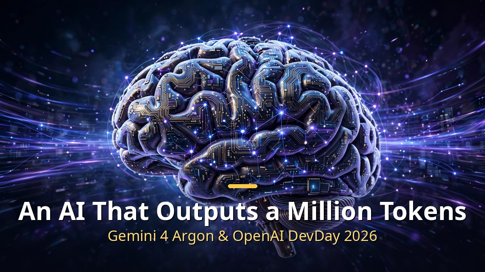
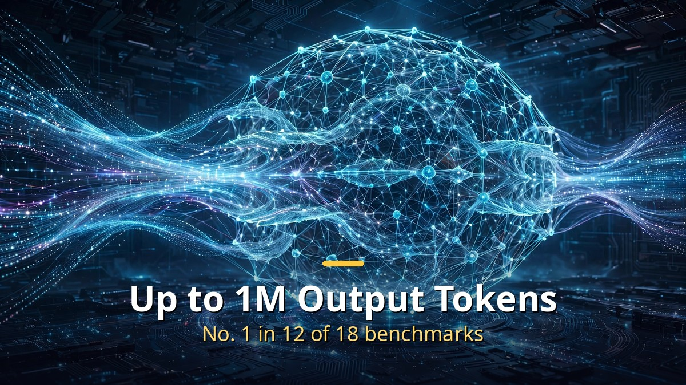
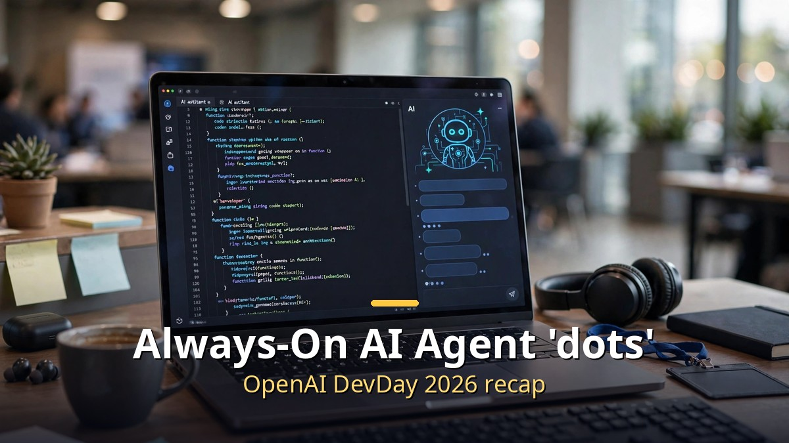

<!-- 본문 시작 -->

In late September, a wave of major announcements came from giant AI models and the developer ecosystem. Here is a roundup of Google's top-tier model, Gemini 4 Argon, and OpenAI's annual developer event, DevDay 2026. The real theme of these announcements is not "a smarter model" but "an AI that works longer."

## Google's Gemini 4 Argon Unveiled (September 30)

Google DeepMind's top-tier AI model, released after about seven months, is aimed at complex, long-running work such as software development, finance, law, and cybersecurity.

The headline spec: up to 1 million output tokens
- That is about 15 times the previous generation (64,000 tokens) and an industry first.
- The important thing here is that this is the "output limit," not the "context window" (input). It means the AI can produce 1 million tokens in a single run, so it can handle long reports and large codebases in one go.

Benchmark results (based on Google's own announcement — treat vendor claims with care):
- DeepSWE v1.1 (real-world coding test) 77.9% — ahead of GPT-6 Astra at 74.1% and Claude Opus 5.5 at 74.2%
- AutomationBench (work automation) 51.3%, ranked 1st
- Harvey legal benchmark 19.6% — more than 3 times Astra's 5.4%
- LVBench (long-video understanding) 91.7%, CWE-bench (security) 68%
- Ranked 1st in 12 of 18 categories

There are also areas where it lost on the same scoreboard.
- FrontierSWE v2 55.0% — 10.5 points behind Astra's 65.5%
- Terminal-bench 4.0 57.4% — behind Opus 5.5's 66.4%
- Rival models are ahead on terminal-based coding work. Worth knowing alongside the "1st in 12 of 18" headline.

Third-party evaluations are mixed.
- Artificial Analysis Intelligence Index 53 points — tied with Astra, behind Opus 5.5 (58 points)
- Arena Text Arena 1st (1,525 points) vs. Code Arena WebDev 8th — a "1st in words, 8th in coding" split
- In the independent Vending-Bench 2 evaluation (Andon Labs) it ranked 3rd, with simulated year-end cash of $13,718 (1st place Astra at $15,514)

Pricing:
- Introductory pricing: $2 per million input tokens, $10 per million output tokens. Cached input is 95% off ($0.10)
- The list price will later rise to $4/$20 — the same level as Claude Opus 5.5's list price

The most paradoxical part: a model that launched but cannot be used
- Right now the only ones with access are cybersecurity defense teams (the Fairwind Program) and the US government.
- As of October 1 it is not in the public API catalog, and the paid API and AI Ultra releases are planned "gradually" with no date set.
- The reason is concern that its powerful capabilities could be misused for hacking.
- According to Bloomberg, some inside Google are skeptical, saying "the benchmarks look good, but hands-on performance falls short" (Google disputes this). A Hacker News thread also carried practitioners pointing out that "the model is gated."

## OpenAI DevDay 2026 (September 29, San Francisco)

OpenAI's annual developer event brought more than 20 announcements. The five the press singled out were Dots, GPT-6.1 Sol, Ultrafast, the Decisions API, and the Agents API. The real theme of this DevDay was not models but "platform."

Dots — the biggest talking point:
- An always-on agent built on GPT-6 Astra.
- Each Dot gets its own dedicated cloud Linux computer and browser, and connects to more than 4,000 apps including Slack and Teams.
- It keeps working toward a goal around the clock, even while the user is offline.
- The first Dot is included in the Pro and Business Premium plans, and conversations with a Dot do not count against usage limits.
- Coming a few weeks after Meta's Muse and SpaceXAI's Grok Bot, this signals that the "always-on agent" race is now in full swing.

GPT-6.1 Sol — the value model:
- Astra-class performance at one-fifth the price. $2 input / $10 output (per million tokens), cached input $0.10.
- Available via the API, ChatGPT Work, and Codex (not yet in regular chat).
- Coding and computer-operation abilities are strengthened.

Ultrafast — the speed tier:
- Up to 8 times faster in Codex (about 300 tokens per second), 6 times faster via the API.
- But the price is 6 times the standard tier (Astra Ultrafast at $60/$300).
- Sam Altman reportedly said he now "only prompts with Ultrafast."

Plan changes:
- Pro 500: $500 per month. 25 times Plus usage, Ultrafast included.
- The existing Pro ($200) is being adjusted down to 10 times (existing subscribers keep 20 times).

Developer tools:
- Agents API (public beta): computer-use capability added. Async tool calls, mid-turn steering, WebSocket, prompt caching, and context compression are offered through a single interface, with infrastructure hosted by OpenAI.
- Decisions API (limited preview): built on GPT-6 Luna, a constrained-answer format that picks from a fixed set of choices. For classification and routing.
- Codex in the cloud: coding work continues on a cloud VM even after you close your laptop.
- Codex Security Cloud: scans GitHub repositories for vulnerabilities and prepares fixes.
- ChatGPT Space + Pages: a team-and-agent collaboration workspace and a shared human-agent editing document.

In one line, this announcement marks a shift from "an AI that answers" to "an AI that works." Beyond competing on model performance itself, it shows we are entering the era of agents that actually do work on our behalf.

## Closing

One thread runs through both Google's and OpenAI's announcements: "longer, more accurate, more autonomous." Gemini pushed the "longer" limit with 1 million output tokens, and OpenAI opened the "more autonomous" era with Dots, its always-on agent. Still, the conditions behind the flashy numbers — like Gemini's access limits and the gap between benchmarks and real-world performance — are worth keeping in view.

<!-- 본문 끝 -->

## 작업용 출처·이미지 정보 (업로드 제외)

- Source: 로컬 초안 ~/workspace/naver-blog/ainews-series-01-models.md 기준 복원 (윤문 없음, 연관글·더 보기 링크 제외, 이미지 마커 전환)
- Images: images/01-hero-en.jpg ~ 03-img2-en.jpg / existing base illustration + English banner overlay (1200x675) / license: original
